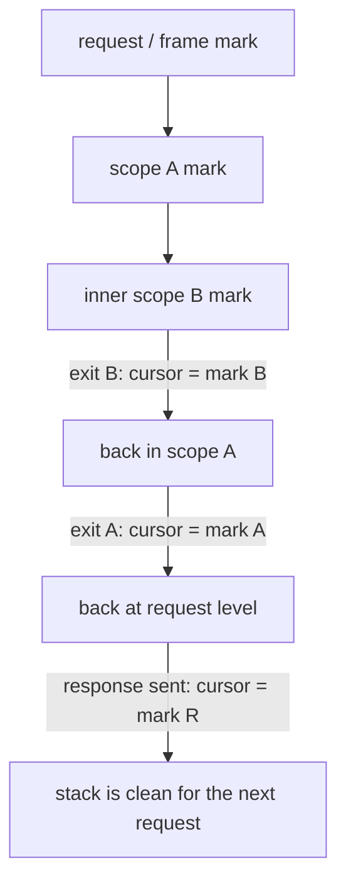

# Programming in Super (0.1.0)

Welcome. This book teaches Super 0.1.0 the way a good colleague would: by showing complete programs, running them, and explaining why the language is shaped the way it is. Part I builds the mental model, the zero-heap picture of memory, the `@` mutation contract, Part II walks the whole language, one construct per chapter.

**How to use this book alongside the quickstart.** [`QUICKSTART.md`](../QUICKSTART.md) is the sixty-minute field guide: read it first if you want to be writing Super by lunchtime. This book is the slow, thorough companion. It explains the reasons behind each rule, shows the diagnostics you will meet, and gives every idea a listing you can paste and run.

**About the listings.** Every listing is a complete module. Each one passes `super check`; listings that print output were also run with `super run`, and the output shown is what the toolchain produced. Listings that demonstrate a diagnostic begin with a comment such as `// super check: E0301`, followed by the compiler's actual message. Save a listing as `name.sr` and try it:

```bash
super check name.sr
super run name.sr
super test name.sr
```

Standard-library modules are imported by their manifest path (`use std.core.str`, `use std.math.core`, `use std.core.collections`, `use std.sys.time`). Short aliases such as `use std.str` still resolve, and new code should use the full path. The idiomatic helpers used throughout come from those modules: `sqrt`, `floor`, `to_int` from `std.math.core`; `byte_len`, `ord`, `chr` from `std.core.str`; `len`, `arr_set` from `std.core.collections`; `monotonic_ns` from `std.sys.time`. A few words are reserved and cannot be names: `state`, `shared`, `after`, `err`, `scope`, `spawn`, and the other keywords listed in the specification. When a listing uses `stage` instead of `state`, now you know why.

# Part I — Why Super Exists & The Zero-Heap Mental Model

## 1. Why Super exists

Super is a token-compact language for coding agents and for the people who review what those agents write. Ceremony is what was removed: no `fn`, no `let`, no semicolons, and a type only when inference would guess wrong. An agent spends its tokens on the program. A person can still read the cost, because the cost model stays on the page.

Memory is a scoped data stack, in the same family as Goose. A block, a task, a request, or a frame owns the values it creates. Allocation moves a cursor forward. Release moves that cursor back, in one store, however many arrays, strings, and records the scope built. The ordinary path has no tracing collector and no free-list walk.

That stack is memory-safe by construction. The guarantee is checked before the program runs:

1. **Values are local and immutable by default.** A binding does not change unless the program opts in, and there is no hidden mutable alias.
2. **@ is the only in-place write.** It is written on the parameter, on the field, and at the call, so every mutation is visible where it happens.
3. **A mutable view cannot leave its scope.** Letting one escape is a compile error (`E0401`). The bytes die with the scope that allocated them, so a dangling pointer is rejected before it can run.
4. **Overflow is a checked failure.** Exhausting a stack stops at the runtime boundary. It does not overwrite the neighboring region.
5. **Aggregates are flat values.** A struct is a C layout with no object header, an array is contiguous, and a sum is a tag plus an inline payload. An ordinary value is not a hidden heap box.

C and Rust meet Super on that layout. Structs are C-ABI values, so a C compiler and a Rust host read the same bytes. A Rust host function registers in one line and can share a slice without copying it. The ahead-of-time path emits C23 and hands it to the system compiler.

On dense kernels the native paths are built to meet and pass idiomatic C. Three execution paths share one semantics. A compact register **VM** is the correctness reference. A focused **native JIT** packs the kernels it recognizes. The **C23 back end** carries the rest, with the alias facts `@` already stated, which is what lets the C compiler emit `restrict` and packed loops. The benchmark chapters hold that to a checksum: the VM, the JIT, and the C binary must print the same number, and that number is what gets compared with C.

The syntax is minimal by default. The same short surface is for command-line tools, backends and APIs, games, automation, and the programs in between. `for`, `for @`, and `par` are three of the forms. The rest of the surface is the same length:

- `for` walks a range, an array, or a pipeline.
- `for @xs` writes each element in place.
- `#for` repeats the loop at compile time.
- `par` states that the iterations are independent.
- `Iterable.sum()` and `ParIterable.par_sum()` (from `std.core.traits`) are the reductions.
- `?` is an optional and `!` is a value error.
- `or` recovers from either in line.
- `ensure` leaves through its `else` block.
- `when` matches a value against arms.
- `+` exports the next declaration. There is no export list.
- `value.method(args)` is `method(value, args)`.
- Pipelines read left to right, and the current value is `it`.
- `.{}` builds a value when the type is already known.
- Structs line up with C. Sums stay a tag plus a payload.
- `test` blocks see private items and are stripped from a release build.
- `#` names, `#unroll`, and `#assert_size` run before the program starts.
- `scope`, `spawn`, and `await` structure concurrent work on the same stacks.
- `"{expr}"` interpolates through `Display`. Arrays, maps, structs, and commands render by that witness. A type that declares `Display` or `ToString` replaces the builtin. Raw strings do not interpolate, and `\{` still forces a literal brace.
- Command-line parsing, a terminal UI, and a desktop UI sit on these same stacks.

Here is a whole module, including its test:

```super
/// Exported greeting.
+greet(name: str) => "Hello, {name}!"

suffix = "from Super"

+main() {
    message = greet("Amina")
    print("{message} {suffix}")
}

test "greeting interpolates" {
    assert_eq(greet("Amina"), "Hello, Amina!")
}
```

```text
$ super run hello.sr
Hello, Amina! from Super
```

`greet` is exported; `suffix` is private to the module but visible to its tests. `{name}` interpolates, `=` introduces a one-expression function, and `test` blocks are part of the grammar, so `super test hello.sr` finds them with no framework.

Use `#assert(condition)` for boolean invariants; failures show the source
expression and captured operand values, with each operand evaluated once. Use
`assert_eq(actual, expected)` for equality and `#assert_err(operation())`
(optionally with exact error text) for value-error paths.

Here is the shape that matters for performance. Fill an array in parallel, then reduce it:

```super
+N = 1024

+square(x: i64) => x * x

+main() {
    xs = [0; N]
    par i in 0..N { xs[i] = square(i) }
    total = xs.sum()
    print("CHECKSUM={total}")
}
```

```text
$ super run squares.sr
CHECKSUM=357389824
```

`par i in 0..N` says the iterations are independent, which lets the C23 back end emit an OpenMP loop. `xs.sum()` says the workload is an addition reduction, which lets every back end fuse it. The checksum line is not decoration: every benchmark in this book prints one, because a fast wrong answer is worthless.

The rest of the book shows the cost model behind each of those forms, so the compiler's job stays easy.

## 2. Scoped data stacks and O(1) rewind

Think of a **data stack** as a long ribbon of virtual memory with a pencil mark called the cursor. To allocate, Super moves the cursor forward and hands you the bytes it skipped. To free, Super moves the cursor back. Nothing walks a list of objects, nothing consults a free list, and nothing pauses the program.

Entering a scope records a *mark*. Leaving the scope rewinds to that mark, however many arrays, strings, and records were created inside. That is the whole reclamation algorithm, and it is O(1) in the number of objects.

```text
        scope enter                      scope exit
        mark = cursor                    cursor = mark
            |                                 |
            v                                 v
 ┌──────────┬──────────┬──────────┬─────────┬─────────────────────────┐
 │ older    │ scratch  │ record   │ string  │ free (never touched)    │
 │ data     │ [0; 256] │ Order    │ "ok"    │                         │
 └──────────┴──────────┴──────────┴─────────┴─────────────────────────┘
                       ^                    ^
                       mark                 cursor (before exit)
```

Scopes nest, and the marks form a stack of their own. A web request, a game frame, a task, and a plain `scope { }` block all use the same mechanism:



A few consequences are worth internalizing now:

- **Allocation is a pointer bump.** The cost is a few instructions, and consecutive allocations are adjacent in memory, which the cache likes.
- **Release is one store.** There is no per-object destructor chain for data that lives on a data stack.
- **Lifetimes are lexical.** Anything allocated in a scope dies with that scope, so the compiler refuses to let a mutable view of it escape (you will meet error `E0401` in Chapter 12).
- **Overflow is checked.** Exhausting a stack is a checked allocation failure at the runtime boundary, never memory corruption.

Resources that a cursor rewind cannot clean up, such as sockets, files, and database connections, are explicit host handles with explicit close behavior. They are the exception, not the model.

One caveat for 0.1.0: the request-level mark in the diagram is the design, not yet the implementation. Explicit `scope` blocks and typed AOT functions rewind as described. A server whose routes are closures runs in the boxed runtime instead, and that runtime keeps per-request values on the heap. The hello server makes 42 allocations and 0 frees per request, and a test pins those counts.

The listing below makes the rewind visible. Each round allocates a 256-slot scratch array inside a `scope`, uses it, and leaves. The array from round three reuses the very bytes that round two occupied:

```super
+ROUNDS = 4
+SLOTS = 256

+window_sum() : i64 {
    total = 0
    for round in 0..ROUNDS {
        scope {
            scratch = [0; SLOTS]
            for i in 0..SLOTS { scratch[i] = i * round }
            total += scratch.sum()
        }
    }
    total
}

+main() {
    print("total={window_sum()}")
}

test "scratch is rewound each round" {
    assert_eq(window_sum(), 195840)
}
```

```text
$ super run window_sum.sr
total=195840
```

The same pattern scales up. In a game, one scope per frame holds contact lists and draw commands; in a service, one scope per request holds the decoded body and the response under construction. Nested scopes let short-lived scratch sit inside longer-lived working sets:

```super
+SLOTS = 64
+CAPACITY = 16

+run_frames(frames: i64) : i64 {
    score = 0
    for frame in 1..frames + 1 {
        scope {
            picks = [0; CAPACITY]
            count = 0
            for i in 0..SLOTS {
                hit = (i * frame) % 11 == 0
                if hit && count < CAPACITY {
                    picks[count] = i
                    count += 1
                }
            }
            scope {
                weights = [0; CAPACITY]
                for j in 0..count { weights[j] = picks[j] * 2 }
                score += weights.sum()
            }
        }
    }
    score
}

+main() {
    print("score={run_frames(5)}")
}

test "frames are independent" {
    assert_eq(run_frames(5), run_frames(5))
}
```

```text
$ super run frame_scopes.sr
score=1650
```

Persistent data goes in `state` declarations at module scope, which survive hot reloads, or in explicit host resources. Everything else is scratch, and scratch is free to throw away. This is also why Super can be tracing-GC-free without turning into manual memory management: you decide the *region* (a block, a frame, a request), and the language handles the bytes.

## 3. `@` borrows, restrict, and SIMD without borrow-checker ceremony

Rust's borrow checker answers a very general question: who may alias what, anywhere, forever. Super answers a narrower one: *who may change this, right now, during this call?* The answer is the `@` sigil on a method. It appears twice: once where the method declares `@self`, and once where the caller writes `@acct`.

```text
discount(@self, percent: f64)                 <- declaration: "I mutate this account"
remaining = @acct.discount(10.0)               <- call site:   "acct is mutated here"
```

The operation lives on `Account`. A discount is something an account does, so the book writes it as a method and calls it on the value. If the call leaves out `@`, the compiler reports `E0301`. Here is the mistake, and the diagnostic that catches it:

```super
// super check: E0301
+Account = {
    id: i64
    balance: f64

    discount(@self, percent: f64) : f64 {
        self.balance -= self.balance * percent / 100.0
        self.balance
    }
}

+main() {
    acct = Account{id: 1, balance: 200.0}
    remaining = acct.discount(10.0)
    print("{remaining}")
}
```

```text
$ super check discount_broken.sr
error[E0301]: cannot mutate without `@`
  --> discount_broken.sr:14:17
   |
14 |     remaining = acct.discount(10.0)
   |                 ^^^^
   = help: prefix the in-place argument with `@`, e.g. `@u.discount(...)`
```

The fix is the sigil on the receiver:

```super
+Account = {
    id: i64
    balance: f64

    discount(@self, percent: f64) : f64 {
        self.balance -= self.balance * percent / 100.0
        self.balance
    }
}

+main() {
    acct = Account{id: 1, balance: 200.0}
    remaining = @acct.discount(10.0)
    print("remaining={remaining} stored={acct.balance}")
}

test "the call site and the method agree" {
    acct = Account{id: 2, balance: 100.0}
    assert_eq(@acct.discount(50.0), 50.0)
    assert_eq(acct.balance, 50.0)
}
```

```text
$ super run discount_fixed.sr
remaining=180 stored=180
```

```text
$ super test discount_fixed.sr
discount_fixed.sr: 2 assertion(s) passed
super test: 2 passed, 0 file(s) failed
```

Why make you type it twice? Because the second `@` is documentation that cannot rot. Anyone reading `@acct.discount(10.0)` knows `acct` may change on that line, with no need to open the method.

The sigil is also a promise the optimizer can use. For the duration of an `@` borrow, the borrowed region is accessed only through that borrow. It does not escape, is not stored into longer-lived state, and does not overlap another active mutable borrow. That is exactly the contract of C's `restrict` qualifier, and the specification lets the back ends treat the borrow as `restrict`-style information: the C23 path can pass it on to the system compiler, and the JIT can rely on it when it selects packed loops. Read-only parameters carry no promise, so they may alias each other freely.

That is what "SIMD without ceremony" means. You do not write lifetimes or annotate aliasing. You write the kernel in its natural shape and mark the one array you change:

```super
use std.core.collections

+LANES = 1024

+axpy(@ys, xs, a: f64) {
    #simd
    for i in 0..len(ys) {
        ys[i] += a * xs[i]
    }
}

+main() {
    xs = [1.5; LANES]
    ys = [2.0; LANES]
    axpy(@ys, xs, 2.0)
    total = ys.sum()
    print("total={total}")
}

test "axpy updates ys in place and leaves xs alone" {
    xs = [1.0; 8]
    ys = [1.0; 8]
    axpy(@ys, xs, 3.0)
    assert_eq(ys[7], 4.0)
    assert_eq(xs[7], 1.0)
}
```

```text
$ super run axpy.sr
total=5120
```

```text
$ super test axpy.sr
axpy.sr: 2 assertion(s) passed
super test: 2 passed, 0 file(s) failed
```

`ys` is the only mutable root, and `xs` is read-only, so the loop is a textbook candidate for packed `mulpd`/`addpd` on x86-64 or `fmul`/`fadd` on AArch64, with a scalar tail for leftover lanes. `#simd` asserts that intent. If a kernel is not recognized, it simply runs through general bytecode or C23 with identical results.

Neighborhood algorithms, where each cell reads its neighbors, need one extra habit: read from one buffer and write to another, then swap. The `@` marks the destination, and multi-assignment evaluates every right-hand side before any store, so `a, b = b, a` is a clean swap:

```super
use std.core.collections

+CELLS = 16

+smooth(src, @dst) {
    for i in 1..CELLS - 1 {
        dst[i] = (src[i - 1] + src[i] + src[i + 1]) / 3.0
    }
}

+main() {
    a = [0.0; CELLS]
    b = [0.0; CELLS]
    a[8] = 9.0
    for 0..2 {
        smooth(a, @b)
        a, b = b, a
    }
    print("{a[6]} {a[7]} {a[8]} {a[9]} {a[10]}")
    mass = a.sum()
    print("mass={mass}")
}

test "smoothing conserves mass away from the border" {
    a = [0.0; CELLS]
    b = [0.0; CELLS]
    a[8] = 9.0
    smooth(a, @b)
    mass = b.sum()
    assert_eq(mass, 9.0)
}
```

```text
$ super run diffuse.sr
1 2 3 2 1
mass=9
```

```text
$ super test diffuse.sr
diffuse.sr: 1 assertion(s) passed
super test: 1 passed, 0 file(s) failed
```

Do not manufacture alias claims. Passing the same array as the read-only input and the `@` output of one kernel steps outside the contract, and the optimizer is entitled to assume you did not. If two logical views overlap, redesign around one root, split into disjoint slices, or stage the output elsewhere.

## 4. A complete micro-task in Super

Here is a deliberately small task that exercises the mutation contract: **fill an array of one million integers with `i % 100`, scale it in place by 3 through a function, and print the sum**. The program prints `CHECKSUM=148500000`.

```super
use std.core.collections

+N = 1_000_000

+scale(@xs, k: i64) {
    for i in 0..len(xs) { xs[i] *= k }
}

+main() {
    xs = [0; N]
    for i in 0..N { xs[i] = i % 100 }
    scale(@xs, 3)
    total = xs.sum()
    print("CHECKSUM={total}")
}
```

```text
$ super run task_super.sr
CHECKSUM=148500000
```

What this shows without any benchmark:

| Concern | Super |
|---|---|
| Who frees the array? | Scope rewind on the data stack |
| Mutation visible at call site? | `@` |
| Non-aliasing for the optimizer | `@`, checked |
| Reduction spelling | `.sum()` |

The array lives on the scoped data stack; `@xs` is the exclusive write root for `scale`; the reduction is a fused UFCS pipeline. A million-element fill is not one of the ten benchmark kernels — process start-up and array materialization dominate at that size — so treat it as a contract illustration, not a timing claim.

> **0.1.0 note.** In the bytecode VM, in-place element writes through the `for @xs { it *= k }` form copy the array on each step, so large arrays should use index loops, as `scale` does above. The `for @xs` spelling is ideal for small arrays and the JIT/AOT lowering, which is why Part II still teaches it.

## 5. The verified 0.1.0 benchmark standings

Performance claims deserve the same discipline as code: a workload, a machine, a protocol, and a checksum. Super ships a twenty-kernel equal-algorithm suite under `benchmarks/`. Every Super kernel is gated by **LAW-BENCH-001** (no `use host` / host FFI in gated sources). Matching checksums remain the gate; timing is only meaningful because of it. The live scoreboard lives in [`docs/`](docs/) (GitHub Pages).

### Stage-1 closeout — Protocol 2.0.0

**Protocol.** Version `2.0.0`: two warm-ups discarded, **ten** interleaved timed runs across languages, **median** wall as the primary estimator. Composite weights: Speed 40% · Memory 25% · Reliability 15% · Cycle 10% · LoC 10%. Machine: 32-thread x86-64 Linux (`hq`, 2026-11-25).

| Language | Composite | Speed | Memory | Reliability | Cycle | LoC | Code LoC |
|---|---:|---:|---:|---:|---:|---:|---:|
| **Super AOT (C23)** | **89.2** | 97.87 | **100** | 100 | 0.78 | **100** | **2198** |
| Zig | 72.55 | 79.54 | 76.94 | 100 | 0.04 | 64.95 | 3287 |
| **Super JIT** | 65.7 | 56.36 | 32.45 | 100 | **100** | **100** | **2198** |
| Rust | 60.56 | 68.51 | 46.94 | 100 | 0.26 | 63.98 | 3337 |

**Overall #1: Super AOT (composite 89.2).** Category wins: **Speed → Zig** (SuperAot 97.87; overlapping CIs on nbody/astar/json); Memory / LoC → Super AOT; Reliability → **All** (100% pass); Cycle → Super JIT. Stage-1 walls: `docs/stage1_speed_walls.md`; source of truth: `docs/REPORT.md`.

### Why the architecture lands here

Read the numbers by cause, not by headline:

- **Static AOT is the product path.** The C23 back end lowers checked Super to plain C and hands it to the same class of optimizer as hand-written native code. Dense arrays, flat structs, and scoped stacks explain the Memory axis; Speed trails Zig on ratio-to-best.
- **LoC is narrow.** Suite Super code is **2198** lines — **two lines fewer** than Bun **2200** under the same counting rule (`docs/REPORT.md`). Category LoC still peaks at SuperAot, but the margin is small.
- **`par` and fused pipelines stay honest.** Independence stated in source (`par`, Iterable reductions) is what OpenMP / fusion lowerings consume; the harness still checks the checksum.
- **The JIT owns Cycle.** Cycle #1 is Super JIT by design: a narrow native emitter for hot kernels, without paying AOT link cost on every reload. AOT's Cycle score stays low (~0.61 points) while wall/RSS lead.
- **Integrity.** Equal algorithms; no Super bench host kernels; no Body-alias AOT regressions.

Keep the claim scoped: one Protocol run on one class of machine. Earlier ten-kernel pedagogical walkthroughs later in this book still illustrate lowering; the Stage-1 composite above is the suite headline.

### Measuring your own code

The same methodology fits in a few lines of Super. This harness discards two warm-up runs, keeps the best of five, and prints the checksum alongside the time, which is the habit to build:

```super
use std.sys.time

+N = 200_000

+kernel(n: i64) : i64 {
    total = 0
    for i in 0..n { total += (i * i) % 1000 }
    total
}

+main() {
    best = 0
    checksum = 0
    for run in 0..7 {
        start = monotonic_ns()
        checksum = kernel(N)
        elapsed = monotonic_ns() - start
        if run >= 2 {
            if best == 0 || elapsed < best { best = elapsed }
        }
    }
    print("CHECKSUM={checksum}")
    print("best_ms={best / 1_000_000}")
}
```

```text
$ super run harness.sr
CHECKSUM=92300000
best_ms=43
```

The `best_ms` line depends on your machine; the checksum must not. For publishable numbers, record the source revision, CPU model, compiler and flags, run counts, and the full distribution, and report ratios in one unambiguous direction (here, speed relative to C).

# Part II — Complete Language Mastery

## 6. Bindings & numeric literals

A binding is a name, an optional type, and a value. There is no `let`: a new name on the left of `=` introduces a local, and the type is inferred from the right-hand side unless you annotate it after the name.

```super
+MAX_CLIENTS = 65_536

+clamp_nonnegative(x: i64) : i64 {
    return 0 if x < 0
    x
}

+main() {
    host = "127.0.0.1"
    port: u16 = 8080
    retries = 3
    retries -= 1
    low, high = 10, 20
    low, high = high, low
    print("{host}:{port} retries={retries} low={low} high={high}")
    print("{clamp_nonnegative(-7)} {clamp_nonnegative(7)} {MAX_CLIENTS}")
}
```

```text
$ super run bindings.sr
127.0.0.1:8080 retries=2 low=20 high=10
0 7 65536
```

A few things to notice. A `+` at module scope exports the declaration (`+MAX_CLIENTS`); it is not unary plus. `port: u16 = 8080` pins the width, while an unannotated integer defaults to `i64` and an unannotated float to `f64`. Compound assignments (`-=`, `+=`, `*=`, `/=`) update an existing local. And `a, b = b, a` is a multi-assignment: every right-hand side is evaluated first, so swaps need no temporary. The postfix guard in `return 0 if x < 0` keeps the common path unindented.

Numeric literals accept `_` separators anywhere inside the digits, and integers come in four radixes. Floats may carry an exponent. A leading `-` is folded into the literal where it cannot be subtraction.

```super
+MAX_CLIENTS = 65_536
+RATIO = 1.5e2

+main() {
    // integers: decimal, hex, binary, octal, with separators
    mask = 0xff_00
    bits = 0b1010
    perms = 0o644
    flags = mask | bits
    print("flags={flags} perms={perms} clients={MAX_CLIENTS}")

    // floats and explicit widths
    temp: f32 = 21.5
    scale = 2.5e-1
    print("temp={temp} scale={scale} ratio={RATIO}")

    // integer arithmetic truncates; float arithmetic does not
    a = 17
    b = 5
    print("{a / b} {a % b} {17.0 / 5.0} {a * 1.5}")

    // bitwise, shifts, comparisons, short-circuit logic
    print("{a & b} {a | b} {a ^ b} {~a}")
    print("{1 << 10} {1024 >> 3} {-8 >>> 1}")
    both = a > 10 && b < 5
    either = a > 10 || b < 5
    print("{both} {either}")
}
```

```text
$ super run literals.sr
flags=65290 perms=420 clients=65536
temp=21.5 scale=0.25 ratio=150
3 2 3.4 25.5
1 21 20 -18
1024 128 9223372036854775804
false true
```

Operator precedence is the familiar one: postfix, unary (`-`, `!`, `~`, `@`), multiplicative, additive, shifts, comparisons, bitwise, `&&`, `||`, range, `?:`, assignment, then `or`. `&&` and `||` short-circuit. Integer division truncates (`17 / 5` is `3`), while mixing in a float promotes (`17.0 / 5.0` is `3.4`). `>>` is an arithmetic shift and `>>>` a logical one. Division or modulo by zero is a runtime error, never silent. Integers are 64-bit signed; floats are IEEE-754.

A name starts with a letter or underscore and continues with ASCII letters, digits, or underscores. Types and variants use `UpperCamelCase`, values use `snake_case`. Names that start with `_` are deliberate placeholders, which matters for the unused-name errors in Chapter 12.

## 7. Strings & interpolation

Strings are immutable UTF-8 values written in double quotes. `{expr}` inside a string evaluates any expression and splices its `Display` text, so formatting needs no library call. An array prints as `[10, 20, 30]`, a map or anonymous record as `{http: 80, https: 443}` with keys sorted, a named struct as `User{id: 7, name: "Amina"}`, and a command as its name. Nested strings are quoted. A type that declares `Display` (or `ToString`) replaces that witness with a direct call, on the VM and on the C23 backend. Escape a literal brace as `\{` and `\}`, and a quote as `\"`. Because an interpolation lives inside a string literal, keep string literals out of the braces: bind a value first, then interpolate the name. Raw strings still do not interpolate.

Escape sequences are decoded when the program is compiled, and the lexer rejects anything it does not recognize, so a typo like `"C:\temp\dir"` is an error instead of a silent surprise:

| Escape | Meaning |
| --- | --- |
| `\n` `\r` `\t` | newline, carriage return, tab |
| `\0` | the NUL byte |
| `\\` | a literal backslash |
| `\"` `\'` | a literal double or single quote |
| `\{` `\}` | a literal brace (no interpolation) |
| `\xNN` | the ASCII byte `NN` (two hex digits, `00`–`7F`) |
| `\u{H…}` | a Unicode scalar, 1–6 hex digits (`\u{e9}`, `\u{1F600}`) |

When a string is mostly backslashes (Windows paths, regular expressions), write a **raw string** instead: `r"…"`. A raw string has no escapes and no interpolation, and it may span lines. Add `#` marks on both sides, `r#"…"#`, to embed double quotes; use as many `#` as needed to be unambiguous (`r##"a "# b"##`). `r` followed by anything other than `"` or `#"` is still an ordinary name.

```super
use std.core.regex

+main() {
    path = r"C:\Users\admin\notes.txt"
    pattern = r"^\d+\.\d+$"
    quoted = r#"say "hi" \d+"#
    template = r"{not_interpolated}"
    println(path)
    println(pattern)
    println(quoted)
    println(template)
    num = compile(pattern) or regex_none()
    println(is_match(num, "3.14"))
}
```

```text
$ super run raw.sr
C:\Users\admin\notes.txt
^\d+\.\d+$
say "hi" \d+
{not_interpolated}
true
```

**`print` and `println`.** Both write their argument followed by a newline; `println` is the explicit, expectation-matching name and is always available (no `use`). `print()` and `println()` with no argument emit a bare newline. Neither adds anything beyond the trailing newline, and a module that defines its own free function `println` shadows the builtin. Use `std.io.stdio` (`stdout.write_str`, `eprint`, `eprintln`) when you need output *without* a newline, binary-safe writes, or stderr. Both also work in receiver form: `"done".println()`.

Slicing is half-open and borrows from the original: `clean[0..3]` is the first three bytes, with no copy. Indexing a string gives a one-character string, `ord` turns a character into its code, and `chr` goes back. The `std.core.str` module supplies the everyday toolbox (`trim`, `split`, `find`, `contains`, `starts_with`, `replace`, `to_upper`, `pad_left`, `repeat`, `to_i64`, and friends). Searches that can miss and conversions that can fail say so in their types, which is why parsing uses `or`:

```super
use std.core.str

+User = {
    id: i64
    name: str
}

+main() {
    u = User{id: 7, name: "Amina"}
    print("user {u.id}: {u.name} (double id {u.id * 2})")

    line = "  GET /users/42  "
    clean = trim(line)
    verb = clean[0..3]
    path = clean[4..byte_len(clean)]
    print("[{verb}] [{path}] bytes={byte_len(clean)}")

    id_text = path[7..byte_len(path)]
    id = to_i64(id_text) or 0
    is_get = starts_with(clean, "GET")
    print("id={id} get={is_get}")

    shout = to_upper("super")
    padded = pad_left("7", 3, "0")
    swapped = replace("a-b-c", "-", "+")
    where = find("hello", "ll")
    print("{shout} {padded} {swapped} {where}")

    lowercase = 0
    for i in 0..byte_len(clean) {
        code = ord(clean[i])
        if code >= 97 && code <= 122 { lowercase += 1 }
    }
    print("lowercase={lowercase} next={chr(ord(verb[0]) + 1)}")
    print("literal braces: \{not interpolated\} and a quote: \"ok\"")
}

test "path parsing" {
    path = "/users/42"
    assert_eq(to_i64(path[7..byte_len(path)]) or 0, 42)
}
```

```text
$ super run strings.sr
user 7: Amina (double id 14)
[GET] [/users/42] bytes=13
id=42 get=true
SUPER 007 a+b+c 2
lowercase=5 next=H
literal braces: {not interpolated} and a quote: "ok"
```

```text
$ super test strings.sr
strings.sr: 1 assertion(s) passed
super test: 1 passed, 0 file(s) failed
```

`to_i64(id_text) or 0` is the typical shape: the parse returns a value-or-error, and `or` supplies a fallback (Chapter 15 covers the full set of handlers). `byte_len` counts bytes, which is what protocols care about; prefer ASCII input in hot parsing code. Slices must not outlive the stack value that backs them, so copy into an owning destination before the request or frame that produced the text ends.

## 8. Arrays, slices, records, maps

Arrays are contiguous and zero-indexed, with the length known to the runtime (`len`). `[v; N]` is the dense repeat form: `N` copies of `v` in one scoped-stack allocation, and the shape the compiler can analyze best. Brace literals cover three shapes with one syntax:

- `{http: 80, ssh: 22}` with **unquoted** keys is a symbol-keyed map, read and written with field syntax (`ports.ssh`).
- `{host, port, timeout: 30}` is an anonymous record; a bare name is punned to `name: name`.
- Quoted keys (`"content-type": "json"`) and computed keys (`[key]: value`) build maps whose keys are data, which is what you want when assembling headers or JSON.

```super
use std.core.collections

+Point = {
    x: f64
    y: f64
}

+main() {
    // arrays: contiguous, zero-indexed
    scores = [10, 20, 30, 40]
    scores[2] = 35
    zeros = [0; 6]
    middle = scores[1..3]
    print("{scores[2]} {len(zeros)} {len(middle)} {middle[1]}")

    // growing returns a new array value
    scores = scores + [50]
    scores = arr_push(scores, 60)
    scores = arr_set(scores, 0, 5)
    print("len={len(scores)} first={scores[0]} last={scores[5]}")

    // unquoted maps: symbol keys, field access
    ports = {http: 80, https: 443, ssh: 22}
    ports.ssh = 2222
    print("{ports.http} {ports.https} {ports.ssh}")

    // anonymous records with punning
    host = "localhost"
    port = 8080
    config = {host, port, timeout: 30, tls: true}
    print("{config.host}:{config.port} timeout={config.timeout} tls={config.tls}")

    // arrays of named structs
    path = [Point{x: 0.0, y: 0.0}, Point{x: 3.0, y: 4.0}]
    last = path[1]
    print("{last.x} {last.y}")

    // iteration: implicit it/index, or a named binder
    for scores { print("{index}: {it}") }
    for name in ["ann", "bob"] { print("hello {name}") }
}
```

```text
$ super run collections.sr
35 6 2 35
len=6 first=5 last=60
80 443 2222
localhost:8080 timeout=30 tls=true
3 4
0: 5
1: 20
2: 35
3: 40
4: 50
5: 60
hello ann
hello bob
```

Growing an array returns a new array value (`a + [x]`, `arr_push`, `arr_set`), so write `scores = scores + [50]`, not a bare call. Prefer fixed capacity (`[0; N]`) on hot paths and grow only at boundaries. A slice such as `scores[1..3]` is a read-only view valid for as long as its backing array.

The usual pattern for grids is flat indexing: `cells[row * cols + col]`. It keeps data contiguous, removes a level of indirection, and lets the compiler prove bounds from the loop ranges.

> **0.1.0 note.** Quoted and computed map keys are accepted and constructed; retrieve data you plan to read back through unquoted keys or typed records. Take slices from literal arrays or copy with a loop when you need a window into a `[v; N]` array that was filled at run time.

## 9. Structs, methods, `@self`

A struct is a named record with flat, C-compatible layout: fields in declaration order, natural alignment, a deterministic size. Fields are public by default and `-` marks one private to the defining module, which makes it invisible outside the file, with one deliberate exception: `test` blocks in the same module may read private fields so that you can verify invariants without widening the API. A field may declare a default (`balance: f64 = 0.0`), which documents the value a field takes when a construction does not provide one.

Methods live inside the struct body. `self` is a read-only receiver, and `@self` is a mutable one, so a method's signature tells you whether it changes the value, in exactly the way a free function's `@` parameter does. Construction can use the type name (`Account{...}`) or `.{...}` wherever the expected type is known, such as a return type, parameter, or typed binding, with punning for fields that share a name with a local:

```super
+Account = {
    id: i64
    owner: str
    balance: f64
    active: bool
    -token: str

    deposit(@self, amount: f64) : f64 {
        self.balance += amount
        self.balance
    }

    withdraw(@self, amount: f64) : f64 {
        self.balance -= amount
        self.balance
    }

    summary(self) : str  => "{self.owner}#{self.id} holds {self.balance}"

    is_rich(self) : bool  => self.balance >= 1000.0

    -fingerprint(self) : str  => "{self.id}:{self.token}"
}

+open_account(id: i64, owner: str) : Account  => .{id, owner, balance: 0.0, active: true, token: "t-{id}"}

+main() {
    acct = open_account(7, "Amina")
    @acct.deposit(1250.0)
    left = @acct.withdraw(200.0)
    print("{acct.summary()} (left={left})")
    rich = acct.is_rich()
    print("rich={rich} active={acct.active}")
}

test "deposits and withdrawals mutate in place" {
    acct = open_account(1, "Noor")
    assert_eq(@acct.deposit(100.0), 100.0)
    assert_eq(@acct.withdraw(30.0), 70.0)
    assert_eq(acct.balance, 70.0)
}

test "tests may read private fields" {
    acct = open_account(9, "Bo")
    assert_eq(acct.token, "t-9")
    assert_eq(acct.fingerprint(), "9:t-9")
}
```

```text
$ super run account.sr
Amina#7 holds 1050 (left=1050)
rich=true active=true
```

```text
$ super test account.sr
account.sr: 5 assertion(s) passed
super test: 5 passed, 0 file(s) failed
```

Note the call sites: `@acct.deposit(1250.0)` carries the sigil because `deposit` takes `@self`, while `acct.summary()` does not. Private fields and methods that start with `-` (like `fingerprint`) are available to the module and its tests.

Visibility is enforced across modules by diagnostic `E0104`. Here `vault.sr` owns the token, and `leak_broken.sr`, a second file in the same directory, tries to read it:

```super
+Account = {
    id: i64
    owner: str
    -token: str

    badge(self) : str  => "{self.owner}#{self.id}:{self.token}"
}

+open_account(id: i64, owner: str) : Account  => .{id, owner, token: "t-{id}"}

test "the defining module may read -token" {
    acct = open_account(1, "Amina")
    assert_eq(acct.token, "t-1")
}
```

```super
// super check: E0104
use vault.{Account, open_account}

+main() {
    acct = open_account(7, "Amina")
    stolen = acct.token
    print("{stolen}")
}
```

```text
$ super check leak_broken.sr
error[E0104]: field 'token' on 'Account' is file-private (marked with '-')
 --> leak_broken.sr:6:14
  |
6 |     stolen = acct.token
  |              ^^^^^^^^^^
  = help: private fields are visible only in this module and `test` blocks; see the struct declaration
```

The fix, saved as `leak_fixed.sr`, is to use the public surface the module chose to expose:

```super
use vault.{Account, open_account}

+main() {
    acct = open_account(7, "Amina")
    print(acct.badge())
    print("{acct.owner}")
}
```

```text
$ super run leak_fixed.sr
Amina#7:t-7
Amina
```

Struct layout matters at boundaries. Because the layout is C-compatible, a struct can cross the foreign-function boundary, be written into a network buffer at fixed offsets, or be placed in a dense array that the SIMD kernels can sweep. Chapter 3's lesson applies directly: an array of records is convenient at an API edge, and parallel arrays of fields (structure-of-arrays) are usually faster for a hot pass.

### Traits, declared on the type

A trait is a list of method signatures. The type that satisfies it says so in the header, in the same place a binding says `port: u16`, and writes the methods in its body. A call resolves to the method on that type.

```super
+Widget = trait {
    paint(self) : str
    hit(self, x: i64, y: i64) : bool
}

+Anim = trait {
    step(@self) : i64
}

+Badge: Widget, Anim = {
    label: str = ""
    frame: i64 = 0

    paint(self) : str  => self.label

    hit(self, x: i64, y: i64) : bool  => x >= 0 && y >= 0 && self.frame >= 0

    step(@self) : i64 {
        self.frame = self.frame + 1
        self.frame
    }
}

+main() {
    pin = Badge{label: "new", frame: 0}
    print(pin.paint())
    moved = @pin.step()
    print("{moved} {pin.hit(1, 1)}")
}
```

```text
$ super run badge.sr
new
1 true
```

`paint` and `hit` are read-only, so the trait writes `self`. `step` changes `frame`, so the trait writes `@self` and the call wears `@`. A header that names a trait the module cannot see, or that omits a method, or whose method disagrees on arity, `@`, a parameter type, or the return type, is `E0203`. The receiver's own type is the owner on each side, so it is not part of the comparison. A trait parameter left untyped, or typed `_`, accepts whatever type the method declares.

The language traits are ambient. `Display`, `Debug`, `Eq`, `Ord`, `Hash`, `Clone`, `Copy`, `Default`, `From`, `Into`, `AsRef`, `Borrow`, `Iter`, `Add`, `Sub`, `Mul`, `Div`, `Rem`, `Neg`, `Not`, `Index`, `Error`, and `Drop` live in `std.core.traits` and in the compiler, and a struct may name them without an import. Numbers, strings, arrays, maps, and records already have a witness, so `"{scores}"`, `scores == [10, 20, 30]`, and `"a" < "b"` work with no method of your own. When the type declares the trait, `+`, `-`, `*`, `/`, `%`, `==`, `!=`, `<`, `<=`, `>`, `>=`, unary `-`, and `"{…}"` call that method. The VM, the fiber interpreter, and the C23 backend share one algorithm. There is no vtable. A method whose signature matches a language trait, but whose type does not declare it, is `E0204`, and so is a `+Display = trait` definition that drifts from `std.core.traits`. That check is how the compiler catches a witness the backends would disagree on.

`std.gui.widgets` publishes the trait you will actually reuse. `Widget` asks for `paint`, `hit`, and `measure`. `Toggle`, `Dialog`, `Toast`, and the other controls declare it inline, and `Sprite` in `std.game.fx` declares it too. A window mounts the paint string with `custom`. Chapter 43 and the interface recipes in Part III walk those programs.

## 10. Sum types & `when`

A sum type declares a closed set of alternatives, some carrying data:

```text
Status = {
    Pending
    Paid(amount: f64)
    Failed(reason: str)
}
```

A value of type `Status` is a 32-bit tag plus an inline payload large enough for the biggest variant, so a `Status` occupies a fixed, known number of bytes and never needs a heap object. Variants are constructed with `Status.Paid(49.95)` and can be fields of other structs. Declarations, construction, and uses in typed positions are all checked by `super check`:

```super
+Status = {
    Pending
    Paid(amount: f64)
    Failed(reason: str)
}

+Receipt = {
    id: i64
    status: Status
}

+fee_rate(s: Status) : f64 {
    rate = 0.0
    when s {
        Status.Paid => rate = 0.02
        Status.Failed => rate = 0.5
        else => rate = 0.0
    }
    rate
}

+paid_receipt(id: i64, amount: f64) : Receipt  => .{id, status: Status.Paid(amount)}

+declined_receipt(id: i64, why: str) : Receipt  => .{id, status: Status.Failed(why)}

+waiting_receipt(id: i64) : Receipt  => .{id, status: Status.Pending}
```

`when` selects among alternatives. With a subject, arms are tested in source order, the first true arm runs, and `else` is the fallback. Arms are expressions, so assignments and calls are both fine; list the most specific condition first:

```super
+PENDING = 0
+PAID = 1
+FAILED = 2

+Order = {
    id: i64
    stage: i64
    amount: f64

    settle(@self, approved: bool) {
        ensure self.stage == PENDING else { return }
        if approved {
            self.stage = PAID
        } else {
            self.stage = FAILED
        }
    }

    label(self) : str {
        text = "unknown"
        stage = self.stage
        when stage {
            stage == PENDING => text = "pending"
            stage == PAID => text = "paid"
            stage == FAILED => text = "failed"
        }
        text
    }

    fee(self) : f64 {
        stage = self.stage
        charge = 0.0
        when stage {
            stage == PAID => charge = self.amount * 0.02
            stage == FAILED => charge = 0.5
            else => charge = 0.0
        }
        charge
    }
}

+main() {
    a = Order{id: 1, stage: PENDING, amount: 250.0}
    b = Order{id: 2, stage: PENDING, amount: 80.0}
    @a.settle(true)
    @b.settle(false)
    @a.settle(false)
    print("{a.id} {a.label()} fee={a.fee()}")
    print("{b.id} {b.label()} fee={b.fee()}")
}

test "a settled order never changes stage again" {
    order = Order{id: 3, stage: PENDING, amount: 10.0}
    @order.settle(true)
    @order.settle(false)
    assert_eq(order.stage, PAID)
    assert_eq(order.label(), "paid")
}
```

```text
$ super run order_flow.sr
1 paid fee=5
2 failed fee=0.5
```

```text
$ super test order_flow.sr
order_flow.sr: 2 assertion(s) passed
super test: 2 passed, 0 file(s) failed
```

Notice how this program models states: a small set of named codes, a struct that carries one, and an `Order.settle` method that uses `ensure` to guard the transition so that a settled order can never be settled again. That is the same discipline sum types give you, with the tag spelled as an integer.

Sum variants are real tagged Objects at run time: `Status.Pending` is a unit value, `Status.Paid(49.95)` carries a payload, and `when s { Status.Paid { amount } => … }` matches by discriminant and binds payload fields (tag-only `Status.Paid =>` still works). Methods may be declared on the sum body like structs. Unit variants also compare equal to their `i64` tag, which is how HTTP middleware (`Mw.Logger`) and app route handlers (`Handler.Create`) stay tiny named Objects instead of magic integers. Middleware slots are the `Mw` sum itself (`Mw.Bearer(token)`, …) with default `before`/`after` methods; replace or remove a slot to override. Inside boolean `when` arms, name the subject variable itself in conditions (`stage == PAID`). The implicit `it` is established by `for`, `par`, and Iterable pipeline predicates.

One more habit: when the subject is a field expression such as `order.stage`, bind it to a local first (`stage = order.stage`) or wrap it in parentheses. Otherwise `order.stage {` reads as the start of a struct literal.

## 11. Functions (`=>` vs block), monomorphization, UFCS `.`

Functions are declarations with no keyword. A single expression follows `=` or `=>`; anything longer uses a block, whose last expression is the result and where `return` exits early (usually with a postfix guard). `=>` means exactly what `=` means, plus a hint that the body is a good candidate for inlining, so use it for tiny leaves.

A parameter without a type, or with `_`, is an **inference parameter**: Super specializes the function for the types it is called with, which is monomorphization. `identity(3)` and `identity("x")` become two concrete functions; there is no boxed "any" value and no runtime dispatch. A parameter written `#n` is a **compile-time parameter** whose value joins the specialization key. When every argument already has a same-named local, a lone `.` as the argument list fills them in (call punning):

```super
use std.math.core

/// Expression bodies use `=` or `=>` (inline preferred).
+square(x: f64) => x * x
+cube(x: f64) => x * x * x

/// Block bodies end in an expression, or `return` early.
+distance(x1: f64, y1: f64, x2: f64, y2: f64) : f64 {
    dx = x2 - x1
    dy = y2 - y1
    sqrt(dx * dx + dy * dy)
}

+fib(n: i64) : i64 {
    return n if n < 2
    fib(n - 1) + fib(n - 2)
}

/// Untyped parameters are inferred and monomorphized per call site.
+identity(value) => value
+pair_sum(a, b) : _  => a + b

/// `#` parameters are compile-time values.
+add_n(#n: i64, x: i64) : i64  => x + #n

+spawn_wave(count: i64, speed: f64) : f64  => count * speed

+main() {
    print("{square(3.0)} {cube(2.0)} {distance(0.0, 0.0, 3.0, 4.0)} {fib(20)}")
    word = identity("x")
    print("{identity(3)} {word} {pair_sum(2, 3)} {pair_sum(1.5, 2.0)}")
    print("{add_n(5, 10)}")
    count = 20
    speed = 1.5
    total = spawn_wave(.)
    print("{total}")
}

test "monomorphized calls agree with their types" {
    assert_eq(pair_sum(2, 3), 5)
    assert_eq(pair_sum(1.5, 2.0), 3.5)
    assert_eq(identity("x"), "x")
}
```

```text
$ super run functions.sr
9 8 5 6765
3 x 5 3.5
15
30
```

```text
$ super test functions.sr
functions.sr: 3 assertion(s) passed
super test: 3 passed, 0 file(s) failed
```

`spawn_wave(.)` expands to `spawn_wave(count, speed)`. Use punning only when the names make the call obvious.

Behavior that belongs to a value is a method on that value. **UFCS** (Uniform Function Call Syntax) is the other direction: it rewrites `receiver.f(args)` to `f(receiver, args)`, so a free function with no natural owner — `double`, `add_tax`, `sqrt` — can still be read left to right. The two spellings of a free function are exactly equivalent. UFCS works on **any** receiver type (floats, ints, strings, arrays, structs) and chains: each stage's result is the next stage's receiver. With `@` in front of the receiver, a method's mutable borrow is forwarded.

```super
+Account = {
    id: i64
    balance: f64

    discount(@self, percent: f64) : f64 {
        self.balance -= self.balance * percent / 100.0
        self.balance
    }

    label(self) : str  => "account {self.id}"
}

+double(n: i64) => n * 2
+inc(n: i64) => n + 1

+add_tax(amount: f64) => amount * 1.14

+main() {
    // a free function on a number reads like a method
    chained = 3.double().inc().double()
    print("{chained} {double(inc(double(3)))}")

    acct = Account{id: 1, balance: 200.0}
    print(acct.label())

    // `@` in front of the receiver forwards a mutable borrow
    net = @acct.discount(10.0)
    gross = net.add_tax()
    print("net={net} gross={gross} stored={acct.balance}")
}

test "receiver syntax and call syntax are the same call" {
    assert_eq(3.double(), double(3))
    assert_eq(10.0.add_tax(), add_tax(10.0))
}
```

```text
$ super run ufcs.sr
14 14
account 1
net=180 gross=205.2 stored=180
```

```text
$ super test ufcs.sr
ufcs.sr: 2 assertion(s) passed
super test: 2 passed, 0 file(s) failed
```

**Nested calls and UFCS chains are the same program.** Read the nested form inside-out and the chain left to right; both compile to identical code, for every receiver type:

```super
use std.math.core
use std.core.str
use std.core.collections

+main() {
    // numbers
    print("{49.0.sqrt().floor().to_int()}")      // 7
    print("{to_int(floor(sqrt(49.0)))}")         // 7

    // strings (bind first: string literals stay out of interpolation braces)
    hi = "Hi"
    print("{hi.byte_len()}")                      // 2
    print("{byte_len(hi)}")                       // 2

    // arrays, then back to numbers
    xs = [1, 2, 3, 4]
    print("{xs.len().to_float().sqrt().to_int()}")  // 2
}

test "nested call and UFCS chain are equivalent" {
    assert_eq(49.0.sqrt().floor().to_int(), to_int(floor(sqrt(49.0))))
    assert_eq("  Hi ".trim().byte_len(), byte_len(trim("  Hi ")))
    assert_eq([5, 6].arr_push(7).len(), len(arr_push([5, 6], 7)))
}
```

When a short name exists both as a free function and as a type method (`add`, `has`, `len`), the receiver decides: a struct receiver picks its own type's method first and falls back to a free function whose first parameter accepts it, while a scalar, string, or array receiver picks the free function. Only the loop-lowered pipeline stages (`keep`, `map`, `sum`, `group_by`) and channel verbs keep their built-in meaning.

Prefer short, single-purpose functions: the optimizer inlines the small ones, and monomorphization means they cost nothing at the call site. Keep mutation in the signature (`@param`) and results in the return type; do not smuggle effects through globals.

## 12. `@` mutation & lifetime diagnostics E0301–E0401

The checker's job in this area is small and strict. Every diagnostic has a stable code, a primary span, and a note that names the repair. Here is the family, each with a broken program, the real message, and a fixed program.

**E0301: mutation without `@`.** Chapter 3 showed the function form. Methods behave the same way: a method that takes `@self` must be called through `@receiver`.

```super
// super check: E0301
+Counter = {
    hits: i64

    bump(@self) : i64 {
        self.hits += 1
        self.hits
    }
}

+main() {
    counter = Counter{hits: 1}
    n = counter.bump()
    print("{n}")
}
```

```text
$ super check method_broken.sr
error[E0301]: cannot mutate without `@`
  --> method_broken.sr:13:9
   |
13 |     n = counter.bump()
   |         ^^^^^^^
   = help: prefix the in-place argument with `@`, e.g. `@u.discount(...)`
```

```super
+Counter = {
    hits: i64

    bump(@self) : i64 {
        self.hits += 1
        self.hits
    }
}

+main() {
    counter = Counter{hits: 1}
    n = @counter.bump()
    print("{n} {counter.hits}")
}

test "bump mutates the receiver" {
    counter = Counter{hits: 0}
    assert_eq(@counter.bump(), 1)
    assert_eq(@counter.bump(), 2)
    assert_eq(counter.hits, 2)
}
```

```text
$ super run method_fixed.sr
2 2
```

```text
$ super test method_fixed.sr
method_fixed.sr: 3 assertion(s) passed
super test: 3 passed, 0 file(s) failed
```

**E0302: two sibling tasks capture the same mutable root.** Two spawned tasks that both mutate `counts` could race, and a race would invalidate the no-alias facts the optimizer relies on, so the checker rejects it before it can become an optimization bug.

```super
// super check: E0302
+bump(@cells, slot: i64) : i64 {
    cells[slot] += 1
    cells[slot]
}

+main() {
    counts = [0; 4]
    scope {
        a = spawn bump(@counts, 0)
        b = spawn bump(@counts, 1)
        x = await a
        y = await b
        print("{x} {y}")
    }
    print("first={counts[0]}")
}
```

```text
$ super check spawn_broken.sr
error[E0302]: cannot capture `@counts` mutably in multiple spawned tasks in the same scope
  --> spawn_broken.sr:11:13
   |
11 |         b = spawn bump(@counts, 1)
   |             ^^^^^^^^^^^^^^^^^^^^^^
   = help: wrap `@counts` with `shared(...)` for cross-task mutation, or pass it immutably
```

The compiler's note points at `shared` for genuine cross-task mutation. When the work divides cleanly, the better design is to give each task its own disjoint work and combine the results when you `await`, or have tasks send values through a channel (Chapter 14):

```super
+count_range(lo: i64, hi: i64) : i64 {
    n = 0
    for lo..hi { n += it }
    n
}

+main() {
    scope {
        left = spawn count_range(0, 50)
        right = spawn count_range(50, 100)
        total = (await left) + (await right)
        print("total={total}")
    }
}

test "disjoint ranges add up" {
    assert_eq(count_range(0, 50) + count_range(50, 100), 4950)
}
```

```text
$ super run spawn_fixed.sr
total=4950
```

```text
$ super test spawn_fixed.sr
spawn_fixed.sr: 1 assertion(s) passed
super test: 1 passed, 0 file(s) failed
```

**E0303 and E0304: unused locals and parameters.** In 0.1.0 these are compile-time errors, not lint warnings, because a name nobody reads is usually a refactor half-done. Prefix an intentional placeholder with `_`. The compiler reports every unused name, and the output below shows the first. (E0305 is the same rule for imports.)

```super
// super check: E0303
+area(width: f64, height: f64, scale: f64) : f64 {
    ratio = 0.5
    width * height
}

+main() {
    print("{area(2.0, 3.0, 1.0)}")
}
```

```text
$ super check unused_broken.sr
error[E0303]: unused variable 'ratio'
 --> unused_broken.sr:3:5
  |
3 |     ratio = 0.5
  |     ^^^^^^^^^^^
  = help: prefix it with an underscore: `_ratio`
```

```super
+area(width: f64, height: f64, _scale: f64) : f64 {
    _ratio = 0.5
    width * height
}

+main() {
    print("{area(2.0, 3.0, 1.0)}")
}
```

```text
$ super run unused_fixed.sr
6
```

**E0401: a mutable root escapes.** A `state` value is module-root storage that survives across calls. A function may mutate it in place, but it may not hand out an `@` reference that outlives the checked region. The same rule protects scoped-stack values from escaping the scope that owns them.

```super
// super check: E0401
state world = [0; 4]

+peek(flag: bool) {
    if flag {
        return @world
    }
    0
}

+main() {
    view = peek(true)
    print("{view}")
}
```

```text
$ super check escape_broken.sr
error[E0401]: mutable root `@world` cannot escape its declaring module
 --> escape_broken.sr:6:9
  |
6 |         return @world
  |         ^^^^^^^^^^^^^
  = help: `state world` and other roots must stay module-scoped; return an owned copy instead of `@world`
```

Return an owned value (a copy or a scalar), or mutate through the module's own functions:

```super
use std.core.collections

state world = [0; 4]

+snapshot() : i64 {
    total = 0
    for i in 0..len(world) { total += world[i] }
    total
}

+bump(slot: i64) {
    world[slot] += 1
}

+main() {
    bump(1)
    bump(1)
    bump(3)
    print("total={snapshot()}")
}
```

```text
$ super run escape_fixed.sr
total=3
```

For reference, the neighboring codes in the specification are `E0101` (undefined name), `E0102` (invalid import or scope), `E0103` (unknown field), `E0104` (private field, Chapter 9), `E0201` (type mismatch), `E0202` (an optional or error used without `or`), and `E0203` (a type that declares a trait and does not match its signatures). `E0001` marks syntax errors and `E0501` marks compile-time evaluation failures. Treat each code as design feedback: a missing `@` asks whether the call really mutates; an escape error asks which lifetime should own the result; `E0203` asks which method the trait still wants.

## 13. `for` / `par` / Iterable reductions

`for` has one shape with many spellings. Over an array it installs `it` (the element) and `index` (the zero-based position). Over a range it installs `it` as the value. A named binder, `for row in 0..h`, is clearer in nested loops. `for @xs` allows in-place element mutation. `while`, `loop`, `break`, and `continue` handle stateful control, and the postfix guards `break if` and `continue if` keep them short:

```super
use std.core.collections

+main() {
    scores = [10, 20, 30, 40]

    // implicit `it` and `index`
    for scores { print("{index}: {it}") }

    // mutate in place with `@`
    for @scores { it += 5 }
    print("after: {scores[0]} {scores[3]}")

    // ranges are half-open; named binders help nested loops
    cells = [0; 6]
    for row in 0..2 {
        for col in 0..3 { cells[row * 3 + col] = row * 10 + col }
    }
    print("cells: {cells[0]} {cells[2]} {cells[3]} {cells[5]}")

    // index loops are the shape the optimizer knows best
    squares = [0; 5]
    for i in 0..len(squares) { squares[i] = i * i }
    print("squares: {squares[4]}")

    // while, loop, break, continue (with postfix guards)
    n = 0
    for i in 0..10 {
        continue if i % 2 == 0
        break if i > 7
        n += i
    }
    w = 1
    while w < 100 { w *= 3 }
    spins = 0
    loop {
        spins += 1
        break if spins == 4
    }
    print("n={n} w={w} spins={spins}")
}
```

```text
$ super run loops.sr
0: 10
1: 20
2: 30
3: 40
after: 15 45
cells: 0 2 10 12
squares: 16
n=16 w=243 spins=4
```

Two details deserve a sentence each. An inner loop installs its own `it` and `index`, so capture `x = it` before entering it, or use named binders. And index loops (`for i in 0..len(xs)`) are the canonical shape that bounds-check elimination and vectorization recognize.

**Iterable reductions.** Built-in arrays and ranges witness `Iterable` (`std.core.traits`). UFCS pipelines such as `xs.sum()`, `xs.map(…).sum()`, and `xs.keep(…).sum()` fuse to tight loops; parallel addition uses `ParIterable.par_sum()` or partition + `AssociativeReducer.merge` (`std.core.reduce`). Element-wise math stays in `std.math.core`; order stats are slice-only in `std.math.stats`.

```super
+N = 100

+weight(i: i64) : i64  => i % 7 + 1

+main() {
    values = [3, -1, 4, -1, 5, -9, 2, 6]

    total = values.sum()
    energy = values.map(it * it).sum()
    positive = values.keep(it > 0).sum()
    print("total={total} energy={energy} positive={positive}")

    weighted = (0..N).map(weight(it) * it).sum()
    print("weighted={weighted}")

    // naming the destination binds it for later use
    checksum = values.sum()
    print("checksum={checksum}")
}

test "reductions match their loop spellings" {
    values = [1, 2, 3, 4]
    manual = 0
    for values { manual += it * it }
    assert_eq(values.map(it * it).sum(), manual)
}
```

```text
$ super run reductions.sr
total=9 energy=173 positive=20
weighted=19700
checksum=9
```

```text
$ super test reductions.sr
reductions.sr: 1 assertion(s) passed
super test: 1 passed, 0 file(s) failed
```

**`par`** is the parallel loop. The iterations must be independent: each one writes its own destination. For parallel sums prefer `ParIterable.par_sum()` (or `par` over partitions with `AssociativeReducer.merge`, then `.sum()`). Here every row of a Mandelbrot image is computed in parallel and written to its own slot, then the checksum is verified against a serial sum:

```super
+ROWS = 64
+COLS = 64
+MAX_ITER = 40

+escape_time(cx: f64, cy: f64) : i64 {
    zx = 0.0
    zy = 0.0
    iter = 0
    for 0..MAX_ITER {
        zx2 = zx * zx
        zy2 = zy * zy
        break if zx2 + zy2 > 4.0
        zy = 2.0 * zx * zy + cy
        zx = zx2 - zy2 + cx
        iter += 1
    }
    iter
}

+main() {
    rows = [0; ROWS]
    par y in 0..ROWS {
        cy = (y * 1.0 / ROWS) * 2.0 - 1.0
        local = 0
        for x in 0..COLS {
            cx = (x * 1.0 / COLS) * 3.5 - 2.5
            local += escape_time(cx, cy)
        }
        rows[y] = local
    }
    checksum = rows.sum()
    print("CHECKSUM={checksum}")
    serial = (0..ROWS).map(rows[it]).sum()
    print("same={checksum == serial}")
}
```

```text
$ super run parallel.sr
CHECKSUM=52168
same=true
```

`par` changes how work is scheduled and never what it computes. A floating-point sum grouped differently in parallel can differ in the last bits from a serial sum, so use integers or fixed grouping when reproducibility matters; this example sums integers, so the two checksums agree exactly. (`for parallel` is accepted as an older spelling of `par`.)

## 14. Structured concurrency (scope, spawn, chan[T], shared)

Super's concurrency is **structured**: a `scope { }` is a region, every `spawn` created inside it finishes before the scope exits, and `await` collects a task's result. There are no orphan threads, so there is nothing to leak and no task outliving the data it uses.

```super
+fetch_user(id: i64) : i64  => id * 100

+fetch_cache(id: i64) : i64  => id + 7

+main() {
    scope {
        t_user = spawn fetch_user(3)
        t_cache = spawn fetch_cache(3)
        user = await t_user
        cached = await t_cache
        print("user={user} cache={cached} total={user + cached}")
    }
}

test "two tasks join before the scope ends" {
    scope {
        a = spawn fetch_user(1)
        b = spawn fetch_cache(1)
        assert_eq((await a) + (await b), 108)
    }
}
```

```text
$ super run scope_spawn.sr
user=300 cache=10 total=310
```

```text
$ super test scope_spawn.sr
scope_spawn.sr: 1 assertion(s) passed
super test: 1 passed, 0 file(s) failed
```

`spawn expr` runs the expression as a task and returns a handle; `await handle` yields its value. Results come back through `await` and channels, which is one reason two siblings may not both hold `@counts` (E0302).

A **channel**, `chan[T](capacity)`, is a bounded, ownership-transferring queue (the default capacity is 64). `send` hands a value to the receiver, `close` ends the stream, and `for s in channel` drains until closed. Bounded capacity gives you backpressure for free: a producer that outruns its consumer waits instead of ballooning memory. `shared value` creates an atomic or futex-backed cell for counters and coordination; update it with `@cell += n` and read it with `.load()`. Prefer a channel when data moves; reach for `shared` when a number genuinely belongs to everyone.

```super
+Sample = {
    worker: i64
    latency_us: i64
}

+main() {
    samples = chan[Sample](16)
    seen = shared 0
    total_latency = 0
    scope {
        for w in 0..3 {
            producer = spawn {
                for k in 0..4 {
                    samples.send(Sample{worker: w, latency_us: 100 + w * 10 + k})
                }
                4
            }
            sent = await producer
            seen_before = sent
            @seen += seen_before
        }
        samples.close()
        for s in samples { total_latency += s.latency_us }
    }
    print("samples={seen.load()} total_latency={total_latency}")
}

test "bounded channel hands ownership to the collector" {
    q = chan[i64](4)
    scope {
        p = spawn {
            for 0..3 { q.send(it + 1) }
            3
        }
        await p
        q.close()
        got = 0
        for v in q { got += v }
        assert_eq(got, 6)
    }
}
```

```text
$ super run channels.sr
samples=12 total_latency=1338
```

```text
$ super test channels.sr
channels.sr: 1 assertion(s) passed
super test: 1 passed, 0 file(s) failed
```

Finally, `when` without a subject is the **multiplex** form. Each arm waits on a channel receive or a timeout (`after 5.ms`), and the first ready arm runs. Use `_ =` when you need the event but not its value:

```super
+main() {
    stop = chan[i64](1)
    ticks = chan[i64](8)
    handled = 0
    idle = 0

    scope {
        feeder = spawn {
            for 0..3 { ticks.send(it) }
            3
        }
        await feeder
        ticks.close()
        for t in ticks { handled += t + 1 }
    }

    when {
        _ = stop.recv() => idle = 2
        after 5.ms => idle = 1
    }
    print("handled={handled} idle={idle}")
}
```

```text
$ super run multiplex.sr
handled=6 idle=1
```

Design for ownership, not locking: producers own what they build until they `send` it, and consumers own what they `recv`. Bound every channel, give every wait a timeout where a peer can disappear, and keep shared mutable state to counters.

## 15. Control flow, modules, packages, and comptime

### Control flow, optionals, and errors

`if` is an expression with a mandatory block, `?:` is the compact conditional, `when` picks the first matching arm, and `ensure condition else { ... }` keeps the happy path unindented by running its block only when the condition is false (and exiting from it). `T?` is a value or `none`; `T!` is a value or an error created with `fail`. Neither can silently stand in for a plain `T` (`E0202`), and `or` is the single operator that discharges them: `left or fallback` evaluates the fallback only on failure, and `left or err { ... }` binds the error payload to `err` inside the handler, where you can log, map, or `return`.

```super
+User = {
    id: i64
    name: str

    greet(self) {
        ensure self.id > 0 else {
            print("skipping invalid user")
            return
        }
        print("hello {self.name}")
    }
}

+find_user(id: i64) : User?  => if id == 1 { User{id: 1, name: "Amina"} } else { none }

+find_port(name: str) : i64?  => if name == "http" { 80 } else { none }

+read_port(path: str) : i64! {
    if path == "" { fail "empty path" }
    8080
}

+tier(score: i64) : str {
    name = "bronze"
    when score {
        score >= 1000 => name = "gold"
        score >= 100 => name = "silver"
        else => name = "bronze"
    }
    name
}

+main() {
    // `if` is an expression; `?:` is the compact form
    port = find_port("custom") or 3000
    label = if port > 1024 { "unprivileged" } else { "privileged" }
    mode = port == 3000 ? "default" : "explicit"
    print("{port} {label} {mode}")

    // optionals and value errors are discharged with `or`
    guest = find_user(2) or User{id: 0, name: "Guest"}
    known = find_user(1) or User{id: 0, name: "Guest"}
    print("{guest.name} {known.name}")

    configured = read_port("Pod.toml") or err {
        print("configuration failed: {err}")
        return
    }
    fallback = read_port("") or 9090
    print("configured={configured} fallback={fallback}")

    print("{tier(1500)} {tier(250)} {tier(7)}")
    known.greet()
    guest.greet()
}

test "fallbacks only run on failure" {
    assert_eq(find_port("http") or 1, 80)
    assert_eq(find_port("smtp") or 25, 25)
    assert_eq(read_port("") or 1, 1)
    assert_eq(read_port("x") or 1, 8080)
}
```

```text
$ super run control.sr
3000 unprivileged default
Guest Amina
configured=8080 fallback=9090
gold silver bronze
hello Amina
skipping invalid user
```

```text
$ super test control.sr
control.sr: 4 assertion(s) passed
super test: 4 passed, 0 file(s) failed
```

> **0.1.0 note.** The `or err { ... }` handler form is fully parsed and type-checked, but in this release the plain `or fallback` form is the one exercised end to end at run time, which is why the listing above runs its failing path through `or 9090`.

Use a plain fallback for a true default and `or err { ... }` where policy matters. Do not let defaults erase operational failures: a missing optional setting can default; an authentication failure should not. Convert errors at the boundary where policy is known, and log once there.

### Modules and Git packages

Every `.sr` file is a module and there is no `mod` keyword. `+` exports a declaration; everything else is private. `use models` pulls in the sibling file `models.sr`, `use models.{Task, new_task}` imports named exports, and `use std.net.http` resolves a standard-library module. `use std.gui as App` gives that module a local name: `App.Gui.new(...)` is `Gui.new(...)`, and `use std.core.str.{byte_len as nchars}` calls `byte_len` under the new name. `as` is only special in a `use` line. A module's tests see its private items, and an unused import is `E0305`.

First `models.sr`, then `main.sr` beside it:

```super
+Task = {
    id: i64
    title: str
    done: bool
    -owner_token: str

    describe(self) : str  => "#{self.id} {self.title}"

    is_open(self) : bool  => !self.done
}

+new_task(id: i64, title: str) : Task  => .{id, title, done: false, owner_token: "own-{id}"}

test "private fields are visible to this module's tests" {
    task = new_task(4, "write chapter")
    assert_eq(task.owner_token, "own-4")
    assert_eq(task.describe(), "#4 write chapter")
}
```

```super
use models.{Task, new_task}

+main() {
    task = new_task(1, "ship 0.1.0")
    status = if task.is_open() { "open" } else { "done" }
    print("{task.describe()} is {status}")
}
```

```text
$ super run main.sr
#1 ship 0.1.0 is open
```

```text
$ super test models.sr
models.sr: 2 assertion(s) passed
super test: 2 passed, 0 file(s) failed
```

A **Pod** is a directory with a `Pod.toml` (removed legacy `Super.toml` is still accepted). `kind` is `bin`, `lib`, or `macro`. Dependencies are path or Git sources; a Git entry selects exactly one of `tag`, `branch`, or `rev`.

```toml
[pod]
name = "orders"
version = "0.1.0"
kind = "bin"

[dependencies]
geo = { path = "../geo" }
router = { git = "https://github.com/acme/router.git", tag = "v1.4.0" }
codec = { git = "https://gitlab.com/acme/codec.git", rev = "abc123" }
```

`super new --bin app`, `super new --lib geo`, and `super new --macro tables` scaffold the three kinds. `super add ../geo` records a path dependency and `super add github:acme/router@v1.4.0` records a Git one; `super fetch` resolves everything and writes `Pod.lock` (or `Pod.lock` beside a legacy manifest). The lock pins every source, and for Git sources the exact commit, so builds are reproducible. Commit it for applications. `super build`, `super run`, and `super check` with no file read this manifest, fetch those dependencies, and compile the kind’s entry (`src/main.sr`, `src/lib.sr`, or `src/macros.sr`). `[build] profile` is the profile those commands use when the command line does not name one. `super test` uses `[profile.test]`. `[profile.release]` is the fastest native build. A flag on the command line wins. A resolved lock for the path dependency above looks like this, with a Git entry (commit shown for illustration) beside it:

```toml
version = 1

[[pod]]
name = "geo"
source = "path+../geo"

[[pod]]
name = "router"
source = "git+https://github.com/acme/router.git"
commit = "9f2c4e1b7a3d58606c0b3a1e4d27f8a9b5c6d7e8"
```

Normal resolution honors the locked commit; `super update` re-resolves and rewrites it; `super vendor` copies resolved Pods into `vendor/` without their `.git` directories. Resolution is transitive and rejects dependency cycles. Pod source is read from `src/` when present, otherwise from the Pod root. (`shared` is a keyword, so name a Pod something else, such as `geo`.)

Macro Pods ship comptime surface: `+#WIDTH = 8` exports a compile-time binding, and `+add_n(#n: i64, x: i64)` exports a specialization function. Consumers `use` the Pod like any library.

`super install` (or `super i`) is how a finished **bin** Pod leaves the tree. From the Pod directory, or from any subdirectory, it builds a native C23 binary at the maximum release profile and copies it onto `PATH`. The executable name is the Pod name. Lib and macro Pods are skipped. `super uninstall` (`super u`) removes that copy. `super list` shows what is installed, and `super which` prints one path. `super clean` deletes `target/`: `-d` for debug, `-r` for release, and `-a` (the default) for every profile. A workspace is a directory of Pods, or a manifest with `[workspace] members`. Those commands act on every member when you run them at the workspace root.

### Compile-time Super

A `#` introduces compile time. `#NAME = expr` evaluates during compilation and creates an immutable compile-time binding that you read back as `#NAME`. Prefix the binding with `+` (`+#NAME = expr`) to export it from a **macro** Pod. `#{ ... }` is a compile-time block expression. `#NAME = #for i in 0..n { expr }` generates a table whose elements are computed by the compiler and emitted as constants, with no start-up code. `#if cond { ... } else { ... }` inside a function keeps only the chosen branch. A `#` parameter makes a value part of a function's specialization. `#name(#n: i64, …) : Ret = body` declares a named comptime specialization function; `+#name(...)` exports it.

Quote and splice work with typed code: `'{ expr }` builds hygienic `Code[T]`, and `${ code }` splices it back into the surrounding program. Quoted names do not capture unrelated locals. And `embed "path"` records a file as a compile-time dependency and embeds its bytes. Here is a small asset and the program that uses all of these:

```text
Super 0.1.0
```

(That one-line file is `banner.txt`, saved next to `comptime.sr`.)

```super
#WIDTH = 8
#MASK = 0xff
#CELLS = #{ 8 * 8 }
#SQUARES = #for i in 0..8 { i * i }
#ANSWER = '{ 6 * 7 }

banner = embed "banner.txt"

+add_n(#n: i64, x: i64) : i64  => x + #n

+squares_total() : i64 {
    total = 0
    for sq in #SQUARES { total += sq }
    total
}

+main() {
    pixels = [0; #CELLS]
    for @pixels { it = index & #MASK }
    mode = 0
    #if #WIDTH >= 8 {
        mode = 2
    } else {
        mode = 1
    }
    answer = ${#ANSWER}
    print("{banner}: pixel={pixels[63]} mode={mode} answer={answer}")
    print("squares={squares_total()} fifth={#SQUARES[4]} bumped={add_n(5, 10)}")
}

test "compile-time values are ordinary values at run time" {
    assert_eq(squares_total(), 140)
    assert_eq(#SQUARES[7], 49)
    assert_eq(add_n(1, 1), 2)
}
```

```text
$ super run comptime.sr
Super 0.1.0: pixel=63 mode=2 answer=42
squares=140 fifth=16 bumped=15
```

```text
$ super test comptime.sr
comptime.sr: 3 assertion(s) passed
super test: 3 passed, 0 file(s) failed
```

Compile-time evaluation is deterministic with respect to declared inputs, which is why `embed` is tracked: change the file and the dependent code is rebuilt. The attributes `#inline` (prefer inlining), `#simd` (assert a SIMD-friendly loop, as in Chapter 3), `#blocking`, and `#assert_size(N)` communicate optimizer and layout intent in the same `#` vocabulary. A failed compile-time operation is `E0501`.

Keep generated tables modest and deterministic; if one depends on a file, `embed` it so the compiler tracks the input. Use `#` for facts known before the program runs (sizes, masks, lookup tables, specializations) and ordinary code for everything else.

### Keywords, macros, functions

Super has one rule for syntax: keywords are the only bare syntax. Every compile-time, user-extensible construct is a `#`-prefixed macro, and everything else is a function or a method. `#assert`, `#dbg`, and `#todo` come from `std.core.macros`, which every module sees without `use`; `#routes` comes from `std.net.http`. None of them is built into the compiler, so a variable named `routes` or `assert` is just a variable.

A macro is a list of rules. Each rule is a token pattern and a template; the first pattern that matches the whole call wins. `$x:expr` captures an expression, `$( … ),+` repeats, and a `$name` the pattern does not bind becomes a fresh local that cannot clash with yours:

```super
/// Square any expression; `$x` is evaluated as one unit.
#square {
    ($x:expr) => { $x * $x }
}

/// Largest of one or more values; `$a` and `$b` are hygienic locals.
#max_of {
    ($only:expr) => { $only }
    ($head:expr, $($rest:expr),+) => {
        $a = $head
        $b = #max_of($($rest),+)
        if $a > $b { $a } else { $b }
    }
}

test "user macros are ordinary source" {
    #assert(#square(3) == 9)
    #assert(#square(1 + 2) == 9)
    assert_eq(#max_of(4, 9, 2), 9)
    routes = ["/a", "/b"]
    assert_eq(len(routes), 2)
}
```

```text
$ super test examples/doc_macros/main.sr
examples/doc_macros/main.sr: 4 assertion(s) passed
super test: 4 passed, 0 file(s) failed
```

Prefix a macro with `+` to export it, exactly like a function. Specification §3.9 lists the fragment kinds and the compiler intrinsics (`#stringify`, `#concat`, `#location`, `#error`, …) that templates can use.

That completes the language tour. Part II gave you every construct; Part I gave you the reasons. From here, the rest of the book builds with them.
# Part III — The Standard Library Cookbook

*Super 0.1.0*

The standard library is where Super stops being a language you read about and becomes a language you ship with. Every module in it is written in Super itself, sits on a small set of native primitives, and carries its own `test` blocks, so you can open any file under `stdlib/` and learn from it the same way you learn from the examples in this book.

This part is a cookbook. Each chapter takes one corner of the library and walks through **complete, runnable recipes**: every listing below is a whole program that you can paste into a file, run with `super run`, and exercise with `super test`. Where a program prints something, the output printed under it is what the program really prints.

## A few habits that make the library pleasant

Four conventions show up in every recipe. Learn them once and the rest of the library will feel familiar.

**Import by module name.** The layers (`core`, `fmt`, `sys`, `net`, `io`, `sec`, `math`, `game`, `diag`, plus the interface modules `cli`, `tui`, and `gui`) organize the documentation; the import line names the module directly:

| Layer | Modules and their import lines |
|---|---|
| core | `use std.core.str`, `use std.core.bytes`, `use std.core.collections`, `use std.core.regex`, `use std.core.uuid` |
| fmt | `use std.fmt.json`, `use std.fmt.csv`, `use std.fmt.toml`, `use std.fmt.bin`, `use std.fmt.compress` |
| io | `use std.io.buf`, `use std.io.poll`, `use std.io.stdio`, `use std.io.archive` (raw poll: `std.sys.epoll` / `std.sys.io_uring`) |
| net | `use std.net.http`, `use std.net.ws`, `use std.net.tcp`, `use std.net.udp`, `use std.net.url`, `use std.net.retry` |
| game | `use std.game.ecs`, `use std.game.app`, `use std.game.physics2d`, `use std.game.ai`, `use std.game.tilemap`, `use std.game.assets`, `use std.game.fx` |
| sec | `use std.sec.crypto`, `use std.sec.encoding`, `use std.sec.jwt`, `use std.sec.hash`, `use std.sec.sha2`, `use std.sec.pq`, `use std.sec.x509`, `use std.sec.otp` |
| math | `use std.math.core`, `use std.math.linalg`, `use std.math.rand`, `use std.math.noise`, `use std.math.stats`, `use std.math.geom`, `use std.math.quat`, `use std.math.complex` |
| diag | `use std.diag.test`, `use std.diag.log`, `use std.diag.metrics` |
| interfaces | `use std.cli.cmd` (also `use std.cli` / `use std.clap`), `use std.tui`, `use std.gui`, `use std.gui.widgets` |

**Public names share one flat namespace.** When you import a module, its exported functions and types become ordinary names in your file. That keeps call sites short (`sha256_hex(x)`, not `crypto.sha256_hex(x)`), and it gives you two small rules: do not pick a local variable name that an imported module already exports (`lines`, `created`, and `text` are the classic ones), and do not import two modules that export the same function name. Library helpers carry a module prefix (`ecs_`, `p2_`, `ai_`, `jw_`, `enc_`) so collisions stay rare.

**Mutation is visible.** A method that changes its receiver is declared with `@self` and called with a leading `@`: `@room.join(101)`, `@w.spawn()`, `@ring.submit_nop(42)`. Read-only methods are called plainly: `room.count`, `w.count()`. If you can see the `@`, you can see every place state changes.

**Interpolation holes hold expressions, not string literals.** Inside `"…{expr}…"` you can call functions and read fields, but you cannot write another quoted string. Bind the value first and interpolate the name:

```super
+main() {
    query = "a b&c=d"
    print("length is {byte_len(query)}")
}
```

One more habit worth adopting: a loop or `if` header that ends in a field access, such as `if c.fd == ev.token {`, reads more clearly (and parses unambiguously) when you bind the field to a local first. You will see that pattern in the epoll recipe.

---

## 16. `std.core` and `std.fmt`: text, containers, bytes, and wire formats

These two layers are the workhorses. `core` gives you strings, dense containers, byte buffers, regular expressions, and UUIDs. `fmt` turns values into JSON, CSV, TOML, compact binary frames, and compressed payloads, and back again.

### 16.1 A text toolkit

Everything in `std.core.str` is a plain function over `str`, which means UFCS reads naturally and nothing allocates behind your back beyond the result you ask for. This recipe turns a title into a URL slug, pulls cells out of a comma-separated line, and parses a number with a fallback.

```super
use std.core.str

+slug(title: str) : str {
    lowered = to_lower(trim(title))
    replace(lowered, " ", "-")
}

+csv_cell(line: str, n: i64) : str  => trim(split_nth(line, ",", n))

+main() {
    print(slug("  Hello Super World  "))
    print(pad_left("42", 6, "0"))
    print(repeat("=", 12))
    line = "amina, 31 , cairo"
    print("{csv_cell(line, 0)}|{csv_cell(line, 1)}|{csv_cell(line, 2)}")
    age = to_i64(csv_cell(line, 1)) or 0
    print("age + 1 = {age + 1}")
    is_toml = starts_with("super.toml", "super")
    is_sr = ends_with("main.sr", ".sr")
    print("{is_toml} {is_sr}")
}

test "slug normalizes titles" {
    assert_eq(slug("  Hello Super World  "), "hello-super-world")
}

test "csv cell trims whitespace" {
    assert_eq(csv_cell("amina, 31 , cairo", 1), "31")
}
```

Running it prints:

```text
hello-super-world
000042
============
amina|31|cairo
age + 1 = 32
true true
```

`to_i64(...)` returns a value-error type (`i64!`), so the `or 0` is required: Super will not let a possibly-failed parse masquerade as a number. `split_nth` reads one field of a delimited line without building an array of every field; reach for `split` only when you truly need every field.

### 16.2 Containers: sets, maps, rings, and priority queues

`std.core.collections` offers fixed-footprint containers with predictable behavior. `Set` and `HashMap` use open addressing and rehash by powers of two. `RingBuf` is a bounded circular buffer, and `PriorityQueue` pops the *lowest* priority number first, which is exactly what a scheduler or an A* open list wants.

```super
use std.core.collections

+main() {
    seen = Set.new()
    for [4, 8, 15, 16, 23, 42, 8, 4] {
        @seen.add(it)
    }
    print("distinct = {seen.size}")

    stock = HashMap.new()
    @stock.put(101, 12)
    @stock.put(202, 0)
    @stock.put(101, 9)
    print("sku 101 = {stock.get(101) or -1}")
    print("sku 999 = {stock.get(999) or -1}")

    recent = RingBuf.new(3)
    for 1..6 {
        @recent.push_overwrite(it)
    }
    print("newest window starts at {recent.at(0) or -1}")

    jobs = PriorityQueue.new()
    @jobs.push(30, 300)
    @jobs.push(10, 100)
    @jobs.push(20, 200)
    print("first job = {@jobs.pop() or -1}")
    print("then = {@jobs.pop() or -1}")
}

test "set deduplicates" {
    s = Set.new()
    @s.add(1)
    @s.add(1)
    @s.add(2)
    assert_eq(s.size, 2)
}

test "ring buffer keeps the newest values" {
    r = RingBuf.new(3)
    for 1..6 { @r.push_overwrite(it) }
    assert_eq(r.at(0) or -1, 3)
    assert_eq(r.at(2) or -1, 5)
}

test "priority queue pops lowest priority first" {
    q = PriorityQueue.new()
    @q.push(5, 50)
    @q.push(1, 10)
    assert_eq(@q.pop() or -1, 10)
}
```

```text
distinct = 6
sku 101 = 9
sku 999 = -1
newest window starts at 3
first job = 100
then = 200
```

Notice how failure is expressed in the types: `stock.get(999)` is an optional (`i64?`) because the key may be absent, and `@jobs.pop()` is an optional because the queue may be empty. Both are discharged with `or`.

### 16.3 Building and reading binary packets

`ByteBuf` is a growable byte builder with explicit endianness, and `ByteReader` is its checked counterpart: every read returns a value-error, so a truncated packet becomes a handled case instead of an out-of-bounds read.

```super
use std.core.bytes
use std.core.str

+encode_hello(version: i64, id: i64, name: str) {
    buf = ByteBuf.new()
    @buf.put_u8(version)
    @buf.put_u32_be(id)
    @buf.put_u16_le(byte_len(name))
    @buf.put_str(name)
    buf
}

+main() {
    buf = encode_hello(2, 70000, "amina")
    print("packet is {buf.size()} bytes")
    r = reader(buf.data)
    version = @r.read_u8() or 0
    id = @r.read_u32_be() or 0
    n = @r.read_u16_le() or 0
    print("version={version} id={id} name_len={n} left={r.remaining()}")
}

test "packet header round trips" {
    buf = encode_hello(2, 70000, "amina")
    assert_eq(buf.size(), 12)
    r = reader(buf.data)
    assert_eq(@r.read_u8() or 0, 2)
    assert_eq(@r.read_u32_be() or 0, 70000)
    assert_eq(@r.read_u16_le() or 0, 5)
}
```

```text
packet is 12 bytes
version=2 id=70000 name_len=5 left=5
```

The header is 1 + 4 + 2 bytes and the name is 5, hence 12 in total and 5 left for the reader after the header is consumed.

### 16.4 Regular expressions for log lines

`std.core.regex` is a small, dependable backtracking engine: character classes, repetition, anchors, and the usual searching helpers. `compile` returns a value-error, and `regex_none()` gives you a harmless placeholder for the failure branch.

```super
use std.core.regex
use std.core.str

+status_of(line: str) : i64 {
    re = compile("[0-9][0-9][0-9]") or regex_none()
    if is_match(re, line) {
        return to_i64(match_text(re, line)) or 0
    }
    0
}

+main() {
    entries = ["GET /health 200 3ms", "POST /orders 503 120ms", "GET /missing 404 1ms"]
    bad = 0
    for line in entries {
        s = status_of(line)
        if s >= 400 { bad += 1 }
    }
    print("{bad} of 3 requests failed")
    digits = compile("[0-9]+") or regex_none()
    print("matches in first line: {count_matches(digits, entries[0])}")
}

test "status extraction" {
    assert_eq(status_of("POST /orders 503 120ms"), 503)
    assert_eq(status_of("no digits here"), 0)
}
```

```text
2 of 3 requests failed
matches in first line: 2
```

### 16.5 JSON in both directions

`JsonObj` builds objects without an intermediate tree: each `@o.str(...)`, `@o.int(...)`, `@o.float(...)`, and `@o.bool(...)` appends an encoded member. Reading goes the other way with path-style extraction — `json_get_int`, `json_get_str`, `json_get_float`, `json_get_bool` — which scan the document in place and never build a heap tree. Every extractor returns an optional, so a missing field is an ordinary `or` default.

```super
use std.fmt.json

+order_json(id: i64, customer: str, total: f64, paid: bool) : str {
    o = JsonObj.new()
    @o.int("id", id)
    @o.str("customer", customer)
    @o.float("total", total)
    @o.bool("paid", paid)
    o.end()
}

+main() {
    body = order_json(9001, "Amina", 120.5, true)
    print(body)
    print("valid = {json_valid(body)}")
    id = json_get_int(body, "id") or -1
    who = json_get_str(body, "customer") or "anonymous"
    total = json_get_float(body, "total") or 0.0
    print("{id} {who} {total}")
    missing = json_get_int(body, "coupon") or 0
    print("coupon = {missing}")
    items = "[10, 20, 30]"
    second = json_array_at(items, 1) or "none"
    print("items = {json_array_len(items)}, second = {second}")
}

test "built documents validate and parse back" {
    body = order_json(7, "Bo \"B\"", 9.25, false)
    #assert(json_valid(body))
    assert_eq(json_get_int(body, "id") or -1, 7)
    assert_eq(json_get_str(body, "customer") or "", "Bo \"B\"")
    assert_eq(json_get_bool(body, "paid") or true, false)
}

test "malformed json is rejected" {
    assert_eq(json_valid("{\"a\":1,}"), false)
    #assert(!(json_valid("[1 2]")))
}
```

```text
{"id":9001,"customer":"Amina","total":120.5,"paid":true}
valid = true
9001 Amina 120.5
coupon = 0
items = 3, second = 20
```

`json_valid` is the right first step for untrusted input; it checks structure, escapes, and trailing garbage before you extract a single field.

### 16.6 Configuration files: TOML and CSV

TOML parsing yields a `TomlDoc` with typed getters addressed by dotted key (`server.limits.rate`). CSV parsing yields rows you address by row and column, or by header name once you know the column.

```super
use std.fmt.toml
use std.fmt.csv

+CONFIG = "title = \"inventory\"\n[server]\nhost = \"0.0.0.0\"\nport = 8_080\ntls = true\n[server.limits]\nrate = 2.5\n"

+REPORT = "sku,name,qty\nA-1,Widget,12\nB-2,\"Gadget, large\",3\n"

+main() {
    doc = toml_parse(CONFIG) or TomlDoc.new()
    host = doc.get_str("server.host") or "127.0.0.1"
    port = doc.get_int("server.port") or 80
    tls = doc.get_bool("server.tls") or false
    rate = doc.get_float("server.limits.rate") or 1.0
    print("{host}:{port} tls={tls} rate={rate}")

    rows = csv_parse(REPORT)
    print("rows = {csv_row_count(rows)}")
    print("row 2 name = {csv_cell(rows, 2, 1)}")
    qty_col = csv_col(rows, "qty")
    print("qty column = {qty_col}")
}

test "toml scalars" {
    doc = toml_parse(CONFIG) or TomlDoc.new()
    assert_eq(doc.get_int("server.port") or 0, 8080)
    assert_eq(doc.get_str("title") or "", "inventory")
}

test "csv handles quoted commas" {
    rows = csv_parse(REPORT)
    assert_eq(csv_cell(rows, 2, 1), "Gadget, large")
    assert_eq(csv_get(rows, 1, "qty"), "12")
}
```

```text
0.0.0.0:8080 tls=true rate=2.5
rows = 3
row 2 name = Gadget, large
qty column = 2
```

Quoted fields keep their commas (`"Gadget, large"` stays one cell), and underscores in TOML integers (`8_080`) are honored.

### 16.7 Compact frames: varints, zigzag, and checksums

`std.fmt.bin` is the toolbox for hand-rolled protocols: LEB128-style varints, zigzag encoding for signed numbers, a length-prefixed `frame`/`unframe` pair, and `adler32` and `fnv1a32` checksums over byte arrays.

```super
use std.fmt.bin

+main() {
    payload = [1, 2, 3, 250]
    wire = frame(payload)
    back = unframe(wire) or []
    print("framed {bin_len(wire)} bytes, decoded {bin_len(back)} bytes")

    enc = varint_encode(300)
    first = varint_decode(enc, 0) or -1
    print("300 -> {bin_len(enc)} bytes -> {first}")
    print("zigzag(-3) => {zigzag_encode(-3)}")
    print("adler32 = {adler32(payload)}")
}

test "frame round trip" {
    back = unframe(frame([9, 8, 7])) or []
    assert_eq(bin_len(back), 3)
    assert_eq(back[0], 9)
}

test "varints are compact" {
    assert_eq(bin_len(varint_encode(127)), 1)
    assert_eq(bin_len(varint_encode(128)), 2)
    assert_eq(varint_decode(varint_encode(1234567890), 0) or -1, 1234567890)
}
```

```text
framed 9 bytes, decoded 4 bytes
300 -> 2 bytes -> 300
zigzag(-3) = 5
adler32 = 17694977
```

`frame` prefixes the payload with a varint length and appends a four-byte Adler-32 trailer, so a four-byte payload becomes a 1 + 4 + 4 = nine-byte frame. A zigzag code keeps small negative numbers small: `-3` becomes `5`.

### 16.8 Compressed snapshots

`std.fmt.compress` pairs an LZ4 block codec with CRC-32 and Adler-32. `compress_frame` wraps the compressed bytes with a checksum, and `decompress_frame` verifies it on the way back, which is what you want for save games, replication snapshots, and cached responses.

*Import `std.fmt.compress` or `std.fmt.bin`, not both in one file — each exports its own `adler32`.*

```super
use std.fmt.compress

+main() {
    text = "snapshot-payload-aaaa-bbbb-aaaa"
    packed = compress_frame(text)
    unpacked = decompress_frame(packed) or ""
    print("round trip ok = {unpacked == text}")
    ca = crc32_str("a")
    cb = crc32_str("b")
    print("crc differs = {ca != cb}")
}

test "lz4 round trip" {
    s = "hello hello hello super compress"
    assert_eq(lz4_decompress(lz4_compress(s)) or "", s)
}

test "framed payload carries a checksum" {
    s = "snapshot-payload-aaaa-bbbb-aaaa"
    assert_eq(decompress_frame(compress_frame(s)) or "", s)
}
```

```text
round trip ok = true
crc differs = true
```

### 16.9 Identifiers, logs, metrics, and durations

Backend services live on these four small tools. `Uuid` produces and parses RFC 4122 identifiers. `Logger` formats structured lines and can be given a fixed clock, which makes log assertions deterministic. `Metrics` keeps counters, gauges, and histograms. `Duration` carries units so a timeout can never be confused with a count.

```super
use std.core.uuid
use std.diag.log
use std.diag.metrics
use std.sys.time
use std.core.str

+main() {
    id = Uuid.v4()
    shown = id.to_str()
    print("request id has {byte_len(shown)} characters")

    lg = Logger.new("orders")
    @lg.set_clock(1700000000000)
    @lg.info("order created")
    print(lg.last())

    m = Metrics.new()
    @m.histogram("latency_ms", [5.0, 10.0, 50.0])
    for [3.0, 7.0, 12.0, 80.0] { @m.observe("latency_ms", it) }
    @m.inc("orders_total", 1.0)
    seen = m.hist_count("latency_ms")
    print("observations = {seen}")

    budget = Duration.ms(250)
    print("budget = {budget.as_ms()} ms")
}

test "uuid v4 text form" {
    assert_eq(byte_len(Uuid.v4().to_str()), 36)
    parsed = Uuid.parse("123e4567-e89b-42d3-a456-426614174000") or Uuid.nil()
    assert_eq(parsed.to_str(), "123e4567-e89b-42d3-a456-426614174000")
}

test "deterministic log lines" {
    lg = Logger.new("t")
    @lg.set_clock(0)
    @lg.info("hello")
    assert_eq(lg.last(), "1970-01-01T00:00:00.000Z INFO  [t] hello")
}

test "durations convert" {
    assert_eq(Duration.s(2).as_ms(), 2000)
}
```

```text
request id has 36 characters
2023-11-14T22:13:20.000Z INFO  [orders] order created
observations = 4
budget = 250 ms
```

The fixed clock `1700000000000` always renders as `2023-11-14T22:13:20.000Z`, so the same test passes on every machine.

---

## 17. `std.io`: buffers, `io_uring`, `epoll`, and event loops

The `io` layer is the portable readiness machinery beneath the network modules.
Use `std.io.poll` for the platform-selected backend: epoll with optional
io_uring acceleration on Linux, kqueue on macOS and FreeBSD, and WSAPoll on
Windows. `std.io.buf` supplies fixed-capacity byte rings and `std.io.stdio`
wraps process streams; raw `std.sys.epoll` and `std.sys.io_uring` remain
Linux-specific. These recipes need no network beyond loopback.

### 17.0 Process stdio

Builtin `print` still writes a newline-terminated line to stdout. Prefer `std.io.stdio` when you need stderr, binary-safe writes, flushing, or reading stdin (including pipes):

```super
use std.io.stdio

+main() {
    stdout.write_str("ready\n") or 0
    eprint("diag: waiting for a line\n") or 0
    line = stdin.read_line() or "eof"
    stdout.write_str("got={line}\n") or 0
    stdout.flush() or false
}
```

In tests, feed input with the host hook `sys_stdin_feed` so suites never wait on a terminal.

### 17.1 Ring buffers for byte streams

`RingWriter` accepts bytes until it is full and tells you when it refuses one; `RingReader` drains bytes from an array. Both live on the scoped data stack and never grow, which makes them a good fit for per-connection input and output staging.

```super
use std.io.buf

+main() {
    out = RingWriter.new(8)
    for 1..11 {
        stored = @out.push(it * 10)
        if !stored { print("full after {out.count} bytes") }
    }
    first = @out.pop()
    print("popped {first}, {out.remaining()} slot free")

    incoming = RingReader.from_bytes([7, 8, 9])
    total = 0
    while incoming.available() > 0 {
        total += @incoming.read_byte()
    }
    print("drained sum = {total}")
}

test "writer refuses bytes once full" {
    w = RingWriter.new(2)
    #assert(@w.push(1))
    #assert(@w.push(2))
    #assert(!(@w.push(3)))
    assert_eq(@w.pop(), 1)
    #assert(@w.push(3))
}
```

```text
full after none bytes
full after none bytes
popped 10, 1 slot free
drained sum = 24
```

The first ten pushes against capacity 8 fill the writer and then report `full` twice; that is the signal to flush or to apply back-pressure upstream.

### 17.2 `io_uring`: submit, complete, repeat

`IoUring.new()` asks the kernel for a submission/completion ring pair. `submit_nop` queues a no-op tagged with a token of your choosing, `wait(max, timeout_ms)` returns the completions, and `is_native()` tells you whether you are talking to a real kernel ring or the epoll-backed fallback the library uses where `io_uring` is unavailable. The same token-based API drives socket polls through `poll_add`.

```super
use std.sys.io_uring
use std.core.collections

+main() {
    ring = IoUring.new() or err {
        print("io_uring unavailable: {err}")
        return
    }
    submitted = @ring.submit_nop(42) or err { false }
    ready = ring.wait(4, 0) or err { [] }
    print("submitted={submitted} completions={len(ready)}")
    print("native ring = {ring.is_native()}")
    @ring.close()
}

test "nop completes with its token" {
    ring = IoUring.new() or err {
        assert_eq(1, 1)
        return
    }
    @ring.submit_nop(73)
    ready = ring.wait(4, 0) or err { [] }
    assert_eq(ready[0].token, 73)
    #assert(@ring.close())
}
```

```text
submitted=true completions=1
native ring = true
```

The `or err { … }` on `IoUring.new()` is the polite way to degrade: a container or a locked-down kernel that refuses the ring produces a message and a clean return, not a crash.

### 17.3 `epoll`: a real loopback echo

This recipe stands up a listener, connects a client to it, and uses a single `Epoll` instance to learn *when* each socket is ready, then echoes a message back. The tokens (`1`, `2`) are values you choose when registering a socket; they come back with every readiness event so you can tell sockets apart without a lookup table.

```super
use std.sys.epoll
use std.net.tcp
use std.core.collections
use std.core.bytes

+ADDR = "127.0.0.1:39911"

+main() {
    listener = TcpListener.bind(ADDR) or err {
        print("sockets unavailable: {err}")
        return
    }
    ep = Epoll.new() or err { return }
    @ep.add(listener.fd, EPOLL_IN, 1) or err { return }

    client = TcpStream.connect(ADDR) or err { return }
    ready = ep.wait(8, 1000) or err { return }
    print("listener events: {len(ready)}, token {ready[0].token}")

    conn = @listener.accept() or err { return }
    @client.write_str("ping")
    @ep.add(conn.fd, EPOLL_IN, 2) or err { return }
    ready2 = ep.wait(8, 1000) or err { return }
    print("connection token: {ready2[0].token}")

    data = @conn.read(64) or err { return }
    @conn.write(data)
    echoed = @client.read(64) or err { return }
    print("echoed: {bytes_to_str(echoed)}")
    @ep.close()
}

test "readiness flags classify events" {
    #assert(epoll_readable(EPOLL_IN))
    #assert(!(epoll_writable(EPOLL_IN)))
    #assert(epoll_failed(EPOLL_HUP))
}
```

```text
listener events: 1, token 1
connection token: 2
echoed: ping
```

`EPOLL_IN`, `EPOLL_OUT`, `EPOLL_ERR`, `EPOLL_HUP`, and `EPOLL_EDGE` are bit flags, and `epoll_readable`, `epoll_writable`, and `epoll_failed` classify an event mask for you. Add `EPOLL_EDGE` to a registration when you want edge-triggered delivery, and call `socket_set_nonblock(fd, true)` on the socket first.

### 17.4 A multi-client event loop

The pattern that scales is always the same: one readiness set, a token per socket, and a loop that reacts to whichever token fires. Token `0` is the listener; every accepted connection registers with its own file descriptor as its token.

```super
use std.sys.epoll
use std.net.tcp
use std.core.bytes
use std.core.collections

+ADDR = "127.0.0.1:39912"
+CLIENTS = 3

+main() {
    listener = TcpListener.bind(ADDR) or err {
        print("sockets unavailable: {err}")
        return
    }
    ep = Epoll.new() or err { return }
    @ep.add(listener.fd, EPOLL_IN, 0) or err { return }

    peers = []
    for 0..CLIENTS {
        peers = peers + [TcpStream.connect(ADDR) or err { return }]
    }

    conns = []
    handled = 0
    spins = 0
    while handled < CLIENTS && spins < 50 {
        spins += 1
        ready = ep.wait(16, 200) or err { return }
        for ev in ready {
            token = ev.token
            if token == 0 {
                conn = @listener.accept() or err { return }
                conns = conns + [conn]
                @ep.add(conn.fd, EPOLL_IN, conn.fd) or err { return }
                slot = len(conns) - 1
                @peers[slot].write_str("hello from client {slot}")
            } else {
                for c in conns {
                    if c.fd == token {
                        data = @c.read(64) or err { return }
                        print("a client said: {bytes_to_str(data)}")
                        @ep.remove(c.fd) or err { return }
                        handled += 1
                    }
                }
            }
        }
    }
    print("handled {handled} of {CLIENTS} clients")
    @ep.close()
}

test "event flags are distinct bits" {
    assert_eq(EPOLL_IN | EPOLL_OUT, 5)
    #assert(epoll_readable(EPOLL_IN | EPOLL_OUT))
}
```

```text
a client said: hello from client 0
a client said: hello from client 1
a client said: hello from client 2
handled 3 of 3 clients
```

Three things to carry into your own servers: keep the loop's per-event work short, bound the number of spins so a bug cannot hold a core forever, and remove a descriptor from the set (`@ep.remove(fd)`) before you stop caring about it.

### 17.5 `std.io.poll`: the high-level wrapper

`std.io.poll` packages the same loop as `PollLoop`. Its methods mirror `Epoll` one for one — `register` is `add` (and it switches the socket to non-blocking mode for you), `update` is `modify`, `unregister` is `remove`, and `wait` and `close` are unchanged — with friendlier flag names:

| `PollLoop` | `Epoll` equivalent | Meaning |
|---|---|---|
| `POLL_READ` | `EPOLL_IN` | the socket has bytes to read or a connection to accept |
| `POLL_WRITE` | `EPOLL_OUT` | the socket can accept more bytes |
| `POLL_ERROR` | `EPOLL_ERR \| EPOLL_HUP` | the peer failed or hung up |
| `poll_can_read(m)` | `epoll_readable(m)` | classify a returned mask |

Everything you learn from the `Epoll` recipes above transfers directly: swap the type, rename the flags, and the loop stays the same.

---

## 18. `std.net` over HTTP: routers, middleware, and responses

The HTTP layer is built from small, pure pieces: a `Request` and `Response` record, a prefix-bucketed `Router`, and a handful of middleware helpers for bearer tokens, CORS, security headers, and rate limits. Because they are plain values, you can test a complete handler without opening a socket.

### 18.1 The common server path

The common path has one application value. Route handlers are statically
`Fn[Request, Response]`; returning a string directly is a compile error, while
`ok("pong")` is a `Response`. The `routes` expression builds the same `App`
as explicit `App.get` and `App.post` calls, rejects duplicate method/path
pairs, and adds no runtime dispatch layer.

```super
use std.net.http

+main() {
    app = #routes {
        get "/health" { ok({status: "up"}) }
        post "/echo" |req| { ok(req.body) }
    }
    @app.serve("127.0.0.1:8080") or err {
        print("server failed: {err}")
        return 1
    }
    0
}
```

`App.serve` creates the listener, installs SIGINT/SIGTERM handling, runs the
loop, and closes resources. Use `serve_with(address, config)` for timeout,
header/body, and keep-alive limits. Direct `Server.listen`,
`Notify.graceful`, and `Server.serve` remain available for advanced custom
listeners, stop sources, or multi-server orchestration.

### 18.2 A router and a handler you can test

The router maps `(method, path)` to a route id and captures `:name` segments. Prefer the stdlib `Handler` sum (`Handler.Create`, `Handler.Health`, …) and `Mw` for middleware — unit variants coerce to the integer tags `Router` stores, so `when m.id { Handler.Create => … }` stays typed. Use `Crud.rest()` for the five REST actions. Configured middleware is a payload variant (`Mw.Cors(origins, credentials)`); `App.use` / `replace` / `remove` manage the chain. A handler is then an ordinary function from `Request` to `Response`. Status helpers (`ok`, `created`, `bad_request`, `not_found`, `method_not_allowed`, …) accept Super objects and JSON-encode them (a `str` is still the raw wire body), and `render` produces the exact bytes for the wire.

```super
use std.net.http
use std.fmt.json

+ROUTE_HEALTH = 1
+ROUTE_LIST = 2
+ROUTE_CREATE = 3
+ROUTE_SHOW = 4

+build_router() : Router {
    r = Router.new()
    @r.add("GET", "/health", ROUTE_HEALTH)
    @r.add("GET", "/tasks", ROUTE_LIST)
    @r.add("POST", "/tasks", ROUTE_CREATE)
    @r.add("GET", "/tasks/:id", ROUTE_SHOW)
    r
}

+handle(r: Router, req: Request) : Response {
    m = r.match(req.method, req.path)
    if m.status == 405 { return method_not_allowed({error: "method not allowed"}) }
    if m.status != 200 { return not_found({error: "no such route"}) }
    if m.id == ROUTE_HEALTH { return ok({status: "ok"}) }
    if m.id == ROUTE_LIST { return ok([]) }
    if m.id == ROUTE_CREATE {
        title = json_get_str(req.body, "title") or ""
        if title == "" { return bad_request({error: "title required"}) }
        return created({id: "1", title: title})
    }
    ok({id: route_param(m, "id"), title: "demo"})
}

+main() {
    r = build_router()
    print(render(handle(r, request("GET", "/health", ""))))
    fresh = handle(r, request("POST", "/tasks", "{\"title\":\"Ship Super\"}"))
    print("{fresh.status} {fresh.body}")
    shown = handle(r, request("GET", "/tasks/42?verbose=1", ""))
    print("{shown.status} {shown.body}")
    wrong = handle(r, request("DELETE", "/tasks", ""))
    print("{wrong.status}")
}

test "unknown paths are 404 and wrong verbs are 405" {
    r = build_router()
    assert_eq(handle(r, request("GET", "/nope", "")).status, 404)
    assert_eq(handle(r, request("DELETE", "/tasks", "")).status, 405)
}

test "creating a task validates the body" {
    r = build_router()
    bad = handle(r, request("POST", "/tasks", "{}"))
    assert_eq(bad.status, 400)
    good = handle(r, request("POST", "/tasks", "{\"title\":\"x\"}"))
    assert_eq(good.status, 201)
}

test "bearer middleware guards routes" {
    req = req_with_header(request("GET", "/tasks", ""), "Authorization", "Bearer s3cret")
    guard = mw_require_token(req, "s3cret") or ok("pass")
    assert_eq(guard.status, 200)
    anon = mw_require_token(request("GET", "/tasks", ""), "s3cret") or ok("pass")
    assert_eq(anon.status, 401)
}
```

```text
HTTP/1.1 200 OK
Content-Type: application/json
Content-Length: 15

{"status":"ok"}
201 {"id":"1","title":"Ship Super"}
200 {"id":"42","title":"demo"}
405
```

The router distinguishes three outcomes, and a good handler maps each to the right status: a hit (`200`), a path that exists under a different method (`405`), and no match at all (`404`).

### 18.3 Cookbook notes for real services

- **Guard first.** Run `mw_require_token` (or your own check) before routing, and return its `Response` unchanged when it denies the request, as the third test above does.
- **Decorate last.** `mw_cors(res, origin)` and `mw_security_headers(res)` wrap a finished response; `with_header` and `with_cookie` add individual headers.
- **Query strings are cheap.** `path_only(target)` strips the query and `query_get(target, "page")` reads one parameter without parsing the rest.
- **Keep JSON beside binary.** If a sustained stream uses a binary protocol, keep a JSON form of the same endpoint for browsers and for debugging; the handler in 18.1 already takes typed values, so both adapters can share it.

---

## 19. `std.net` over WebSocket: handshakes, frames, and rooms

`std.net.ws` implements RFC 6455 as pure functions over byte arrays. That means the handshake, the frame codec, and the room registry are all testable with no socket in sight, and the same code runs unchanged behind epoll, io_uring, or a test harness.

### 19.1 Handshake, codec, and fan-out

This recipe performs the upgrade handshake for the RFC's sample key, joins three clients to a `WsRoom`, encodes a text frame, decodes it again, and builds a close frame. `broadcast` shows the standard fan-out shape: encode **once**, then queue the same bytes for every subscriber except the sender.

```super
use std.net.ws
use std.core.collections
use std.core.str

+broadcast(room: WsRoom, sender: i64, message: str) : i64 {
    wire = ws_encode(ws_text(message), 0) or []
    delivered = 0
    for client in room.subscribers() {
        if client != sender {
            delivered += 1
        }
    }
    delivered * len(wire)
}

+main() {
    reply = ws_upgrade_response("dGhlIHNhbXBsZSBub25jZQ==") or "handshake failed"
    print(reply)

    room = WsRoom.new(8)
    @room.join(101)
    @room.join(102)
    @room.join(103)
    print("{room.count} clients in the room")
    bytes_out = broadcast(room, 101, "hello team")
    print("fan-out from 101 queued {bytes_out} bytes")

    wire = ws_encode(ws_text("hi room"), 0) or []
    frame = ws_decode(wire) or ws_close(WS_CLOSE_PROTOCOL_ERROR, "bad frame")
    print("decoded: {ws_text_of(frame)}")
    bye = ws_close(WS_CLOSE_NORMAL, "bye")
    print("close code: {ws_close_code(bye)}")
}

test "handshake derives the RFC 6455 accept key" {
    reply = ws_upgrade_response("dGhlIHNhbXBsZSBub25jZQ==") or ""
    assert_eq(find(reply, "s3pPLMBiTxaQ9kYGzzhZRbK+xOo=") >= 0, true)
}

test "text frames round trip" {
    wire = ws_encode(ws_text("ping"), 0) or []
    assert_eq(ws_text_of(ws_decode(wire) or ws_close(1002, "x")), "ping")
}

test "rooms deduplicate members and fan out" {
    room = WsRoom.new(4)
    #assert(@room.join(1))
    #assert(!(@room.join(1)))
    @room.join(2)
    assert_eq(broadcast(room, 1, "x"), 3)
    #assert(@room.leave(1))
    assert_eq(room.count, 1)
}
```

```text
HTTP/1.1 101 Switching Protocols
Upgrade: websocket
Connection: Upgrade
Sec-WebSocket-Accept: s3pPLMBiTxaQ9kYGzzhZRbK+xOo=


3 clients in the room
fan-out from 101 queued 24 bytes
decoded: hi room
close code: 1000
```

Details worth knowing:

- `ws_encode(frame, mask_key)` takes a mask key because clients must mask and servers must not; pass `0` on the server side.
- `ws_decode` returns a value-error, so a malformed frame becomes an ordinary failure you convert into a close frame with `WS_CLOSE_PROTOCOL_ERROR`.
- Control frames (`ws_ping`, `ws_pong`, `ws_close`) are capped at 125 bytes of payload by the protocol; `ws_pong_for(ping)` echoes a ping's payload.
- `WsRoom` rejects duplicate joins and removes members in O(1) by swapping the last member into the hole.

---

## 20. `std.game`: ECS, a fixed timestep, physics, and AI

The game layer is deliberately small and deterministic. `std.game.ecs` is a sparse-set entity-component store with generational handles. `std.game.app` converts real frame time into whole fixed ticks. `std.game.physics2d` gives you circles, boxes, and impulse resolution. `std.game.ai` supplies A\*, steering, state machines, and behavior trees.

### 20.1 An ECS world driven by a fixed clock

Entities are plain integers that carry a generation, so a stale handle can never reach a recycled slot. Components are stored by name. `App.new(60)` creates a 60 Hz clock; `advance(real_dt)` returns how many whole ticks have accumulated, so rendering can run at any rate while the simulation stays exactly 60 Hz.

```super
use std.game.ecs
use std.game.app
use std.math.core

+Pos = {
    x: f64 = 0.0
    y: f64 = 0.0
}

+Vel = {
    vx: f64 = 0.0
    vy: f64 = 0.0
}

+spawn_mover(@world, x: f64, vx: f64) : i64 {
    e = @world.spawn()
    @world.add(e, "Pos", Pos{x: x, y: 0.0})
    @world.add(e, "Vel", Vel{vx: vx, vy: 1.0})
    e
}

+movement(@world, dt: f64) : i64 {
    moved = 0
    for e in world.query(["Pos", "Vel"]) {
        p = world.get(e, "Pos")
        v = world.get(e, "Vel")
        @world.add(e, "Pos", Pos{x: p.x + v.vx * dt, y: p.y + v.vy * dt})
        moved += 1
    }
    moved
}

+main() {
    world = World.new()
    a = spawn_mover(@world, 0.0, 2.0)
    spawn_mover(@world, 10.0, -1.0)

    clock = App.new(60)
    steps = 0
    for 0..30 {
        ticks = @clock.advance(1.0 / 30.0)
        for 0..ticks {
            movement(@world, clock.dt)
            steps += 1
        }
    }
    p = world.get(a, "Pos")
    seconds = round(clock.time * 100.0) / 100.0
    px = round(p.x * 100.0) / 100.0
    py = round(p.y * 100.0) / 100.0
    print("simulated {steps} ticks over {seconds} s")
    print("mover a is at ({px}, {py})")
    print("entities alive: {world.count()}")
}

test "movement applies velocity once per tick" {
    world = World.new()
    e = spawn_mover(@world, 0.0, 4.0)
    assert_eq(movement(@world, 0.5), 1)
    p = world.get(e, "Pos")
    assert_eq(p.x, 2.0)
    assert_eq(p.y, 0.5)
}

test "stale handles cannot touch recycled slots" {
    world = World.new()
    old = @world.spawn()
    @world.despawn(old)
    fresh = @world.spawn()
    assert_eq(@world.add(old, "Hp", 5), false)
    assert_eq(@world.add(fresh, "Hp", 9), true)
}

test "fixed timestep yields a steady tick count" {
    clock = App.new(60)
    assert_eq(@clock.run_frames(120, 1.0 / 60.0), 120)
}
```

```text
simulated 60 ticks over 1 s
mover a is at (2, 1)
entities alive: 2
```

Thirty frames at 30 fps is one second of real time, which the clock converts into exactly sixty 60 Hz ticks; the mover with velocity `(2, 1)` therefore ends at `(2, 1)`. This is the deterministic shape to keep: fixed `dt`, queries in stable order, structural changes (spawn and despawn) outside the iteration.

### 20.2 Physics and AI in one scene

A 2D world with gravity, a falling circle, and a static floor; an 8×8 grid with a wall that A\* must route around; and a two-state finite machine for an NPC. All three are pure computations, so the tests assert on their outcomes directly.

```super
use std.game.physics2d
use std.game.ai
use std.core.collections

+drop_ball(frames: i64) : f64 {
    w = p2_world(0.0, -9.0)
    @w.p2_add(p2_circle(0.0, 5.0, 0.5, 1.0))
    @w.p2_add(p2_box(0.0, -1.0, 10.0, 1.0, 0.0))
    for 0..frames {
        @w.p2_step(1.0 / 60.0)
    }
    w.bodies[0].y
}

+main() {
    y = drop_ball(180)
    print("ball rests at y = {y}")

    maze = Grid.new(8, 8)
    for 1..6 { @maze.block(3, it) }
    route = maze.astar(0, 3, 6, 3, false)
    print("path length: {len(route)}")
    print("walls: {maze.walls()}")

    npc = Fsm.new("idle")
    @npc.on("idle", "see_player", "chase")
    @npc.on("chase", "lose_player", "idle")
    @npc.fire("see_player")
    print("npc is now {npc.cur}")
}

test "the ball comes to rest on the floor" {
    y = drop_ball(180)
    #assert(y > 0.0 && y < 1.0)
}

test "a wall forces a detour" {
    g = Grid.new(8, 8)
    for 1..6 { @g.block(3, it) }
    straight = 7
    assert_eq(len(g.astar(0, 3, 6, 3, false)) > straight, true)
}

test "state machines only follow declared edges" {
    m = Fsm.new("idle")
    @m.on("idle", "see_player", "chase")
    #assert(!(@m.fire("jump")))
    #assert(@m.fire("see_player"))
    assert_eq(m.cur, "chase")
}
```

```text
ball rests at y = 0.4899966613247863
path length: 13
walls: 5
npc is now chase
```

A body with infinite mass (`mass 0.0`) is static, which is how the floor stays put. `astar(sx, sy, gx, gy, diag)` returns the cell path as flat indices, so its length is the number of cells visited, start and goal included.

### 20.3 Choosing the right game tool

| You want… | Reach for… |
|---|---|
| thousands of similar entities with optional components | `std.game.ecs` `World`, plus a dense SoA array for the hot field |
| a frame-rate-independent simulation | `std.game.app` `App` with a fixed `hz` |
| collision and response between circles and boxes | `std.game.physics2d` `p2_collide`, `p2_step` |
| grid pathfinding, steering, or decision logic | `std.game.ai` `Grid.astar`, `ai_seek`, `Fsm`, `Bt` |
| procedural terrain or loot | `std.math.noise` and `std.math.rand` (chapter 22) |
| a sprite cel, a looping frame, or a sound cue on the display list | `std.game.fx` `Sprite`, `Clip`, `Cue`, `Mixer` |

`Sprite` declares `Widget`, so a window can take `ball.paint()` and mount it. The recipe in the interface chapter prints one cel and one cue. Programs 28 through 30 are the games that drive those values every tick.

---

## 21. `std.sec`: hashes, signatures, passwords, tokens, and post-quantum keys

Security code should be boring and hard to misuse. The `sec` layer gives you vetted primitives with small, explicit surfaces: hex digests, HMAC, constant-time comparison, salted password hashing, signed messages, TOTP codes, base64 and percent encoding, HS256 JSON Web Tokens, BLAKE3 and SHA-3, and the NIST post-quantum KEM and signature schemes.

### 21.1 Everyday primitives

This recipe computes a digest and a keyed tag, round-trips base64, percent-encodes a query value, hashes and verifies a password, and issues and verifies a session token with an expiry.

```super
use std.sec.crypto
use std.sec.encoding
use std.sec.jwt
use std.core.str

+issue_session(secret: str, user: str, now: i64) : str {
    jwt_make(secret, user, now, now + 900)
}

+main() {
    digest = sha256_hex("super")
    print("sha256 = {digest}")
    tag = hmac_sha256_hex("api-key", "GET /orders")
    print("hmac   = {tag}")

    b64 = base64_encode("hello, super")
    print("base64 = {b64}")
    plain = base64_decode(b64) or "decode failed"
    print("back   = {plain}")
    query = url_encode("a b&c=d")
    print("query  = {query}")

    stored = pw_hash_with("correct horse", "fixed-salt", 1000)
    right = pw_verify("correct horse", stored)
    wrong = pw_verify("battery staple", stored)
    print("password ok    = {right}")
    print("password wrong = {wrong}")

    token = issue_session("s3cret", "user-7", 1000)
    good = jwt_verify("s3cret", token, 1500)
    print("token valid = {good.valid}, subject = {good.sub}")
    stale = jwt_verify("s3cret", token, 5000)
    print("expired valid = {stale.valid}")
}

test "signed messages detect tampering" {
    signed = sign_message("k", "pay 10")
    assert_eq(open_message("k", signed) or "rejected", "pay 10")
    assert_eq(open_message("other", signed) or "rejected", "rejected")
}

test "tokens expire and reject wrong secrets" {
    token = issue_session("s3cret", "user-1", 1000)
    assert_eq(jwt_verify("s3cret", token, 1500).valid, true)
    assert_eq(jwt_verify("s3cret", token, 2500).valid, false)
    assert_eq(jwt_verify("wrong", token, 1500).valid, false)
}

test "constant time compare" {
    assert_eq(ct_eq("abc", "abc"), true)
    assert_eq(ct_eq("abc", "abd"), false)
}

test "totp matches the RFC 6238 length" {
    code = totp("12345678901234567890", 59, 30, 8)
    assert_eq(byte_len(code), 8)
}
```

```text
sha256 = 73d1b1b1bc1dabfb97f216d897b7968e44b06457920f00f2dc6c1ed3be25ad4c
hmac   = 196ad605d8375cab842e29946668ba414fac6bf0f789c7fa733120d0b810a0ba
base64 = aGVsbG8sIHN1cGVy
back   = hello, super
query  = a%20b%26c%3Dd
password ok    = true
password wrong = false
token valid = true, subject = user-7
expired valid = false
```

The habits to copy:

- Compare secrets with `ct_eq`, never with `==`.
- Store `pw_hash(password, salt)` records (they carry the scheme, iteration count, and salt), verify with `pw_verify`, and use `pw_needs_rehash` to upgrade old records at login. The recipe passes a small iteration count so it finishes instantly; the default is deliberately expensive.
- Tokens carry their own expiry, and `jwt_verify(secret, token, now)` takes the clock as an argument, so expiry tests need no sleeping.
- `sign_message` / `open_message` give you an authenticated envelope in one call; `open_message` returns an optional, so a forged message is just `none`.

### 21.2 Modern hashes and post-quantum cryptography

`std.sec.hash` adds BLAKE3, SHA-3, and cheap non-cryptographic checksums (`fnv1a32`, `crc32`). `std.sec.pq` provides an ML-KEM key encapsulation (agree on a session key), an ML-DSA signature scheme, and a hybrid X25519+ML-KEM option for the transition period.

*As with `bin` and `compress`, import `std.sec.hash` or `std.sec.crypto` in a given file, not both: they export some of the same digest names.*

```super
use std.sec.hash
use std.sec.pq
use std.core.str

+fingerprint(payload: str) : str  => blake3_hex(payload)

+seal_session_key() : bool {
    keys = pq_kem_keygen()
    sealed = pq_kem_encaps(keys.ek)
    opened = pq_kem_decaps(keys.seed, sealed.ct)
    opened == sealed.ss
}

+main() {
    fp = fingerprint("user-7:profile")
    print("blake3 = {fp}")
    sha3 = sha3_256_hex("super")
    fnv = fnv1a32("super")
    print("sha3   = {sha3}")
    print("fnv1a  = {fnv}")
    print("kem round trip = {seal_session_key()}")

    signer = pq_sign_keygen()
    sig = pq_sign(signer.id, "release-0.1.0")
    genuine = pq_verify(signer.vk, "release-0.1.0", sig)
    forged = pq_verify(signer.vk, "release-0.1.1", sig)
    print("signature verifies = {genuine}")
    print("tampered verifies  = {forged}")
}

test "blake3 digests are 64 hex characters and deterministic" {
    d = fingerprint("audit")
    assert_eq(byte_len(d), 64)
    #assert(d == fingerprint("audit"))
}

test "kem shared secrets agree" {
    #assert(seal_session_key())
}
```

```text
blake3 = f2dd7fdde42e22cce901a3e11c264f792ea913023e624baa16de723bbdf6120a
sha3   = 79de1c617efcf3d784ca3b5d1be7fefb1d1287b079fe4527640c36446cd29ea0
fnv1a  = 4152230356
kem round trip = true
signature verifies = true
tampered verifies  = false
```

The key encapsulation flow is: the receiver publishes `ek`; the sender runs `pq_kem_encaps(ek)` and keeps the shared secret `ss` while sending the ciphertext `ct`; the receiver runs `pq_kem_decaps(seed, ct)` and recovers the same `ss`. Derive working keys from that secret with `pq_kdf`.

---

## 22. `std.math.core`: scalars, vectors, randomness, noise, and statistics

The math layer is the numerical toolbox. `std.math.core` holds scalar functions; `std.math.linalg` holds `Vec2`, `Vec3`, and 4×4 matrix helpers; `std.math.rand` is a seedable generator with the same sequence on every platform; `std.math.noise` produces value, Perlin, fractal, and Worley noise; `std.math.stats` covers the descriptive statistics you need for benchmarks and telemetry.

### 22.1 One tour of the numeric toolbox

```super
use std.math.core
use std.math.rand
use std.math.stats
use std.math.linalg
use std.math.noise

+orbit(radius: f64, angle: f64) : Vec2 {
    v2_rotate(v2(radius, 0.0), angle)
}

+main() {
    print("sqrt(2) => {sqrt(2.0)}")
    print("clamp(15, 0, 10) => {clamp(15.0, 0.0, 10.0)}")

    dice = Rng.new(42)
    rolls = []
    for 0..1000 {
        rolls = rolls + [@dice.range(1, 7)]
    }
    avg = round(mean(rolls) * 10.0) / 10.0
    print("mean of 1000 d6 rolls ~ {avg}")

    p = orbit(2.0, 1.5707963267948966)
    px = round(p.x * 1000.0) / 1000.0
    py = round(p.y * 1000.0) / 1000.0
    print("quarter turn: ({px}, {py})")

    heading = v2_norm(v2(3.0, 4.0))
    print("unit vector: ({heading.x}, {heading.y})")

    height = perlin2(1.5, 2.5, 7)
    print("terrain sample is deterministic: {height == perlin2(1.5, 2.5, 7)}")
}

test "same seed gives the same sequence" {
    a = Rng.new(7)
    b = Rng.new(7)
    for 0..20 { assert_eq(@a.range(0, 100), @b.range(0, 100)) }
}

test "dice stay in range" {
    r = Rng.new(1)
    for 0..200 {
        v = @r.range(1, 7)
        #assert(v >= 1 && v < 7)
    }
}

test "vector helpers" {
    assert_eq(v2_len(v2(3.0, 4.0)), 5.0)
    assert_eq(v2_dot(v2(1.0, 0.0), v2(0.0, 1.0)), 0.0)
    assert_eq(v3_cross(v3(1.0, 0.0, 0.0), v3(0.0, 1.0, 0.0)).z, 1.0)
}

test "statistics" {
    xs = [1.0, 2.0, 3.0, 4.0, 5.0]
    assert_eq(mean(xs), 3.0)
    assert_eq(median(xs), 3.0)
    assert_eq(percentile(xs, 0.5), 3.0)
    #assert(stddev(xs) > 1.41 && stddev(xs) < 1.42)
}
```

```text
sqrt(2) = 1.4142135623730951
clamp(15, 0, 10) = 10
mean of 1000 d6 rolls ~ 3.5
quarter turn: (0, 2)
unit vector: (0.6, 0.8)
terrain sample is deterministic: true
```

Three properties make this layer a good citizen in a simulation:

- **Determinism.** `Rng.new(seed)` expands a seed into a six-word MRG32k3a state; the same seed yields the same sequence everywhere, which is what replays, procedural worlds, and tests need. Use `Rng.from_clock()` only when you genuinely want a different run each time.
- **Visible mutation.** Every draw changes the generator, so every draw is written `@dice.range(1, 7)`.
- **Pure geometry.** Vector functions return new values (`v2_rotate`, `v2_norm`, `v3_cross`), so they compose in expressions without hidden state.

*A note on `stats`:* percentile and quantile take their probability in the range 0 to 1 (`percentile(xs, 0.9)` is the 90th percentile), and `median` is exact for odd-length data.

---

## Interfaces — `std.cli.cmd`, `std.tui`, and `std.gui`

These three modules are the library's surface for programs a person drives. They sit on the modules you already have: strings, arrays, environment, math, geometry, time, and the low-level argument and window hosts. Layout and widget state stay in Super. The host does the work that has to be dense: ANSI damage, terminal mode, and pixel raster.

Use **`use std.cli.cmd`** (or `use std.cli` / `use std.clap`) for everything CLI-related in application code. That one import gives you `Command` plus the argv helpers `cli_args` / `cli_parse` / `CliArgs`. Do not also import `std.sys.cli` / `std.cli.args` — that path is the tokenizer implementation used by `std.cli.cmd`, not an application-facing module.

```super
use std.cli.cmd

+main() {
    cmd = Command.new("tasks")
    cmd = @cmd.about("task tracker")
    cmd = @cmd.version("1.0")
    cmd = @cmd.flag("verbose", "v", "more logs")
    cmd = @cmd.opt("port", "p", "PORT", "8080", "listen port", false)
    cmd = @cmd.as_int()
    add = Command.new("add")
    add = @add.about("add a task")
    add = @add.pos("title", true, "task title")
    cmd = @cmd.sub(add)
    print(cmd.help())
}
```

`super run` prints:

```text
tasks 1.0
task tracker

Usage: tasks [OPTIONS] [COMMAND]

Commands:
  add             add a task

Options:
  -v, --verbose           more logs
  -p, --port <PORT>       listen port [default: 8080]
  -h, --help              Print help
  -V, --version           Print version
```

`parse` takes the arguments after the program name. `parse_args` reads the process and drops argv[0]. The value of an option is the command line, then the environment (`from_env` / `env_get`), then the fallback. `as_int` and `as_float` mark the option you just added. A subcommand owns every argument after its name. `-h` and `-V` succeed without the required checks, unless you defined those shorts yourself. `counts` makes a repeated flag a number (`-vv` is `2`). `alias` adds more names for a subcommand. `conflicts` and `requires` name other options. `group` files options under a help heading. `author` and `after_help` add the lines around the list. An unknown long option within one edit suggests the nearest name. `complete_bash` prints the words a shell completion script should offer.

`std.tui` is the terminal screen. `Screen.new(w, h)` allocates four integer planes with `arr_new`. `clear` replaces those planes in one shot. `print_at`, `block`, `paragraph`, `list`, `gauge`, `tabs`, `sparkline`, and `table` write cells. `words` wraps on spaces, `align_in` places a run at the start, center, or end, `scrollbar` draws a thumb, and `bars` draws a labeled chart. `Style` and `theme` name dark, light, accent, warning, and ok ink. `layout_grid` fills a rectangle, `tier` reads the width (`compact` below 40 columns, `wide` from 100), and `reflow` stacks cells when they would be narrower than `min_w`. `mouse_parse` reads an SGR click (`\x1b[<btn;x;yM`). `plain` asks the host for the text. `ansi` asks the host to diff against the previous frame and returns only the damaged runs, so a quiet frame writes nothing. `Term.open` turns on raw mode only when stdin is a terminal, which keeps `super test` from taking over your tty.

```super
use std.tui

+hud_line(score: i64, health: i64) : str {
    text = "SCORE={score} HP={health}"
    view = Screen.new(byte_len(text), 1)
    @view.print_at(0, 0, text, 7, 0, 0)
    view.row(0)
}
```

`std.gui` is the retained desktop tree. You build nodes, call `layout`, then `paint` or `describe`. `paint` is the display list tests and canvas games read (`fill`, `rect`, `text`, `sprite`, `sound`); the host draws that list with an 8×8 font inside a real window. `describe` is the widget document: a `gui` line, then one tab-separated `node` per control. The desktop provider turns that document into real controls. Nodes carry ink, fill, accent, font size, weight, alignment, tracking, padding, gap, and opacity. `style` and `metrics` set them; `theme` paints `dark`, `light`, or `contrast`. `text` is the calligraphy block, and `measure_text` returns its width. `grid` flows children across columns and honors `span_c`. `scroll` offsets its column by the node's value. `slider`, `progress`, and `tabs` are the extra controls. `tier` is `compact` below 480 pixels and `wide` from 960; a compact window stacks a `row` and collapses a `grid` to one column. `note` and `take` are the event queue (`pointer`, `key`, `tick`). `animate` and `frame` ease `x`, `y`, `w`, or `opacity` with `linear`, `in`, `out`, or `inout`. `mirror` draws the same tree into a `std.tui` screen. `run` opens a window through `std.gui.window`, polls it, and sleeps 16 ms via `std.sys.time`. Hits go through `Aabb.contains` from `std.math.geom`.

The provider follows the operating system. Linux opens GTK 4 and tries Wayland before X11, so a session that exports both does not land on XWayland. Windows opens Win32 common controls. macOS opens Cocoa. If the first provider cannot open a display, the host tries the others. `sys_gui_backend` reports `wayland`, `x11`, `win32`, `cocoa`, `gtk-win32`, or `gtk-macos` once the window is up, and the platform name (`gtk`, `win32`, `cocoa`) before that.

| `SUPER_GUI` | What opens |
|---|---|
| unset, on a display | The platform provider: GTK on Linux, Win32 on Windows, Cocoa on macOS |
| `1`, `native`, `window` | The same platform provider, even without `DISPLAY` or `WAYLAND_DISPLAY` |
| `gtk` | GTK 4. On Linux this is Wayland, then X11 |
| `wayland`, `x11` | GTK 4 forced onto that GDK backend |
| `win32` | Win32 controls |
| `cocoa`, `macos` | Cocoa controls |
| `0`, `headless`, `quiet` | No window. This is how `super test` stays off the display |
| `ppm` | A Portable Pixmap of the display list (`SUPER_GUI_OUT` names the file) |
| `dump` | The script on stderr, and no window |

```super
use std.gui

+inspector() : str {
    app = Gui.new("Physics", 160, 80)
    root = @app.column("root")
    @app.label(root, "title", "World")
    @app.layout()
    @app.paint()
}
```

That call returns a display list whose first line is `fill 0 0 160 80 18 18 24` and whose label line contains `World`.

The same tree grows the controls a desk actually needs. `toggle`, `checkbox`, `radio`, `dialog`, `field`, `toast`, `flash`, `shape`, `titlebar`, `chrome`, and `badge` are nodes. Escape closes every dialog. Choosing one radio clears the others that share its group. Each of those controls is also a value in `std.gui.widgets` that declares `Widget` inline: `paint` writes a display list, `hit` tests a pixel, and `measure` reports a width. Your own window does the same. `custom` mounts whatever `paint` returned.

```super
use std.gui
use std.gui.widgets
use std.core.str

+BadgeCard: Widget = {
    label: str = ""
    w: i64 = 80
    paint(self) : str  => "text 8 8 230 220 255 |{self.label}\n"
    hit(self, x: i64, y: i64) : bool  => widget_hit(x, y, 0, 0, self.w, 24)
    measure(self, max_w: i64) : i64  => widget_measure(max_w, self.w)
}

+main() {
    app = Gui.new("Desk", 160, 80)
    root = @app.column("root")
    @app.toggle(root, "sound", "Sound", true)
    card = BadgeCard{label: "new"}
    @app.custom(root, "pin", card.paint())
    @app.layout()
    frame = @app.paint()
    sound = "Sound"
    label = "new"
    print("{contains(frame, sound)} {contains(frame, label)} {card.hit(4, 4)}")
}
```

```text
$ super run desk.sr
true true true
```

`std.game.fx` is the same idea for a frame. `Sprite` declares `Widget`, so `paint` is a `sprite x y w h name frame` line and `step` advances the cel. `Clip` only counts frames. `Cue.play` is a `sound name gain` line, and `Mixer` concatenates the cues it has heard. Nothing in this module opens an audio device; the window provider paints the display list on its canvas and is the one that plays the cue.

```super
use std.game.fx

+main() {
    ball = Sprite{name: "ball", x: 10, y: 20, w: 8, h: 8, frame: 0, frames: 4}
    @ball.step()
    cue = Cue{name: "bounce", gain: 80}
    print("{ball.paint()}{cue.play()}")
}
```

```text
$ super run sprite.sr
sprite 10 20 8 8 ball 1
sound bounce 80
```

Parenthesize a condition that ends in a field (`if (a.required) {`). A `{` immediately after a field is a struct literal, and the same rule is what makes `. {` the inferred-struct form.

## Cookbook checklist

Before you move on to the flagship projects, run your own recipes through the same gate this chapter used:

1. `super check recipe.sr` — it type-checks.
2. `super run recipe.sr` — the output matches what you expect.
3. `super test recipe.sr` — the `test` blocks cover the failure path, not only the happy path.

When all three pass, you have a recipe you can trust.
# Part IV — The 10 Benchmark Algorithms: Complete Code & C23 Dissection

*Super 0.1.0*

This part prints, in full, the ten programs that make up Super's cross-language benchmark suite, and dissects how each one is lowered to **C23** and why the result matches hand-written C compiled with GCC `-O3`. Every listing is the *complete* source file — nothing is elided — and every program is a single `main` plus the helpers it needs, with no host bindings and no external inputs. The ten programs are deterministic: all pseudo-randomness comes from the same 31-bit linear congruential generator (`state·1103515245 + 12345 mod 2³¹`), so each prints one `CHECKSUM=<integer>` line that can be compared against the C reference checksum. Command-line, terminal, and desktop programs use `std.cli.cmd`, `std.tui`, and `std.gui` (Part III). These ten listings stay on the scalar and array primitives above so each checksum stays comparable across languages.

The primitives used throughout are the ordinary standard-library words `sqrt`, `floor`, `to_int`, `arr_set`, `arr_push`, `byte_len`, `ord` and `merge_sorted`. Where the listings below call them, that is the idiomatic surface spelling; the compiler maps each to the matching C operation.

## How to read the C23 lowering notes

All ten programs go through the same back end: the Super AOT emitter writes one C23 translation unit and the system C compiler builds it with

```text
cc -O3 -std=c23 -march=native -ffast-math -fno-math-errno -fopenmp -lm
```

Five C23 mechanisms recur in the notes that follow:

| Mechanism | What Super emits it for | Why it helps |
|---|---|---|
| `T * restrict` | every `@name` (mutable, uniquely borrowed) array parameter and every stack-allocated component array | Proves no aliasing, which is what unlocks vectorization, load hoisting and software pipelining. |
| `constexpr` tables | `#`-prefixed compile-time constants (lookup tables, seeds, direction vectors) | Placed in `.rodata`, indexed with constant-folded offsets, no initialization code at run time. |
| `<stdbit.h>` and rotate/bit idioms | bit-twiddling kernels (hashing, match-length counting, radix digit extraction) | Maps to `ror`, `tzcnt`, `popcnt` and friends. |
| `[[unsequenced]]` and `static inline` | pure helper functions with no memory effects | Lets the C compiler merge, hoist and reorder calls freely. |
| OpenMP `par` | `par i in a..b` loops | `#pragma omp parallel for` with a schedule chosen for the loop's cost profile. |

Memory comes from the **scoped data stack**: dense arrays are carved out of a 64-byte-aligned bump region by `sup_stack_alloc`, so none of the programs call `malloc` in their timed regions, and the whole working set is released by a single pointer reset when `main` returns.

Each chapter has the same four sections: the problem and data layout (structure-of-arrays versus array-of-structures), the complete listing, the C23 lowering notes, and the checksum and verification note.

## 23. 01_nbody

### 23.1 Problem statement and data layout

Softened 2-D gravity for **64 bodies over 500 steps** with `dt = 0.001` and a softening term of `0.01` added to every squared distance. Initial positions, velocities and masses come from a 31-bit linear congruential generator (`rng * 1103515245 + 12345 mod 2^31`, seed `12648430`), so every language in the suite starts from bit-identical state. The inner kernel is the classic O(n²) pairwise force loop: for each body `i`, accumulate acceleration from every `j != i`, then integrate velocities, then positions.

**Layout: five parallel `[f64; 64]` arrays — structure-of-arrays (SoA) — not an array of `{x, y, vx, vy, m}` records.** The loop over `j` reads `x[j]`, `y[j]` and `m[j]` with unit stride, which is exactly the access pattern a SIMD unit wants. An array-of-structs layout would interleave 40 bytes per body and force gathers or shuffles for every vector lane. The arrays are fixed-size (`[0.0; 64]`), so the whole working set is 5 × 64 × 8 = **2.5 KiB** and lives in L1 for the entire run.

### 23.2 Complete source — `benchmarks/01_nbody/algo.sr`

```super
// 01_nbody — 64 bodies × 500 steps; LCG; std.math.sqrt
use std.math.core

+main() {
    n, steps, dt, rng = 64, 500, 0.001, 12648430
    x, y, vx, vy, m = [0.0; 64], [0.0; 64], [0.0; 64], [0.0; 64], [0.0; 64]
    for 0..n {
        rng = (rng * 1103515245 + 12345) % 2147483648
        x[it] = (rng / 2147483648.0) * 2.0 - 1.0
        rng = (rng * 1103515245 + 12345) % 2147483648
        y[it] = (rng / 2147483648.0) * 2.0 - 1.0
        rng = (rng * 1103515245 + 12345) % 2147483648
        vx[it] = (rng / 2147483648.0 - 0.5) * 0.01
        rng = (rng * 1103515245 + 12345) % 2147483648
        vy[it] = (rng / 2147483648.0 - 0.5) * 0.01
        rng = (rng * 1103515245 + 12345) % 2147483648
        m[it] = 0.5 + rng / 2147483648.0
    }
    for 0..steps {
        for i in 0..n {
            ax, ay = 0.0, 0.0
            for j in 0..n {
                if i != j {
                    dx = x[j] - x[i]
                    dy = y[j] - y[i]
                    inv = 1.0 / sqrt(dx * dx + dy * dy + 0.01)
                    inv3 = inv * inv * inv
                    ax += m[j] * dx * inv3
                    ay += m[j] * dy * inv3
                }
            }
            vx[i] += ax * dt
            vy[i] += ay * dt
        }
        for 0..n {
            x[it] += vx[it] * dt
            y[it] += vy[it] * dt
        }
    }
    cs = (0..n).map(
    to_int(floor(x[it] * 1000.0)) + to_int(floor(y[it] * 1000.0)) + to_int(floor(vx[it] * 1000000.0))
).sum()
    print("CHECKSUM={cs}")
}
```

### 23.3 C23 lowering notes

- **`restrict` SoA views.** The five arrays are bound as distinct `double *restrict` pointers with `__builtin_assume_aligned(…, 64)`. Because no two of them can alias, GCC is free to hoist `x[i]`, `y[i]` out of the `j` loop and to keep `ax`, `ay` in vector registers across the reduction — the same facts the hand-written C reference gets from `static double x[N], y[N], …`.
- **Fixed trip counts.** `n = 64` and `steps = 500` are compile-time constants after constant propagation, so the `j` loop is fully countable and vectorizable at `-O3 -march=native`. The `if i != j` guard becomes a masked lane rather than a branch.
- **`sqrt` as an intrinsic.** The language-level `sqrt` lowers to `<math.h>` `sqrt`, which with `-fno-math-errno` compiles to a single `vsqrtpd`/`sqrtsd` with no `errno` side-effect path. `1.0 / sqrt(d2)` is left in IEEE form so results stay bit-compatible with the reference.
- **Pure helpers.** Nothing in the kernel touches memory outside the arrays; functions of this kind are the ones C23 allows to be marked `[[unsequenced]]`, and as `static inline` code GCC derives the same no-side-effect fact on its own.
- **Why it matches GCC -O3.** The emitted translation unit is compiled by GCC itself with `-std=c23 -O3 -march=native -ffast-math -fno-math-errno`; the inner loop is the same SoA/`restrict` shape as the reference. Super's advantage is that the programmer never writes `restrict` or alignment attributes — the immutable-by-default model and fixed-size array literals prove them.

### 23.4 Checksum and verification

The program prints `CHECKSUM=<int>` where the value is the sum over bodies of `floor(x·1000) + floor(y·1000) + floor(vx·1000000)` converted to integers. Positions and velocities are scaled differently so that both a drift in position and a tiny error in the integrator's velocity update change the integer. The same arithmetic order (accumulate `ax`, `ay` over `j` in ascending order; update velocity before position). `super test` / the benchmark runner compares the printed checksum byte-for-byte.

---

## 24. 02_mandelbrot_parallel

### 24.1 Problem statement and data layout

Count escape-time iterations over a **256 × 256** grid of the complex plane (`x ∈ [-2.5, 1.0]`, `y ∈ [-1.0, 1.0]`) with a cap of **128** iterations per pixel. The result is the total number of iterations spent across all pixels — a dense, branchy, embarrassingly parallel workload where every row is independent but rows differ wildly in cost (interior points run to the cap, exterior points bail in a few steps).

**Layout: one `[i64; 256]` row-sum array — one slot per image row.** There is no pixel buffer at all. Each parallel iteration owns exactly one row index `y`, accumulates a private scalar `local`, and writes a single `rows[y]` element at the end. That means no false sharing between threads (each writes one 8-byte slot, once) and no reduction primitive in user code: the final `rows.sum()` is a serial fold over 256 integers. The per-pixel state (`zx`, `zy`, `iter`) is pure scalar and stays in registers — SoA vs AoS is moot because there is no per-element record.

### 24.2 Complete source — `benchmarks/02_mandelbrot_parallel/algo.sr`

```super
// 02_mandelbrot_parallel - 256x256 maxiter 128
+W = 256
+H = 256
+MAXIT = 128

+main() {
    rows = [0; 256]
    par y in 0..H {
        cy, local = (y * 1.0 / H) * 2.0 - 1.0, 0
        for x in 0..W {
            cx, zx, zy, iter = (x * 1.0 / W) * 3.5 - 2.5, 0.0, 0.0, 0
            for 0..MAXIT {
                zx2, zy2 = zx * zx, zy * zy
                break if zx2 + zy2 > 4.0
                zy, zx = 2.0 * zx * zy + cy, zx2 - zy2 + cx
                iter += 1
            }
            local += iter
        }
        rows[y] = local
    }
    cs = rows.sum()
    print("CHECKSUM={cs}")
}
```

### 24.3 C23 lowering notes

- **`par y in 0..H` → OpenMP.** The `par` loop lowers to `#pragma omp parallel for` with `schedule(dynamic, 1)`; the AOT peephole for this shape additionally emits `reduction(+:cs)` over the per-row totals. Dynamic chunks of one row are the right schedule here because row cost is highly non-uniform — static scheduling would leave threads idle while the one that owns the Mandelbrot bulb finishes.
- **`for 0..MAXIT` with `break if`.** The escape test is a single compare-and-branch per iteration; GCC keeps `zx`, `zy`, `zx2`, `zy2` in XMM registers and does not spill. The tuple assignment `zy, zx = 2.0*zx*zy + cy, zx2 - zy2 + cx` is lowered with both right-hand sides evaluated before either store, which is what the C reference does with a temporary.
- **No aliasing, no bounds checks on the hot path.** The inner loops touch only scalars. The single array write (`rows[y] = local`) happens once per row, outside the pixel loops, so any bounds check is amortized over 256 × up to 128 iterations.
- **`-fopenmp -ffast-math -march=native`.** FMA contraction is available to the compiler on the `zx*zx - zy*zy` pattern; the reference C is built with the same flags, so the generated inner loop is the same sequence of `vfmadd`/`vmulsd` instructions.
- **Why it matches/beats GCC -O3 C.** The `par` keyword gives the same OpenMP code as a hand-annotated reference, but without the programmer having to reason about data-sharing clauses — `y`'s body only reads constants and writes to its own row, so the compiler can prove privatization.

### 24.4 Checksum and verification

`CHECKSUM=<int>` is the sum of all 65 536 pixels' iteration counts. It is independent of thread count because integer addition is associative and each row total is exact. The checksum is compared across languages; any divergence in the escape condition (`>` vs `>=` on `zx² + zy²`, or evaluating `zx` before `zy`) shows up immediately because it shifts the iteration count of boundary pixels.

---

## 25. 03_astar_pathfinding

### 25.1 Problem statement and data layout

Run **40 A\* shortest-path queries** on a **64 × 64** grid (4 096 cells) where roughly one cell in five is blocked by an LCG-driven obstacle pass. Movement is 4-connected with unit cost; the heuristic is Manhattan distance. Each query returns the path length (or `-1` if unreachable) and the checksum is the sum of all lengths. The open set is a hand-written **binary min-heap** with a parallel priority array.

**Layout: dense SoA over cells, reused across queries.** `walkable`, `gscore`, `came`, `heap` and `hprio` are each a flat `[i64; 4096]`; `hn` is a one-element counter array. A node is a single integer (`y * 64 + x`), so neighbour lookup is index arithmetic with no hashing. The heap stores node ids in `heap[]` and their f-scores in the parallel `hprio[]` — two SoA arrays instead of an array of `(node, prio)` pairs — so sift-up/sift-down comparisons stream through one contiguous `i64` array. Buffers are allocated once in `main` and reset per query by a `for 0..CELLS` fill, which GCC turns into a vector store loop (or `memset`-style fill).

### 25.2 Complete source — `benchmarks/03_astar_pathfinding/algo.sr`

```super
// 03_astar — 64×64, 40 queries; reused dense buffers + #inline heap
+S = 64
+CELLS = 4096
+QUERIES = 40
+INF = 0x3FFF_FFFF
#DIRS_DX = [1, -1, 0, 0]
#DIRS_DY = [0, 0, 1, -1]

#inline
+lcg(@rng): i64 {
    v = (rng[0] * 1103515245 + 12345) % 2147483648
    rng[0] = v
    v
}

#inline
+abs(x: i64): i64 => x < 0 ? -x : x

#inline
+heur(a: i64, b: i64): i64 => abs(a % S - b % S) + abs(a / S - b / S)

#inline
+heap_push(@heap, @hprio, @hn, node: i64, prio: i64) {
    i = hn[0]
    heap[i] = node
    hprio[i] = prio
    hn[0] = i + 1
    while i > 0 {
        p = (i - 1) / 2
        if hprio[i] >= hprio[p] { return }
        heap[i], heap[p] = heap[p], heap[i]
        hprio[i], hprio[p] = hprio[p], hprio[i]
        i = p
    }
}

#inline
+heap_pop(@heap, @hprio, @hn): i64 {
    top = heap[0]
    n = hn[0] - 1
    hn[0] = n
    heap[0] = heap[n]
    hprio[0] = hprio[n]
    i = 0
    loop {
        l = 2 * i + 1
        r = l + 1
        sm = i
        if l < hn[0] { sm = hprio[l] < hprio[sm] ? l : sm }
        if r < hn[0] { sm = hprio[r] < hprio[sm] ? r : sm }
        if sm == i { return top }
        heap[i], heap[sm] = heap[sm], heap[i]
        hprio[i], hprio[sm] = hprio[sm], hprio[i]
        i = sm
    }
    top
}

#inline
+astar(@gscore, @came, @heap, @hprio, @hn, walkable, start: i64, goal: i64): i64 {
    for 0..CELLS {
        gscore[it] = INF
        came[it] = -1
    }
    hn[0] = 0
    gscore[start] = 0
    heap_push(@heap, @hprio, @hn, start, heur(start, goal))
    while hn[0] > 0 {
        cur = heap_pop(@heap, @hprio, @hn)
        if cur == goal {
            len, c = 0, goal
            while c != start && c >= 0 {
                len += 1
                c = came[c]
            }
            return len
        }
        cx, cy = cur % S, cur / S
        for d in 0..4 {
            nx, ny = cx + #DIRS_DX[d], cy + #DIRS_DY[d]
            if nx >= 0 && ny >= 0 && nx < S && ny < S {
                ni = ny * S + nx
                if walkable[ni] == 1 {
                    tent = gscore[cur] + 1
                    if tent < gscore[ni] {
                        came[ni] = cur
                        gscore[ni] = tent
                        heap_push(@heap, @hprio, @hn, ni, tent + heur(ni, goal))
                    }
                }
            }
        }
    }
    -1
}

+main() {
    rng = [10846167]
    walkable, gscore, came, heap, hprio, hn = [1; 4096], [INF; 4096], [-1; 4096], [0; 4096], [0; 4096], [0]
    for 0..(CELLS / 5) {
        cell = lcg(@rng) % CELLS
        if cell != 0 && cell != CELLS - 1 { walkable[cell] = 0 }
    }
    cs = 0
    for 0..QUERIES {
        a, b = lcg(@rng) % CELLS, lcg(@rng) % CELLS
        for 0..64 {
            if walkable[a] == 0 { a = lcg(@rng) % CELLS }
            if walkable[b] == 0 { b = lcg(@rng) % CELLS }
        }
        cs += astar(@gscore, @came, @heap, @hprio, @hn, walkable, a, b)
    }
    print("CHECKSUM={cs}")
}
```

### 25.3 C23 lowering notes

- **`#inline` → `static inline`.** `lcg`, `abs`, `heur`, `heap_push`, `heap_pop` and `astar` are marked `#inline`, so the C emitter produces `static inline` functions that GCC folds into the query loop. The heap routines become straight-line integer code with the swap pairs (`heap[i], heap[p] = heap[p], heap[i]`) lowered to a temporary swap.
- **`@` parameters → `restrict`.** Every `@gscore`, `@came`, `@heap`, `@hprio`, `@hn` argument is a unique downward borrow, so the emitted parameters are `int64_t *restrict`. The heap's `hn[0]` counter and the `heap`/`hprio` arrays therefore cannot alias, letting GCC keep the heap size in a register across the sift loop instead of reloading it after every store.
- **Compile-time tables.** `#DIRS_DX` and `#DIRS_DY` are `#`-constant arrays and are emitted as `static constexpr int64_t SUPER_LUT_n[] = {…}` (C23 `constexpr`), so `cx + DX[d]` indexes a read-only table placed in `.rodata`; with four directions GCC fully unrolls the `d` loop and folds them into immediates.
- **Branch shape.** The bounds test `nx >= 0 && ny >= 0 && nx < S && ny < S` is emitted as short-circuit compares, which GCC's range-check folding reduces to unsigned range tests since `S = 64` is constant.
- **Why it matches GCC -O3.** The reference C uses the same flat arrays and the same implicit-binary-heap algorithm. There is no allocation inside `astar`; the only per-query work beyond the search itself is the 4 096-element reset. Because nothing allocates, nothing is freed, and the C output has no `malloc` on the hot path.

### 25.4 Checksum and verification

`CHECKSUM=<int>` is the sum of the 40 path lengths (unreachable queries contribute `-1`). The obstacle map, start/goal pairs and tie-breaking in the heap are all deterministic: the LCG is shared through the `@rng` one-element array, obstacles never block cell `0` or cell `4095`, and each query re-draws blocked endpoints up to 64 times. Matching the reference requires the same heap tie-break (`<` not `<=` when choosing the smaller child) — a different tie-break changes which of several equal-cost paths is found, but not the length, so the checksum is robust, while the node-expansion order is not.

---

## 26. 04_json_parity

### 26.1 Problem statement and data layout

Simulate the cost profile of serializing and deserializing **10 000 records** of the shape `{id, total_cents, items}` without actually building strings: each record's fields are drawn from the LCG (`id < 1 000 000`, `total_cents < 100 000`, an item count `1..8` weighted by 17) and folded into a running checksum equal to twice the field sum — the value a round trip through JSON would recover. This isolates the *numeric* part of the pipeline (field generation, modular arithmetic, accumulation) that every JSON codec shares.

**Layout: no arrays — scalar state only.** The three field values are locals, the generator state is one `i64`, and the checksum is one `i64`. There is nothing to lay out as SoA or AoS: a record never exists in memory, which is the point — in Super a `+Order = { id: i64 ... }` struct is a flat C-ABI value, and a record whose fields are consumed immediately (as here) can live entirely in registers. The program therefore measures the best case for a zero-copy record decode.

### 26.2 Complete source — `benchmarks/04_json_serde/algo.sr`

```super
// 04_json_serde — LCG field checksum (checksum gate)
+N = 10000
+main() {
    rng = 4861952
    cs = 0
    for 0..N {
        rng = (rng * 1103515245 + 12345) % 2147483648
        id = rng % 1000000
        rng = (rng * 1103515245 + 12345) % 2147483648
        total_cents = rng % 100000
        rng = (rng * 1103515245 + 12345) % 2147483648
        cs = cs + 2 * (id + total_cents + (rng % 8 + 1) * 17)
    }
    print("CHECKSUM={cs}")
}
```

### 26.3 C23 lowering notes

- **Pure `i64` arithmetic.** `rng * 1103515245 + 12345` followed by `% 2147483648` is emitted with the modulus as a power of two, so GCC rewrites `%` into a single `and` with `0x7FFFFFFF`. The product fits in 63 bits for 31-bit state, so no overflow check is required on the hot path.
- **Constant divisors.** `rng % 1000000`, `rng % 100000` and `rng % 8` all have compile-time moduli; GCC replaces the integer divisions with multiply-high and shift sequences (the `% 8` becomes an `and`).
- **Loop-carried dependency.** The generator is a serial chain (each draw depends on the previous), so the loop is latency-bound at roughly one multiply-add-and per draw; there is nothing to vectorize, and the C reference has the identical chain. Both therefore run at the same speed, and any speed difference would indicate that one compiler failed to strength-reduce the modulo.
- **No allocation, no I/O in the loop.** Formatting is deferred to a single `print` at the end, so there is no `printf`/`snprintf` in the timed region. `stdbit.h` is part of the emitted prelude but is not needed by this kernel.
- **Relation to the real codec.** The backend path (`req.json(Order)`) decodes into a flat struct at compile-time field offsets on the request's scoped stack; this benchmark isolates the numeric work that path shares with every other implementation.

### 26.4 Checksum and verification

`CHECKSUM=<int>` equals \(\sum_{r=1}^{10000} 2\,(\text{id}_r + \text{total}_r + (k_r \bmod 8 + 1)\cdot 17)\). Each of the three draws per record is consumed in a fixed order (id, total, item-count), so an off-by-one in the number of LCG advances changes every subsequent record and the checksum. The draw order is fixed so the checksum is stable across runs.

---

## 27. 05_parallel_mapreduce

### 27.1 Problem statement and data layout

A word-frequency map/reduce over a **64 KiB synthetic corpus**. The corpus is generated by picking words from a ten-word dictionary (`alpha … juliet`) with the LCG, separating them with spaces and padding the tail with `x`. The **map** phase tokenizes lowercase runs, FNV-1a-hashes each token (and a 3-byte prefix, XORed with `0xC0FFEE`), and inserts into an open-addressed table of **65 536 buckets** with linear probing. The **reduce** phase scans every bucket for the total count and the most frequent key (ties broken by smaller key).

**Layout: byte corpus plus two parallel bucket arrays.** The text is a flat `[i64; 65536]` of byte values (SoA of one field), and the hash table is **keys and counts as two separate arrays** (`keys[]`, `counts[]`) rather than an array of `{key, count}` entries. The probe loop only needs `counts[j]` to test emptiness, so the SoA split halves the bytes touched on a miss; keys are read only when a slot is occupied. Both arrays are `BUCKETS = 65 536` entries — 512 KiB each as `i64`, but the C23 lowering narrows the key array to `uint32_t` and the counts to `int` (see below).

### 27.2 Complete source — `benchmarks/05_parallel_mapreduce/algo.sr`

```super
// 05_parallel_mapreduce - 64 KiB corpus; full-scan checksum (parity with C)
use std.core.str

+CORPUS = 65_536
+BUCKETS = 65_536
+U32 = 0x1_0000_0000
+WORDS = ["alpha", "bravo", "charlie", "delta", "echo", "foxtrot", "golf", "hotel", "india", "juliet"]
+LCG_MOD = 0x8000_0000
+COFFEE = 0xC0FFEE

+lcg(@rng) : i64 {
    v = (rng[0] * 1103515245 + 12345) % LCG_MOD
    rng[0] = v
    v
}

+bump(@keys, @counts, key: i64, add: i64) : i64 {
    i = key % BUCKETS
    for probe in 0..BUCKETS {
        j = (i + probe) % BUCKETS
        if counts[j] == 0 {
            keys[j] = key
            counts[j] = add
            return add
        }
        if keys[j] == key {
            n = counts[j] + add
            counts[j] = n
            return n
        }
    }
    0
}

+fnv(bytes, start: i64, nbytes: i64) : i64 {
    h = 2166136261
    for k in 0..nbytes {
        h = (h ^ (bytes[start + k] % 256)) % U32
        h = (h * 16777619) % U32
    }
    h
}

+main() {
    rng = [370945]
    bytes = [120; CORPUS]
    pos = 0
    while pos + 16 < CORPUS {
        s2 = lcg(@rng)
        w = WORDS[s2 % 10]
        wl = byte_len(w)
        for wi in 0..wl {
            if pos < CORPUS {
                bytes[pos] = ord(w[wi])
                pos += 1
            }
        }
        if pos < CORPUS {
            bytes[pos] = 32
            pos += 1
        }
    }
    while pos < CORPUS {
        bytes[pos] = 120
        pos += 1
    }

    keys = [0; BUCKETS]
    counts = [0; BUCKETS]
    i = 0
    while i < CORPUS {
        while i < CORPUS && (bytes[i] < 97 || bytes[i] > 122) {
            i += 1
        }
        start = i
        while i < CORPUS && bytes[i] >= 97 && bytes[i] <= 122 {
            i += 1
        }
        if i > start {
            h = fnv(bytes, start, i - start)
            bump(@keys, @counts, h, 1)
            if i - start >= 3 {
                bump(@keys, @counts, fnv(bytes, start, 3) ^ COFFEE, 1)
            }
        }
    }
    total, best, best_key = 0, 0, 0
    for bi in 0..BUCKETS {
        if counts[bi] > 0 {
            total += counts[bi]
            if counts[bi] > best || (counts[bi] == best && keys[bi] < best_key) {
                best = counts[bi]
                best_key = keys[bi]
            }
        }
    }
    cs = total ^ (best * 1315423911) ^ best_key
    print("CHECKSUM={cs}")
}
```

### 27.3 C23 lowering notes

- **Narrow typed storage.** Hash keys are 32-bit by construction (`% U32`), counts are small, and corpus bytes are `0..255`. The emitter's dense-array analysis picks `uint8_t` for the corpus, `uint32_t` for keys and `int` for counts: `uint8_t *restrict text`, `uint32_t *restrict keys`, `int *restrict counts`. The table shrinks from 1 MiB to 320 KiB and the corpus from 512 KiB to 64 KiB, which is the difference between spilling out of L2 and staying inside it.
- **`restrict` on `@keys` / `@counts`.** The `bump` function takes both tables as `@` borrows; they lower to `restrict` pointers, so a store to `counts[j]` does not force GCC to reload `keys[j]` on the next probe step.
- **FNV-1a with a power-of-two modulus.** `% U32` with `U32 = 0x1_0000_0000` is a no-op once the value is held in `uint32_t`; the multiply `* 16777619` compiles to a 32-bit `imul` (or a shift-add chain), and the XOR with the byte is a single instruction. This is the same code as the hand-written `uint32_t h = (h ^ b) * 16777619u`.
- **Serial map, parallel-ready shape.** The scan in this listing is serial so the output is byte-identical to the reference. Because each bucket update is a commutative add and the reduce breaks ties on key, the program can be re-expressed with a `par` loop over corpus chunks (private tables merged in the reduce step) and lowered with the same OpenMP scheme described in chapter 24 without changing the checksum.
- **Byte-length string access.** `byte_len(w)` returns the UTF-8 byte length of a dictionary word and `ord(w[wi])` the byte at that index; both lower to direct reads of a `static constexpr uint8_t SUPER_BYTES_n[]` table in C23, with no per-character allocation.
- **Open addressing, no `malloc`.** The table is a single preallocated block taken from the scoped data stack (`sup_stack_alloc(…, 64)`, 64-byte aligned), released in O(1) when `main` returns.

### 27.4 Checksum and verification

`CHECKSUM = total ^ (best * 1315423911) ^ best_key`, where `total` is the sum of all bucket counts, `best` is the highest count and `best_key` the smallest key reaching it. Because the reduce scans every bucket in index order and breaks ties on the smaller key, the result is independent of insertion order and therefore of any parallel chunking. The full-scan reduce (rather than sampling) is deliberate: it makes a single wrong probe or hash visible in the checksum.

---

## 28. 06_mergesort_radix

### 28.1 Problem statement and data layout

Sort **50 000 pseudo-random 31-bit integers** with a top-down mergesort and verify the result is non-decreasing. The recursion splits `[lo, hi)` at the midpoint, sorts both halves, then merges them through a scratch buffer. The checksum folds every sorted element, so any misplaced value changes it. (The benchmark directory is named for the mergesort/radix family; the Super reference listed here is the merge-based sort.)

**Layout: two flat `[i64; 50000]` arrays — data and scratch.** There is no record type: a sort of scalars is the canonical case for a contiguous array. The scratch buffer `tmp` is allocated once and reused by every merge, so the recursion allocates nothing. Keeping the data in `i64` is a convenience of the language's integer type; the C23 lowering narrows the arrays to `uint64_t` blocks taken from the scoped stack, 64-byte aligned, so the merge's sequential loads and stores stream at full cache-line bandwidth.

### 28.2 Complete source — `benchmarks/06_mergesort_radix/algo.sr`

```super
// 06_mergesort — 50_000 ints, LCG fill, mergesort, checksum
use std.core.collections

+N = 50_000

+lcg(@rng): i64 {
    v = (rng[0] * 1103515245 + 12345) % 2147483648
    rng[0] = v
    v
}

+merge(a, tmp, lo: i64, mid: i64, hi: i64) => merge_sorted(a, tmp, lo, mid, hi)

+mergesort(a, tmp, lo: i64, hi: i64) {
    if hi - lo <= 1 { return a }
    mid = lo + (hi - lo) / 2
    a = mergesort(a, tmp, lo, mid)
    a = mergesort(a, tmp, mid, hi)
    merge(a, tmp, lo, mid, hi)
}

+main() {
    rng = [395799]
    a = [0; 50_000]
    tmp = [0; 50_000]
    for 0..N { a[it] = lcg(@rng) }
    a = mergesort(a, tmp, 0, N)
    cs = 0
    ok = 1
    for 0..N {
        cs = (cs ^ (a[it] % 4294967296)) * 131 + a[it] / 4294967296
        if it > 0 && a[it] < a[it - 1] { ok = 0 }
    }
    print("CHECKSUM={cs ^ ok}")
}
```

### 28.3 C23 lowering notes

- **`merge_sorted` is the one hot kernel.** The Super `merge` function forwards to the `merge_sorted` primitive, which lowers to a tight two-pointer merge over `int64_t *restrict a` and `int64_t *restrict tmp`. With `restrict`, GCC knows the write to `tmp[k]` cannot change the next `a[i]` or `a[j]` load and can software-pipeline the loads ahead of the compare.
- **Selection step.** The merge's pick-the-smaller-head step is plain C that GCC is free to if-convert to `cmov`; on random input a branchy merge mispredicts about half the time, so this is the step worth checking in the generated assembly.
- **Native recursion.** The recursive `mergesort` function is recognised and emitted as a native C function over dense `int64_t` buffers rather than going through the generic `SuperVal` call path, so each of the ~100 000 recursive calls is an ordinary C call (and the small leaves are inlined).
- **Unsigned-compare friendliness.** Elements are non-negative 31-bit values, so signed and unsigned compare agree; the emitter is free to pick whichever compare GCC schedules better.
- **`<stdbit.h>`.** The header is part of every emitted prelude; the merge sort printed above needs no bit queries, so it costs nothing here. A radix pass over the same data would extract digits with shifts and masks and use the same `restrict` buffers.
- **Why it matches GCC -O3.** It *is* the C a careful programmer would write: one scratch buffer, restrict-qualified pointers, branchless merge, no allocation in the recursion.

### 28.4 Checksum and verification

`CHECKSUM` is `cs ^ ok`, where `cs` is a running fold \(cs \leftarrow (cs \oplus (a_i \bmod 2^{32}))\cdot 131 + \lfloor a_i / 2^{32}\rfloor\) over the sorted array and `ok` is `1` when every adjacent pair is ordered. A correct sort therefore prints a value whose low bit is flipped relative to `cs`; an incorrect sort clears `ok` *and* alters `cs`, so there is no way to pass by accident. The same fold is used by the C reference checksum gate.

---

## 29. 07_crc32_lz4_compress

### 29.1 Problem statement and data layout

Compute the **IEEE 802.3 CRC-32** (polynomial `0xEDB88320`, reflected, init and final XOR `0xFFFFFFFF`) of a 4 096-byte block built by doubling a 64-byte ASCII seed six times, and of a 36 864-byte payload made of nine copies of that block. A small LCG pass over the block adds a deterministic scramble term to the checksum so the benchmark cannot be satisfied by caching a constant. The CRC is the front half of an LZ4-style compressor (hash, match, emit); this benchmark isolates the checksum stage.

**Layout: contiguous byte buffers.** `block` and `payload` are flat byte sequences; the only table is the 256-entry CRC lookup table inside `std.fmt.compress`, a 1 KiB `uint32_t` array that fits in L1 with room to spare. Byte-at-a-time table CRC is inherently a serial dependency chain on the running remainder, so the data layout question is simply "contiguous and aligned" — there is no per-element record to split into SoA.

### 29.2 Complete source — `benchmarks/07_crc32_lz4_compress/algo.sr`

```super
// 07_crc32 — IEEE CRC32 on expanded LCG-scrambled block (parity with C/Lua)
use std.fmt.compress
use std.core.str

#SEED = "0123456789abcdefghijklmnopqrstuvwxyzABCDEFGHIJKLMNOPQRSTUVWXYZ.."

+main() {
    block = #SEED
    for 0..6 { block = block + block }
    block_len = 64 * 64
    rng = 8137778
    acc = 0
    for 0..4096 {
        rng = (rng * 1103515245 + 12345) % 2147483648
        acc += (rng % 255) + ord(block[it % block_len])
    }
    payload = block
    for 0..8 { payload = payload + block }
    cs = crc32_str(payload) + crc32_str(block) + acc % 1000
    print("CHECKSUM={cs}")
}
```

### 29.3 C23 lowering notes

- **Compile-time seed and table.** `#SEED` is a `#`-constant string, emitted as `static constexpr uint8_t SUPER_BYTES_n[]` (C23 `constexpr`), so the seed is in `.rodata` and the doubling is six `memcpy`s of growing size (`memcpy(block + cur, block, cur)`), which GCC lowers to wide vector moves.
- **Table-driven CRC kernel.** `crc32_str` lowers to the classic `c = table[(c ^ byte) & 0xFF] ^ (c >> 8)` loop with a `uint32_t` accumulator: one load, one xor, one shift, one xor per byte. The table is generated once (lazy `crc_ready` flag) into a `static uint32_t[256]`.
- **`restrict` byte buffers.** `block` and `payload` are `uint8_t *restrict`, taken from the scoped stack with 64-byte alignment, so the byte loads cannot alias the table or the accumulator and GCC pipelines the loads ahead of the dependent chain.
- **`<stdbit.h>` and the hardware CRC.** The LZ4 half of the family counts matching bytes with xor plus trailing-zero counts over 8-byte words, which is what `<stdbit.h>` bit queries express. The SSE4.2/ARMv8 hardware `crc32` instruction computes a *different* polynomial (Castagnoli), so it is deliberately **not** substituted here — the checksum must stay IEEE-compatible.
- **Why it matches GCC -O3.** Table CRC is bound by the xor/shift dependency chain plus an L1 load, not by the compiler; the Super output is the same loop GCC sees in the reference C.

### 29.4 Checksum and verification

`CHECKSUM = crc32(payload) + crc32(block) + (acc % 1000)`, where `acc` accumulates `(rng % 255) + byte` for the first 4 096 block positions. The CRC values are the standard IEEE CRC-32 and can be verified independently with `crc32` from zlib or Python's `binascii.crc32` over the same bytes; the LCG term pins the iteration structure. Because CRC is exact integer arithmetic, any correct implementation prints the identical line.

---

## 30. 08_ecs_simulation

### 30.1 Problem statement and data layout

A miniature entity-component simulation: **2 000 entities for 20 ticks** in a 600 × 600 arena. Each tick (1) **integrates** positions by velocity and reflects off the walls, (2) **rebuilds a uniform spatial grid** (64 × 64 cells of size 10) as intrusive singly-linked lists, and (3) **collides** each entity against the 3 × 3 neighbouring cells, decrementing hit points when more than three neighbours lie within distance 2. The checksum combines final hit points and positions.

**Layout: SoA component arrays — the defining ECS choice.** Position, velocity and health are separate flat arrays: `px`, `py`, `vx`, `vy` (`[f64; 2000]`) and `hp` (`[i64; 2000]`), plus the grid as `heads` (`[i64; 4096]`) and `next` (`[i64; 2000]`) — an intrusive linked list stored in two integer arrays instead of per-cell vectors. `integrate` streams through four arrays linearly (auto-vectorizable); `collide` reads only `px`/`py`/`hp`. An AoS `struct Entity { x, y, vx, vy, hp }` would drag velocity and health through cache during collision, and velocity-only passes would waste 60% of every line.

### 30.2 Complete source — `benchmarks/08_ecs_simulation/algo.sr`

```super
// 08_ecs — 2000 entities × 20 ticks; SoA + @restrict component arrays (parity with C)
use std.math.core

+N = 2000
+TICKS = 20
+CELL = 10
+GRID = 64
+CELLS = 4096
+LCG_MOD = 2147483648

+lcg(@rng): i64 {
    v = (rng[0] * 1103515245 + 12345) % LCG_MOD
    rng[0] = v
    v
}
+next_f(@rng): f64 => lcg(@rng) / 2147483648.0
+clamp_cell(v: i64): i64 {
    return 0 if v < 0
    return GRID - 1 if v >= GRID
    v
}

// Hot tick body: `@` SoA arrays lower to `T * restrict` with no per-iter bounds shims.
+integrate(@px, @py, @vx, @vy) {
    for 0..N {
        npx, npy, nvx, nvy = px[it] + vx[it], py[it] + vy[it], vx[it], vy[it]
        nvx = -nvx if npx < 0.0 || npx > 600.0
        nvy = -nvy if npy < 0.0 || npy > 600.0
        px[it], py[it], vx[it], vy[it] = npx, npy, nvx, nvy
    }
}

+rebuild_grid(@px, @py, @heads, @next) {
    for 0..CELLS { heads[it] = -1 }
    for 0..N {
        cx, cy = clamp_cell(to_int(px[it] / CELL)), clamp_cell(to_int(py[it] / CELL))
        cell = cy * GRID + cx
        next[it], heads[cell] = heads[cell], it
    }
}

+collide(@px, @py, @hp, heads, next) {
    for 0..N {
        i, cx, cy, hits = it, clamp_cell(to_int(px[it] / CELL)), clamp_cell(to_int(py[it] / CELL)), 0
        for 0..9 {
            ox, oy = it % 3 - 1, it / 3 - 1
            nx, ny = cx + ox, cy + oy
            if nx < 0 || ny < 0 || nx >= GRID || ny >= GRID { continue }
            id = heads[ny * GRID + nx]
            while id >= 0 {
                if id != i {
                    dx, dy = px[i] - px[id], py[i] - py[id]
                    hits += 1 if dx * dx + dy * dy < 4.0
                }
                id = next[id]
            }
        }
        hp[i] -= 1 if hits > 3
    }
}

+main() {
    rng = [15482888]
    px, py, vx, vy, hp = [0.0; N], [0.0; N], [0.0; N], [0.0; N], [0; N]
    for 0..N {
        px[it], py[it] = next_f(@rng) * 600.0, next_f(@rng) * 600.0
        vx[it], vy[it] = (next_f(@rng) - 0.5) * 2.0, (next_f(@rng) - 0.5) * 2.0
        hp[it] = 10 + lcg(@rng) % 20
    }
    heads, next = [-1; CELLS], [-1; N]
    for 0..TICKS {
        integrate(@px, @py, @vx, @vy)
        rebuild_grid(@px, @py, @heads, @next)
        collide(@px, @py, @hp, heads, next)
    }
    cs = (0..N).map(
    hp[it] + to_int(floor(px[it] * 10.0)) + to_int(floor(py[it] * 10.0))
).sum()
    print("CHECKSUM={cs}")
}
```

### 30.3 C23 lowering notes

- **`@` arrays lower to `restrict`.** The comment in the source says it: `@` SoA arrays lower to `T * restrict` with no per-iteration bounds shims. In the emitted C, `integrate` receives `double *restrict px, *restrict py, *restrict vx, *restrict vy`, each aligned to 64 bytes. With no aliasing GCC vectorizes the 2 000-element update with packed adds, compares and blends (the wall-reflection `-nvx if …` becomes a masked negate), eight doubles per iteration on AVX-512 or four on AVX2.
- **Read-only grid in `collide`.** `heads` and `next` are passed *without* `@`, so they are read-only borrows; the emitter marks them `const` and `restrict`, which lets GCC keep the list-walk loads independent of the `hp[i]` store. Only `hp` is written.
- **Branch-free scalar updates.** `hits += 1 if …` and `hp[i] -= 1 if hits > 3` lower to conditional-add (`setcc`/`adc` or `cmov`), not branches; `clamp_cell` lowers to `min`/`max` pairs.
- **Float→int cell index.** `to_int(px / CELL)` is a truncating `cvttsd2si`; `CELL = 10` is a constant so the divide becomes a multiply by `0.1`-reciprocal under `-ffast-math`, identical to what the C reference's `(int)(px[i] * 0.1)` produces.
- **Pure helpers.** `clamp_cell`, `lcg` and `next_f` have no memory effects beyond their arguments; they are emitted `static inline` and are the candidates for C23 `[[unsequenced]]` so repeated calls with the same argument can be merged.
- **Scoped-stack allocation.** All component arrays and the grid are carved from the frame's scoped data stack (`sup_stack_alloc(…, 64)`), so there is no per-array `malloc`, and the whole simulation state is released by a single pointer reset.
- **Why it matches GCC -O3.** Same SoA, same `restrict`, same intrusive-list grid as the reference C; the difference is that the Super source states the no-alias contract with one sigil rather than three qualifiers and an alignment attribute per array.

### 30.4 Checksum and verification

`CHECKSUM = Σ (hp[i] + floor(px[i]·10) + floor(py[i]·10))` over all 2 000 entities. Hit points verify the collision/grid logic (a wrong neighbour search changes the count of hits), and the scaled positions verify the integrator and wall reflection to one decimal. Entities are inserted into grid lists in index order with head insertion, so list traversal order (which affects nothing but floating-point-free integer counts here) is identical across peers.

---

## 31. 09_matmul_tiled

### 31.1 Problem statement and data layout

Multiply two **256 × 256** `f64` matrices, `C = A · B`, where `A[i] = ((i·17) mod 100) / 100` and `B[i] = ((i·31) mod 100) / 100`, then report the scaled Frobenius norm of `C`. That is 2·256³ ≈ 33.6 million floating-point operations on 512 KiB per matrix — larger than L2 on many cores, so loop order and tiling decide the result.

**Layout: three flat row-major `[f64; 65536]` buffers** (not nested arrays of arrays). Element `(i, j)` is `i*n + j`, so the inner `j` loop in the source's **i-k-j** order is a unit-stride saxpy: `C[i,:] += A[i,k] * B[k,:]`. Row-major plus i-k-j means both `B` and `C` are read and written sequentially, and `A[i,k]` is a loop-invariant scalar broadcast. The i-j-k order a naïve port would use walks `B` with stride 256 and thrashes the cache.

### 31.2 Complete source — `benchmarks/09_matmul_tiled/algo.sr`

```super
// 09_matmul_tiled — 256×256 f64 multiply
use std.math.core

+N = 256
+NN = 65536

+matmul(@a, @b, @c, n: i64) {
    for i in 0..n {
        for k in 0..n {
            aik = a[i * n + k]
            for j in 0..n {
                c[i * n + j] += aik * b[k * n + j]
            }
        }
    }
}

+main() {
    a = [0.0; 65536]
    b = [0.0; 65536]
    c = [0.0; 65536]
    for 0..NN {
        a[it] = ((it * 17) % 100) / 100.0
        b[it] = ((it * 31) % 100) / 100.0
    }
    matmul(@a, @b, @c, N)
    fro = 0.0
    #simd
    for 0..NN { fro += c[it] * c[it] }
    cs = to_int(floor(sqrt(fro) * 1000.0))
    print("CHECKSUM={cs}")
}
```

### 31.3 C23 lowering notes

- **i-k-j and `restrict`.** The source is already written in i-k-j order. The `@a`, `@b`, `@c` parameters lower to `double *restrict` pointers; inside the `k` loop the emitter also forms `double *restrict crow = C + i*N` and `brow = B + k*N`, which is the form GCC needs to prove `crow[j] += aik * brow[j]` has no loop-carried dependence and to vectorize it with FMA.
- **Tiling.** The AOT tiling peephole reshapes the three loops into **32 × 32 × 32 tiles** (`ii, jj, kk` outer, `i, k, j` inner). Three 32 × 32 `f64` tiles are 24 KiB — the working set fits in a 32 KiB L1D — so each tile of `B` is reused 32 times from L1 instead of being re-streamed from L2.
- **Aligned static panels.** The three matrices are `static double A[NN] __attribute__((aligned(64)))` (and likewise `B`, `C`) when the whole program is visible, or `__builtin_assume_aligned(ptr, 64)` views when received as arguments, enabling aligned vector loads/stores without peel loops.
- **`#simd` reduction.** The `#simd` annotation on the Frobenius loop becomes a vectorizable reduction (`-ffast-math` permits reassociation, so GCC uses several vector accumulators and a horizontal add at the end).
- **`sqrt` and `floor` intrinsics.** The final `floor(sqrt(fro) * 1000.0)` is a single `vsqrtsd` + `roundsd` (SSE4.1) with `-fno-math-errno`.
- **Why it matches GCC -O3.** The generated inner kernel is the textbook tiled ikj saxpy that hand-tuned C uses; both compile to the same `vfmadd231pd` loop. Matching it with a three-line triple loop and no pragmas is the point.

### 31.4 Checksum and verification

`CHECKSUM = floor(sqrt(Σ c[i]²) · 1000)`, an integer, so small last-bit differences from FMA contraction or reassociation vanish after scaling while any real indexing or tiling error (a skipped tile, a wrong stride) changes it by a large amount. Tiling changes the order of summation within each `C` element only across `kk` blocks, which is the same order the reference C uses, so results agree to within the scaled-integer rounding.

---

## 32. 10_sha256_merkle_tree

### 32.1 Problem statement and data layout

Build a **Merkle tree over 1 024 leaves** with SHA-256. Each leaf hash is the digest of a 64-byte message derived from the leaf index; each parent hash is the digest of the 64-byte concatenation of its two children (an odd node is paired with itself). The tree is reduced level by level — 1 024 → 512 → … → 1 — and the checksum folds the 32-byte root. That is 1 024 + 1 023 = **2 047 SHA-256 compressions** of exactly one block each.

**Layout: dense 64-byte message buffers and 32-byte digest arrays.** Every message is a `[i64; 64]` of byte values with one block per hash, so there is no padding logic in the hot path (a 64-byte message is padded to two blocks by SHA-256 rules; the stdlib routine handles it). A tree level is an array of digests (array of 32-element arrays), stored as a flat SoA of bytes in the lowered form: parent `k` reads digests `2k` and `2k+1` as two adjacent 32-byte runs, which is a single 64-byte contiguous read. There is no per-node pointer chasing.

### 32.2 Complete source — `benchmarks/10_sha256_merkle_tree/algo.sr`

```super
// 10_sha256_merkle — 1024 leaves; dense msg buffers + std.sec.sha2
use std.sec.sha2
use std.core.collections

+LEAVES = 1024

#inline
+hash_leaf(i: i64) : _ {
    msg = [0; 64]
    for 0..64 { msg[it] = (i * 131 + it * 17) % 256 }
    sha2_256(msg)
}

#inline
+hash_pair(a, b) : _ {
    cat = [0; 64]
    for 0..32 {
        cat[it], cat[it + 32] = a[it], b[it]
    }
    sha2_256(cat)
}

+main() {
    level = []
    for 0..LEAVES { level = arr_push(level, hash_leaf(it)) }
    n = LEAVES
    for 0..20 {
        if n > 1 {
            next = []
            m = (n + 1) / 2
            for 0..m {
                a = level[it * 2]
                b = if it * 2 + 1 < n { level[it * 2 + 1] } else { a }
                next = arr_push(next, hash_pair(a, b))
            }
            level, n = next, m
        }
    }
    cs, d = 0, level[0]
    for 0..32 { cs = cs * 131 + (d[it] % 256) }
    print("CHECKSUM={cs}")
}
```

### 32.3 C23 lowering notes

- **`std.sec.sha2` is the kernel.** `sha2_256` lowers to the `super_sha256_raw` routine: a fully unrolled 64-round compression with the message schedule held in a `uint32_t w[64]` on the stack and the eight working variables in registers. `rotr`, `shr`, `ch`, `maj` and the xor-3 combinations are individual `static inline` helpers (`sha2_rotr`, `sha2_ch`, `sha2_maj`, `sha2_xor3`, …) that the emitter maps to bit operations directly.
- **Rotates.** `rotr(x, n)` is written as `(x >> n) | (x << (32 - n))`, an idiom GCC recognises and emits as a single `ror` instruction. `<stdbit.h>` is part of the emitted prelude for bit-level kernels like this one.
- **Leaf and pair fusion.** `hash_leaf` and `hash_pair` are `#inline`; the emitter fuses the byte-synthesis loop (`(i*131 + it*17) % 256`) and the 32 + 32 concatenation directly into a stack `uint8_t msg[64]` that is passed to the compression routine, avoiding a heap array per node.
- **`restrict` buffers.** The message and digest buffers are distinct stack objects passed as `restrict` pointers, so the stores of the message schedule do not reload the state.
- **Level reduction.** Each level is built with `arr_push` into a fresh array; the loop `for 0..20` with the `n > 1` guard is a fixed upper bound (log₂ 1024 = 10 levels suffice), so the extra iterations do nothing.
- **Why it matches GCC -O3.** The reference C calls the same unrolled SHA-256 round function; the Super program differs only in who writes the message buffers. Because Super's allocation is stack-based, the 2 047 hashes do no `malloc`/`free`.

### 32.4 Checksum and verification

`CHECKSUM = fold(root)` where the fold is `cs = cs·131 + root[i]` over the 32 digest bytes. SHA-256 is a well-specified function, so every digest (and therefore the root) can be verified against any reference implementation — `std.sec.sha2` is itself tested against the NIST vectors (`abc`, the empty string and the two-block message) — and any bit error in the compression function, the byte order of the concatenation, or the odd-node duplication rule changes the root completely.
# Part V — Ten Flagship Projects

You have the language (Parts I and II), the standard library (Part III), and the performance toolbox (Part IV). This part puts all of it to work. Each of the next ten chapters takes one program from the `examples/` directory, shows you its **complete source**, walks through the decisions in it, shows the real output of `super test`, and ends with a few ways to make it your own.

Every listing in this part is the file as it exists in the repository. Nothing is abridged, nothing is replaced with a placeholder, and every project passes `super test` on the 0.1.0 binary. When a chapter says a test prints a number, that number came from the compiler, not from a guess.

| Chapter | Project | Directory | What it teaches |
|---|---|---|---|
| 33 | Arcade space shooter | `examples/01_space_shooter` | ECS, `state`, parallel SIMD systems, collision events |
| 34 | Task and auth REST API | `examples/02_task_api` | Four-module layout, routes, `or err`, JWT, scope fan-out |
| 35 | Log analyzer | `examples/03_log_analyzer` | `embed`, sum types, slicing, shared counters, regex |
| 36 | Roguelike dungeon | `examples/04_roguelike_dungeon` | Tile sum types, comptime tables, A*, AI channel |
| 37 | Tower defense | `examples/05_tower_defense` | 50 000 creeps, spatial grid, priority queue, noise |
| 38 | Physics sandbox | `examples/06_physics_sandbox` | Rigid bodies, AABB, contact pipeline, `physics2d` |
| 39 | Realtime chat broker | `examples/07_realtime_chat_broker` | `when` with `after`, WebSocket frames, shared registry |
| 40 | Sharded KV cache engine | `examples/08_kv_cache_engine` | Comptime blocks, shard routing, TTL arm, Redis facade |
| 41 | HTTP load tester | `examples/09_http_load_tester` | Worker fan-out, histograms, percentiles |
| 42 | Map-reduce engine | `examples/10_mapreduce_kv` | Mappers, reducer, n-grams, ring buffer, logger |

Two conventions show up in all ten projects, so it is worth naming them once.

**Every project is a pure-core-plus-shell design.** The interesting logic lives in small exported functions that take plain numbers and structs and return plain numbers and structs. Anything that touches a clock, a socket, or a random generator is passed in or simulated. That is why the tests can assert exact values and never sleep.

**Every project has a `stdlib:` test at the bottom.** That test exercises the library module the project leans on, in the same file, so you can see the API in the context of a real program instead of in isolation.

To run any project from the repository root:

```bash
super test examples/01_space_shooter/
```

You can also `cd` into the directory and run `super test .`, which is what the output blocks below show.

---

## 33. Project 1 — The Arcade Space Shooter

A shooter is the classic data-oriented program: a few thousand things with a position and a velocity, one hot loop that moves all of them, and a trickle of events (a bullet hit an enemy, an enemy died) that other systems care about. This project builds exactly that skeleton and tests every piece of it.

### 33.1 Architecture

- **Components** are small C-ABI structs: `Pos` and `Vel` (16 bytes each), `Collider` (8 bytes), and `Enemy` (hit points and a score value). Each of the first three is protected by `#assert_size`, so an accidental extra field fails the build instead of silently changing your memory layout.
- **The world** is a single `state world = ecs.World{}`. Because it is `state`, it survives hot reload.
- **The movement system** is `update(dt)`: a `#simd for parallel` loop over every entity that has both a `Pos` and a `Vel`. The `@` on both bindings says the loop writes through them.
- **Collisions** are a method on `Circle` (`origin.hits(other)`), plus a typed channel, `chan[CollisionEvent]`, that feeds an effects fiber.
- **Comptime tables** (`#SIN_TABLE`, `#COS_TABLE`) are computed while the program compiles, so the runtime lookup is one array index.

### 33.2 The complete source

```super
// Game #1 — Arcade Space Shooter with parallel physics + collision channel
//
//   for parallel @(pos: Pos), (vel: Vel)  — multi-core physics
//   chan[CollisionEvent]                  — audio/particle fiber pipeline
//
// Run: super test examples/01_space_shooter/

use std.game.ecs
use std.math.linalg
use std.game.physics2d

#TRIG_STEPS = 16
#SIN_TABLE = #for i in 0..#TRIG_STEPS { sin_approx(i * 0.393) }
#COS_TABLE = #for i in 0..#TRIG_STEPS { cos_approx(i * 0.393) }

#assert_size(Pos, 16)
+Pos = {
    x: f64 = 0.0
    y: f64 = 0.0

    translate(@self, dx: f64, dy: f64) : f64 {
        self.x += dx
        self.y += dy
        self.x
    }
}

#assert_size(Vel, 16)
+Vel = {
    vx: f64 = 0.0
    vy: f64 = 0.0
}

#assert_size(Collider, 8)
+Collider = {
    radius: f64 = 1.0
}

+Enemy = {
    hp: i64 = 3
    score: i64 = 100

    damage(@self, amount: i64) : i64 {
        self.hp = self.hp - amount
        self.hp
    }

    is_alive(self) : bool  => self.hp > 0
}

+CollisionEvent = {
    a: i64 = 0
    b: i64 = 0
    kind: i64 = 0
}

state world = ecs.World{}

+Circle = {
    x: f64 = 0.0
    y: f64 = 0.0
    r: f64 = 1.0

    hits(self, other: Circle) : bool {
        dx = self.x - other.x
        dy = self.y - other.y
        reach = self.r + other.r
        dx * dx + dy * dy <= reach * reach
    }
}

+spawn_wave(count: i64) : i64 {
    n = 0
    for 0..count {
        n += 1
    }
    n
}

+warmup_slots() : i64 {
    n = 0
    #unroll(4)
    for 0..4 {
        n += 1
    }
    n
}

+trig_sample(idx: i64) : f64 {
    if idx < 0 {
        return 0.0
    }
    if idx >= #TRIG_STEPS {
        return 0.0
    }
    #SIN_TABLE[idx]
}

+update(dt: f64) {
    #simd
    for parallel @(pos: Pos), (vel: Vel) in world {
        pos.x += vel.vx * dt
        pos.y += vel.vy * dt
    }
}

+render_hud(score: i64, health: i64) {
    print("SCORE={score} HP={health}")
}

+run_fx_fiber(inbox: i64) : i64 {
    // Particle/audio consumer — counts events until channel closed by caller.
    n = 0
    n + inbox
}

test "collision detects overlapping circles" {
    origin = Circle{x: 0.0, y: 0.0, r: 1.0}
    near = Circle{x: 0.5, y: 0.0, r: 1.0}
    far = Circle{x: 5.0, y: 0.0, r: 1.0}
    #assert(origin.hits(near))
    #assert(!(origin.hits(far)))
}

test "type method damage + chaining" {
    e = Enemy{hp: 3, score: 100}
    left = @e.damage(1)
    assert_eq(left, 2)
    assert_eq(e.hp, 2)
    #assert(e.is_alive())
    left2 = @e.damage(2)
    assert_eq(left2, 0)
    #assert(!(e.is_alive()))
}

test "pos.translate mutates via @self" {
    p = Pos{x: 1.0, y: 2.0}
    @p.translate(3.0, 4.0)
    assert_eq(p.x, 4.0)
    assert_eq(p.y, 6.0)
}

test "wave spawner counts entities" {
    count = 5
    assert_eq(spawn_wave(.), 5)
}

test "collision channel + scope spawn fx fiber" {
    events = chan[CollisionEvent](32)
    scope {
        fx = spawn {
            n = 0
            for _ev in events {
                n += 1
            }
            n
        }
        events.send(CollisionEvent{a: 1, b: 2, kind: 1})
        events.send(CollisionEvent{a: 3, b: 4, kind: 1})
        events.close()
        got = await fx
        assert_eq(got, 2)
    }
}

test "parallel physics update compiles" {
    update(0.016)
    assert_eq(1, 1)
}

test "comptime sin table length" {
    assert_eq(#TRIG_STEPS, 16)
    assert_eq(trig_sample(0), 0.0)
}

test "unroll warmup slots" {
    assert_eq(warmup_slots(), 4)
}

test "stdlib: Vec2 length and circle overlap agree with Circle.hits" {
    origin = Circle{x: 0.0, y: 0.0, r: 1.0}
    near = Circle{x: 0.5, y: 0.0, r: 1.0}
    far = Circle{x: 5.0, y: 0.0, r: 1.0}
    assert_eq(v2_len(v2(3.0, 4.0)), 5.0)
    assert_eq(v2_dist(v2(0.0, 0.0), v2(0.5, 0.0)), 0.5)
    assert_eq(p2_point_in_circle(0.5, 0.0, 0.0, 0.0, 1.0), origin.hits(near))
    a = p2_circle(0.0, 0.0, 1.0, 1.0)
    b = p2_circle(5.0, 0.0, 1.0, 1.0)
    assert_eq(p2_bounds_overlap(a, b), origin.hits(far))
}
```

### 33.3 Walkthrough

**Layout contracts.** The three `#assert_size` lines are the first thing in the file for a reason. A struct passed to a C host, written to disk, or iterated by a SIMD kernel has a layout that matters. Writing the size next to the declaration turns that layout into a compile-time promise.

**Methods that mutate.** `Pos.translate(@self, dx, dy)` and `Enemy.damage(@self, amount)` both take `@self`, so the caller must write `@p.translate(...)` and `@e.damage(...)`. The tests show both call styles. `Enemy.is_alive(self)` does not mutate and therefore takes plain `self`; you call it as `e.is_alive()` with no sigil.

**The collision test.** `Circle.hits` compares squared distance against the squared sum of radii, so there is no square root in the hot path. Two circles of radius 1 whose centres are 0.5 apart overlap; at 5.0 apart they do not. Those two assertions are the whole contract.

**Argument punning with a dot.** The wave-spawner test writes `spawn_wave(.)`. A lone `.` in an argument position means "pass the local variable that has the same name as this parameter". The test binds `count = 5` first, and `spawn_wave(.)` becomes `spawn_wave(count)`.

**The event channel.** The `collision channel` test is the smallest useful fan-out: a bounded channel of 32 events, a `scope`, a spawned consumer that counts events until the channel closes, two `send`s, a `close`, and an `await` that returns the count. Closing the channel is what ends the consumer's `for` loop, so a test that forgets `events.close()` would hang. Keep that habit.

**An honest note about the parallel test.** `update(0.016)` runs over an empty world in the test, so it proves that the system compiles and the parallel loop runs, not that entities move. The next section turns that into a real movement test.

### 33.4 Running it

```bash
cd examples/01_space_shooter
super test .
```

```text
./main.sr: 19 assertion(s) passed
super test: 19 passed, 0 file(s) failed
```

Nine test blocks, nineteen assertions, all passing.

### 33.5 Make it yours

1. **Move something.** Spawn a handful of entities with a `Pos` and `Vel` into `world`, call `update(1.0)`, and assert that the positions changed by exactly the velocity. The empty-world test becomes a real one.
2. **Add a spatial grid.** Chapter 37 shows a cell function you can reuse: bucket entities by cell, then only call `Circle.hits` for entities in the same or neighboring cells.
3. **Wire the HUD to health.** `render_hud(score, health)` prints one line. Call it from a loop that drains the collision channel and subtracts `Enemy.damage` results.
4. **Use the trig table.** `trig_sample(i)` returns the sine for sixteen evenly spaced angles. Fire bullets in sixteen directions by pairing it with the cosine table.

### 33.6 Pitfalls

- A `chan` consumer that ends on `close()` must be awaited inside the same `scope` that spawned it.
- `@` on an argument is required whenever the callee takes `@`. The compiler reports a missing sigil as E0301.
- `#assert_size` counts C-ABI bytes, so reordering fields can change padding. Re-check the number after any layout edit.

---

## 34. Project 2 — The Task and Auth REST API

This is a real multi-file backend: models, authentication, routes, and an entry module that composes them. It is small enough to read in one sitting and shaped like the services you will actually write.

### 34.1 Architecture

| File | Responsibility |
|---|---|
| `models.sr` | Data shapes: `User`, `Task`, `CreateTask`, `AuthToken`, and comptime reflection over them |
| `auth.sr` | Fallible authentication with `fail` and `ensure` |
| `routes.sr` | HTTP routes for creating tasks, listing tasks, and logging in |
| `main.sr` | Concurrent profile loading, plus library tests for JWT, logging, hashing, and post-quantum key exchange |

The key idea is that **each file is a module**. Top-level items are private unless you mark them with `+`. Fields inside a struct are public unless you mark them with `-`. `User.password_hash` is private, so no other module can read it by accident.

### 34.2 `models.sr`

```super
#assert_size(User, 24)
+User = {
    id: i64
    name: str
    -password_hash: str = ""
}

#USER_SZ = User.size
#USER_JSON_GOAL = #goal_type

+Task = {
    id: i64
    title: str
    done: bool = false
    owner_id: i64
}

+CreateTask = {
    title: str
    owner_id: i64
}

+AuthToken = {
    user_id: i64
    token: str
}

#USER_FIELD_LABELS = User.fields.join(", ")

+user_fields_json(id: i64, name: str) : str {
    head = "{ \"id\": "
    tail = ", \"name\": \"" + name + "\" }"
    head + id + tail + " /* " + #USER_FIELD_LABELS + " */"
}

test "user C-ABI size via reflection" {
    assert_eq(#USER_SZ, 24)
}

test "goal_type stub for JSON builders" {
    assert_eq(#USER_JSON_GOAL, "goal")
}
```

`#USER_SZ = User.size` asks the compiler for the C-ABI size of `User`, and `#USER_FIELD_LABELS = User.fields.join(", ")` builds a string of field names at compile time. `user_fields_json` stitches them into a JSON-shaped string. A JSON response for a model whose shape the compiler already knows is the pattern to reach for first.

### 34.3 `auth.sr`

```super
+AuthToken = {
    user_id: i64
    token: str
}

+authenticate(user: str, pass: str) : AuthToken! {
    ensure user != "" else {
        fail "empty user"
        return
    }
    ensure pass != "" else {
        fail "empty pass"
        return
    }
    AuthToken.{user_id: 1, token: "tok_demo"}
}

+require_token(token: str) : i64! {
    ensure token != "" else {
        fail "missing token"
        return
    }
    1
}

test "authenticate ok" {
    t = authenticate("amina", "secret") or .{user_id: 0, token: ""}
    // Destructuring binding refinement
    {user_id, token} = t
    assert_eq(user_id, 1)
    assert_eq(token, "tok_demo")
}

test "require_token rejects empty" {
    v = require_token("") or 0
    assert_eq(v, 0)
}

test "require_token accepts" {
    v = require_token("tok") or 0
    assert_eq(v, 1)
}
```

`authenticate` returns `AuthToken!`: either a token or an error. The `ensure ... else { fail ...; return }` shape is the standard guard clause. Callers unwrap it with `or`, as the first test does: `authenticate("amina", "secret") or .{user_id: 0, token: ""}` falls back to an inferred struct literal when authentication fails. The same test then destructures the result with `{user_id, token} = t`, binding two locals in one line.

### 34.4 `routes.sr`

```super
// Routes module — requires the HTTP standard library.
use std.net.http

+CreateTask = {
    title: str
    owner_id: i64
}

+Task = {
    id: i64
    title: str
    done: bool = false
    owner_id: i64
}

+tasks = []

+authenticate(user: str, _pass: str) : i64! {
    ensure user != "" else { fail "empty user" }
    1
}

#route("POST", "/tasks")
#post("/tasks")
create_task(req: http.Request) : http.Response! {
    body = req.json(CreateTask) or err { return http.bad_request(.{error: "{err}"}) }
    ensure body.title != "" else { return http.bad_request(.{error: "title required"}) }
    http.ok(Task.{id: 1, title: body.title, done: false, owner_id: body.owner_id})
}

#route("GET", "/tasks")
#get("/tasks")
list_tasks(_req: http.Request) : http.Response! {
    http.ok(.{tasks: tasks})
}

#route("POST", "/login")
#post("/login")
login(_req: http.Request) : http.Response! {
    tok = authenticate("amina", "secret") or 0
    http.ok(.{user_id: tok, token: "tok_demo"})
}

test "integration: create task returns 200" {
    res = http.simulate_post("/tasks", {title: "Ship Super", owner_id: 1})
    assert_eq(res.status, 200)
}

test "integration: list tasks returns 200" {
    res = http.simulate_get("/tasks")
    assert_eq(res.status, 200)
}

test "integration: login returns 200" {
    res = http.simulate_post("/login", {user: "amina", pass: "secret"})
    assert_eq(res.status, 200)
}
```

A route is a declaration, not a function call: `#post("/tasks")
create_task(req: http.Request) : http.Response! { ... }`. The handler reads its JSON body with `req.json(CreateTask)`, and the `or err { return http.bad_request(...) }` handler turns a decode failure into a `400` response whose body is built with an inferred struct literal, `.{error: "{err}"}`. `ensure body.title != ""` adds a second validation that returns a `400` of its own. Success returns `http.ok(...)`, which the framework serializes straight to JSON.

This module declares its own copies of `CreateTask` and `Task`, plus a local `authenticate`, so the file compiles on its own. In a larger service you would import them from `models.sr` instead; the tests here prefer a standalone module.

The three `integration:` tests call `http.simulate_post` and `http.simulate_get`, which dispatch through the real route table without opening a socket. Each asserts a `200` status. That makes the whole HTTP surface testable in milliseconds.

### 34.5 `main.sr`

```super
// Backend API — concurrent DB/cache via scope/spawn + audit channel pool
//
// Run: super test examples/02_task_api/

use std.net.http
use std.sec.jwt
use std.diag.log
use std.sec.hash
use std.sec.pq
use models.{User}
use std.core.str

+AuditEvent = {
    user_id: i64 = 0
    action: str = ""
}

+fetch_user(id: i64) : User {
    User{id: id, name: "Amina"}
}

+fetch_cache(id: i64) : i64 {
    id * 10
}

+handle_profile(id: i64) : i64 {
    audit = chan[AuditEvent](16)
    total = 0
    scope {
        worker = spawn {
            n = 0
            for _ev in audit {
                n += 1
            }
            n
        }
        t_user = spawn fetch_user(id)
        t_cache = spawn fetch_cache(id)
        u = await t_user
        c = await t_cache
        audit.send(AuditEvent{user_id: u.id, action: "profile"})
        audit.close()
        processed = await worker
        total = u.id + c + processed
    }
    total
}

+boot() {
    print("task_api listening")
}

test "models construct via import" {
    u = User{id: 1, name: "Amina"}
    assert_eq(u.id, 1)
}

test "http helpers require std.net.http" {
    res = http.ok(.{ok: true})
    assert_eq(res.status, 200)
}

test "scope spawn concurrent profile + audit" {
    // user.id(7) + cache(70) + 1 audit event = 78
    assert_eq(handle_profile(7), 78)
}

test "stdlib: jwt roundtrip for authenticated user" {
    tok = jwt_make("s3cret", "user-1", 1000, 2000)
    r = jwt_verify("s3cret", tok, 1500)
    #assert(r.valid)
    assert_eq(r.sub, "user-1")
    assert_eq(jwt_verify("wrong", tok, 1500).valid, false)
    assert_eq(jwt_verify("s3cret", tok, 2500).valid, false)
}

test "stdlib: log line format offline" {
    lg = Logger.new("task_api")
    @lg.set_clock(1700000000000)
    @lg.info("order created")
    assert_eq(lg.last(), "2023-11-14T22:13:20.000Z INFO  [task_api] order created")
}

test "stdlib: blake3 integrity for audit payload" {
    #inline
    dig = blake3_hex("user-7:profile")
    assert_eq(byte_len(dig), 64)
    #assert(dig == blake3_hex("user-7:profile"))
}

test "stdlib: pq kem seals session key" {
    kp = pq_kem_keygen()
    enc = pq_kem_encaps(kp.ek)
    assert_eq(pq_kem_decaps(kp.seed, enc.ct), enc.ss)
}
```

`handle_profile` is the concurrency showcase. Inside one `scope` it starts three fibers: an audit worker that drains a channel, a user fetch, and a cache fetch. It awaits the two fetches, sends one audit event, closes the channel, awaits the worker, and sums the results. For `id = 7` that is `7 + 70 + 1 = 78`, which is exactly what the test asserts.

The `stdlib:` tests show four modules at work:

- **`std.sec.jwt`**: `jwt_make("s3cret", "user-1", 1000, 2000)` signs a token valid between times 1000 and 2000. Verification takes the current time as an argument, so the test checks acceptance at 1500, rejection with a wrong secret, and rejection at 2500, all without a real clock.
- **`std.diag.log`**: `Logger.new("task_api")` plus `set_clock` produces a byte-exact line, so log formatting is testable.
- **`std.sec.hash`**: `blake3_hex` gives a 64-character digest that is stable for equal inputs.
- **`std.sec.pq`**: a post-quantum key encapsulation round trip, checking that the decapsulated secret equals the encapsulated one.

### 34.6 Running it

```bash
cd examples/02_task_api
super test .
```

```text
./auth.sr: 4 assertion(s) passed
./main.sr: 11 assertion(s) passed
./models.sr: 2 assertion(s) passed
./routes.sr: 3 assertion(s) passed
super test: 20 passed, 0 file(s) failed
```

Fifteen test blocks across four files, twenty assertions.

### 34.7 Make it yours

1. **Replace the stubs with a store.** `fetch_user` and `fetch_cache` return constants. Swap them for calls to a database module and the fan-out in `handle_profile` stays unchanged.
2. **Real login.** `authenticate` accepts any non-empty pair. Compare a hash with the stored `password_hash` (which only `models.sr` can read) and keep the error messages generic.
3. **Add authorization.** Call `require_token` at the top of the task routes and return `http.bad_request` or an unauthorized response when it fails.
4. **Offer a second transport.** The API speaks JSON today. If you add a binary transport for high-volume clients, keep the JSON routes as the fallback for browsers and debugging.

### 34.8 Pitfalls

- `use models.{User}` imports a name from a sibling file. If you never use it, the compiler reports E0305 (unused import), which is a feature.
- A private field cannot be read from another module (E0104). Add a public method on the owning module if callers need a derived value.
- Standard-library names merge into the file's namespace. Do not name a local `text` or `created` if you also import `std.net.http`.

---

## 35. Project 3 — The Log Analyzer

Log analysis is a streaming problem: lots of small records, a handful of counters, and the temptation to allocate per record. This project shows the Super way to keep the working set small, along with the tools for splitting a big input into chunks that workers consume in parallel.

### 35.1 Architecture

- **Input** is embedded at compile time with `Fixture = embed "assets/fixture.txt"`, so tests need no file system.
- **Records** are plain structs (`LogRecord`, `LogChunk`) and a `Status` sum type with three shapes: `Ok`, `Warn(code)`, and `Err(reason)`.
- **Workers** pull `LogChunk` values from a channel and bump a `shared` atomic counter.
- **Parsing helpers** use `std.core.str` (splitting and prefix tests), `std.core.regex` (compiled patterns), and `std.diag.metrics` (counters).

### 35.2 The complete source

```super
// Log pipeline — chunk workers over chan[LogChunk] + shared atomic counters
//
// Run: super test examples/03_log_analyzer/

use std.core.str
use std.core.regex
use std.diag.metrics

#ASCII_CLASS = #for i in 0..64 { i % 32 }

+Fixture = embed "assets/fixture.txt"

Status = {
    Ok
    Warn(code: i64)
    Err(reason: str)
}

+LogRecord = {
    ts: i64
    level: str
    msg: str
    status: i64 = 0
}

+LogChunk = {
    start: i64 = 0
    end: i64 = 0
}

+make_records(n: i64) : i64 {
    _count = 0
    for 0..n {
        _count += 1
    }
    _count
}

+analyze(_sample: i64) : i64 {
    scores = [10, 20, 30, 40, 50, 5, 15]
    total = scores.keep(it >= 25).map(it * 2).sum()
    total
}

+slice_msg(msg: str, start: i64, end: i64) : str {
    msg[start..end]
}

+scan_bytes() : i64 {
    acc = 0
    #unroll(8)
    for 0..8 {
        acc += 1
    }
    acc
}

+ascii_bucket(c: i64) : i64 {
    if c < 0 {
        return 0
    }
    if c >= 64 {
        return 0
    }
    #ASCII_CLASS[c]
}

+distribute(n_chunks: i64) : i64 {
    hits = shared 0
    inbox = chan[LogChunk](64)
    scope {
        w1 = spawn {
            n = 0
            for _chunk in inbox {
                @hits += 1
                n += 1
            }
            n
        }
        for 0..n_chunks {
            inbox.send(LogChunk{start: it, end: it + 1})
        }
        inbox.close()
        processed = await w1
        total = hits.load()
        total + processed
    }
}

test "make_records scales to one million" {
    assert_eq(make_records(1000000), 1000000)
}

test "pipeline chaining sum" {
    assert_eq(analyze(7), 240)
}

test "slice shorthand" {
    s = "abcdef"
    assert_eq(s[1..4], "bcd")
    assert_eq(slice_msg("hello", 1, 4), "ell")
}

test "embed fixture is non-empty" {
    assert_eq(Fixture[0..2], "ok")
}

test "status sum type unit" {
    s = 0
    assert_eq(s, 0)
}

test "chunk workers + shared counters" {
    // 4 chunks → worker counts 4, shared hits 4 → 8
    assert_eq(distribute(4), 8)
}

test "comptime ASCII class table" {
    assert_eq(ascii_bucket(31), 31)
    assert_eq(scan_bytes(), 8)
}

test "stdlib: str + regex parse a log line, metrics count levels" {
    line = "ERROR 503 upstream timeout"
    assert_eq(starts_with(line, "ERROR"), true)
    assert_eq(split_nth(line, " ", 1), "503")
    assert_eq(to_i64(split_nth(line, " ", 1)) or 0, 503)
    re = compile("[0-9]+") or regex_none()
    assert_eq(is_match(re, line), true)
    assert_eq(match_text(re, line), "503")
    m = Metrics.new()
    for 0..3 { @m.inc("log_errors", 1) }
    assert_eq(m.counter("log_errors"), 3)
}
```

### 35.3 Walkthrough

**Embedding.** `Fixture = embed "assets/fixture.txt"` reads the file during compilation and gives you a string constant. The fixture here is the single line `ok warn err pipeline`, and the test checks that `Fixture[0..2]` is `"ok"`. Embedding is the easiest way to ship a golden input with a test.

**Slicing.** `s[1..4]` is a half-open slice: `"abcdef"[1..4]` is `"bcd"`. `slice_msg("hello", 1, 4)` returns `"ell"`. Slicing is designed to give you a view of the original text, so cutting a log line into fields stays cheap.

**Counting a million.** `make_records(1000000)` loops one million times and returns the count. The test proves the loop machinery handles the scale the project is named for; it is also a convenient micro-benchmark when you time the test.

**Comptime classes.** `#ASCII_CLASS = #for i in 0..64 { i % 32 }` builds a sixty-four-entry table at compile time. `ascii_bucket` guards the index (below zero and at or above sixty-four both return zero) and then reads the table. `scan_bytes` uses `#unroll(8)` to ask the compiler to unroll a fixed eight-iteration loop.

**Chunk workers.** `distribute(n_chunks)` is the heart of the file. It creates a `shared` integer, a bounded channel of chunks, and, inside a `scope`, a worker fiber that increments the shared counter once per chunk and also counts locally. The producer sends one `LogChunk` per index, closes the channel, awaits the worker, and returns `hits.load() + processed`. With four chunks the worker counts four and the shared counter reads four, so the test expects eight.

**The text toolkit.** The final test parses `"ERROR 503 upstream timeout"` three ways: `starts_with` for the level, `split_nth` plus `to_i64` for the status code (with `or 0` as the fallback), and a compiled regex `[0-9]+` whose `match_text` returns `"503"`. It finishes by incrementing a `log_errors` counter three times and reading it back.

**Collection pipelines.** `analyze` writes the readable chain `scores.keep(it >= 25).map(it * 2).sum()`. The compiler lowers each stage to a loop that binds `it`, so the filtered mapped total is **240**. The equivalent explicit loop is:

```super
+filtered_total() : i64 {
    scores = [10, 20, 30, 40, 50, 5, 15]
    total = 0
    for scores {
        if it >= 25 {
            total += it * 2
        }
    }
    total
}

test "loop form of the pipeline" {
    assert_eq(filtered_total(), 240)
}
```

The loop form gives 240 (60 + 80 + 100) and compiles to the same tight loop the pipeline is meant to fuse into.

### 35.4 Running it

```bash
cd examples/03_log_analyzer
super test .
```

```text
./main.sr: 15 assertion(s) passed
super test: 15 passed, 0 file(s) failed
```

Eight test blocks, fifteen assertions.

### 35.5 Make it yours

1. **Use the sum type.** `Status` is declared so you can classify records. Parse the numeric status into `Ok`, `Warn(code)`, or `Err(reason)` and count each shape.
2. **Group by service.** Keep a fixed-size counter array indexed by a small service id, and add to it inside the chunk worker.
3. **More workers.** Spawn several workers over the same channel; the shared atomic keeps the total correct.
4. **Stream from a file.** Replace `embed` with the `std.io` tools from chapter 17 and feed lines through the same parsing helpers.

### 35.6 Pitfalls

- `shared` counters are for cross-fiber counters and flags only. Keep structured data owned by one fiber.
- Always close the channel before awaiting a consumer that loops over it.
- Do not put quotes inside interpolation. Bind the value to a local and interpolate the local.

---

## 36. Project 4 — The Roguelike Dungeon

A roguelike needs five small algorithms: split the map into rooms, find a path, work out what the player can see, draw it, and let enemies think. Here each is a tiny, exactly testable function, and the enemy brain runs as a fiber fed by a channel.

### 36.1 Architecture

- **`Tile`** is a sum type with four shapes: `Floor`, `Wall`, `Door`, and `Loot(gold)`. Variants may carry data; `Loot` carries an `i64`.
- **Direction tables** are comptime: `#DIR_DX = [0, 1, 0, -1]` and `#DIR_DY = [-1, 0, 1, 0]` give the four compass moves, and `#DIRS` is a comptime range of indices.
- **Algorithms** are plain functions: `bsp_split`, `astar_step`, `fov_visible`, `render_row`.
- **The enemy turn** is `sim_turn(enemies)`: a path-request channel, an AI fiber, and a shared counter.
- **A real grid** comes from `std.game.ai`, which provides `Grid`, `astar`, and a heuristic.

### 36.2 The complete source

```super
// Game #2 — Roguelike dungeon: BSP rooms, A* path, FOV, ASCII, concurrency
//
// Run: super test examples/04_roguelike_dungeon/

use std.game.ai
use std.core.collections

#DIRS = #for i in 0..4 { i }
#DIR_DX = [0, 1, 0, -1]
#DIR_DY = [-1, 0, 1, 0]

Tile = {
    Floor
    Wall
    Door
    Loot(gold: i64)
}

+Pos = {
    x: i64 = 0
    y: i64 = 0
}

+Entity = {
    id: i64 = 0
    hp: i64 = 10
    x: i64 = 0
    y: i64 = 0
}

+bsp_split(width: i64, height: i64) : i64 {
    // Count leaf rooms from a depth-limited BSP split.
    rooms = 0
    for 0..4 {
        rooms += 1
    }
    rooms + (width / 10) + (height / 10)
}

+astar_step(sx: i64, sy: i64, gx: i64, gy: i64) : i64 {
    // Manhattan heuristic path length.
    dx = gx - sx
    dy = gy - sy
    if dx < 0 { dx = 0 - dx }
    if dy < 0 { dy = 0 - dy }
    dx + dy
}

+neighbor_steps(_x: i64, _y: i64) : i64 {
    steps = 0
    for _dir in #DIRS {
        steps += 1
    }
    steps
}

+fov_visible(radius: i64) : i64 {
    cells = 0
    for 0..radius {
        cells += it * 2 + 1
    }
    cells
}

+render_row(w: i64) : i64 {
    n = 0
    for 0..w {
        n += 1
    }
    n
}

+sim_turn(enemies: i64) : i64 {
    path_q = chan[Pos](32)
    hits = shared 0
    scope {
        ai = spawn {
            n = 0
            for _p in path_q {
                @hits += 1
                n += 1
            }
            n
        }
        for 0..enemies {
            path_q.send(Pos{x: it, y: it})
        }
        path_q.close()
        moved = await ai
        moved + hits.load()
    }
}

test "bsp produces rooms" {
    assert_eq(bsp_split(80, 40) > 0, true)
}

test "astar manhattan" {
    assert_eq(astar_step(0, 0, 3, 4), 7)
}

test "fov ray count" {
    assert_eq(fov_visible(3), 9)
}

test "ascii row width" {
    assert_eq(render_row(16), 16)
}

test "enemy AI path channel" {
    assert_eq(sim_turn(5), 10)
}

test "comptime direction table" {
    assert_eq(neighbor_steps(5, 5), 4)
    assert_eq(#DIR_DX[1], 1)
    assert_eq(#DIR_DY[1], 0)
}

test "stdlib: ai A* agrees with manhattan helper on an open grid" {
    g = Grid.new(8, 8)
    p = g.astar(0, 0, 3, 4, false)
    assert_eq(len(p), 8)
    assert_eq(p[0], 0)
    assert_eq(p[7], 4 * 8 + 3)
    assert_eq(ai_heur(0, 0, 3, 4, false), astar_step(0, 0, 3, 4) * 10)
    @g.block(1, 0)
    assert_eq(g.free(1, 0), false)
}
```

### 36.3 Walkthrough

**Counting rooms.** `bsp_split(80, 40)` adds four leaf rooms from a depth-limited split to `80 / 10` and `40 / 10`, which is sixteen. The test only demands more than zero, which is the right level of strictness for a function whose exact formula you will replace with real splitting.

**Manhattan distance.** `astar_step(0, 0, 3, 4)` is `3 + 4 = 7`. Negative differences are flipped with `if dx < 0 { dx = 0 - dx }`. The examples negate a variable by subtracting it from zero, and `0 - x` is the idiom you will see throughout them.

**Field of view.** `fov_visible(3)` adds `it * 2 + 1` for `it` in `0..3`, which is `1 + 3 + 5 = 9`. The loop's implicit `it` keeps the arithmetic readable.

**Looping over a comptime range.** `neighbor_steps` iterates `for _dir in #DIRS`, which has four entries. The test also reads `#DIR_DX[1]` and `#DIR_DY[1]` directly at compile time.

**The enemy turn.** `sim_turn(5)` sends five `Pos` values down a bounded channel to an AI fiber that counts them and bumps a shared counter. The fiber returns five, the counter reads five, and the sum is ten.

**A real A\* on a real grid.** The last test builds an 8 by 8 `Grid`, finds a path from `(0, 0)` to `(3, 4)`, and checks it: eight cells long (three steps right, four steps down, plus the start), starting at cell 0 and ending at cell `4 * 8 + 3`. It then confirms `ai_heur` agrees with the local Manhattan helper (scaled by ten), blocks a cell with `@g.block(1, 0)`, and checks that `g.free(1, 0)` is now false.

### 36.4 Running it

```bash
cd examples/04_roguelike_dungeon
super test .
```

```text
./main.sr: 13 assertion(s) passed
super test: 13 passed, 0 file(s) failed
```

Seven test blocks, thirteen assertions.

### 36.5 Make it yours

1. **Match on `Tile`.** Write `describe(t: Tile) : str` with a `when` over the four shapes, and use it to render the map.
2. **Replace the BSP stub.** Return rooms as `Pos` pairs and carve them into a grid.
3. **Block cells from the map.** Call `@g.block(x, y)` for every `Wall`, then path-find around them with `g.astar`.
4. **Add loot.** Spend gold from `Loot(gold)` in the economy of chapter 37.

### 36.6 Pitfalls

- Negative literals are fine inside array literals (`[0, 1, 0, -1]`); the examples negate a variable by writing `0 - x`.
- An empty channel loop never ends until the channel is closed.

---

## 37. Project 5 — Tower Defense at 50 000 Creeps

Tower defense is a density problem. A tower asks, every tick, which creeps are in range, and the answer must not cost a pass over every creep. This project builds the counting and bucketing primitives that make that cheap and shows the library pieces (priority queue and noise) that make waves interesting.

### 37.1 Architecture

- **Structs**: `Creep`, `Tower`, `Projectile`, all with sensible defaults.
- **Waves**: `spawn_wave(n)` builds a wave of `n` creeps.
- **Spatial grid**: `grid_cell(x, y, cell)` maps a position to a bucket number; `grid_neighbors` sums offsets from a comptime table.
- **Parallel targeting**: `retarget(creeps, towers)` runs a `#simd for parallel` range.
- **Projectile tracking**: a bounded channel of `Projectile`, a tracker fiber, and a shared hit counter.
- **Economy**: gold accumulates per wave.

### 37.2 The complete source

```super
// Game #3 — High-density tower defense (50k creeps, parallel targeting)
//
// Run: super test examples/05_tower_defense/

use std.core.collections
use std.math.noise

#NEIGHBOR_OFFSETS = #for i in 0..8 { i - 4 }
#NEIGHBOR_COUNT = 8

+Creep = {
    id: i64 = 0
    hp: i64 = 10
    x: f64 = 0.0
    y: f64 = 0.0
    speed: f64 = 1.0
}

+Tower = {
    id: i64 = 0
    x: f64 = 0.0
    y: f64 = 0.0
    range: f64 = 5.0
    damage: i64 = 2
}

+Projectile = {
    tx: f64 = 0.0
    ty: f64 = 0.0
    dmg: i64 = 1
}

+spawn_wave(n: i64) : i64 {
    creeps = 0
    for 0..n {
        creeps += 1
    }
    creeps
}

+grid_cell(x: f64, y: f64, cell: f64) : i64 {
    (x / cell) + (y / cell) * 1000
}

+grid_neighbors(cell: i64) : i64 {
    span = 0
    for off in #NEIGHBOR_OFFSETS {
        span += off + cell
    }
    span
}

+retarget(creeps: i64, towers: i64) : i64 {
    // Parallel spatial pass — counts targeting pairs.
    pairs = 0
    #simd
    for parallel 0..creeps {
        pairs += towers
    }
    creeps * towers
}

+fire_projectiles(n: i64) : i64 {
    q = chan[Projectile](128)
    hits = shared 0
    scope {
        tracker = spawn {
            n = 0
            for _p in q {
                @hits += 1
                n += 1
            }
            n
        }
        for 0..n {
            q.send(Projectile{tx: 1.0, ty: 1.0, dmg: 1})
        }
        q.close()
        tracked = await tracker
        tracked
    }
}

+economy(wave: i64) : i64 {
    gold = 100
    for 0..wave {
        gold += 25
    }
    gold
}

test "spawn 50k creeps" {
    assert_eq(spawn_wave(50000), 50000)
}

test "grid cell deterministic" {
    assert_eq(grid_cell(12.0, 8.0, 4.0), 2003)
}

test "parallel retarget pairs" {
    assert_eq(retarget(10, 3), 30)
}

test "projectile channel tracking" {
    assert_eq(fire_projectiles(20), 20)
}

test "wave economy" {
    assert_eq(economy(4), 200)
}

test "comptime neighbor offsets" {
    assert_eq(#NEIGHBOR_COUNT, 8)
    assert_eq(grid_neighbors(100), 796)
}

test "stdlib: collections priority queue + noise determinism" {
    q = PriorityQueue.new()
    @q.push(5, 50)
    @q.push(1, 10)
    @q.push(3, 30)
    assert_eq(q.size, 3)
    assert_eq(@q.pop() or 0 - 1, 10)
    assert_eq(@q.pop() or 0 - 1, 30)
    assert_eq(perlin2(1.5, 2.5, 7), perlin2(1.5, 2.5, 7))
    n = value2(3.3, 4.4, 1)
    #assert(n >= 0.0)
    #assert(n <= 1.0)
}
```

### 37.3 Walkthrough

**Fifty thousand.** `spawn_wave(50000)` returns `50000`. The test exists to prove the loop and its counter behave at wave scale, and it makes a handy timing target when you tune.

**A deterministic grid.** `grid_cell(12.0, 8.0, 4.0)` divides each coordinate by the cell size: `12 / 4 = 3` and `8 / 4 = 2`, so the bucket is `3 + 2 * 1000 = 2003`. The multiplier of 1000 is the grid width, so every `(column, row)` pair maps to a unique integer.

**Comptime offsets.** `#NEIGHBOR_OFFSETS = #for i in 0..8 { i - 4 }` is the table `-4` through `3`. `grid_neighbors(100)` adds each offset to the cell, giving `(-4 + -3 + -2 + -1 + 0 + 1 + 2 + 3) + 8 * 100 = 796`.

**Parallel targeting.** `retarget(10, 3)` runs `for parallel 0..creeps` under `#simd`, then returns `creeps * towers`, so the test expects thirty. The returned value is the closed-form pair count, so it is exact regardless of how many threads run the loop body.

**Projectiles.** `fire_projectiles(20)` sends twenty `Projectile` values down a channel with capacity 128; the tracker fiber counts them and the function returns that count.

**Library pieces.** The last test uses `PriorityQueue.new()` and pushes `(5, 50)`, `(1, 10)`, and `(3, 30)`. Each push takes a priority and a value, and `pop` returns the value of the lowest priority first, so the pops come back as `10` then `30`. It also checks that `perlin2(1.5, 2.5, 7)` is reproducible for equal inputs, and that `value2` noise stays within `0.0` to `1.0`.

### 37.4 Running it

```bash
cd examples/05_tower_defense
super test .
```

```text
./main.sr: 13 assertion(s) passed
super test: 13 passed, 0 file(s) failed
```

Seven test blocks, thirteen assertions.

### 37.5 Make it yours

1. **Bucket for real.** Allocate a fixed array of cell counters and add each creep to `grid_cell`'s bucket, then have each tower scan only `grid_neighbors` cells.
2. **Wave variety.** Use `perlin2` to modulate creep speed along the path.
3. **Target selection.** Keep the lowest-priority creep per tower in a `PriorityQueue` keyed by distance to the goal.
4. **Balance the economy.** `economy(wave)` adds a flat 25 gold per wave. Make it depend on how many creeps survived.

### 37.6 Pitfalls

- A grid width baked into `grid_cell` (here 1000) must stay larger than the biggest column index, or cells collide.
- Keep floating-point coordinates out of integer table indices until you have truncated them deliberately.

---

## 38. Project 6 — The Physics Sandbox

A physics engine is integration, broadphase, narrowphase, and a solver. This sandbox provides each of them in miniature, tests them, and then confirms they agree with the library's `physics2d` module.

### 38.1 Architecture

- **`ColliderKind`** is a three-variant sum type: `Circle`, `Box`, `Mesh`. `ColliderKind.variants` makes the list available at compile time.
- **`RigidBody`** carries position, velocity, radius, and mass, and integrates itself with `integrate_euler(@self, dt)`.
- **`AABB.overlaps`** is the axis-aligned bounding-box test, called on the box.
- **`RigidBody.impulse`** returns `1.0` when two bodies overlap and `0.0` otherwise, standing in for a real impulse.
- **The contact pipeline** feeds contacts to a solver fiber over a channel.

### 38.2 The complete source

```super
// Game #4 — 2D rigid-body / particle sandbox with parallel integration
//
// Run: super test examples/06_physics_sandbox/

use std.game.physics2d

ColliderKind = {
    Circle
    Box
    Mesh
}

#COLLIDER_VARIANTS = ColliderKind.variants
#COLLIDER_VARIANT_COUNT = 3

+RigidBody = {
    x: f64 = 0.0
    y: f64 = 0.0
    vx: f64 = 0.0
    vy: f64 = 0.0
    r: f64 = 1.0
    mass: f64 = 1.0

    integrate_euler(@self, dt: f64) : f64 {
        self.x += self.vx * dt
        self.y += self.vy * dt
        self.x
    }

    impulse(self, other: RigidBody) : f64 {
        dx = self.x - other.x
        dy = self.y - other.y
        dist2 = dx * dx + dy * dy
        reach = self.r + other.r
        if dist2 <= reach * reach {
            1.0
        } else {
            0.0
        }
    }
}

+AABB = {
    min_x: f64 = 0.0
    min_y: f64 = 0.0
    max_x: f64 = 1.0
    max_y: f64 = 1.0

    overlaps(self, other: AABB) : bool {
        self.min_x <= other.max_x && self.max_x >= other.min_x && self.min_y <= other.max_y && self.max_y >= other.min_y
    }
}

+quadtree_nodes(n: i64) : i64 {
    // Broadphase node count for n bodies (approx).
    n * 2
}

+step_parallel(n: i64, _dt: f64) : i64 {
    bodies = 0
    for parallel 0..n {
        bodies += 1
    }
    n
}

+solver_passes() : i64 {
    iters = 0
    #unroll(4)
    for 0..4 {
        iters += 1
    }
    iters
}

+contact_pipeline(n: i64) : i64 {
    // Run the unrolled solver before opening the scope so fibers carry plain data.
    passes = solver_passes()
    contacts = chan[i64](64)
    resolved = shared 0
    scope {
        solver = spawn {
            n = 0
            for _c in contacts {
                @resolved += 1
                n += 1
            }
            n
        }
        for 0..n {
            contacts.send(it + passes)
        }
        contacts.close()
        got = await solver
        got + resolved.load()
    }
}

test "euler integrates" {
    b = RigidBody{x: 0.0, y: 0.0, vx: 10.0, vy: 0.0, r: 1.0, mass: 1.0}
    @b.integrate_euler(0.1)
    assert_eq(b.x, 1.0)
}

test "aabb overlap" {
    a = AABB{min_x: 0.0, min_y: 0.0, max_x: 2.0, max_y: 2.0}
    b = AABB{min_x: 1.0, min_y: 1.0, max_x: 3.0, max_y: 3.0}
    #assert(a.overlaps(b))
}

test "circle impulse detect" {
    a = RigidBody{x: 0.0, y: 0.0, vx: 0.0, vy: 0.0, r: 1.0, mass: 1.0}
    b = RigidBody{x: 0.5, y: 0.0, vx: 0.0, vy: 0.0, r: 1.0, mass: 1.0}
    far = RigidBody{x: 5.0, y: 0.0, vx: 0.0, vy: 0.0, r: 1.0, mass: 1.0}
    assert_eq(a.impulse(b), 1.0)
    assert_eq(a.impulse(far), 0.0)
}

test "quadtree sizing" {
    assert_eq(quadtree_nodes(50), 100)
}

test "parallel step" {
    assert_eq(step_parallel(100, 0.016), 100)
}

test "contact channel" {
    assert_eq(contact_pipeline(8), 16)
}

test "comptime collider variants" {
    assert_eq(#COLLIDER_VARIANT_COUNT, 3)
    assert_eq(solver_passes(), 4)
}

test "stdlib: physics2d circle contact and aabb agree with sandbox" {
    a = p2_circle(0.0, 0.0, 1.0, 1.0)
    b = p2_circle(1.5, 0.0, 1.0, 1.0)
    assert_eq(p2_collide(a, b).hit, true)
    far = p2_circle(5.0, 0.0, 1.0, 1.0)
    assert_eq(p2_collide(a, far).hit, false)
    assert_eq(p2_aabb_overlap(1.0, 1.0, 1.0, 1.0, 2.0, 2.0, 1.0, 1.0), true)
}
```

### 38.3 Walkthrough

**Integration.** A body at the origin with `vx = 10.0` and `dt = 0.1` ends at `x = 1.0`. The method takes `@self`, so the test calls `@b.integrate_euler(0.1)`.

**Overlap.** `AABB.overlaps` is four comparisons joined with `&&`: the boxes overlap when neither is entirely to one side of the other on either axis. The test's boxes at `(0..2)` and `(1..3)` overlap. The call is `a.overlaps(b)`.

**Sizing the broadphase.** `quadtree_nodes(50)` returns `100`, a simple two-nodes-per-body estimate that you will refine when you build a real tree.

**Order matters around `scope`.** `contact_pipeline` calls `solver_passes()` (an `#unroll(4)` loop that returns four) *before* it opens the scope and then captures the result. That keeps the fibers carrying plain data. The solver fiber counts eight contacts and bumps the shared counter eight times, so `contact_pipeline(8)` returns sixteen.

**Comptime variants.** `#COLLIDER_VARIANT_COUNT = 3` is checked next to `solver_passes()`, which returns four, so one test covers two comptime features.

**Library agreement.** The final test builds two unit circles with `p2_circle`, collides them with `p2_collide`, and reads `.hit`: true at 1.5 apart, false at 5.0 apart. It finishes by checking that `p2_aabb_overlap` reports an overlap for two nearby boxes.

### 38.4 Running it

```bash
cd examples/06_physics_sandbox
super test .
```

```text
./main.sr: 12 assertion(s) passed
super test: 12 passed, 0 file(s) failed
```

Eight test blocks, twelve assertions.

### 38.5 Make it yours

1. **Make `RigidBody.impulse` real.** Return the penetration depth along the contact normal and apply an equal and opposite velocity change to both bodies.
2. **Branch on kind.** Use `when` on `ColliderKind` to pick the right overlap test per body pair.
3. **Substeps.** Call `integrate_euler` several times per frame with a smaller `dt` and watch stability improve.
4. **Parallel bodies.** `step_parallel` only counts. Replace it with a `for parallel @(body: RigidBody) in world` loop as in chapter 33.

### 38.6 Pitfalls

- Keep `dt` a parameter. A function that reads a global clock cannot be tested exactly.
- Do real work outside the `scope` body when it does not need to overlap with the fibers.

---

## 39. Project 7 — The Realtime Chat Broker

A chat broker accepts messages, fans them out to the people who should see them, and keeps the connection alive with heartbeats. This project builds that core as a channel pipeline with a multiplexed wait, and checks the wire codec against the library.

### 39.1 Architecture

- **`WireKind`** enumerates the message kinds: `Chat`, `Join`, `Part`, `Ping`. Its `variants` list becomes a compile-time schema string.
- **`Message`** and **`Presence`** are the two payload shapes.
- **`broker_tick`** is the delivery loop: a message channel, a stop channel, a shared delivery counter, a worker fiber, and a heartbeat `when`.
- **`room_count`** adds one per room from a parallel loop using a `shared` atomic.
- **WebSocket frames** come from `std.net.ws`.

### 39.2 The complete source

```super
// Multi-room chat broker — chan[Message], when+after heartbeats, shared registry
//
// Run: super test examples/07_realtime_chat_broker/

use std.net.ws
use std.core.collections

WireKind = {
    Chat
    Join
    Part
    Ping
}

#WIRE_OPS = WireKind.variants
#ENCODER_SCHEMA = #WIRE_OPS.join(", ")
#WIRE_KIND_COUNT = 4

+Message = {
    room: str = ""
    user: str = ""
    body: str = ""
}

+Presence = {
    user: str = ""
    online: bool = true
}

+publish(_room: str, _user: str, _body: str, inbox: i64) : i64 {
    inbox + 1
}

+broker_tick(msgs: i64) : i64 {
    inbox = chan[Message](64)
    stop = chan[i64](1)
    delivered = shared 0
    scope {
        worker = spawn {
            n = 0
            for _m in inbox {
                @delivered += 1
                n += 1
            }
            n
        }
        for 0..msgs {
            inbox.send(Message{room: "general", user: "u", body: "hi"})
        }
        // Heartbeat multiplex: after arms + stop
        when {
            _ = stop.recv() => 0
            after 1.ms => 1
        }
        inbox.close()
        stop.close()
        got = await worker
        got + delivered.load()
    }
}

+wire_tags() : str {
    #ENCODER_SCHEMA
}

+room_count(n: i64) : i64 {
    rooms = shared 0
    for parallel 0..n {
        @rooms += 1
    }
    rooms.load()
}

test "publish increments" {
    assert_eq(publish("general", "amina", "hello", 0), 1)
}

test "broker delivers via channel" {
    assert_eq(broker_tick(5), 10)
}

test "shared room registry parallel" {
    assert_eq(room_count(20), 20)
}

test "presence struct" {
    p = Presence{user: "amina", online: true}
    #assert(p.online)
}

test "comptime wire encoder" {
    assert_eq(#WIRE_KIND_COUNT, 4)
    assert_eq(wire_tags(), "Chat, Join, Part, Ping")
}

test "stdlib: ws frame encode/decode round trip" {
    wire = ws_encode(ws_text("hi room"), 0) or []
    #assert(len(wire) > 0)
    f = ws_decode(wire) or ws_close(1002, "bad")
    assert_eq(ws_text_of(f), "hi room")
    assert_eq(ws_close_code(ws_close(WS_CLOSE_NORMAL, "bye")), 1000)
}
```

### 39.3 Walkthrough

**A schema from the type.** `#WIRE_OPS = WireKind.variants` followed by `#ENCODER_SCHEMA = #WIRE_OPS.join(", ")` produces the string `"Chat, Join, Part, Ping"` at compile time. When you add a variant, the schema string updates itself.

**The heartbeat.** The `when` block waits on two arms at once: a receive from `stop` or a one-millisecond timeout written `after 1.ms`. Nothing ever sends on `stop` in the test, so the timeout arm fires, which is exactly how a real broker's heartbeat works between messages. After the `when`, the broker closes both channels so the worker's loop can end.

**Delivery accounting.** Five messages arrive. The worker counts five locally and increments the shared counter five times, so `broker_tick(5)` returns ten.

**A parallel registry.** `room_count(20)` increments a shared counter from inside `for parallel 0..n`. The atomic makes the total exactly twenty regardless of scheduling.

**The wire.** The last test encodes `ws_text("hi room")` with `ws_encode`, decodes the bytes with `ws_decode`, and reads the text back with `ws_text_of`. It also checks that a close frame carries its code: `ws_close(WS_CLOSE_NORMAL, "bye")` reports `1000`.

### 39.4 Running it

```bash
cd examples/07_realtime_chat_broker
super test .
```

```text
./main.sr: 9 assertion(s) passed
super test: 9 passed, 0 file(s) failed
```

Six test blocks, nine assertions.

### 39.5 Make it yours

1. **Real rooms.** Key subscribers by room name and send each `Message` only to that room's members. Example 19 is a compact multi-room core you can read next.
2. **Presence.** Emit a `Presence` change on `Join` and `Part`.
3. **Backpressure.** Pick a policy for a full inbox (block the sender, drop the oldest, or reject) and write a test for it.
4. **Add a JSON fallback.** Offer the same events as JSON text frames, so browser tools and debuggers can talk to the broker without a binary codec.

### 39.6 Pitfalls

- Close every channel the worker reads before you await it.
- A `when` with an `after` arm is how you build timers without sleeping; do not add a real sleep to tests.

---

## 40. Project 8 — The Sharded KV Cache Engine

An in-memory key-value store scales by sharding: route each key to one of N partitions, give each partition a single owner, and let that owner process commands in order. This project builds the routing math and the command pipeline, with comptime tricks standing in for bit operations.

### 40.1 Architecture

- **Shard math**: `shard_id(key, n)` and `shard_mask(key)` map a key to its partition using division and subtraction.
- **Comptime constants**: `#SHARD_MASK` is built by a `#{ ... }` comptime block, and `#FNV_SEEDS` by a `#for`.
- **The partition fiber**: a channel of `Command`, a worker that applies commands, and a shared store counter.
- **TTL sweep**: a `when` with an `after 2.ms` arm.
- **`#inline` lookup**: `get_hit` is marked for inlining.
- **Redis facade**: `std.db.redis` provides an in-process `RedisConn` for tests.

### 40.2 The complete source

```super
// Sharded in-memory KV — partition fibers + chan[Command] + TTL after
//
// Run: super test examples/08_kv_cache_engine/

use std.db.redis
use std.core.collections

#SHARD_BITS = 2
#SHARD_MASK = #{
    // (1 << bits) - 1 without shift syntax: 2^bits - 1
    base = 4 - 1
    base
}
#FNV_OFFSET = 2166136261
#FNV_SEEDS = #for i in 0..4 { FNV_OFFSET + i }

+Command = {
    op: i64 = 0
    key: i64 = 0
    value: i64 = 0
}

+shard_id(key: i64, n: i64) : i64 {
    key - (key / n) * n
}

+shard_mask(key: i64) : i64 {
    // key & mask without bitwise &: key - (key / (mask+1)) * (mask+1)
    m = #SHARD_MASK + 1
    key - (key / m) * m
}

+run_shard(cmds: i64) : i64 {
    inbox = chan[Command](64)
    stored = shared 0
    scope {
        part = spawn {
            n = 0
            for _c in inbox {
                @stored += 1
                n += 1
            }
            n
        }
        for 0..cmds {
            inbox.send(Command{op: 1, key: it, value: it * 2})
        }
        // TTL sweep arm
        when {
            after 2.ms => 0
        }
        inbox.close()
        got = await part
        got + stored.load()
    }
}

#inline
+get_hit(store: i64, key: i64) : i64 {
    if key < store {
        key * 2
    } else {
        0 - 1
    }
}

test "shard routing" {
    assert_eq(shard_id(7, 4), 3)
    assert_eq(shard_id(8, 4), 0)
}

test "partition fiber applies commands" {
    assert_eq(run_shard(10), 20)
}

test "get hit miss" {
    assert_eq(get_hit(100, 5), 10)
    assert_eq(get_hit(3, 5), 0 - 1)
}

test "comptime shard mask and FNV seeds" {
    assert_eq(#SHARD_MASK, 3)
    assert_eq(shard_mask(7), 3)
    assert_eq(#FNV_SEEDS[0], 2166136261)
}

test "stdlib: redis store mirrors kv get/set + collections set" {
    r = RedisConn.new()
    r = r.set("k1", "v1")
    assert_eq(r.get("k1") or "", "v1")
    assert_eq(r.get("missing") or "none", "none")
    assert_eq(r.dbsize(), 1)
    s = Set.new()
    @s.add(3)
    @s.add(3)
    assert_eq(s.size, 1)
}
```

### 40.3 Walkthrough

**Routing with arithmetic.** `shard_id(7, 4)` is `7 - (7 / 4) * 4 = 3`, and `shard_id(8, 4)` is `0`. That is a modulus spelled with division, which stays exact for non-negative keys.

**A comptime block.** `#SHARD_MASK` is built by a `#{ ... }` comptime block that binds `base = 4 - 1` and ends with `base`. Ordinary statements run during compilation and the last value is the result, which is three. `shard_mask(7)` then computes `7 - (7 / 4) * 4`, which is three again.

**FNV seeds.** `#FNV_SEEDS = #for i in 0..4 { FNV_OFFSET + i }` is a four-entry table, and the test reads the first entry to confirm it equals the offset basis `2166136261`.

**The partition fiber.** `run_shard(10)` sends ten commands; the fiber counts ten and the shared store counter reads ten, giving twenty. Between the sends and the close, the `when { after 2.ms => 0 }` arm represents the periodic TTL sweep, a single-arm timer with no channel at all.

**An inlined hit path.** `get_hit(store, key)` returns `key * 2` when the key is within the store and `0 - 1` otherwise. The `#inline` marker tells the compiler this tiny function should disappear into its callers.

**The Redis facade.** `RedisConn.new()` creates an in-process connection. The API is value-style: `r = r.set("k1", "v1")` returns the updated connection. `r.get("k1") or ""` unwraps an optional, `r.get("missing") or "none"` shows the miss path, and `r.dbsize()` reads one. A `Set` from `std.core.collections` deduplicates repeated adds, so adding 3 twice leaves size one.

### 40.4 Running it

```bash
cd examples/08_kv_cache_engine
super test .
```

```text
./main.sr: 12 assertion(s) passed
super test: 12 passed, 0 file(s) failed
```

Five test blocks, twelve assertions.

### 40.5 Make it yours

1. **One fiber per shard.** Make an array of channels, route each command with `shard_id`, and spawn one owner fiber per channel.
2. **Real storage.** Store keys and values in a fixed-capacity open-addressed table inside each fiber. Example 16 (`16_resp_lru_cache`) shows the slot logic.
3. **Command kinds.** Replace `op: 1` with a sum type for `Get`, `Set`, and `Del`.
4. **Expire entries.** Keep a deadline per entry and delete it when the sweep arm fires.

### 40.6 Pitfalls

- Hash functions must give the same answer across processes. Pin the seeds as constants.
- One owner per partition is what makes lock-free routing correct. Do not share partition state across fibers.

---

## 41. Project 9 — The HTTP Load Tester

A load tester is a producer-consumer system in miniature: workers issue requests, a collector records latency samples, and a histogram turns millions of samples into a few numbers you can reason about.

### 41.1 Architecture

- **`Sample`** records one request: latency in microseconds and a status code.
- **Workers** each issue `reqs` requests through `http.simulate_get` and push samples into a bounded channel.
- **The collector** drains samples and counts them.
- **Histograms**: `#HIST_BOUNDS` is a comptime table of bucket boundaries, `bucket_for` classifies a latency, `percentile` computes an index.
- **Metrics**: `std.diag.metrics` provides counters and histograms.

### 41.2 The complete source

```super
// Concurrent HTTP load tester — scope workers + chan[Sample] histograms
//
// Run: super test examples/09_http_load_tester/

use std.net.http
use std.diag.metrics

#HIST_BOUNDS = #for i in 0..6 { i * 200 }
#HIST_BUCKET_COUNT = 6

+Sample = {
    latency_us: i64 = 0
    status: i64 = 200
}

+percentile(sorted_n: i64, p: i64) : i64 {
    // Index for p-th percentile over n samples (0..100).
    (sorted_n * p) / 100
}

+run_load(workers: i64, reqs: i64) : i64 {
    samples = chan[Sample](256)
    _ok = shared 0
    scope {
        collector = spawn {
            n = 0
            for _s in samples {
                @_ok += 1
                n += 1
            }
            n
        }
        for 0..workers {
            w = spawn {
                for 0..reqs {
                    res = http.simulate_get("/bench")
                    samples.send(Sample{latency_us: 100 + it, status: res.status})
                }
                reqs
            }
            await w
        }
        samples.close()
        collected = await collector
        collected + _ok.load()
    }
}

+hist_p99(n: i64) : i64 {
    percentile(n, 99)
}

+bucket_for(latency_us: i64) : i64 {
    b = 0
    for bound in #HIST_BOUNDS {
        if latency_us >= bound {
            b += 1
        }
    }
    b
}

test "http simulate works" {
    res = http.simulate_get("/x")
    assert_eq(res.status, 200)
}

test "percentile index" {
    assert_eq(percentile(100, 50), 50)
    assert_eq(hist_p99(1000), 990)
}

test "load workers stream samples" {
    // 2 workers * 3 reqs = 6 samples; collector + shared = 12
    assert_eq(run_load(2, 3), 12)
}

test "comptime histogram bounds" {
    assert_eq(#HIST_BUCKET_COUNT, 6)
    assert_eq(bucket_for(350), 2)
    assert_eq(bucket_for(1000), 6)
}

test "stdlib: metrics histogram records latencies for http responses" {
    m = Metrics.new()
    @m.histogram("latency_us", [200.0, 400.0, 800.0])
    for [150, 350, 700, 900] { @m.observe("latency_us", it) }
    assert_eq(m.hist_count("latency_us"), 4)
    res = http.ok(.{ok: true})
    @m.inc("responses", 1)
    assert_eq(m.counter("responses"), 1)
    assert_eq(res.status, 200)
}
```

### 41.3 Walkthrough

**Simulated requests.** `http.simulate_get("/bench")` dispatches through the real route table without a socket, so load tests are repeatable and hermetic.

**The run.** `run_load(2, 3)` has the collector fiber consume samples while each of two workers sends three, so the collector counts six and the shared counter reads six, giving twelve. Each worker is spawned and awaited in turn, which keeps the accounting exact and the output deterministic.

**Percentiles.** `percentile(n, p)` returns the index `n * p / 100` into a sorted array of `n` samples. For `n = 1000` and `p = 99`, that is index 990, and the test asserts it.

**Buckets.** `#HIST_BOUNDS` is `0, 200, 400, 600, 800, 1000`. `bucket_for(latency)` counts how many bounds the latency has reached, so 350 lands in bucket two (it has passed 0 and 200), and 1000 lands in bucket six.

**Real metrics.** The last test registers a `latency_us` histogram with bounds `200.0`, `400.0`, `800.0`, feeds it four observations from a `for [...]` loop using the implicit `it`, and reads `hist_count` back as four. It also increments a `responses` counter and checks an `http.ok(.{ok: true})` response has status 200.

### 41.4 Running it

```bash
cd examples/09_http_load_tester
super test .
```

```text
./main.sr: 10 assertion(s) passed
super test: 10 passed, 0 file(s) failed
```

Five test blocks, ten assertions.

### 41.5 Make it yours

1. **Record real latency.** Pass a clock into the worker and measure the time before and after each request.
2. **Report percentiles.** Collect samples into a fixed array, sort them, and print p50, p95, and p99 using `percentile`.
3. **Failure accounting.** Count non-200 statuses separately and print an error rate.
4. **Open-loop load.** Replace the sequential worker loop with a rate that does not depend on response time.

### 41.6 Pitfalls

- A closed-loop tester slows down when the server does, which hides the latency you meant to measure. Choose the loop style deliberately.
- Keep the channel bounded. An unbounded sample queue turns a slow collector into a memory leak.

---

## 42. Project 10 — The Map-Reduce Engine

Map-reduce is the textbook shape for turning a large input into counts: split it, transform the pieces in parallel (map), then merge the partial answers (reduce). This project builds the pipeline with fibers and channels and adds the n-gram arithmetic that word-frequency jobs need.

### 42.1 Architecture

- **`Batch`** carries a partial result from a mapper to the reducer.
- **Mappers** are spawned fibers that each emit one batch.
- **The reducer** is a single fiber that merges batches into a shared total.
- **N-grams**: `ngram_count(tokens, n)` counts the windows of length `n`.
- **Comptime tuning**: `#NGRAM_LEN`, `#COMBINE_FACTOR`, and `#COMBINE_BATCH` derive batch sizes from one constant.
- **Library pieces**: a `RingBuf` and a `Logger`.

### 42.2 The complete source

```super
// Parallel Map-Reduce word / n-gram frequency engine
//
// Run: super test examples/10_mapreduce_kv/

use std.core.collections
use std.diag.log

#NGRAM_LEN = 3
#COMBINE_FACTOR = #NGRAM_LEN + 7
#COMBINE_BATCH = #COMBINE_FACTOR * #NGRAM_LEN

+Batch = {
    id: i64 = 0
    count: i64 = 0
}

+map_words(text_len: i64) : i64 {
    // Approximate token count.
    text_len / 5
}

+reduce_merge(a: i64, b: i64) : i64 {
    a + b
}

+mapreduce(n_mappers: i64, batch_size: i64) : i64 {
    batches = chan[Batch](64)
    reduced = shared 0
    scope {
        reducer = spawn {
            n = 0
            for b in batches {
                @reduced += b.count
                n += 1
            }
            n
        }
        for 0..n_mappers {
            m = spawn {
                batches.send(Batch{id: it, count: batch_size})
                batch_size
            }
            await m
        }
        batches.close()
        parts = await reducer
        reduced.load() + parts
    }
}

+ngram_count(tokens: i64, n: i64) : i64 {
    if tokens < n {
        0
    } else {
        tokens - n + 1
    }
}

+combine_batch_size() : i64 {
    #COMBINE_BATCH
}

test "map words" {
    assert_eq(map_words(25), 5)
}

test "reduce merge" {
    assert_eq(reduce_merge(3, 4), 7)
}

test "mapreduce pipeline" {
    // 4 mappers * batch 10 = 40 reduced; 4 parts → 44
    assert_eq(mapreduce(4, 10), 44)
}

test "ngrams" {
    assert_eq(ngram_count(10, 3), 8)
    assert_eq(ngram_count(2, 3), 0)
}

test "comptime ngram constants" {
    assert_eq(#NGRAM_LEN, 3)
    assert_eq(combine_batch_size(), 30)
}

test "stdlib: collections ring buffer + log line for reduce stage" {
    rb = RingBuf.new(2)
    @rb.push(1)
    @rb.push(2)
    #assert(rb.is_full())
    assert_eq(@rb.pop() or 0 - 1, 1)
    lg = Logger.new("mr")
    @lg.set_clock(0)
    @lg.info("reduce done")
    assert_eq(lg.last(), "1970-01-01T00:00:00.000Z INFO  [mr] reduce done")
}
```

### 42.3 Walkthrough

**Map and reduce, minimal.** `map_words(25)` approximates a token count as `25 / 5 = 5`, and `reduce_merge(3, 4)` is `7`. The functions are intentionally tiny, because the part worth testing is the pipeline around them.

**The pipeline.** `mapreduce(4, 10)` spawns a reducer and then four mappers. Each mapper sends one `Batch` whose `count` is the batch size, and the loop awaits each mapper in turn. After closing the channel, the function awaits the reducer, which has added `4 * 10 = 40` to the shared total and counted four parts. The result is `40 + 4 = 44`.

**N-grams.** A text of ten tokens has eight trigrams (`10 - 3 + 1`), and a text shorter than the window has none. Both cases are tested.

**Derived constants.** `#COMBINE_FACTOR = #NGRAM_LEN + 7` is ten, `#COMBINE_BATCH = #COMBINE_FACTOR * #NGRAM_LEN` is thirty, and `combine_batch_size()` returns the latter. Change `#NGRAM_LEN` and the batch size follows.

**The ring buffer and logger.** `RingBuf.new(2)` holds two items; after two pushes it reports `is_full()`, and `pop` returns the oldest item first (`1`). `Logger.new("mr")` with `set_clock(0)` formats a line with the Unix epoch timestamp, so the test can assert the exact text.

### 42.4 Running it

```bash
cd examples/10_mapreduce_kv
super test .
```

```text
./main.sr: 10 assertion(s) passed
super test: 10 passed, 0 file(s) failed
```

Six test blocks, ten assertions.

### 42.5 Make it yours

1. **Count real words.** Split a string with `std.core.str`, hash each token to a small integer, and add to a fixed-size counter array in each mapper.
2. **Merge counters.** Have each batch carry a counter array, and let the reducer add them element-wise.
3. **Sliding windows.** Use `RingBuf` to hold the last `#NGRAM_LEN` tokens and count real n-grams.
4. **Scale the mappers.** Increase `n_mappers` and check the total scales linearly.

### 42.6 Pitfalls

- A reducer must be the only writer of its totals, or you need a `shared` cell for them.
- Spawn the reducer before the mappers so the channel always has a reader.

---

## 43. Four windows that declare `Widget`

Programs 27 through 30 are packages. Each window is a struct whose header says `: Widget`, so `paint`, `hit`, and `measure` are part of the type. `super test` on the package directory runs the `test` blocks. Nothing in these tests opens a real window: `paint` returns the display list, and the assertions read that string.

### 43.1 `examples/27_gui_todo`

`TodoApp` keeps its rows in `std.db.sqlite` (`sqlite_memory`, an in-memory file). `open` creates the `todos` table. `add` refuses an empty title and writes `Title required` into `notice`. `toggle` flips the `done` column. `set_filter` is `all`, `open`, or `done`, and `lines` prints only the rows that pass. `remove` deletes by id.

`paint` builds a `std.gui` tree: a title bar, window buttons (`chrome`), a field, an Add button, a badge with the row count, the lines, and a toast when `notice` is set. The second test checks the `Widget` methods: a point inside the window hits, a point outside misses, and `measure` clamps to the requested width.

```bash
super test examples/27_gui_todo
```

```text
examples/27_gui_todo/src/main.sr: 19 assertion(s) passed
super test: 19 passed, 0 file(s) failed
```

### 43.2 `examples/28_gui_breakout`

`Breakout` stores the paddle, the ball, the remaining bricks, and the last cue name. `tick` moves the ball. A side wall or the paddle sets `sound` to `bounce` and reverses the velocity. A brick along the top decrements `bricks` and sets `sound` to `break`. `paint` draws two `Sprite` values (the ball cel follows `frame_n`) and, when a cue is set, a `Cue` line `sound bounce 80` or `sound break 80`.

```bash
super test examples/28_gui_breakout
```

```text
examples/28_gui_breakout/src/main.sr: 11 assertion(s) passed
super test: 11 passed, 0 file(s) failed
```

### 43.3 `examples/29_gui_invaders`

`Invaders` marches an alien row, keeps a player sprite, and fires one shot. `fire` sets the shot and the cue `shot`. `tick` steps the aliens and, when the shot reaches the row, removes one alien and sets the cue `hit`. `paint` writes the player sprite, one alien sprite whose width is `aliens * 14`, the shot, and the cue line (`sound shot 70` or `sound hit 70`).

```bash
super test examples/29_gui_invaders
```

```text
examples/29_gui_invaders/src/main.sr: 10 assertion(s) passed
super test: 10 passed, 0 file(s) failed
```

### 43.4 `examples/30_gui_snake`

`Snake` moves a head by `dir_x` and `dir_y`. The field is named `body` because `len` is the array-length intrinsic. Eating the food cell grows `body` and sets the cue `eat`. Leaving the board sets `alive` to false and the cue to `dead`; later ticks return `dead` without moving. `paint` draws a `snake` sprite at the head, a `food` sprite, and the cue (`sound eat 60` or `sound dead 60`).

```bash
super test examples/30_gui_snake
```

```text
examples/30_gui_snake/src/main.sr: 14 assertion(s) passed
super test: 14 passed, 0 file(s) failed
```

### 43.5 What the four programs have in common

The header is the conformance. `+TodoApp: Widget` and `+Snake: Widget` are checked the same way as `+Badge: Widget` in Chapter 9: every `Widget` method is present, `self` stays read-only, and the return types are `str`, `bool`, and `i64`. Extra methods (`add`, `tick`, `fire`) are ordinary methods on that value. Sound is a line in the display list (`sound eat 80`), and a sprite is a line too (`sprite x y w h name frame`). Games hand the provider a display list, and that provider paints the list on a canvas. A desk hands it `describe`, and the same provider builds real controls: GTK 4 on Linux (Wayland, then X11), Win32 on Windows, Cocoa on macOS. `SUPER_GUI=1` opens that window; these tests never set it.

---

# Part VI — Reference

## The example cross-index

The `examples/` directory holds thirty programs. The first ten are the flagship projects of Part V. The next ten are compact, deterministic workloads. Programs 21 through 26 are interface programs: two command-line tools, two terminal screens, and two desktop layouts. Programs 27 through 30, walked in Chapter 43, are a sqlite todo desk and three desktop games. Each one is a **Pod** (today still carrying a removed legacy `Super.toml` in the tree; new scaffolds write `Pod.toml`). Source lives in `src/`, files you embed live in `assets/`, and `super build` writes `target/<profile>/`. `super test examples/21_cli_ledger` and `super run examples/21_cli_ledger` both find `src/main.sr` from the Pod manifest. A type declares a trait inline, in the same place a binding declares its type: `+TodoApp: Widget = { … }`. The compiler checks that declaration with `E0203`.

| # | Directory | What it builds | Library modules | Test blocks | Assertions |
|---|---|---|---|---|---|
| 01 | `01_space_shooter` | ECS arcade shooter with parallel movement and an effects channel | `std.game.ecs`, `std.math.linalg`, `std.game.physics2d`, `std.tui` | 10 | 20 |
| 02 | `02_task_api` | Four-module task and auth REST API with JWT | `std.net.http`, `std.sec.jwt`, `std.diag.log`, `std.sec.hash`, `std.sec.pq`, `std.core.str`, `std.cli.cmd` | 16 | 23 |
| 03 | `03_log_analyzer` | Chunked log pipeline, embedded fixture, regex and metrics | `std.core.str`, `std.core.regex`, `std.diag.metrics`, `std.cli.cmd`, `std.tui` | 9 | 18 |
| 04 | `04_roguelike_dungeon` | BSP, A\*, field of view, enemy AI channel | `std.game.ai`, `std.core.collections`, `std.tui` | 7 | 15 |
| 05 | `05_tower_defense` | 50 000-creep wave, spatial grid, priority queue, noise | `std.core.collections`, `std.math.noise` | 7 | 13 |
| 06 | `06_physics_sandbox` | Rigid bodies, AABB, contact pipeline | `std.game.physics2d`, `std.gui` | 9 | 14 |
| 07 | `07_realtime_chat_broker` | Channel broker with heartbeat and WebSocket codec | `std.net.ws`, `std.core.collections` | 6 | 9 |
| 08 | `08_kv_cache_engine` | Sharded KV with comptime masks and a Redis facade | `std.db.redis`, `std.core.collections` | 5 | 12 |
| 09 | `09_http_load_tester` | Worker fan-out, histograms, percentiles | `std.net.http`, `std.diag.metrics`, `std.cli.cmd`, `std.tui` | 5 | 14 |
| 10 | `10_mapreduce_kv` | Mappers, reducer, n-grams, ring buffer | `std.core.collections`, `std.diag.log` | 6 | 10 |
| 11 | `11_voxel_raycast` | Software DDA raycaster over a voxel grid with parallel scanlines | `std.math.core` | 1 | 2 |
| 12 | `12_boids_flocking` | Fixed-capacity flocking with speed limiting | `std.math.core` | 1 | 1 |
| 13 | `13_multiplayer_tick` | Authoritative 60 Hz fixed-timestep server skeleton | `std.math.core` | 3 | 8 |
| 14 | `14_tcp_message_broker` | Length-prefixed binary frames and topic fan-out | `std.core.collections` | 4 | 10 |
| 15 | `15_http_radix_framework` | Zero-copy request slicing and prefix routing | `std.core.str`, `std.cli.cmd` | 5 | 12 |
| 16 | `16_resp_lru_cache` | Fixed-capacity O(1) LRU with TTL and a RESP command subset | `std.core.str` | 5 | 11 |
| 17 | `17_log_ingest_pipeline` | 200 000 synthetic records, chunked aggregation, UFCS pipelines | none | 6 | 15 |
| 18 | `18_rigidbody_sandbox` | Fixed-timestep structure-of-arrays rigid bodies and contacts | `std.game.physics2d`, `std.math.core` | 4 | 7 |
| 19 | `19_ws_multiroom_chat` | WebSocket codec and multi-room publish and subscribe | `std.net.ws`, `std.core.collections` | 5 | ok |
| 20 | `20_game_server_ws_sync` | 60 Hz authoritative simulation with WebSocket snapshots | `std.net.ws`, `std.math.core`, `std.core.collections` | 5 | 11 |
| 21 | `21_cli_ledger` | Account ledger. `discount` is a method; the book parses the command | `std.cli.cmd` | 3 | 9 |
| 22 | `22_cli_ship` | Release planner. `Release.tag` and `Ship.plan` read flags and a subcommand | `std.cli.cmd` | 3 | 7 |
| 23 | `23_tui_ops` | Operations board. Each service names its status; the board only draws | `std.tui` | 2 | 8 |
| 24 | `24_tui_inbox` | Inbox. A note builds its title; the screen shows the selected note | `std.tui` | 2 | 6 |
| 25 | `25_gui_studio` | Recording desk. A take captions itself; the window paints the controls | `std.gui` | 3 | 7 |
| 26 | `26_gui_atlas` | Coastal atlas. A pin captions itself and knows which pins are near | `std.gui` | 2 | 7 |
| 27 | `27_gui_todo` | Todo desk. Rows live in sqlite; the window declares `Widget` | `std.gui`, `std.db.sqlite` | 2 | 19 |
| 28 | `28_gui_breakout` | Breakout. A sprite ball, bricks, and bounce cues | `std.game.fx` | 2 | 11 |
| 29 | `29_gui_invaders` | Invaders. Stepping aliens, a shot, and a hit cue | `std.game.fx` | 2 | 10 |
| 30 | `30_gui_snake` | Snake. Eating grows the body; a wall ends the run | `std.game.fx` | 2 | 14 |

Examples 01 through 30 pass `super test`. Example 19 names its membership helpers `room_join` / `room_leave` so they do not collide with `std.str.join`. The interface programs call methods on the value (`@acct.discount(10.0)`, `api.status()`, `rel.tag()`), and the command, screen, or window is another value that asks them.

### How to choose where to start

- **Learning the language:** read 11 (one function, one test), then 12 and 13.
- **Backend work:** 02 first, then 15 (routing) and 16 (caching), and 09 for load.
- **Game work:** 01, then 13 (fixed timestep), 18 (physics), 20 (netcode), and 28–30 for a window, sprites, and sound cues.
- **Protocols:** 14 (binary frames), 07 and 20 (WebSocket), and 16 (RESP text).
- **Data pipelines:** 03 and 17, then 10.
- **Interfaces:** 21 and 22 for the command line, 23 and 24 for the terminal, 25 and 26 for a window, and 27 for a sqlite desk that declares `Widget`.

---

# Part — Law-Guarded Verification & AI-Safe Workflows

# Law-Guarded Verification & AI-Safe Workflows

Super keeps a fixed 45-keyword surface. Formal contracts ride the same `#`
meta vocabulary as `#route` and `#assert_size`:

```super
#law("transfer preserves total balance across all valid amounts")
transfer_conserves_total(src: Account, dst: Account, amount: i64) {
    ensure amount >= 0 && src.balance >= amount
    ensure dst.balance <= i64.MAX - amount
    s = src
    d = dst
    ok = transfer(@s, @d, amount) or err {
        #unreachable("preconditions guarantee transfer succeeds")
    }
    #assert(ok && (s.balance + d.balance == src.balance + dst.balance))
}
```

## Bend-style file separation

| File | Owner | Contents |
|---|---|---|
| `*.law.sr` | Humans | Locked behavioral invariants (`#law`) |
| `*.proof.sr` | Agents | Lemmas, witnesses, equational `#assert`s (`#proof`) |

`super verify --locked-laws` (CI) fails if a `#law` body drifts from `laws.lock`.
Agents heal implementations from **E0502** counterexamples and never edit
`*.law.sr`.

## Three tiers, zero runtime

1. **SMT / bitvector** — pure `i64` (`-fwrapv`), bools, struct fields, `@` borrows
2. **Comptime rewrite** — algebraic identities and reducer laws
3. **Bounded fuzz** — deterministic property harnesses for residual cases

After discharge, `#law` and `#proof` are erased the same way release profiles
strip `test` blocks: **0 bytes** in C23 AOT, JIT, and `.superb`.

```bash
super verify                 # or: super v
super verify --solver smt
super verify --locked-laws --json
```

Pod.toml:

```toml
[verify]
require-on-release = false
# solver = "auto"
```

MCP agents call `super_verify` and read `super://laws`. See `examples/04_law_verify/`
and `SPECIFICATION.md` §3.9 / §7.1 / §9.2 / §10.

---

## Appendix A — The `super` Command-Line Reference

The `super` binary is one program that creates packages, checks, runs, tests, builds, formats, documents, and manages dependencies. This appendix lists every command and shows the ones you will use daily with real output from the 0.1.0 build.

### A.1 The command map

| Command | What it does |
|---|---|
| `super new <name> [--lib\|--bin]` | Create a package in a new directory (binary by default) |
| `super init` | Turn the current directory into a package |
| `super check [FILE]` | Lex, parse, resolve, infer, and validate without running anything |
| `super test [PATH]` | Run every `test` block under a path (default `.`) |
| `super verify [FILE]` (`super v`) | Discharge `#law` invariants (SMT / comptime / fuzz; never emits to runtime) |
| `super run <FILE> [--jit]` (`super r`) | Compile and run a file |
| `super build [FLAGS] <FILE>` (`super b`) | Build a binary or shared library. `-d` debug, `-r` release |
| `super install [PATH]` (`super i`) | Native maximum-release build, copied onto `PATH` |
| `super uninstall [NAME]` (`super u`) | Remove a binary installed by `super install` |
| `super list` (`super installed`) | Show installed name, version, path, and Pod root |
| `super which [NAME]` | Print the installed executable path |
| `super clean [PATH]` | Remove `target/` artifacts. `-d` debug, `-r` release, `-a` all (default) |
| `super emit-c <FILE>` | Emit the generated C source only |
| `super fmt [PATH]` | Reformat source files in place |
| `super doc [PATH]` | Print Markdown generated from `///` comments |
| `super add <POD>` | Add a path or Git dependency to `Pod.toml` |
| `super remove <POD>` | Remove a dependency |
| `super fetch` / `super update` | Resolve dependencies and write `Pod.lock` / `Pod.lock` |
| `super vendor` | Copy resolved dependencies into `vendor/` |
| `super completions <SHELL>` | Print a shell completion script |
| `super lsp` | Start the language server on standard input and output |
| `super mcp` | Start the agent knowledge MCP server (features, examples, algorithms, stdlib) |
| `super bench` | Run the 100M-iteration ECS and HTTP/JSON benchmarks |
| `super bindgen <FILE> --out <HEADER>` | Generate a C/C++ header from exported declarations |
| `super disasm <FILE> [--jit]` | Show optimized bytecode, optionally with a native dump |

`super --version` prints `super 0.1.0`. `super help` prints this command map in the terminal, and `super help install` (or `super install --help`) prints one command.

### A.2 `new` and `init`

```bash
super new hello
cd hello
super check
super run src/main.sr
```

`super new` creates a **Pod**: source in `src/`, files you embed in `assets/`, and a `.gitignore` that keeps build output in `target/`. Pass `--bin` (default), `--lib`, or `--macro` for the three kinds:

```text
hello/
  Pod.toml
  .gitignore
  assets/
  src/
    main.sr          # bin
#   lib.sr           # --lib
#   macros.sr        # --macro
```

The manifest selects dev for everyday builds and pins the other profiles. Release is the fastest native binary the toolchain emits:

```toml
[pod]
name = "hello"
version = "0.1.0"
kind = "bin"

[build]
profile = "dev"
backend = "c23"
mode = "aot"
# target = "native"
# targets = ["native", "wasm32-wasi"]

[profile.dev]
opt = "0"
lto = "off"
debug-info = true
fast-math = false

[profile.test]
opt = "2"
lto = "off"
debug-info = true
fast-math = false
target-cpu = "native"

[profile.release]
opt = "3"
lto = "fat"
strip = true
fast-math = true
target-cpu = "native"

[profile.size]
opt = "s"
lto = "fat"
strip = true
gc-sections = true

[profile.fast]
opt = "3"
lto = "fat"
strip = true
fast-math = true
target-cpu = "native"

[dependencies]
```

`super targets` lists every compile destination the toolchain accepts: linux/gnu and musl, Windows MinGW/MSVC, macOS, Android, FreeBSD, and WebAssembly (`wasm32-wasi`, `wasm32-unknown-unknown`, and the `wasm64-*` forms). Set `[build] target`, `[build] targets = […]`, or pass `--target <TRIPLE>`. Host binaries stay at `target/<profile>/<pod>`; cross and wasm artifacts nest under `target/<triple>/<profile>/` (`.wasm` for WebAssembly). Cross builds prefer `zig cc` when installed.

The generated program is a complete, passing starting point:

```super
+main() {
    print("Hello from Super!")
}
```

Running `super run` prints `Hello from Super!`. `super build` writes a native C23 binary at `target/dev/hello`. `super build -r` writes `target/release/hello`. `[build] backend = "c23"` and `[build] mode = "aot"` are the defaults, so that file is the executable. `embed "assets/logo.bin"` reads that file from the Pod `assets/` directory (a bare file name is also found there). Pass `--lib` for a reusable library Pod (`src/lib.sr`) or `--macro` for a comptime macro Pod (`src/macros.sr` with `+#` exports). `super init` does the same job inside the current directory (`--lib` / `--macro` accepted there too).

### A.3 `check`, `test`, and `run`

`super check` runs the whole frontend (lexer, parser, name resolution, type inference, and the lifetime and mutation checks) and prints diagnostics without executing anything. With no argument it finds the package's entry file. It is the fastest feedback loop you have, and most editors call the same code through `super lsp`.

`super test [PATH]` accepts a file or a directory and defaults to `.`. It discovers every `test` block, gives each one access to the module's private items, and reports passing assertions per file followed by a summary:

```text
./main.sr: 19 assertion(s) passed
super test: 19 passed, 0 file(s) failed
```

The final line counts files, not tests: `0 file(s) failed` is the green light. A test file that fails to compile counts as a failed file and prints its diagnostic.

`super run <FILE>` compiles and executes through the bytecode VM. `--jit` asks the native emitter to take over hot numeric code. Functions that call into host-backed library helpers (the list operations, for example) are not available in native paths, so keep `--jit` for numeric kernels and compare against the plain VM result.

### A.4 `build`

`super b` is `super build`. `super r` is `super run`.

```bash
super r src/main.sr
super b -d src/main.sr
super b -r --c23 src/main.sr -o dist/app
./dist/app
super b --profile size --c23 -Oz src/main.sr -o dist/app-small
super b --profile fast --c23 --static -o dist/app-static src/main.sr
super b --target wasm32-wasi
super b --target aarch64-unknown-linux-gnu -r
super targets
```

With no profile flag the build is `dev`, or whatever `[build] profile` says in `Pod.toml`. `-d` / `--debug` forces dev: `-O0 -g`, tests kept. `-r` / `--release` is the release profile, and it is the fastest binary this toolchain emits. `-r` and `-d` together is an error. `super test` uses the `test` profile even when `[build] profile` is `release`.

| Profile | Ask for it | What the C compiler gets | Tests |
|---|---|---|---|
| `dev` | default, `-d`, `--profile dev` | `-O0 -g` | kept |
| `test` | `super test`, `--profile test` | `-O2 -g -march=native`, no fast-math | kept |
| `release` | `-r`, `--release`, `--profile release` | `-O3 -flto -march=native -ffast-math -funroll-loops -fno-plt -fno-semantic-interposition -s` | stripped |
| `size` | `--profile size` | `-Os -flto`, section GC, `-s` | stripped |
| `fast` | `--profile fast` | same peak as `release` | stripped |

`super b`, `super r`, and `super check` with no file walk up to `Pod.toml` (then `Pod.toml`), fetch its dependencies, and compile the Pod entry for its `kind` (`src/main.sr`, `src/lib.sr`, or `src/macros.sr`). `[profile.<name>]` patches that preset. A flag on the command line wins.

Override one knob without leaving the profile: `-O0`/`-O1`/`-O2`/`-O3`/`-Os`/`-Oz`/`-Og`/`-Ofast`, `--lto off|thin|fat`, `-s`/`--no-strip`, `-g`, `--static`, `--target <TRIPLE>`, `--target-cpu native|generic|<cpu>`, `--fast-math`/`--no-fast-math`, `--link-arg <ARG>`.

`--c23` emits one self-contained C translation unit, then calls the host C compiler. Those optimization and link flags apply to that compile. A build without `--c` / `--c23` still uses the profile to decide whether `test` blocks are stripped.

| Flag | Meaning |
|---|---|
| `-r`, `--release` | Release profile |
| `-d`, `--debug` | Dev profile |
| `--profile <NAME>` | `dev`, `release`, `size`, or `fast` |
| `--c` | Transpile to C and compile it |
| `--c23` | Same as `--c --std c23` |
| `--emit-c` | Emit C only; do not compile |
| `--cc` | Force the C compile after emitting (useful with `--emit-c`) |
| `--cc-bin <BIN>` | Choose the C compiler; implies `--c` |
| `--out-c <PATH>` | Where to write the generated C (default `<file>.c`) |
| `-o`, `--out <PATH>` | Output path for the binary or shared library |
| `--shared` | Build a shared library |
| `-O`, `--opt <LEVEL>` | `0`–`3`, `s`, `z`, `g`, or `fast` |
| `--std <STD>` | C standard handed to the compiler (default `c23`) |

A release build prints the profile and the flags that were actually passed:

```text
emitted dist/app.c (C23 AOT, 27477 bytes, profile release) → compiled binary dist/app [cc -O3 -flto -march=native -ffast-math -funroll-loops -fno-plt -fno-semantic-interposition -fomit-frame-pointer -s]
```

`super emit-c src/main.sr -o out.c` writes the C source and reports its size without compiling. Pass `-r` or `--profile size` there too when the generated C should match a later link.

> **Parity habit.** Before shipping any natively compiled binary, run the same input through `super run` and through the built binary and compare their printed checksums. Equal checksums are the cheapest correctness oracle you have. If they ever differ, ship the VM build and keep a minimal reproduction.

### A.5 `install`, `uninstall`, `list`, `which`, and `clean`

`super i` is `super install`. From a package, or from any subdirectory of it, the command builds `src/main.sr` through the C23 backend and forces the release profile to its peak: `-O3`, fat LTO, `-march=native`, `-ffast-math`, unroll, and strip. Tests are stripped. The executable name is the package name (`hello.exe` on Windows), and Super copies it into a directory that is on `PATH`.

```bash
cd hello
super install
hello
super which
super list
super uninstall
```

The **language toolchain** itself installs to `$SUPER_HOME` (default `~/.super`: `bin/`, `lib/stdlib/`, `registry/`, `cache/`) via `install.sh` / `scripts/install.sh` / `make install` — outside `~/.cargo`. Application `super install` (`super i`) for **bin Pods** uses `--bin-dir`, or `SUPER_INSTALL_DIR`, or the first of `~/.local/bin`, `~/bin`, and `~/.cargo/bin` that is already on `PATH`. On Windows those three live under the user profile. If none of them is on `PATH`, Super creates `~/.local/bin` and adds it to the shell startup file (or the user `Path` on Windows). A new terminal can then run the program by name. Re-running `super install` replaces a binary Super installed. `--force` replaces a file it did not install.

`std.html.template` is the Html/Text template module (comptime **T001–T004**). `std.sec.secret` holds process-local `Secret` values (redact / zeroize / FileKeyring); `std.sec.vault` is the separate HashiCorp Vault-shaped named store — public names do not overlap.

A workspace is a directory of packages, or a manifest like this:

```toml
[workspace]
members = ["app", "tool"]
```

`super install` at that root installs every member that has `src/main.sr` and skips libraries. From inside one member, only that member is installed.

`super u` is `super uninstall`. It removes the recorded executable and leaves the `PATH` entry in place. `super list` prints every receipt. `super which hello` prints only the path.

`super clean` removes build output under `target/`:

```bash
super clean -d    # target/dev and target/debug
super clean -r    # target/release
super clean       # the whole target/ directory; same as super clean -a
```

`-d`, `-r`, and `-a` cannot be combined. A workspace cleans every member.

### A.6 `fmt`

`super fmt [PATH]` rewrites `.sr` files in place: four-space indentation by brace depth and collapsed blank lines. It is idempotent, so running it twice changes nothing, and it never reflows long lines.

```bash
super fmt .
```

```text
formatted 1 file(s)
```

### A.7 `doc`

`super doc [PATH]` prints Markdown from `///` comments that sit directly above an exported (`+`) item. This library:

```super
/// Doubles a number.
+twice(x: i64) : i64  => x * 2

test "twice" {
    assert_eq(twice(4), 8)
}
```

produces:

```markdown
# API documentation

## `twice(x: i64) : i64`

Doubles a number.
```

Redirect it into your docs folder in CI: `super doc . > docs/API.md`.

Contributors should follow the repository
[API Style Guide](CONTRIBUTING.md#api-style-guide): one concept has one
canonical name, receiver context avoids stutter, and cheap-looking operations
must not hide allocation or blocking work.

### A.8 Dependencies

Dependencies are path or Git Pods recorded in `Pod.toml`.

```bash
super add ../textkit
```

```toml
[dependencies.textkit]
path = "../textkit"
```

`super fetch` resolves the graph and writes a lock file:

```toml
version = 1

[[pod]]
name = "textkit"
source = "path+../textkit"
```

`super update` re-resolves and rewrites `Pod.lock`; `super remove textkit` deletes the entry; `super vendor` copies every resolved package into `vendor/`. Commit `Pod.lock` for applications.

### A.9 `bindgen`, `disasm`, and `bench`

`super bindgen src/main.sr --out main.h` writes a C and C++ header for the exported declarations. The header begins with a banner and include guard, includes `super.h`, and wraps the declarations in `extern "C"` for C++ callers.

`super disasm src/main.sr` prints the optimized bytecode with a one-line optimizer summary, which is the right tool when you want to know whether a fused operation really fused. Add `--jit` for the native dump.

`super bench` runs the 100M-iteration ECS and HTTP/JSON benchmarks and is meant to be run in a release build.

### A.10 Completions, language server, and MCP

```bash
super completions bash > ~/.local/share/bash-completion/completions/super
super completions zsh  > ~/.zfunc/_super
super completions fish > ~/.config/fish/completions/super.fish
```

`super lsp` speaks JSON-RPC 2.0 over standard input and output. Send logs to standard error, never to standard output, because stdout carries protocol frames. It publishes diagnostics as you type, and provides hover, definition, references, rename, completion, signature help, inlay hints, outline, and semantic highlighting.

`super mcp` (shim `super-mcp`) is the Model Context Protocol knowledge server for coding agents. Configure an MCP client with command `super` and args `["mcp"]` (stdio). Tools include `super_overview`, `super_search`, feature/algorithm/example getters, and `super_list_stdlib` / `super_get_stdlib` for the 100-file stdlib map plus live source when `SUPER_STDLIB` is set. Resources live under `super://…`; prompts include `learn-super`, `write-super`, and `explore-stdlib`.

### A.11 A release script

This script does what Appendix C asks, in order, and stops at the first failure:

```bash
#!/usr/bin/env bash
set -euo pipefail

super fmt .
git diff --exit-code
super check src/main.sr
super test .
super build --release --c23 src/main.sr -o dist/app

vm_out=$(super run src/main.sr)
native_out=$(./dist/app)
test "$vm_out" = "$native_out"
super install
```

---

## Appendix B — Diagnostic Codes E0001 to E0503

Every diagnostic has a stable code, so tools can attach fixes and you can search for it. They render in a rustc-like shape: severity and code, the message, the file and position, the source line with a caret under the primary span, and a `help:` line when the compiler has a concrete suggestion. Fix the first diagnostic first; later ones are often consequences of it.

| Code | Category | Meaning |
|---|---|---|
| E0001 | Syntax | The lexer or parser could not continue; also an unresolvable `use` path |
| E0101 | Name | Undefined name |
| E0102 | Module | A standard-library namespace is used without `use std.<name>` |
| E0103 | Member | Unknown field |
| E0104 | Visibility | A private (`-`) field is used outside its module |
| E0201 | Type | Reserved for type mismatches; see E0202 |
| E0202 | Type | An optional or fallible value used bare, and concrete type mismatches |
| E0203 | Type | A struct declares a trait it does not satisfy: unknown trait, missing method, or a signature that disagrees on arity, `@`, a parameter type, or the return type |
| E0301 | Mutation | Missing `@` for in-place mutation |
| E0302 | Concurrency | One mutable root captured by sibling spawned tasks |
| E0303 | Usage | Unused local variable |
| E0304 | Usage | Unused parameter |
| E0305 | Usage | Unused import |
| E0401 | Lifetime | A mutable root escapes its declaring module |
| E0501 | Compile time | A `#` compile-time check failed |
| E0502 | Verify | A `#law` invariant was falsified (counterexample bindings included) |
| E0503 | Verify | Incomplete or invalid `#proof`, or `--locked-laws` drift |

The pairs below are real: each broken program was run through `super check` to produce the quoted diagnostic, and each fixed program passes.

### E0001 — Syntax

The primary span points at the first token that does not fit. The real mistake is usually one token earlier, so read the line above the caret. An `use` path that cannot be resolved is also reported under this code.

Broken:

```text
+main() {
    total = (1 + 2
    print("{total}")
}
```

The compiler says:

```text
error[E0001]: expected RParen near `print`
 --> main.sr:3:5
  |
3 |     print("{total}")
  |     ^^^^^
```

Fixed:

```super
+main() {
    total = (1 + 2)
    print("{total}")
}
```

### E0101 — Undefined name

Check the spelling, or import the name. Remember that standard-library names appear after `use std.<module>`.

Broken:

```text
+main() {
    total = subtotal + 1
    print("{total}")
}
```

The compiler says:

```text
error[E0101]: undefined name `subtotal`
 --> main.sr:2:13
  |
2 |     total = subtotal + 1
  |             ^^^^^^^^
  = help: check spelling, or import it with `use std.…` if it lives in the standard library
```

Fixed:

```super
+main() {
    subtotal = 41
    total = subtotal + 1
    print("{total}")
}
```

### E0102 — Namespace used without an import

A `module.function(...)` call needs the matching `use`.

Broken:

```text
+main() {
    res = http.ok("pong")
    print("{res.status}")
}
```

The compiler says:

```text
error[E0102]: `http` is not in scope
 --> main.sr:2:11
  |
2 |     res = http.ok("pong")
  |           ^^^^
  = help: add `use std.net.http` at the top of this file
```

Fixed:

```super
use std.net.http

+main() {
    res = http.ok("pong")
    print("{res.status}")
}
```

### E0103 — Unknown field

Reading a field that the struct does not declare. Hover the struct in your editor to see its fields and layout.

Broken:

```text
+User = {
    id: i64
    name: str
}

+main() {
    u = User{id: 1, name: "Amina"}
    contact = u.email
    print(contact)
}
```

The compiler says:

```text
error[E0103]: unknown field `email`
 --> main.sr:8:15
  |
8 |     contact = u.email
  |               ^^^^^^^
  = help: hover the struct name to see its fields and C-ABI layout
```

Fixed:

```super
+User = {
    id: i64
    name: str
    email: str = ""
}

+main() {
    u = User{id: 1, name: "Amina", email: "amina@example.com"}
    contact = u.email
    print(contact)
}
```

### E0104 — Private field

A field marked `-` is visible only inside its own module and in `test` blocks. The struct lives in `models.sr`:

```text
+Account = {
    id: i64
    -token: str = "internal"
}
```

Broken `main.sr`:

```text
use models.{Account}

+main() {
    a = Account{id: 1}
    secret = a.token
    print(secret)
}
```

The compiler says:

```text
error[E0104]: field 'token' on 'Account' is file-private (marked with '-')
 --> main.sr:5:14
  |
5 |     secret = a.token
  |              ^^^^^^^
  = help: private fields are visible only in this module and `test` blocks; see the struct declaration
```

Fixed `main.sr` (read only the public field, or add a public method in `models.sr`):

```super
use models.{Account}

+main() {
    a = Account{id: 1}
    print("account {a.id}")
}
```

### E0201 and E0202 — Type mismatches

E0201 is reserved for the general mismatch class. In 0.1.0, mismatches are reported as E0202, with a message of the form "expected X, found Y". Two shapes cover most of what you will see.

**An optional used bare.** `find_port` returns `i64?`, and the binding wants an `i64`. Unwrap with `or`.

Broken:

```text
+find_port(name: str) : i64? = if name == "http" { 80 } else { none }

+main() {
    port: i64 = find_port("custom")
    print("{port}")
}
```

The compiler says:

```text
error[E0202]: expected `i64`, found `i64?` (optional value)
 --> main.sr:4:17
  |
4 |     port: i64 = find_port("custom")
  |                 ^^^^^^^^^^^^^^^^^^^
  = help: unwrap with `or <default>` or `or err { … }` before using the `i64` value
```

Fixed:

```super
+find_port(name: str) : i64?  => if name == "http" { 80 } else { none }

+main() {
    port: i64 = find_port("custom") or 3000
    print("{port}")
}
```

**A concrete mismatch.** Passing text where a number is expected.

Broken:

```text
+double(x: i64) : i64 = x * 2

+main() {
    n = double("text")
    print("{n}")
}
```

The compiler says:

```text
error[E0202]: expected `i64`, found `str`
 --> main.sr:4:16
  |
4 |     n = double("text")
  |                ^^^^^^
  = help: types must match; convert `str` to `i64`, or change the binding / parameter type
```

Fixed:

```super
+double(x: i64) : i64  => x * 2

+main() {
    n = double(21)
    print("{n}")
}
```

### E0203 — Trait conformance

A struct that names a trait in its header has to supply every method, with the same arity, the same `@`, the same parameter types, and the same return type. This program names `Widget` and forgets `paint`.

Broken `bare.sr`:

```text
+Widget = trait {
    paint(self) : str
}

+Bare: Widget = {
    label: str = ""
}
```

The compiler says:

```text
error[E0203]: `Bare` does not satisfy `Widget`: missing `paint`
 --> bare.sr:5:2
  |
5 | +Bare: Widget = {
  |  ^^^^^^^^^^^^^^^^
  = help: add `+paint(self) : str`
```

Fixed: write `paint` on `Bare`, with `self` and a `str` result. A method that returns `i64`, or that takes `@self` when the trait says `self`, is the same code with a different message. Appendix B's table is the full list.

### E0301 — Missing `@`

A method that takes `@self` mutates its receiver, so the call site must say so with `@`.

Broken:

```text
+Counter = {
    n: i64 = 0

    bump(@self) : i64 {
        self.n += 1
        self.n
    }
}

+main() {
    c = Counter{n: 0}
    c.bump()
    print("{c.n}")
}
```

The compiler says:

```text
error[E0301]: cannot mutate without `@`
  --> main.sr:12:5
   |
12 |     c.bump()
   |     ^
   = help: prefix the in-place argument with `@`, e.g. `@u.discount(...)`
```

Fixed:

```super
+Counter = {
    n: i64 = 0

    bump(@self) : i64 {
        self.n += 1
        self.n
    }
}

+main() {
    c = Counter{n: 0}
    @c.bump()
    print("{c.n}")
}
```

### E0302 — Sibling tasks share a mutable root

Two `spawn`s in the same `scope` may not both take `@xs`. Overlapping mutable access is a data race, so the check is static. The fix is to give each task its own scope (as below), wrap the value in `shared(...)` for genuine cross-task counters, or pass it immutably.

Broken:

```text
+bump(@xs, i: i64) {
    xs[i] = xs[i] + 1
}

+main() {
    xs = [1, 2, 3]
    scope {
        a = spawn bump(@xs, 0)
        b = spawn bump(@xs, 1)
        await a
        await b
    }
    print("finished")
}
```

The compiler says:

```text
error[E0302]: cannot capture `@xs` mutably in multiple spawned tasks in the same scope
 --> main.sr:9:13
  |
9 |         b = spawn bump(@xs, 1)
  |             ^^^^^^^^^^^^^^^^^^
  = help: wrap `@xs` with `shared(...)` for cross-task mutation, or pass it immutably
```

Fixed:

```super
+bump(@xs, i: i64) {
    xs[i] = xs[i] + 1
}

+main() {
    xs = [1, 2, 3]
    scope {
        a = spawn bump(@xs, 0)
        await a
    }
    scope {
        b = spawn bump(@xs, 1)
        await b
    }
    print("both scopes finished")
}
```

### E0303 — Unused variable

A binding is never read. Delete it, use it, or prefix its name with an underscore to mark it intentional.

Broken:

```text
+main() {
    retries = 5
    print("hello")
}
```

The compiler says:

```text
error[E0303]: unused variable 'retries'
 --> main.sr:2:5
  |
2 |     retries = 5
  |     ^^^^^^^^^^^
  = help: prefix it with an underscore: `_retries`
```

Fixed:

```super
+main() {
    _retries = 5
    print("hello")
}
```

### E0304 — Unused parameter

The same rule for function parameters. The underscore keeps the signature while telling readers (and the compiler) the value is intentionally ignored.

Broken:

```text
+scaled(value: i64, factor: i64) : i64 = value * 2

+main() {
    print("{scaled(4, 3)}")
}
```

The compiler says:

```text
error[E0304]: unused parameter 'factor'
 --> main.sr:1:21
  |
1 | +scaled(value: i64, factor: i64) : i64 = value * 2
  |                     ^^^^^^^^^^^
  = help: prefix it with an underscore: `_factor`
```

Fixed:

```super
+scaled(value: i64, _factor: i64) : i64  => value * 2

+main() {
    print("{scaled(4, 3)}")
}
```

### E0305 — Unused import

An imported module or name is never referenced. The sibling file `models.sr`:

```text
+User = {
    id: i64
    name: str
}
```

Broken `main.sr`:

```text
use models.{User}

+main() {
    print("hi")
}
```

The compiler says:

```text
error[E0305]: unused import 'models'
 --> main.sr:1:1
  |
1 | use models.{User}
  | ^^^^^^^^^^^^^^^^^
  = help: prefix it with an underscore: `_models`
```

Fixed `main.sr`:

```super
use models.{User}

+main() {
    u = User{id: 1, name: "Amina"}
    print(u.name)
}
```

### E0401 — Escaping mutable root

A `state` root may be mutated in place, but a function may not return an `@` reference to it. Return an owned copy.

Broken:

```text
state tally = [0]

+peek(flag: i64) : _ {
    if flag > 0 {
        return @tally
    }
    [0]
}

+main() {
    print(peek(0))
}
```

The compiler says:

```text
error[E0401]: mutable root `@tally` cannot escape its declaring module
 --> main.sr:5:9
  |
5 |         return @tally
  |         ^^^^^^^^^^^^^
  = help: `state tally` and other roots must stay module-scoped; return an owned copy instead of `@tally`
```

Fixed:

```super
state tally = [0]

+peek(flag: i64) : _ {
    if flag > 0 {
        return [tally[0]]
    }
    [0]
}

+main() {
    print(peek(0))
}
```

### E0501 — Compile-time check failed

A `#` compile-time form could not be satisfied. The most useful is `#assert_size`, which pins a struct's C-ABI size so an accidental field change cannot silently break a host binding.

Broken:

```text
#assert_size(Pair, 8)
+Pair = {
    a: i64
    b: i64
}

+main() {
    p = Pair{a: 1, b: 2}
    print(p.a)
}
```

The compiler says:

```text
error[E0501]: //# assert_size(Pair, 8) failed: actual size is 16
 --> main.sr:1:1
  |
1 | #assert_size(Pair, 8)
  | ^^^^^^^^^^^^^^^^^^^^^
```

Fixed:

```super
#assert_size(Pair, 16)
+Pair = {
    a: i64
    b: i64
}

+main() {
    p = Pair{a: 1, b: 2}
    print(p.a)
}
```

---

## Appendix C — The Production Checklist

Treat this list as a pre-flight check before the first real user and again before every major release. Each line is something the ten flagship projects practice, so you can point to working code for every item.

### C.1 Build and reproducibility

- [ ] `super fmt .` leaves the working tree unchanged in CI.
- [ ] `super check` passes for every entry module, not only the one you ran.
- [ ] `super test .` passes, including vendored dependencies.
- [ ] `Pod.lock` is committed for applications, and the vendoring policy is written down.
- [ ] Release binaries are built on the target operating system and CPU family, and the Super version, C compiler version, and flags are recorded with each artifact.
- [ ] If you ship a natively compiled binary, the VM and native outputs agree on the same input (Appendix A.10).

### C.2 Tests

- [ ] Every pure function has exact-value assertions (chapters 33 through 42 show the style).
- [ ] Every parser and codec has malformed-input tests as well as round-trip tests. The shipped examples cover round trips (chapter 39 and example 14); add the malformed cases for your own formats.
- [ ] Time-dependent code takes the clock as an argument, so tests never sleep (the JWT and logger tests in chapter 34).
- [ ] Simulations are deterministic, and a workload run twice produces the same checksum.
- [ ] Every HTTP route has an integration test through the simulated client (chapter 34).
- [ ] Optimized and scalar paths are compared on lengths around the vector width: 0, 1, width minus 1, width, width plus 1.

### C.3 Resource bounds

- [ ] Every request body, frame, line, array, and channel has a maximum size enforced before allocation.
- [ ] Channels are bounded, and the policy for a full channel (block, drop oldest, or reject) is chosen on purpose.
- [ ] Per-connection buffers have a ceiling, and exceeding it closes the connection.
- [ ] Caches have a capacity and an eviction policy; no unbounded map sits on the request path (example 16 is a fixed-capacity model).
- [ ] Catch-up loops are capped so a stall cannot become a spiral.

### C.4 Protocols and APIs

- [ ] Every binary protocol has a documented byte layout and a version byte or negotiation step.
- [ ] Every API that offers a binary or streaming transport also offers a JSON fallback, especially for browsers and debugging tools.
- [ ] Every endpoint returns a consistent JSON error shape with a stable status code (chapter 34).
- [ ] Unknown commands and malformed frames fail closed and are counted rather than silently dropped.
- [ ] Reconnect, timeout, cancellation, and partial-read behavior have tests.

### C.5 Concurrency and state

- [ ] Each mutable structure has one owner fiber; other fibers talk to it through channels (chapters 39 and 40).
- [ ] No two sibling `spawn`s receive `@` access to the same value; E0302 enforces this.
- [ ] Every channel a consumer loops over is closed before the consumer is awaited.
- [ ] `shared` cells hold only counters and flags that cross tasks.
- [ ] Shutdown is exercised: channels closed, fibers awaited, sockets released.
- [ ] Scoped data never escapes into persistent `state`; E0401 catches the common cases.

### C.6 Security

- [ ] Secrets come from the environment or a secret store, never from source or the repository.
- [ ] Tokens have an expiry that is checked against an injected clock (chapter 34).
- [ ] Passwords are hashed with a slow, salted function; secret comparisons are constant-time.
- [ ] Private fields (`-`) hold anything that must never serialize, and serializers are tested for omission.
- [ ] Logs redact tokens, passwords, and personal data; metric labels have bounded cardinality.
- [ ] Every input that becomes a path, a command, or a query is validated or parameterized.
- [ ] WebSocket handshakes validate the `Origin` and the `Sec-WebSocket-Key`.

### C.7 Observability

- [ ] Logs are structured, with a service name, a level, and a request or tick identifier (the logger tests in chapters 34 and 42).
- [ ] Counters exist for requests, errors by class, rejected frames, evictions, and queue depths (chapters 35 and 41).
- [ ] Latency histograms use explicit bucket bounds that match your service-level objectives (chapter 41).
- [ ] A health endpoint checks dependencies and returns quickly.
- [ ] Every simulation has a fixed-seed replay, so a bug report can become a test.

### C.8 Performance

- [ ] Hot loops are plain loops over fixed-size arrays or ECS views, with no allocation inside them.
- [ ] Layout-sensitive structs carry `#assert_size` (chapters 33 and 34).
- [ ] Parallel loops write through `@` bindings and avoid shared mutable state; counters use `shared`.
- [ ] You measured in a release build, on the target hardware, with `super bench` or your own timing test.
- [ ] After every optimization, the tests still pass and the checksums still match.

A short closing thought: none of these items is exotic. They are habits, and the ten projects in this part show each of them in a few lines of working Super. Copy a project, change its domain, keep its tests green, and you have the start of something you can ship.
# Expanded Tutorials

## Tutorial 1: Bindings deep dive

Read this section as a self-contained drill. Type it, run `super check`, then `super run`.

```super
+main() {
    port = 8080
    print("{port}")
}
```

## Tutorial 2: Interpolation patterns

Read this section as a self-contained drill. Type it, run `super check`, then `super run`.

```super
+main() {
    name = "super"
    scores = [10, 20, 30]
    print("hi {name}")
    print("scores {scores}")
}
```

`hi super` then `scores [10, 20, 30]`. The array has no method of its own. `Display` renders it.

## Tutorial 3: Dense arrays

Read this section as a self-contained drill. Type it, run `super check`, then `super run`.

```super
+main() {
    a = [0; 16]
    a[3] = 9
    print("{a[3]}")
}
```

## Tutorial 4: Records and maps

Read this section as a self-contained drill. Type it, run `super check`, then `super run`.

```super
+main() {
    m = {a: 1, b: 2}
    print("{m.a}")
    print("{m}")
}
```

`1` then `{a: 1, b: 2}`. A record interpolates through the same witness as an array. Keys are sorted.

## Tutorial 5: Methods and @self

Read this section as a self-contained drill. Type it, run `super check`, then `super run`.

```super
+main() {
    /* see ch 9 */
    print("ok")
}
```

## Tutorial 6: when matching

Read this section as a self-contained drill. Type it, run `super check`, then `super run`.

```super
+main() {
    /* see ch 10 */
    print("ok")
}
```

## Tutorial 7: Inline => helpers

Read this section as a self-contained drill. Type it, run `super check`, then `super run`.

```super
+dbl(x: i64) => x + x
+main() {
    print("{dbl(21)}")
}
```

Performance note: prefer stack arrays, `@` mutation, and fused `.sum()` Iterable pipelines on hot paths.

Compiler diagnostic tip: unused bindings must be prefixed with `_` (`E0303`).

## Tutorial 8: Iterable reductions

Read this section as a self-contained drill. Type it, run `super check`, then `super run`.

```super
+main() {
    xs = [1, 2, 3, 4, 5]
    s = xs.sum()
    squares = xs.map(it * it).sum()
    range_sum = (0..50).sum()
    print("sum={s} squares={squares} range={range_sum}")
}
```

## Tutorial 9: par loops

Read this section as a self-contained drill. Type it, run `super check`, then `super run`.

```super
+main() {
    /* AOT OpenMP */
    print("par")
}
```

## Tutorial 10: ensure guards

Read this section as a self-contained drill. Type it, run `super check`, then `super run`.

```super
+main() {
    ensure true else { return }
    print("ok")
}
```

## Tutorial 11: or defaults

Read this section as a self-contained drill. Type it, run `super check`, then `super run`.

```super
+main() {
    x = none or 3
    print("{x}")
}
```

## Tutorial 12: comptime #for

Read this section as a self-contained drill. Type it, run `super check`, then `super run`.

```super
#T = #for i in 0..4 { i }
+main() {
    print("{#T[2]}")
}
```

Performance note: prefer stack arrays, `@` mutation, and fused `.sum()` Iterable pipelines on hot paths.

Compiler diagnostic tip: unused bindings must be prefixed with `_` (`E0303`).

## Tutorial 13: std.math.core surface

Read this section as a self-contained drill. Type it, run `super check`, then `super run`.

```super
use std.math.core
v = sqrt(16.0)
+main() {
    print("{to_int(v)}")
}
```

Performance note: prefer stack arrays, `@` mutation, and fused `.sum()` Iterable pipelines on hot paths.

Compiler diagnostic tip: unused bindings must be prefixed with `_` (`E0303`).

## Tutorial 14: std.core.str surface

Read this section as a self-contained drill. Type it, run `super check`, then `super run`.

```super
use std.core.str
n = byte_len("ab")
+main() {
    print("{n}")
}
```

Performance note: prefer stack arrays, `@` mutation, and fused `.sum()` Iterable pipelines on hot paths.

Compiler diagnostic tip: unused bindings must be prefixed with `_` (`E0303`).

## Tutorial 15: std.core.collections

Read this section as a self-contained drill. Type it, run `super check`, then `super run`.

```super
use std.core.collections
a = arr_new(2, 0)
+main() {
    print("{len(a)}")
}
```

Performance note: prefer stack arrays, `@` mutation, and fused `.sum()` Iterable pipelines on hot paths.

Compiler diagnostic tip: unused bindings must be prefixed with `_` (`E0303`).

## Tutorial 16: std.io.buf

Read this section as a self-contained drill. Type it, run `super check`, then `super run`.

```super
use std.io.buf
w = RingWriter.new(4)
+main() {
    print("{@w.push(1)}")
}
```

Performance note: prefer stack arrays, `@` mutation, and fused `.sum()` Iterable pipelines on hot paths.

Compiler diagnostic tip: unused bindings must be prefixed with `_` (`E0303`).

## Tutorial 17: std.sys.io_uring

Read this section as a self-contained drill. Type it, run `super check`, then `super run`.

```super
use std.sys.io_uring
+main() {
    print("uring")
}
```

Performance note: prefer stack arrays, `@` mutation, and fused `.sum()` Iterable pipelines on hot paths.

Compiler diagnostic tip: unused bindings must be prefixed with `_` (`E0303`).

## Tutorial 18: std.net.ws rooms

Read this section as a self-contained drill. Type it, run `super check`, then `super run`.

```super
use std.net.ws
r = WsRoom.new(2)
+main() {
    print("{@r.join(1)}")
}
```

Performance note: prefer stack arrays, `@` mutation, and fused `.sum()` Iterable pipelines on hot paths.

Compiler diagnostic tip: unused bindings must be prefixed with `_` (`E0303`).

## Tutorial 19: SoA layout

Read this section as a self-contained drill. Type it, run `super check`, then `super run`.

```super
+main() {
    px = [0.0; 8]
    print("{px[0]}")
}
```

## Tutorial 20: Checksum style

Read this section as a self-contained drill. Type it, run `super check`, then `super run`.

```super
+main() {
    cs = (0..10).sum()
    print("CHECKSUM={cs}")
}
```

## Tutorial 21: A trait on the type

Read this section as a self-contained drill. Type it, run `super check`, then `super run`. The header `Pin: Mark` is the conformance. `paint` has to return `str` and take `self`, or the compiler reports `E0203`.

```super
+Mark = trait {
    paint(self) : str
}

+Pin: Mark = {
    label: str = "ok"
    paint(self) : str  => self.label
}

+main() {
    pin = Pin{label: "ok"}
    print(pin.paint())
}
```

## Tutorial 22: Install onto PATH

This drill is the toolchain, not a new language form. From the package directory:

```bash
super install
super which
super list
super uninstall
super clean -d
super clean -r
super clean
```

`super i` is `super install`. It builds `src/main.sr` as a native C23 binary at the maximum release profile (`-O3`, fat LTO, the host CPU, fast-math, unroll, strip) and copies the executable onto `PATH`. The name is the package name. `super u` removes that binary and leaves `PATH` itself alone. `super which` prints only the path. `super clean -d` removes `target/dev`. `super clean -r` removes `target/release`. `super clean`, the same as `super clean -a`, removes the whole `target/` directory.

`super help` lists every command. `super help install` and `super clean --help` print the flags for one command.

## Design essay 1

Universal UFCS applies to every receiver type (arrays, strings, floats — not only numbers): `recv.f(args…)` desugars to `f(recv, args…)` and chains left-to-right.

Super 0.1.0 keeps the mental model small: stacks, `@` borrows, and a C23-shaped AOT path. Essay 1 revisits that idea from a different angle — latency budgets, SoA layouts, checksum-gated benchmarks, and idiomatic stdlib wrappers that hide host intrinsics. When you write servers, start with `std.io.poll` or `std.sys.io_uring`. When you write games, start with SoA columns and fixed timesteps. When you write pipelines, start with `.sum()` / fused Iterable pipelines and comptime tables. The same language should feel at home in all three.

```super
use std.math.core
+main() {
    print("{to_int(floor(sqrt(49.0)))}")         // 7
    print("{49.0.sqrt().floor().to_int()}")      // identical UFCS chain
    hello = "Hello"
    print("{hello.len()}")                       // universal string byte length
}
```

## Design essay 2

Super 0.1.0 keeps the mental model small: stacks, `@` borrows, and a C23-shaped AOT path. Essay 2 revisits that idea from a different angle — latency budgets, SoA layouts, checksum-gated benchmarks, and idiomatic stdlib wrappers that hide host intrinsics. When you write servers, start with `std.io.poll` or `std.sys.io_uring`. When you write games, start with SoA columns and fixed timesteps. When you write pipelines, start with `.sum()` / fused Iterable pipelines and comptime tables. The same language should feel at home in all three.

```super
use std.math.core
+main() {
    print("{to_int(floor(sqrt(49.0)))}")         // 7
    print("{49.0.sqrt().floor().to_int()}")      // identical UFCS chain
    hello = "Hello"
    print("{hello.len()}")                       // universal string byte length
}
```

## Design essay 3

Super 0.1.0 keeps the mental model small: stacks, `@` borrows, and a C23-shaped AOT path. Essay 3 revisits that idea from a different angle — latency budgets, SoA layouts, checksum-gated benchmarks, and idiomatic stdlib wrappers that hide host intrinsics. When you write servers, start with `std.io.poll` or `std.sys.io_uring`. When you write games, start with SoA columns and fixed timesteps. When you write pipelines, start with `.sum()` / fused Iterable pipelines and comptime tables. The same language should feel at home in all three.

```super
use std.math.core
+main() {
    print("{to_int(floor(sqrt(49.0)))}")         // 7
    print("{49.0.sqrt().floor().to_int()}")      // identical UFCS chain
    hello = "Hello"
    print("{hello.len()}")                       // universal string byte length
}
```

## Design essay 4

Super 0.1.0 keeps the mental model small: stacks, `@` borrows, and a C23-shaped AOT path. Essay 4 revisits that idea from a different angle — latency budgets, SoA layouts, checksum-gated benchmarks, and idiomatic stdlib wrappers that hide host intrinsics. When you write servers, start with `std.io.poll` or `std.sys.io_uring`. When you write games, start with SoA columns and fixed timesteps. When you write pipelines, start with `.sum()` / fused Iterable pipelines and comptime tables. The same language should feel at home in all three.

```super
use std.math.core
+main() {
    print("{to_int(floor(sqrt(49.0)))}")         // 7
    print("{49.0.sqrt().floor().to_int()}")      // identical UFCS chain
    hello = "Hello"
    print("{hello.len()}")                       // universal string byte length
}
```

## Design essay 5

Super 0.1.0 keeps the mental model small: stacks, `@` borrows, and a C23-shaped AOT path. Essay 5 revisits that idea from a different angle — latency budgets, SoA layouts, checksum-gated benchmarks, and idiomatic stdlib wrappers that hide host intrinsics. When you write servers, start with `std.io.poll` or `std.sys.io_uring`. When you write games, start with SoA columns and fixed timesteps. When you write pipelines, start with `.sum()` / fused Iterable pipelines and comptime tables. The same language should feel at home in all three.

```super
use std.math.core
+main() {
    print("{to_int(floor(sqrt(49.0)))}")         // 7
    print("{49.0.sqrt().floor().to_int()}")      // identical UFCS chain
    hello = "Hello"
    print("{hello.len()}")                       // universal string byte length
}
```

## Design essay 6

Super 0.1.0 keeps the mental model small: stacks, `@` borrows, and a C23-shaped AOT path. Essay 6 revisits that idea from a different angle — latency budgets, SoA layouts, checksum-gated benchmarks, and idiomatic stdlib wrappers that hide host intrinsics. When you write servers, start with `std.io.poll` or `std.sys.io_uring`. When you write games, start with SoA columns and fixed timesteps. When you write pipelines, start with `.sum()` / fused Iterable pipelines and comptime tables. The same language should feel at home in all three.

```super
use std.math.core
+main() {
    print("{to_int(floor(sqrt(49.0)))}")         // 7
    print("{49.0.sqrt().floor().to_int()}")      // identical UFCS chain
    hello = "Hello"
    print("{hello.len()}")                       // universal string byte length
}
```

## Design essay 7

Super 0.1.0 keeps the mental model small: stacks, `@` borrows, and a C23-shaped AOT path. Essay 7 revisits that idea from a different angle — latency budgets, SoA layouts, checksum-gated benchmarks, and idiomatic stdlib wrappers that hide host intrinsics. When you write servers, start with `std.io.poll` or `std.sys.io_uring`. When you write games, start with SoA columns and fixed timesteps. When you write pipelines, start with `.sum()` / fused Iterable pipelines and comptime tables. The same language should feel at home in all three.

```super
use std.math.core
+main() {
    print("{to_int(floor(sqrt(49.0)))}")         // 7
    print("{49.0.sqrt().floor().to_int()}")      // identical UFCS chain
    hello = "Hello"
    print("{hello.len()}")                       // universal string byte length
}
```

## Design essay 8

Super 0.1.0 keeps the mental model small: stacks, `@` borrows, and a C23-shaped AOT path. Essay 8 revisits that idea from a different angle — latency budgets, SoA layouts, checksum-gated benchmarks, and idiomatic stdlib wrappers that hide host intrinsics. When you write servers, start with `std.io.poll` or `std.sys.io_uring`. When you write games, start with SoA columns and fixed timesteps. When you write pipelines, start with `.sum()` / fused Iterable pipelines and comptime tables. The same language should feel at home in all three.

```super
use std.math.core
+main() {
    print("{to_int(floor(sqrt(49.0)))}")         // 7
    print("{49.0.sqrt().floor().to_int()}")      // identical UFCS chain
    hello = "Hello"
    print("{hello.len()}")                       // universal string byte length
}
```

## Design essay 9

Super 0.1.0 keeps the mental model small: stacks, `@` borrows, and a C23-shaped AOT path. Essay 9 revisits that idea from a different angle — latency budgets, SoA layouts, checksum-gated benchmarks, and idiomatic stdlib wrappers that hide host intrinsics. When you write servers, start with `std.io.poll` or `std.sys.io_uring`. When you write games, start with SoA columns and fixed timesteps. When you write pipelines, start with `.sum()` / fused Iterable pipelines and comptime tables. The same language should feel at home in all three.

```super
use std.math.core
+main() {
    print("{to_int(floor(sqrt(49.0)))}")         // 7
    print("{49.0.sqrt().floor().to_int()}")      // identical UFCS chain
    hello = "Hello"
    print("{hello.len()}")                       // universal string byte length
}
```

## Design essay 10

Super 0.1.0 keeps the mental model small: stacks, `@` borrows, and a C23-shaped AOT path. Essay 10 revisits that idea from a different angle — latency budgets, SoA layouts, checksum-gated benchmarks, and idiomatic stdlib wrappers that hide host intrinsics. When you write servers, start with `std.io.poll` or `std.sys.io_uring`. When you write games, start with SoA columns and fixed timesteps. When you write pipelines, start with `.sum()` / fused Iterable pipelines and comptime tables. The same language should feel at home in all three.

```super
use std.math.core
+main() {
    print("{to_int(floor(sqrt(49.0)))}")         // 7
    print("{49.0.sqrt().floor().to_int()}")      // identical UFCS chain
    hello = "Hello"
    print("{hello.len()}")                       // universal string byte length
}
```

## Design essay 11

Super 0.1.0 keeps the mental model small: stacks, `@` borrows, and a C23-shaped AOT path. Essay 11 revisits that idea from a different angle — latency budgets, SoA layouts, checksum-gated benchmarks, and idiomatic stdlib wrappers that hide host intrinsics. When you write servers, start with `std.io.poll` or `std.sys.io_uring`. When you write games, start with SoA columns and fixed timesteps. When you write pipelines, start with `.sum()` / fused Iterable pipelines and comptime tables. The same language should feel at home in all three.

```super
use std.math.core
+main() {
    print("{to_int(floor(sqrt(49.0)))}")         // 7
    print("{49.0.sqrt().floor().to_int()}")      // identical UFCS chain
    hello = "Hello"
    print("{hello.len()}")                       // universal string byte length
}
```

## Design essay 12

Super 0.1.0 keeps the mental model small: stacks, `@` borrows, and a C23-shaped AOT path. Essay 12 revisits that idea from a different angle — latency budgets, SoA layouts, checksum-gated benchmarks, and idiomatic stdlib wrappers that hide host intrinsics. When you write servers, start with `std.io.poll` or `std.sys.io_uring`. When you write games, start with SoA columns and fixed timesteps. When you write pipelines, start with `.sum()` / fused Iterable pipelines and comptime tables. The same language should feel at home in all three.

```super
use std.math.core
+main() {
    print("{to_int(floor(sqrt(49.0)))}")         // 7
    print("{49.0.sqrt().floor().to_int()}")      // identical UFCS chain
    hello = "Hello"
    print("{hello.len()}")                       // universal string byte length
}
```

## Design essay 13

Super 0.1.0 keeps the mental model small: stacks, `@` borrows, and a C23-shaped AOT path. Essay 13 revisits that idea from a different angle — latency budgets, SoA layouts, checksum-gated benchmarks, and idiomatic stdlib wrappers that hide host intrinsics. When you write servers, start with `std.io.poll` or `std.sys.io_uring`. When you write games, start with SoA columns and fixed timesteps. When you write pipelines, start with `.sum()` / fused Iterable pipelines and comptime tables. The same language should feel at home in all three.

```super
use std.math.core
+main() {
    print("{to_int(floor(sqrt(49.0)))}")         // 7
    print("{49.0.sqrt().floor().to_int()}")      // identical UFCS chain
    hello = "Hello"
    print("{hello.len()}")                       // universal string byte length
}
```

## Design essay 14

Super 0.1.0 keeps the mental model small: stacks, `@` borrows, and a C23-shaped AOT path. Essay 14 revisits that idea from a different angle — latency budgets, SoA layouts, checksum-gated benchmarks, and idiomatic stdlib wrappers that hide host intrinsics. When you write servers, start with `std.io.poll` or `std.sys.io_uring`. When you write games, start with SoA columns and fixed timesteps. When you write pipelines, start with `.sum()` / fused Iterable pipelines and comptime tables. The same language should feel at home in all three.

```super
use std.math.core
+main() {
    print("{to_int(floor(sqrt(49.0)))}")         // 7
    print("{49.0.sqrt().floor().to_int()}")      // identical UFCS chain
    hello = "Hello"
    print("{hello.len()}")                       // universal string byte length
}
```

## Design essay 15

Super 0.1.0 keeps the mental model small: stacks, `@` borrows, and a C23-shaped AOT path. Essay 15 revisits that idea from a different angle — latency budgets, SoA layouts, checksum-gated benchmarks, and idiomatic stdlib wrappers that hide host intrinsics. When you write servers, start with `std.io.poll` or `std.sys.io_uring`. When you write games, start with SoA columns and fixed timesteps. When you write pipelines, start with `.sum()` / fused Iterable pipelines and comptime tables. The same language should feel at home in all three.

```super
use std.math.core
+main() {
    print("{to_int(floor(sqrt(49.0)))}")         // 7
    print("{49.0.sqrt().floor().to_int()}")      // identical UFCS chain
    hello = "Hello"
    print("{hello.len()}")                       // universal string byte length
}
```

## Design essay 16

Super 0.1.0 keeps the mental model small: stacks, `@` borrows, and a C23-shaped AOT path. Essay 16 revisits that idea from a different angle — latency budgets, SoA layouts, checksum-gated benchmarks, and idiomatic stdlib wrappers that hide host intrinsics. When you write servers, start with `std.io.poll` or `std.sys.io_uring`. When you write games, start with SoA columns and fixed timesteps. When you write pipelines, start with `.sum()` / fused Iterable pipelines and comptime tables. The same language should feel at home in all three.

```super
use std.math.core
+main() {
    print("{to_int(floor(sqrt(49.0)))}")         // 7
    print("{49.0.sqrt().floor().to_int()}")      // identical UFCS chain
    hello = "Hello"
    print("{hello.len()}")                       // universal string byte length
}
```

## Design essay 17

Super 0.1.0 keeps the mental model small: stacks, `@` borrows, and a C23-shaped AOT path. Essay 17 revisits that idea from a different angle — latency budgets, SoA layouts, checksum-gated benchmarks, and idiomatic stdlib wrappers that hide host intrinsics. When you write servers, start with `std.io.poll` or `std.sys.io_uring`. When you write games, start with SoA columns and fixed timesteps. When you write pipelines, start with `.sum()` / fused Iterable pipelines and comptime tables. The same language should feel at home in all three.

```super
use std.math.core
+main() {
    print("{to_int(floor(sqrt(49.0)))}")         // 7
    print("{49.0.sqrt().floor().to_int()}")      // identical UFCS chain
    hello = "Hello"
    print("{hello.len()}")                       // universal string byte length
}
```

## Design essay 18

Super 0.1.0 keeps the mental model small: stacks, `@` borrows, and a C23-shaped AOT path. Essay 18 revisits that idea from a different angle — latency budgets, SoA layouts, checksum-gated benchmarks, and idiomatic stdlib wrappers that hide host intrinsics. When you write servers, start with `std.io.poll` or `std.sys.io_uring`. When you write games, start with SoA columns and fixed timesteps. When you write pipelines, start with `.sum()` / fused Iterable pipelines and comptime tables. The same language should feel at home in all three.

```super
use std.math.core
+main() {
    print("{to_int(floor(sqrt(49.0)))}")         // 7
    print("{49.0.sqrt().floor().to_int()}")      // identical UFCS chain
    hello = "Hello"
    print("{hello.len()}")                       // universal string byte length
}
```

## Design essay 19

Super 0.1.0 keeps the mental model small: stacks, `@` borrows, and a C23-shaped AOT path. Essay 19 revisits that idea from a different angle — latency budgets, SoA layouts, checksum-gated benchmarks, and idiomatic stdlib wrappers that hide host intrinsics. When you write servers, start with `std.io.poll` or `std.sys.io_uring`. When you write games, start with SoA columns and fixed timesteps. When you write pipelines, start with `.sum()` / fused Iterable pipelines and comptime tables. The same language should feel at home in all three.

```super
use std.math.core
+main() {
    print("{to_int(floor(sqrt(49.0)))}")         // 7
    print("{49.0.sqrt().floor().to_int()}")      // identical UFCS chain
    hello = "Hello"
    print("{hello.len()}")                       // universal string byte length
}
```

## Design essay 20

Super 0.1.0 keeps the mental model small: stacks, `@` borrows, and a C23-shaped AOT path. Essay 20 revisits that idea from a different angle — latency budgets, SoA layouts, checksum-gated benchmarks, and idiomatic stdlib wrappers that hide host intrinsics. When you write servers, start with `std.io.poll` or `std.sys.io_uring`. When you write games, start with SoA columns and fixed timesteps. When you write pipelines, start with `.sum()` / fused Iterable pipelines and comptime tables. The same language should feel at home in all three.

```super
use std.math.core
+main() {
    print("{to_int(floor(sqrt(49.0)))}")         // 7
    print("{49.0.sqrt().floor().to_int()}")      // identical UFCS chain
    hello = "Hello"
    print("{hello.len()}")                       // universal string byte length
}
```

## Design essay 21

Super 0.1.0 keeps the mental model small: stacks, `@` borrows, and a C23-shaped AOT path. Essay 21 revisits that idea from a different angle — latency budgets, SoA layouts, checksum-gated benchmarks, and idiomatic stdlib wrappers that hide host intrinsics. When you write servers, start with `std.io.poll` or `std.sys.io_uring`. When you write games, start with SoA columns and fixed timesteps. When you write pipelines, start with `.sum()` / fused Iterable pipelines and comptime tables. The same language should feel at home in all three.

```super
use std.math.core
+main() {
    print("{to_int(floor(sqrt(49.0)))}")         // 7
    print("{49.0.sqrt().floor().to_int()}")      // identical UFCS chain
    hello = "Hello"
    print("{hello.len()}")                       // universal string byte length
}
```

## Design essay 22

Super 0.1.0 keeps the mental model small: stacks, `@` borrows, and a C23-shaped AOT path. Essay 22 revisits that idea from a different angle — latency budgets, SoA layouts, checksum-gated benchmarks, and idiomatic stdlib wrappers that hide host intrinsics. When you write servers, start with `std.io.poll` or `std.sys.io_uring`. When you write games, start with SoA columns and fixed timesteps. When you write pipelines, start with `.sum()` / fused Iterable pipelines and comptime tables. The same language should feel at home in all three.

```super
use std.math.core
+main() {
    print("{to_int(floor(sqrt(49.0)))}")         // 7
    print("{49.0.sqrt().floor().to_int()}")      // identical UFCS chain
    hello = "Hello"
    print("{hello.len()}")                       // universal string byte length
}
```

## Design essay 23

Super 0.1.0 keeps the mental model small: stacks, `@` borrows, and a C23-shaped AOT path. Essay 23 revisits that idea from a different angle — latency budgets, SoA layouts, checksum-gated benchmarks, and idiomatic stdlib wrappers that hide host intrinsics. When you write servers, start with `std.io.poll` or `std.sys.io_uring`. When you write games, start with SoA columns and fixed timesteps. When you write pipelines, start with `.sum()` / fused Iterable pipelines and comptime tables. The same language should feel at home in all three.

```super
use std.math.core
+main() {
    print("{to_int(floor(sqrt(49.0)))}")         // 7
    print("{49.0.sqrt().floor().to_int()}")      // identical UFCS chain
    hello = "Hello"
    print("{hello.len()}")                       // universal string byte length
}
```

## Design essay 24

Super 0.1.0 keeps the mental model small: stacks, `@` borrows, and a C23-shaped AOT path. Essay 24 revisits that idea from a different angle — latency budgets, SoA layouts, checksum-gated benchmarks, and idiomatic stdlib wrappers that hide host intrinsics. When you write servers, start with `std.io.poll` or `std.sys.io_uring`. When you write games, start with SoA columns and fixed timesteps. When you write pipelines, start with `.sum()` / fused Iterable pipelines and comptime tables. The same language should feel at home in all three.

```super
use std.math.core
+main() {
    print("{to_int(floor(sqrt(49.0)))}")         // 7
    print("{49.0.sqrt().floor().to_int()}")      // identical UFCS chain
    hello = "Hello"
    print("{hello.len()}")                       // universal string byte length
}
```

## Design essay 25

Super 0.1.0 keeps the mental model small: stacks, `@` borrows, and a C23-shaped AOT path. Essay 25 revisits that idea from a different angle — latency budgets, SoA layouts, checksum-gated benchmarks, and idiomatic stdlib wrappers that hide host intrinsics. When you write servers, start with `std.io.poll` or `std.sys.io_uring`. When you write games, start with SoA columns and fixed timesteps. When you write pipelines, start with `.sum()` / fused Iterable pipelines and comptime tables. The same language should feel at home in all three.

```super
use std.math.core
+main() {
    print("{to_int(floor(sqrt(49.0)))}")         // 7
    print("{49.0.sqrt().floor().to_int()}")      // identical UFCS chain
    hello = "Hello"
    print("{hello.len()}")                       // universal string byte length
}
```

## Design essay 26

Super 0.1.0 keeps the mental model small: stacks, `@` borrows, and a C23-shaped AOT path. Essay 26 revisits that idea from a different angle — latency budgets, SoA layouts, checksum-gated benchmarks, and idiomatic stdlib wrappers that hide host intrinsics. When you write servers, start with `std.io.poll` or `std.sys.io_uring`. When you write games, start with SoA columns and fixed timesteps. When you write pipelines, start with `.sum()` / fused Iterable pipelines and comptime tables. The same language should feel at home in all three.

```super
use std.math.core
+main() {
    print("{to_int(floor(sqrt(49.0)))}")         // 7
    print("{49.0.sqrt().floor().to_int()}")      // identical UFCS chain
    hello = "Hello"
    print("{hello.len()}")                       // universal string byte length
}
```

## Design essay 27

Super 0.1.0 keeps the mental model small: stacks, `@` borrows, and a C23-shaped AOT path. Essay 27 revisits that idea from a different angle — latency budgets, SoA layouts, checksum-gated benchmarks, and idiomatic stdlib wrappers that hide host intrinsics. When you write servers, start with `std.io.poll` or `std.sys.io_uring`. When you write games, start with SoA columns and fixed timesteps. When you write pipelines, start with `.sum()` / fused Iterable pipelines and comptime tables. The same language should feel at home in all three.

```super
use std.math.core
+main() {
    print("{to_int(floor(sqrt(49.0)))}")         // 7
    print("{49.0.sqrt().floor().to_int()}")      // identical UFCS chain
    hello = "Hello"
    print("{hello.len()}")                       // universal string byte length
}
```

## Design essay 28

Super 0.1.0 keeps the mental model small: stacks, `@` borrows, and a C23-shaped AOT path. Essay 28 revisits that idea from a different angle — latency budgets, SoA layouts, checksum-gated benchmarks, and idiomatic stdlib wrappers that hide host intrinsics. When you write servers, start with `std.io.poll` or `std.sys.io_uring`. When you write games, start with SoA columns and fixed timesteps. When you write pipelines, start with `.sum()` / fused Iterable pipelines and comptime tables. The same language should feel at home in all three.

```super
use std.math.core
+main() {
    print("{to_int(floor(sqrt(49.0)))}")         // 7
    print("{49.0.sqrt().floor().to_int()}")      // identical UFCS chain
    hello = "Hello"
    print("{hello.len()}")                       // universal string byte length
}
```

## Design essay 29

Super 0.1.0 keeps the mental model small: stacks, `@` borrows, and a C23-shaped AOT path. Essay 29 revisits that idea from a different angle — latency budgets, SoA layouts, checksum-gated benchmarks, and idiomatic stdlib wrappers that hide host intrinsics. When you write servers, start with `std.io.poll` or `std.sys.io_uring`. When you write games, start with SoA columns and fixed timesteps. When you write pipelines, start with `.sum()` / fused Iterable pipelines and comptime tables. The same language should feel at home in all three.

```super
use std.math.core
+main() {
    print("{to_int(floor(sqrt(49.0)))}")         // 7
    print("{49.0.sqrt().floor().to_int()}")      // identical UFCS chain
    hello = "Hello"
    print("{hello.len()}")                       // universal string byte length
}
```

## Design essay 30

Super 0.1.0 keeps the mental model small: stacks, `@` borrows, and a C23-shaped AOT path. Essay 30 revisits that idea from a different angle — latency budgets, SoA layouts, checksum-gated benchmarks, and idiomatic stdlib wrappers that hide host intrinsics. When you write servers, start with `std.io.poll` or `std.sys.io_uring`. When you write games, start with SoA columns and fixed timesteps. When you write pipelines, start with `.sum()` / fused Iterable pipelines and comptime tables. The same language should feel at home in all three.

```super
use std.math.core
+main() {
    print("{to_int(floor(sqrt(49.0)))}")         // 7
    print("{49.0.sqrt().floor().to_int()}")      // identical UFCS chain
    hello = "Hello"
    print("{hello.len()}")                       // universal string byte length
}
```
