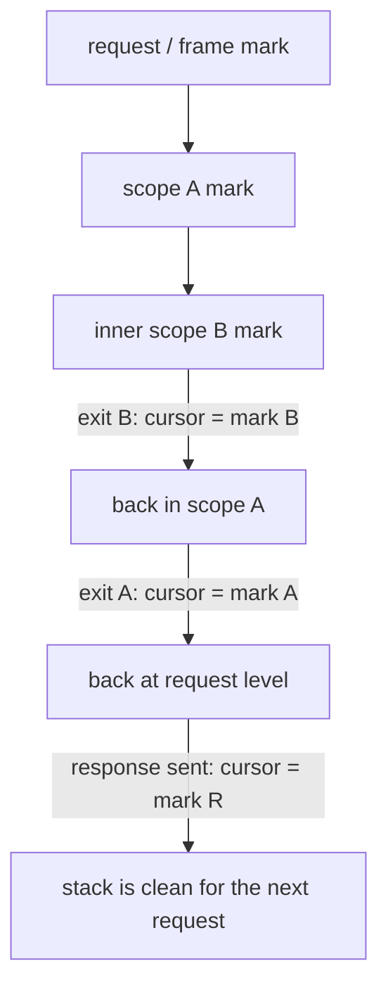

# Programming in Super (0.1.0)

Welcome. This book teaches Super 0.1.0 the way a good colleague would: by showing complete programs, running them, and explaining why the language is shaped the way it is. Part I builds the mental model, the zero-heap picture of memory, the `@` mutation contract, Part II walks the whole language, one construct per chapter.

**How to use this book alongside the quickstart.** [`QUICKSTART.md`](../QUICKSTART.md) is the sixty-minute field guide: read it first if you want to be writing Super by lunchtime. This book is the slow, thorough companion. It explains the reasons behind each rule, shows the diagnostics you will meet, and gives every idea a listing you can paste and run.

**About the listings.** Every listing is a complete module. Each one passes `super check`; listings that print output were also run with `super run`, and the output shown is what the toolchain produced. Listings that demonstrate a diagnostic begin with a comment such as `// super check: E0301`, followed by the compiler's actual message. Save a listing as `name.sr` and try it:

```bash
super check name.sr
super run name.sr
super test name.sr
```

Standard-library modules are imported by their manifest path (`use std.core.str`, `use std.math.core`, `use std.core.collections`, `use std.sys.time`). Short aliases such as `use std.str` still resolve, and new code should use the full path. The idiomatic helpers used throughout come from those modules: `sqrt`, `floor`, `to_int` from `std.math.core`; `byte_len`, `ord`, `chr` from `std.core.str`; `len`, `arr_set` from `std.core.collections`; `monotonic_ns` from `std.sys.time`. A few words are reserved and cannot be names: `state`, `shared`, `after`, `err`, `scope`, `spawn`, and the other keywords listed in the specification. When a listing uses `stage` instead of `state`, now you know why.

# Part I — Why Super Exists & The Zero-Heap Mental Model

## 1. Why Super exists

Super is a token-compact language for coding agents and for the people who review what those agents write. Ceremony is what was removed: no `fn`, no `let`, no semicolons, and a type only when inference would guess wrong. An agent spends its tokens on the program. A person can still read the cost, because the cost model stays on the page.

Memory is a scoped data stack, in the same family as Goose. A block, a task, a request, or a frame owns the values it creates. Allocation moves a cursor forward. Release moves that cursor back, in one store, however many arrays, strings, and records the scope built. The ordinary path has no tracing collector and no free-list walk.

That stack is memory-safe by construction. The guarantee is checked before the program runs:

1. **Values are local and immutable by default.** A binding does not change unless the program opts in, and there is no hidden mutable alias.
2. **@ is the only in-place write.** It is written on the parameter, on the field, and at the call, so every mutation is visible where it happens.
3. **A mutable view cannot leave its scope.** Letting one escape is a compile error (`E0401`). The bytes die with the scope that allocated them, so a dangling pointer is rejected before it can run.
4. **Overflow is a checked failure.** Exhausting a stack stops at the runtime boundary. It does not overwrite the neighboring region.
5. **Aggregates are flat values.** A struct is a C layout with no object header, an array is contiguous, and a sum is a tag plus an inline payload. An ordinary value is not a hidden heap box.

C and Rust meet Super on that layout. Structs are C-ABI values, so a C compiler and a Rust host read the same bytes. A Rust host function registers in one line and can share a slice without copying it. The ahead-of-time path emits C23 and hands it to the system compiler.

On dense kernels the native paths are built to meet and pass idiomatic C. Three execution paths share one semantics. A compact register **VM** is the correctness reference. A focused **native JIT** packs the kernels it recognizes. The **C23 back end** carries the rest, with the alias facts `@` already stated, which is what lets the C compiler emit `restrict` and packed loops. The benchmark chapters hold that to a checksum: the VM, the JIT, and the C binary must print the same number, and that number is what gets compared with C.

The syntax is minimal by default. The same short surface is for command-line tools, backends and APIs, games, automation, and the programs in between. `for`, `for @`, and `par` are three of the forms. The rest of the surface is the same length:

- `for` walks a range, an array, or a pipeline.
- `for @xs` writes each element in place.
- `#for` repeats the loop at compile time.
- `par` states that the iterations are independent.
- `Iterable.sum()` and `ParIterable.par_sum()` (from `std.core.traits`) are the reductions.
- `?` is an optional and `!` is a value error.
- `or` recovers from either in line.
- `ensure` leaves through its `else` block.
- `when` matches a value against arms.
- `+` exports the next declaration. There is no export list.
- `value.method(args)` is `method(value, args)`.
- Pipelines read left to right, and the current value is `it`.
- `.{}` builds a value when the type is already known.
- Structs line up with C. Sums stay a tag plus a payload.
- `test` blocks see private items and are stripped from a release build.
- `#` names, `#unroll`, and `#assert_size` run before the program starts.
- `scope`, `spawn`, and `await` structure concurrent work on the same stacks.
- `"{expr}"` interpolates through `Display`. Arrays, maps, structs, and commands render by that witness. A type that declares `Display` or `ToString` replaces the builtin. Raw strings do not interpolate, and `\{` still forces a literal brace.
- Command-line parsing, a terminal UI, and a desktop UI sit on these same stacks.

Here is a whole module, including its test:

```super
/// Exported greeting.
+greet(name: str) => "Hello, {name}!"

suffix = "from Super"

+main() {
    message = greet("Amina")
    print("{message} {suffix}")
}

test "greeting interpolates" {
    assert_eq(greet("Amina"), "Hello, Amina!")
}
```

```text
$ super run hello.sr
Hello, Amina! from Super
```

`greet` is exported; `suffix` is private to the module but visible to its tests. `{name}` interpolates, `=` introduces a one-expression function, and `test` blocks are part of the grammar, so `super test hello.sr` finds them with no framework.

Use `#assert(condition)` for predicates. It captures the expression and its
immediate operands once, then prints their values and the source location on
failure. Use `assert_eq(left, right)` when seeing both values and their diff is
useful, and `#assert_err(operation())` (optionally with exact error text) for
value errors. Assertions stay active in release programs; `test` blocks
themselves are stripped from release builds.

Here is the shape that matters for performance. Fill an array in parallel, then reduce it:

```super
+N = 1024

+square(x: i64) => x * x

+main() {
    xs = [0; N]
    par i in 0..N { xs[i] = square(i) }
    total = xs.sum()
    print("CHECKSUM={total}")
}
```

```text
$ super run squares.sr
CHECKSUM=357389824
```

`par i in 0..N` says the iterations are independent, which lets the C23 back end emit an OpenMP loop. `xs.sum()` says the workload is an addition reduction, which lets every back end fuse it. The checksum line is not decoration: every benchmark in this book prints one, because a fast wrong answer is worthless.

The rest of the book shows the cost model behind each of those forms, so the compiler's job stays easy.

## 2. Scoped data stacks and O(1) rewind

Think of a **data stack** as a long ribbon of virtual memory with a pencil mark called the cursor. To allocate, Super moves the cursor forward and hands you the bytes it skipped. To free, Super moves the cursor back. Nothing walks a list of objects, nothing consults a free list, and nothing pauses the program.

Entering a scope records a *mark*. Leaving the scope rewinds to that mark, however many arrays, strings, and records were created inside. That is the whole reclamation algorithm, and it is O(1) in the number of objects.

```text
        scope enter                      scope exit
        mark = cursor                    cursor = mark
            |                                 |
            v                                 v
 ┌──────────┬──────────┬──────────┬─────────┬─────────────────────────┐
 │ older    │ scratch  │ record   │ string  │ free (never touched)    │
 │ data     │ [0; 256] │ Order    │ "ok"    │                         │
 └──────────┴──────────┴──────────┴─────────┴─────────────────────────┘
                       ^                    ^
                       mark                 cursor (before exit)
```

Scopes nest, and the marks form a stack of their own. A web request, a game frame, a task, and a plain `scope { }` block all use the same mechanism:



A few consequences are worth internalizing now:

- **Allocation is a pointer bump.** The cost is a few instructions, and consecutive allocations are adjacent in memory, which the cache likes.
- **Release is one store.** There is no per-object destructor chain for data that lives on a data stack.
- **Lifetimes are lexical.** Anything allocated in a scope dies with that scope, so the compiler refuses to let a mutable view of it escape (you will meet error `E0401` in Chapter 12).
- **Overflow is checked.** Exhausting a stack is a checked allocation failure at the runtime boundary, never memory corruption.

Resources that a cursor rewind cannot clean up, such as sockets, files, and database connections, are explicit host handles with explicit close behavior. They are the exception, not the model.

One caveat for 0.1.0: the request-level mark in the diagram is the design, not yet the implementation. Explicit `scope` blocks and typed AOT functions rewind as described. A server whose routes are closures runs in the boxed runtime instead, and that runtime keeps per-request values on the heap. The hello server makes 42 allocations and 0 frees per request, and a test pins those counts.

The listing below makes the rewind visible. Each round allocates a 256-slot scratch array inside a `scope`, uses it, and leaves. The array from round three reuses the very bytes that round two occupied:

```super
+ROUNDS = 4
+SLOTS = 256

+window_sum() : i64 {
    total = 0
    for round in 0..ROUNDS {
        scope {
            scratch = [0; SLOTS]
            for i in 0..SLOTS { scratch[i] = i * round }
            total += scratch.sum()
        }
    }
    total
}

+main() {
    print("total={window_sum()}")
}

test "scratch is rewound each round" {
    assert_eq(window_sum(), 195840)
}
```

```text
$ super run window_sum.sr
total=195840
```

The same pattern scales up. In a game, one scope per frame holds contact lists and draw commands; in a service, one scope per request holds the decoded body and the response under construction. Nested scopes let short-lived scratch sit inside longer-lived working sets:

```super
+SLOTS = 64
+CAPACITY = 16

+run_frames(frames: i64) : i64 {
    score = 0
    for frame in 1..frames + 1 {
        scope {
            picks = [0; CAPACITY]
            count = 0
            for i in 0..SLOTS {
                hit = (i * frame) % 11 == 0
                if hit && count < CAPACITY {
                    picks[count] = i
                    count += 1
                }
            }
            scope {
                weights = [0; CAPACITY]
                for j in 0..count { weights[j] = picks[j] * 2 }
                score += weights.sum()
            }
        }
    }
    score
}

+main() {
    print("score={run_frames(5)}")
}

test "frames are independent" {
    assert_eq(run_frames(5), run_frames(5))
}
```

```text
$ super run frame_scopes.sr
score=1650
```

Persistent data goes in `state` declarations at module scope, which survive hot reloads, or in explicit host resources. Everything else is scratch, and scratch is free to throw away. This is also why Super can be tracing-GC-free without turning into manual memory management: you decide the *region* (a block, a frame, a request), and the language handles the bytes.

## 3. `@` borrows, restrict, and SIMD without borrow-checker ceremony

Rust's borrow checker answers a very general question: who may alias what, anywhere, forever. Super answers a narrower one: *who may change this, right now, during this call?* The answer is the `@` sigil on a method. It appears twice: once where the method declares `@self`, and once where the caller writes `@acct`.

```text
discount(@self, percent: f64)                 <- declaration: "I mutate this account"
remaining = @acct.discount(10.0)               <- call site:   "acct is mutated here"
```

The operation lives on `Account`. A discount is something an account does, so the book writes it as a method and calls it on the value. If the call leaves out `@`, the compiler reports `E0301`. Here is the mistake, and the diagnostic that catches it:

```super
// super check: E0301
+Account = {
    id: i64
    balance: f64

    discount(@self, percent: f64) : f64 {
        self.balance -= self.balance * percent / 100.0
        self.balance
    }
}

+main() {
    acct = Account{id: 1, balance: 200.0}
    remaining = acct.discount(10.0)
    print("{remaining}")
}
```

```text
$ super check discount_broken.sr
error[E0301]: cannot mutate without `@`
  --> discount_broken.sr:14:17
   |
14 |     remaining = acct.discount(10.0)
   |                 ^^^^
   = help: prefix the in-place argument with `@`, e.g. `@u.discount(...)`
```

The fix is the sigil on the receiver:

```super
+Account = {
    id: i64
    balance: f64

    discount(@self, percent: f64) : f64 {
        self.balance -= self.balance * percent / 100.0
        self.balance
    }
}

+main() {
    acct = Account{id: 1, balance: 200.0}
    remaining = @acct.discount(10.0)
    print("remaining={remaining} stored={acct.balance}")
}

test "the call site and the method agree" {
    acct = Account{id: 2, balance: 100.0}
    assert_eq(@acct.discount(50.0), 50.0)
    assert_eq(acct.balance, 50.0)
}
```

```text
$ super run discount_fixed.sr
remaining=180 stored=180
```

```text
$ super test discount_fixed.sr
discount_fixed.sr: 2 assertion(s) passed
super test: 2 passed, 0 file(s) failed
```

Why make you type it twice? Because the second `@` is documentation that cannot rot. Anyone reading `@acct.discount(10.0)` knows `acct` may change on that line, with no need to open the method.

The sigil is also a promise the optimizer can use. For the duration of an `@` borrow, the borrowed region is accessed only through that borrow. It does not escape, is not stored into longer-lived state, and does not overlap another active mutable borrow. That is exactly the contract of C's `restrict` qualifier, and the specification lets the back ends treat the borrow as `restrict`-style information: the C23 path can pass it on to the system compiler, and the JIT can rely on it when it selects packed loops. Read-only parameters carry no promise, so they may alias each other freely.

That is what "SIMD without ceremony" means. You do not write lifetimes or annotate aliasing. You write the kernel in its natural shape and mark the one array you change:

```super
use std.core.collections

+LANES = 1024

+axpy(@ys, xs, a: f64) {
    #simd
    for i in 0..len(ys) {
        ys[i] += a * xs[i]
    }
}

+main() {
    xs = [1.5; LANES]
    ys = [2.0; LANES]
    axpy(@ys, xs, 2.0)
    total = ys.sum()
    print("total={total}")
}

test "axpy updates ys in place and leaves xs alone" {
    xs = [1.0; 8]
    ys = [1.0; 8]
    axpy(@ys, xs, 3.0)
    assert_eq(ys[7], 4.0)
    assert_eq(xs[7], 1.0)
}
```

```text
$ super run axpy.sr
total=5120
```

```text
$ super test axpy.sr
axpy.sr: 2 assertion(s) passed
super test: 2 passed, 0 file(s) failed
```

`ys` is the only mutable root, and `xs` is read-only, so the loop is a textbook candidate for packed `mulpd`/`addpd` on x86-64 or `fmul`/`fadd` on AArch64, with a scalar tail for leftover lanes. `#simd` asserts that intent. If a kernel is not recognized, it simply runs through general bytecode or C23 with identical results.

Neighborhood algorithms, where each cell reads its neighbors, need one extra habit: read from one buffer and write to another, then swap. The `@` marks the destination, and multi-assignment evaluates every right-hand side before any store, so `a, b = b, a` is a clean swap:

```super
use std.core.collections

+CELLS = 16

+smooth(src, @dst) {
    for i in 1..CELLS - 1 {
        dst[i] = (src[i - 1] + src[i] + src[i + 1]) / 3.0
    }
}

+main() {
    a = [0.0; CELLS]
    b = [0.0; CELLS]
    a[8] = 9.0
    for 0..2 {
        smooth(a, @b)
        a, b = b, a
    }
    print("{a[6]} {a[7]} {a[8]} {a[9]} {a[10]}")
    mass = a.sum()
    print("mass={mass}")
}

test "smoothing conserves mass away from the border" {
    a = [0.0; CELLS]
    b = [0.0; CELLS]
    a[8] = 9.0
    smooth(a, @b)
    mass = b.sum()
    assert_eq(mass, 9.0)
}
```

```text
$ super run diffuse.sr
1 2 3 2 1
mass=9
```

```text
$ super test diffuse.sr
diffuse.sr: 1 assertion(s) passed
super test: 1 passed, 0 file(s) failed
```

Do not manufacture alias claims. Passing the same array as the read-only input and the `@` output of one kernel steps outside the contract, and the optimizer is entitled to assume you did not. If two logical views overlap, redesign around one root, split into disjoint slices, or stage the output elsewhere.

## 4. A complete micro-task in Super

Here is a deliberately small task that exercises the mutation contract: **fill an array of one million integers with `i % 100`, scale it in place by 3 through a function, and print the sum**. The program prints `CHECKSUM=148500000`.

```super
use std.core.collections

+N = 1_000_000

+scale(@xs, k: i64) {
    for i in 0..len(xs) { xs[i] *= k }
}

+main() {
    xs = [0; N]
    for i in 0..N { xs[i] = i % 100 }
    scale(@xs, 3)
    total = xs.sum()
    print("CHECKSUM={total}")
}
```

```text
$ super run task_super.sr
CHECKSUM=148500000
```

What this shows without any benchmark:

| Concern | Super |
|---|---|
| Who frees the array? | Scope rewind on the data stack |
| Mutation visible at call site? | `@` |
| Non-aliasing for the optimizer | `@`, checked |
| Reduction spelling | `.sum()` |

The array lives on the scoped data stack; `@xs` is the exclusive write root for `scale`; the reduction is a fused UFCS pipeline. A million-element fill is not one of the ten benchmark kernels — process start-up and array materialization dominate at that size — so treat it as a contract illustration, not a timing claim.

> **0.1.0 note.** In the bytecode VM, in-place element writes through the `for @xs { it *= k }` form copy the array on each step, so large arrays should use index loops, as `scale` does above. The `for @xs` spelling is ideal for small arrays and the JIT/AOT lowering, which is why Part II still teaches it.

## 5. The verified 0.1.0 benchmark standings

Performance claims deserve the same discipline as code: a workload, a machine, a protocol, and a checksum. This chapter reports the ten-kernel suite that ships with Super 0.1.0. Every kernel has a Super program and a C reference that compute the same checksum from the same deterministic input; the harness refuses to report a time when the checksum differs from the reference. **Matching checksums are the gate, and the timing is only meaningful because of it.**

**Protocol.** Two warm-up runs and five timed runs per target; the mean of the timed runs is reported. The machine is a 32-thread x86-64 Linux workstation, and the C reference is compiled with `-O3 -march=native -fopenmp` by a current GCC. Super's C23 back end invokes the same compiler at the same optimization level. Ratios below are **speed relative to C**, where C is 1.00 and bigger is faster.

| Kernel | C (ms) | Super AOT (ms) | Super JIT (ms) | AOT vs C | JIT vs C | Shared checksum |
|---|---:|---:|---:|---:|---:|---|
| 01 n-body | 5.002 | 4.784 | 5.531 | 1.05× | 0.90× | 13388893 |
| 02 mandelbrot (parallel) | 4.461 | 3.442 | 2.292 | 1.30× | 1.95× | 2120966 |
| 03 A* pathfinding | 0.661 | 0.565 | 0.915 | 1.17× | 0.72× | 1622 |
| 04 JSON parity | 0.618 | 0.313 | 0.907 | 1.97× | 0.68× | 10980458832 |
| 05 parallel map-reduce | 2.120 | 0.523 | 1.111 | 4.06× | 1.91× | 1422520636761 |
| 06 mergesort + radix | 3.422 | 3.174 | 3.583 | 1.08× | 0.96× | 3556374819638513243 |
| 07 CRC-32 + LZ4 | 0.482 | 0.392 | 0.781 | 1.23× | 0.62× | 5987620402 |
| 08 ECS simulation | 2.194 | 2.048 | 2.651 | 1.07× | 0.83× | 11972521 |
| 09 tiled matmul | 1.486 | 1.496 | 1.871 | 0.99× | 0.79× | 16065614 |
| 10 SHA-256 Merkle tree | 1.028 | 1.056 | 1.559 | 0.97× | 0.66× | 4258982549689610983 |
| **Geometric mean** | 1.00 | | | **1.33×** | **0.92×** | all ten match |

Standing versus the C reference (geometric mean over the ten kernels):

| Target | Standing vs C |
|---|---:|
| **Super AOT (C23)** | **1.33×** |
| C (reference) | 1.00× |
| **Super JIT** | **0.92×** |

Super also needs less code. Counting code lines in the benchmark sources, Super is shorter than the C reference on **all ten of ten** kernels, 447 lines against 644 in total, about 31% fewer.

### Why the architecture lands here

Read the numbers by cause, not by headline:

- **AOT parity is the floor, by construction.** The C23 back end lowers checked Super to plain C and hands it to the same optimizer as the reference. When Super matches C within a few percent (n-body, mergesort, matmul, SHA-256), that is the design working: no interpreter tax, no boxed values, no write barriers. Dense arrays, flat structs, and static types give the C compiler what it needs.
- **`par` is a language-level win.** Mandelbrot is a row kernel; `par y in 0..H` states the independence, and the back end can emit OpenMP. The C reference is a straightforward program, so the 1.30× AOT and 1.95× JIT rows reflect idiomatic Super against idiomatic C, not a faster ALU.
- **Fixed-capacity scoped arrays remove setup cost.** In the map-reduce and JSON-parity kernels the timed regions are one to two milliseconds long, and compact stack arrays with no allocator traffic and no per-process table setup matter. Treat the 1.97× and 4.06× rows as evidence that the AOT path pays no tax on small, array-heavy work, rather than as a general law. The sober headline is the median: AOT is ahead of C on eight kernels and within 3% on the other two, with a **median ratio of about 1.12×**.
- **The JIT is deliberately narrow.** It recognizes canonical no-alias dense loops and emits packed code. It beats C where a kernel parallelizes and trails it where C's scalar optimizer is already excellent. Its 0.92× geometric mean, achieved without invoking a C compiler at all, is the point of having it.
- **Scalar loops stay honest.** Hash and bit-twiddling kernels (CRC, SHA-256) are bound by arithmetic that every target does equally well, so the ratios sit near 1.00.

Keep the claim scoped: these are ten kernels on one class of machine. Chapter 4's million-element fill is not among them, and it is a reminder that a program shape the optimizer has not seen can behave differently. That is exactly why the harness also checks the answer.

### Measuring your own code

The same methodology fits in a few lines of Super. This harness discards two warm-up runs, keeps the best of five, and prints the checksum alongside the time, which is the habit to build:

```super
use std.sys.time

+N = 200_000

+kernel(n: i64) : i64 {
    total = 0
    for i in 0..n { total += (i * i) % 1000 }
    total
}

+main() {
    best = 0
    checksum = 0
    for run in 0..7 {
        start = monotonic_ns()
        checksum = kernel(N)
        elapsed = monotonic_ns() - start
        if run >= 2 {
            if best == 0 || elapsed < best { best = elapsed }
        }
    }
    print("CHECKSUM={checksum}")
    print("best_ms={best / 1_000_000}")
}
```

```text
$ super run harness.sr
CHECKSUM=92300000
best_ms=43
```

The `best_ms` line depends on your machine; the checksum must not. For publishable numbers, record the source revision, CPU model, compiler and flags, run counts, and the full distribution, and report ratios in one unambiguous direction (here, speed relative to C).

# Part II — Complete Language Mastery

## 6. Bindings & numeric literals

A binding is a name, an optional type, and a value. There is no `let`: a new name on the left of `=` introduces a local, and the type is inferred from the right-hand side unless you annotate it after the name.

```super
+MAX_CLIENTS = 65_536

+clamp_nonnegative(x: i64) : i64 {
    return 0 if x < 0
    x
}

+main() {
    host = "127.0.0.1"
    port: u16 = 8080
    retries = 3
    retries -= 1
    low, high = 10, 20
    low, high = high, low
    print("{host}:{port} retries={retries} low={low} high={high}")
    print("{clamp_nonnegative(-7)} {clamp_nonnegative(7)} {MAX_CLIENTS}")
}
```

```text
$ super run bindings.sr
127.0.0.1:8080 retries=2 low=20 high=10
0 7 65536
```

A few things to notice. A `+` at module scope exports the declaration (`+MAX_CLIENTS`); it is not unary plus. `port: u16 = 8080` pins the width, while an unannotated integer defaults to `i64` and an unannotated float to `f64`. Compound assignments (`-=`, `+=`, `*=`, `/=`) update an existing local. And `a, b = b, a` is a multi-assignment: every right-hand side is evaluated first, so swaps need no temporary. The postfix guard in `return 0 if x < 0` keeps the common path unindented.

Numeric literals accept `_` separators anywhere inside the digits, and integers come in four radixes. Floats may carry an exponent. A leading `-` is folded into the literal where it cannot be subtraction.

```super
+MAX_CLIENTS = 65_536
+RATIO = 1.5e2

+main() {
    // integers: decimal, hex, binary, octal, with separators
    mask = 0xff_00
    bits = 0b1010
    perms = 0o644
    flags = mask | bits
    print("flags={flags} perms={perms} clients={MAX_CLIENTS}")

    // floats and explicit widths
    temp: f32 = 21.5
    scale = 2.5e-1
    print("temp={temp} scale={scale} ratio={RATIO}")

    // integer arithmetic truncates; float arithmetic does not
    a = 17
    b = 5
    print("{a / b} {a % b} {17.0 / 5.0} {a * 1.5}")

    // bitwise, shifts, comparisons, short-circuit logic
    print("{a & b} {a | b} {a ^ b} {~a}")
    print("{1 << 10} {1024 >> 3} {-8 >>> 1}")
    both = a > 10 && b < 5
    either = a > 10 || b < 5
    print("{both} {either}")
}
```

```text
$ super run literals.sr
flags=65290 perms=420 clients=65536
temp=21.5 scale=0.25 ratio=150
3 2 3.4 25.5
1 21 20 -18
1024 128 9223372036854775804
false true
```

Operator precedence is the familiar one: postfix, unary (`-`, `!`, `~`, `@`), multiplicative, additive, shifts, comparisons, bitwise, `&&`, `||`, range, `?:`, assignment, then `or`. `&&` and `||` short-circuit. Integer division truncates (`17 / 5` is `3`), while mixing in a float promotes (`17.0 / 5.0` is `3.4`). `>>` is an arithmetic shift and `>>>` a logical one. Division or modulo by zero is a runtime error, never silent. Integers are 64-bit signed; floats are IEEE-754.

A name starts with a letter or underscore and continues with ASCII letters, digits, or underscores. Types and variants use `UpperCamelCase`, values use `snake_case`. Names that start with `_` are deliberate placeholders, which matters for the unused-name errors in Chapter 12.

## 7. Strings & interpolation

Strings are immutable UTF-8 values written in double quotes. `{expr}` inside a string evaluates any expression and splices its `Display` text, so formatting needs no library call. An array prints as `[10, 20, 30]`, a map or anonymous record as `{http: 80, https: 443}` with keys sorted, a named struct as `User{id: 7, name: "Amina"}`, and a command as its name. Nested strings are quoted. A type that declares `Display` (or `ToString`) replaces that witness with a direct call, on the VM and on the C23 backend. Escape a literal brace as `\{` and `\}`, and a quote as `\"`. Because an interpolation lives inside a string literal, keep string literals out of the braces: bind a value first, then interpolate the name. Raw strings still do not interpolate.

Escape sequences are decoded when the program is compiled, and the lexer rejects anything it does not recognize, so a typo like `"C:\temp\dir"` is an error instead of a silent surprise:

| Escape | Meaning |
| --- | --- |
| `\n` `\r` `\t` | newline, carriage return, tab |
| `\0` | the NUL byte |
| `\\` | a literal backslash |
| `\"` `\'` | a literal double or single quote |
| `\{` `\}` | a literal brace (no interpolation) |
| `\xNN` | the ASCII byte `NN` (two hex digits, `00`–`7F`) |
| `\u{H…}` | a Unicode scalar, 1–6 hex digits (`\u{e9}`, `\u{1F600}`) |

When a string is mostly backslashes (Windows paths, regular expressions), write a **raw string** instead: `r"…"`. A raw string has no escapes and no interpolation, and it may span lines. Add `#` marks on both sides, `r#"…"#`, to embed double quotes; use as many `#` as needed to be unambiguous (`r##"a "# b"##`). `r` followed by anything other than `"` or `#"` is still an ordinary name.

```super
use std.core.regex

+main() {
    path = r"C:\Users\admin\notes.txt"
    pattern = r"^\d+\.\d+$"
    quoted = r#"say "hi" \d+"#
    template = r"{not_interpolated}"
    println(path)
    println(pattern)
    println(quoted)
    println(template)
    num = compile(pattern) or regex_none()
    println(is_match(num, "3.14"))
}
```

```text
$ super run raw.sr
C:\Users\admin\notes.txt
^\d+\.\d+$
say "hi" \d+
{not_interpolated}
true
```

**`print` and `println`.** Both write their argument followed by a newline; `println` is the explicit, expectation-matching name and is always available (no `use`). `print()` and `println()` with no argument emit a bare newline. Neither adds anything beyond the trailing newline, and a module that defines its own free function `println` shadows the builtin. Use `std.io.stdio` (`stdout.write_str`, `eprint`, `eprintln`) when you need output *without* a newline, binary-safe writes, or stderr. Both also work in receiver form: `"done".println()`.

Slicing is half-open and borrows from the original: `clean[0..3]` is the first three bytes, with no copy. Indexing a string gives a one-character string, `ord` turns a character into its code, and `chr` goes back. The `std.core.str` module supplies the everyday toolbox (`trim`, `split`, `find`, `contains`, `starts_with`, `replace`, `to_upper`, `pad_left`, `repeat`, `to_i64`, and friends). Searches that can miss and conversions that can fail say so in their types, which is why parsing uses `or`:

```super
use std.core.str

+User = {
    id: i64
    name: str
}

+main() {
    u = User{id: 7, name: "Amina"}
    print("user {u.id}: {u.name} (double id {u.id * 2})")

    line = "  GET /users/42  "
    clean = trim(line)
    verb = clean[0..3]
    path = clean[4..byte_len(clean)]
    print("[{verb}] [{path}] bytes={byte_len(clean)}")

    id_text = path[7..byte_len(path)]
    id = to_i64(id_text) or 0
    is_get = starts_with(clean, "GET")
    print("id={id} get={is_get}")

    shout = to_upper("super")
    padded = pad_left("7", 3, "0")
    swapped = replace("a-b-c", "-", "+")
    where = find("hello", "ll")
    print("{shout} {padded} {swapped} {where}")

    lowercase = 0
    for i in 0..byte_len(clean) {
        code = ord(clean[i])
        if code >= 97 && code <= 122 { lowercase += 1 }
    }
    print("lowercase={lowercase} next={chr(ord(verb[0]) + 1)}")
    print("literal braces: \{not interpolated\} and a quote: \"ok\"")
}

test "path parsing" {
    path = "/users/42"
    assert_eq(to_i64(path[7..byte_len(path)]) or 0, 42)
}
```

```text
$ super run strings.sr
user 7: Amina (double id 14)
[GET] [/users/42] bytes=13
id=42 get=true
SUPER 007 a+b+c 2
lowercase=5 next=H
literal braces: {not interpolated} and a quote: "ok"
```

```text
$ super test strings.sr
strings.sr: 1 assertion(s) passed
super test: 1 passed, 0 file(s) failed
```

`to_i64(id_text) or 0` is the typical shape: the parse returns a value-or-error, and `or` supplies a fallback (Chapter 15 covers the full set of handlers). `byte_len` counts bytes, which is what protocols care about; prefer ASCII input in hot parsing code. Slices must not outlive the stack value that backs them, so copy into an owning destination before the request or frame that produced the text ends.

## 8. Arrays, slices, records, maps

Arrays are contiguous and zero-indexed, with the length known to the runtime (`len`). `[v; N]` is the dense repeat form: `N` copies of `v` in one scoped-stack allocation, and the shape the compiler can analyze best. Brace literals cover three shapes with one syntax:

- `{http: 80, ssh: 22}` with **unquoted** keys is a symbol-keyed map, read and written with field syntax (`ports.ssh`).
- `{host, port, timeout: 30}` is an anonymous record; a bare name is punned to `name: name`.
- Quoted keys (`"content-type": "json"`) and computed keys (`[key]: value`) build maps whose keys are data, which is what you want when assembling headers or JSON.

```super
use std.core.collections

+Point = {
    x: f64
    y: f64
}

+main() {
    // arrays: contiguous, zero-indexed
    scores = [10, 20, 30, 40]
    scores[2] = 35
    zeros = [0; 6]
    middle = scores[1..3]
    print("{scores[2]} {len(zeros)} {len(middle)} {middle[1]}")

    // growing returns a new array value
    scores = scores + [50]
    scores = arr_push(scores, 60)
    scores = arr_set(scores, 0, 5)
    print("len={len(scores)} first={scores[0]} last={scores[5]}")

    // unquoted maps: symbol keys, field access
    ports = {http: 80, https: 443, ssh: 22}
    ports.ssh = 2222
    print("{ports.http} {ports.https} {ports.ssh}")

    // anonymous records with punning
    host = "localhost"
    port = 8080
    config = {host, port, timeout: 30, tls: true}
    print("{config.host}:{config.port} timeout={config.timeout} tls={config.tls}")

    // arrays of named structs
    path = [Point{x: 0.0, y: 0.0}, Point{x: 3.0, y: 4.0}]
    last = path[1]
    print("{last.x} {last.y}")

    // iteration: implicit it/index, or a named binder
    for scores { print("{index}: {it}") }
    for name in ["ann", "bob"] { print("hello {name}") }
}
```

```text
$ super run collections.sr
35 6 2 35
len=6 first=5 last=60
80 443 2222
localhost:8080 timeout=30 tls=true
3 4
0: 5
1: 20
2: 35
3: 40
4: 50
5: 60
hello ann
hello bob
```

Growing an array returns a new array value (`a + [x]`, `arr_push`, `arr_set`), so write `scores = scores + [50]`, not a bare call. Prefer fixed capacity (`[0; N]`) on hot paths and grow only at boundaries. A slice such as `scores[1..3]` is a read-only view valid for as long as its backing array.

The usual pattern for grids is flat indexing: `cells[row * cols + col]`. It keeps data contiguous, removes a level of indirection, and lets the compiler prove bounds from the loop ranges.

> **0.1.0 note.** Quoted and computed map keys are accepted and constructed; retrieve data you plan to read back through unquoted keys or typed records. Take slices from literal arrays or copy with a loop when you need a window into a `[v; N]` array that was filled at run time.

## 9. Structs, methods, `@self`

A struct is a named record with flat, C-compatible layout: fields in declaration order, natural alignment, a deterministic size. Fields are public by default and `-` marks one private to the defining module, which makes it invisible outside the file, with one deliberate exception: `test` blocks in the same module may read private fields so that you can verify invariants without widening the API. A field may declare a default (`balance: f64 = 0.0`), which documents the value a field takes when a construction does not provide one.

Methods live inside the struct body. `self` is a read-only receiver, and `@self` is a mutable one, so a method's signature tells you whether it changes the value, in exactly the way a free function's `@` parameter does. Construction can use the type name (`Account{...}`) or `.{...}` wherever the expected type is known, such as a return type, parameter, or typed binding, with punning for fields that share a name with a local:

```super
+Account = {
    id: i64
    owner: str
    balance: f64
    active: bool
    -token: str

    deposit(@self, amount: f64) : f64 {
        self.balance += amount
        self.balance
    }

    withdraw(@self, amount: f64) : f64 {
        self.balance -= amount
        self.balance
    }

    summary(self) : str  => "{self.owner}#{self.id} holds {self.balance}"

    is_rich(self) : bool  => self.balance >= 1000.0

    -fingerprint(self) : str  => "{self.id}:{self.token}"
}

+open_account(id: i64, owner: str) : Account  => .{id, owner, balance: 0.0, active: true, token: "t-{id}"}

+main() {
    acct = open_account(7, "Amina")
    @acct.deposit(1250.0)
    left = @acct.withdraw(200.0)
    print("{acct.summary()} (left={left})")
    rich = acct.is_rich()
    print("rich={rich} active={acct.active}")
}

test "deposits and withdrawals mutate in place" {
    acct = open_account(1, "Noor")
    assert_eq(@acct.deposit(100.0), 100.0)
    assert_eq(@acct.withdraw(30.0), 70.0)
    assert_eq(acct.balance, 70.0)
}

test "tests may read private fields" {
    acct = open_account(9, "Bo")
    assert_eq(acct.token, "t-9")
    assert_eq(acct.fingerprint(), "9:t-9")
}
```

```text
$ super run account.sr
Amina#7 holds 1050 (left=1050)
rich=true active=true
```

```text
$ super test account.sr
account.sr: 5 assertion(s) passed
super test: 5 passed, 0 file(s) failed
```

Note the call sites: `@acct.deposit(1250.0)` carries the sigil because `deposit` takes `@self`, while `acct.summary()` does not. Private fields and methods that start with `-` (like `fingerprint`) are available to the module and its tests.

Visibility is enforced across modules by diagnostic `E0104`. Here `vault.sr` owns the token, and `leak_broken.sr`, a second file in the same directory, tries to read it:

```super
+Account = {
    id: i64
    owner: str
    -token: str

    badge(self) : str  => "{self.owner}#{self.id}:{self.token}"
}

+open_account(id: i64, owner: str) : Account  => .{id, owner, token: "t-{id}"}

test "the defining module may read -token" {
    acct = open_account(1, "Amina")
    assert_eq(acct.token, "t-1")
}
```

```super
// super check: E0104
use vault.{Account, open_account}

+main() {
    acct = open_account(7, "Amina")
    stolen = acct.token
    print("{stolen}")
}
```

```text
$ super check leak_broken.sr
error[E0104]: field 'token' on 'Account' is file-private (marked with '-')
 --> leak_broken.sr:6:14
  |
6 |     stolen = acct.token
  |              ^^^^^^^^^^
  = help: private fields are visible only in this module and `test` blocks; see the struct declaration
```

The fix, saved as `leak_fixed.sr`, is to use the public surface the module chose to expose:

```super
use vault.{Account, open_account}

+main() {
    acct = open_account(7, "Amina")
    print(acct.badge())
    print("{acct.owner}")
}
```

```text
$ super run leak_fixed.sr
Amina#7:t-7
Amina
```

Struct layout matters at boundaries. Because the layout is C-compatible, a struct can cross the foreign-function boundary, be written into a network buffer at fixed offsets, or be placed in a dense array that the SIMD kernels can sweep. Chapter 3's lesson applies directly: an array of records is convenient at an API edge, and parallel arrays of fields (structure-of-arrays) are usually faster for a hot pass.

### Traits, declared on the type

A trait is a list of method signatures. The type that satisfies it says so in the header, in the same place a binding says `port: u16`, and writes the methods in its body. A call resolves to the method on that type.

```super
+Widget = trait {
    paint(self) : str
    hit(self, x: i64, y: i64) : bool
}

+Anim = trait {
    step(@self) : i64
}

+Badge: Widget, Anim = {
    label: str = ""
    frame: i64 = 0

    paint(self) : str  => self.label

    hit(self, x: i64, y: i64) : bool  => x >= 0 && y >= 0 && self.frame >= 0

    step(@self) : i64 {
        self.frame = self.frame + 1
        self.frame
    }
}

+main() {
    pin = Badge{label: "new", frame: 0}
    print(pin.paint())
    moved = @pin.step()
    print("{moved} {pin.hit(1, 1)}")
}
```

```text
$ super run badge.sr
new
1 true
```

`paint` and `hit` are read-only, so the trait writes `self`. `step` changes `frame`, so the trait writes `@self` and the call wears `@`. A header that names a trait the module cannot see, or that omits a method, or whose method disagrees on arity, `@`, a parameter type, or the return type, is `E0203`. The receiver's own type is the owner on each side, so it is not part of the comparison. A trait parameter left untyped, or typed `_`, accepts whatever type the method declares.

The language traits are ambient. `Display`, `Debug`, `Eq`, `Ord`, `Hash`, `Clone`, `Copy`, `Default`, `From`, `Into`, `AsRef`, `Borrow`, `Iter`, `Add`, `Sub`, `Mul`, `Div`, `Rem`, `Neg`, `Not`, `Index`, `Error`, and `Drop` live in `std.core.traits` and in the compiler, and a struct may name them without an import. Numbers, strings, arrays, maps, and records already have a witness, so `"{scores}"`, `scores == [10, 20, 30]`, and `"a" < "b"` work with no method of your own. When the type declares the trait, `+`, `-`, `*`, `/`, `%`, `==`, `!=`, `<`, `<=`, `>`, `>=`, unary `-`, and `"{…}"` call that method. The VM, the fiber interpreter, and the C23 backend share one algorithm. There is no vtable. A method whose signature matches a language trait, but whose type does not declare it, is `E0204`, and so is a `+Display = trait` definition that drifts from `std.core.traits`. That check is how the compiler catches a witness the backends would disagree on.

`std.gui.widgets` publishes the trait you will actually reuse. `Widget` asks for `paint`, `hit`, and `measure`. `Toggle`, `Dialog`, `Toast`, and the other controls declare it inline, and `Sprite` in `std.game.fx` declares it too. A window mounts the paint string with `custom`. Chapter 43 and the interface recipes in Part III walk those programs.

## 10. Sum types & `when`

A sum type declares a closed set of alternatives, some carrying data:

```text
Status = {
    Pending
    Paid(amount: f64)
    Failed(reason: str)
}
```

A value of type `Status` is a 32-bit tag plus an inline payload large enough for the biggest variant, so a `Status` occupies a fixed, known number of bytes and never needs a heap object. Variants are constructed with `Status.Paid(49.95)` and can be fields of other structs. Declarations, construction, and uses in typed positions are all checked by `super check`:

```super
+Status = {
    Pending
    Paid(amount: f64)
    Failed(reason: str)
}

+Receipt = {
    id: i64
    status: Status
}

+fee_rate(s: Status) : f64 {
    rate = 0.0
    when s {
        Status.Paid => rate = 0.02
        Status.Failed => rate = 0.5
        else => rate = 0.0
    }
    rate
}

+paid_receipt(id: i64, amount: f64) : Receipt  => .{id, status: Status.Paid(amount)}

+declined_receipt(id: i64, why: str) : Receipt  => .{id, status: Status.Failed(why)}

+waiting_receipt(id: i64) : Receipt  => .{id, status: Status.Pending}
```

`when` selects among alternatives. With a subject, arms are tested in source order, the first true arm runs, and `else` is the fallback. Arms are expressions, so assignments and calls are both fine; list the most specific condition first:

```super
+PENDING = 0
+PAID = 1
+FAILED = 2

+Order = {
    id: i64
    stage: i64
    amount: f64

    settle(@self, approved: bool) {
        ensure self.stage == PENDING else { return }
        if approved {
            self.stage = PAID
        } else {
            self.stage = FAILED
        }
    }

    label(self) : str {
        text = "unknown"
        stage = self.stage
        when stage {
            stage == PENDING => text = "pending"
            stage == PAID => text = "paid"
            stage == FAILED => text = "failed"
        }
        text
    }

    fee(self) : f64 {
        stage = self.stage
        charge = 0.0
        when stage {
            stage == PAID => charge = self.amount * 0.02
            stage == FAILED => charge = 0.5
            else => charge = 0.0
        }
        charge
    }
}

+main() {
    a = Order{id: 1, stage: PENDING, amount: 250.0}
    b = Order{id: 2, stage: PENDING, amount: 80.0}
    @a.settle(true)
    @b.settle(false)
    @a.settle(false)
    print("{a.id} {a.label()} fee={a.fee()}")
    print("{b.id} {b.label()} fee={b.fee()}")
}

test "a settled order never changes stage again" {
    order = Order{id: 3, stage: PENDING, amount: 10.0}
    @order.settle(true)
    @order.settle(false)
    assert_eq(order.stage, PAID)
    assert_eq(order.label(), "paid")
}
```

```text
$ super run order_flow.sr
1 paid fee=5
2 failed fee=0.5
```

```text
$ super test order_flow.sr
order_flow.sr: 2 assertion(s) passed
super test: 2 passed, 0 file(s) failed
```

Notice how this program models states: a small set of named codes, a struct that carries one, and an `Order.settle` method that uses `ensure` to guard the transition so that a settled order can never be settled again. That is the same discipline sum types give you, with the tag spelled as an integer.

> **0.1.0 note.** The sum-type declarations, layouts, constructors, and `when` positions in `status.sr` are fully checked. The 0.1.0 virtual machine does not yet dispatch on variant payloads at run time, so runnable code in this release drives control flow with explicit integer codes, as `order_flow.sr` does. Inside `when` arms, name the subject variable itself in conditions (`stage == PAID`). The implicit `it` is established by `for`, `par`, and Iterable pipeline predicates.

One more habit: when the subject is a field expression such as `order.stage`, bind it to a local first (`stage = order.stage`) or wrap it in parentheses. Otherwise `order.stage {` reads as the start of a struct literal.

## 11. Functions (`=>` vs block), monomorphization, UFCS `.`

Functions are declarations with no keyword. A single expression follows `=` or `=>`; anything longer uses a block, whose last expression is the result and where `return` exits early (usually with a postfix guard). `=>` means exactly what `=` means, plus a hint that the body is a good candidate for inlining, so use it for tiny leaves.

A parameter without a type, or with `_`, is an **inference parameter**: Super specializes the function for the types it is called with, which is monomorphization. `identity(3)` and `identity("x")` become two concrete functions; there is no boxed "any" value and no runtime dispatch. A parameter written `#n` is a **compile-time parameter** whose value joins the specialization key. When every argument already has a same-named local, a lone `.` as the argument list fills them in (call punning):

```super
use std.math.core

/// Expression bodies use `=` or `=>` (inline preferred).
+square(x: f64) => x * x
+cube(x: f64) => x * x * x

/// Block bodies end in an expression, or `return` early.
+distance(x1: f64, y1: f64, x2: f64, y2: f64) : f64 {
    dx = x2 - x1
    dy = y2 - y1
    sqrt(dx * dx + dy * dy)
}

+fib(n: i64) : i64 {
    return n if n < 2
    fib(n - 1) + fib(n - 2)
}

/// Untyped parameters are inferred and monomorphized per call site.
+identity(value) => value
+pair_sum(a, b) : _  => a + b

/// `#` parameters are compile-time values.
+add_n(#n: i64, x: i64) : i64  => x + #n

+spawn_wave(count: i64, speed: f64) : f64  => count * speed

+main() {
    print("{square(3.0)} {cube(2.0)} {distance(0.0, 0.0, 3.0, 4.0)} {fib(20)}")
    word = identity("x")
    print("{identity(3)} {word} {pair_sum(2, 3)} {pair_sum(1.5, 2.0)}")
    print("{add_n(5, 10)}")
    count = 20
    speed = 1.5
    total = spawn_wave(.)
    print("{total}")
}

test "monomorphized calls agree with their types" {
    assert_eq(pair_sum(2, 3), 5)
    assert_eq(pair_sum(1.5, 2.0), 3.5)
    assert_eq(identity("x"), "x")
}
```

```text
$ super run functions.sr
9 8 5 6765
3 x 5 3.5
15
30
```

```text
$ super test functions.sr
functions.sr: 3 assertion(s) passed
super test: 3 passed, 0 file(s) failed
```

`spawn_wave(.)` expands to `spawn_wave(count, speed)`. Use punning only when the names make the call obvious.

Behavior that belongs to a value is a method on that value. **UFCS** (Uniform Function Call Syntax) is the other direction: it rewrites `receiver.f(args)` to `f(receiver, args)`, so a free function with no natural owner — `double`, `add_tax`, `sqrt` — can still be read left to right. The two spellings of a free function are exactly equivalent. UFCS works on **any** receiver type (floats, ints, strings, arrays, structs) and chains: each stage's result is the next stage's receiver. With `@` in front of the receiver, a method's mutable borrow is forwarded.

```super
+Account = {
    id: i64
    balance: f64

    discount(@self, percent: f64) : f64 {
        self.balance -= self.balance * percent / 100.0
        self.balance
    }

    label(self) : str  => "account {self.id}"
}

+double(n: i64) => n * 2
+inc(n: i64) => n + 1

+add_tax(amount: f64) => amount * 1.14

+main() {
    // a free function on a number reads like a method
    chained = 3.double().inc().double()
    print("{chained} {double(inc(double(3)))}")

    acct = Account{id: 1, balance: 200.0}
    print(acct.label())

    // `@` in front of the receiver forwards a mutable borrow
    net = @acct.discount(10.0)
    gross = net.add_tax()
    print("net={net} gross={gross} stored={acct.balance}")
}

test "receiver syntax and call syntax are the same call" {
    assert_eq(3.double(), double(3))
    assert_eq(10.0.add_tax(), add_tax(10.0))
}
```

```text
$ super run ufcs.sr
14 14
account 1
net=180 gross=205.2 stored=180
```

```text
$ super test ufcs.sr
ufcs.sr: 2 assertion(s) passed
super test: 2 passed, 0 file(s) failed
```

**Nested calls and UFCS chains are the same program.** Read the nested form inside-out and the chain left to right; both compile to identical code, for every receiver type:

```super
use std.math.core
use std.core.str
use std.core.collections

+main() {
    // numbers
    print("{49.0.sqrt().floor().to_int()}")      // 7
    print("{to_int(floor(sqrt(49.0)))}")         // 7

    // strings (bind first: string literals stay out of interpolation braces)
    hi = "Hi"
    print("{hi.byte_len()}")                      // 2
    print("{byte_len(hi)}")                       // 2

    // arrays, then back to numbers
    xs = [1, 2, 3, 4]
    print("{xs.len().to_float().sqrt().to_int()}")  // 2
}

test "nested call and UFCS chain are equivalent" {
    assert_eq(49.0.sqrt().floor().to_int(), to_int(floor(sqrt(49.0))))
    assert_eq("  Hi ".trim().byte_len(), byte_len(trim("  Hi ")))
    assert_eq([5, 6].arr_push(7).len(), len(arr_push([5, 6], 7)))
}
```

When a short name exists both as a free function and as a type method (`add`, `has`, `len`), the receiver decides: a struct receiver picks its own type's method first and falls back to a free function whose first parameter accepts it, while a scalar, string, or array receiver picks the free function. Only the loop-lowered pipeline stages (`keep`, `map`, `sum`, `group_by`) and channel verbs keep their built-in meaning.

Prefer short, single-purpose functions: the optimizer inlines the small ones, and monomorphization means they cost nothing at the call site. Keep mutation in the signature (`@param`) and results in the return type; do not smuggle effects through globals.

### Method families (`FuncFamily`), trait params, `#symmetric`, and tuple `when`

Several top-level functions may share one name when their parameter lists differ in arity, concrete types, trait constraints, `#` compile-time parameters, or `@` mutability. Call sites (including UFCS) rank the unified **`FuncFamily`** by specificity: **Concrete > sum-variant > trait > `_`**. Residual ties are `E0205`; identical signatures in one module are `E0206`.

A parameter written `x: TraitName` is a statically monomorphized generic constrained to types that declare `: TraitName` (`E0203` when a witness is missing).

`#symmetric` on a two-parameter function with distinct types or `@` flags synthesizes the swapped mirror `f(b, a) => f(a, b)`. Invalid `#symmetric` is `E0501`.

Multi-subject `when (e1, e2, …)` is the table form: Mode 1 ranks type/trait arms like a `FuncFamily`; Mode 2 matches sum-tag matrices (as in `std.math.linalg` and `std.game.physics2d`).

```super
#symmetric
+mix(a: i64, b: f64) : f64 => a.to_float() + b
+mix(a: i64, b: i64) : i64 => a * 10 + b

Shape = { Circle(r: f64); Rect(w: f64, h: f64); Dot }

+pair_code(a: Shape, b: Shape) : i64 {
    when (a, b) {
        (Shape.Circle, Shape.Rect) => 12
        (Shape.Rect, Shape.Circle) => 21
        else => 0
    }
}
```

See `tests/dispatch_family.sr` for VM / JIT / C23 coverage of the full matrix.

## 12. `@` mutation & lifetime diagnostics E0301–E0401

The checker's job in this area is small and strict. Every diagnostic has a stable code, a primary span, and a note that names the repair. Here is the family, each with a broken program, the real message, and a fixed program.

**E0301: mutation without `@`.** Chapter 3 showed the function form. Methods behave the same way: a method that takes `@self` must be called through `@receiver`.

```super
// super check: E0301
+Counter = {
    hits: i64

    bump(@self) : i64 {
        self.hits += 1
        self.hits
    }
}

+main() {
    counter = Counter{hits: 1}
    n = counter.bump()
    print("{n}")
}
```

```text
$ super check method_broken.sr
error[E0301]: cannot mutate without `@`
  --> method_broken.sr:13:9
   |
13 |     n = counter.bump()
   |         ^^^^^^^
   = help: prefix the in-place argument with `@`, e.g. `@u.discount(...)`
```

```super
+Counter = {
    hits: i64

    bump(@self) : i64 {
        self.hits += 1
        self.hits
    }
}

+main() {
    counter = Counter{hits: 1}
    n = @counter.bump()
    print("{n} {counter.hits}")
}

test "bump mutates the receiver" {
    counter = Counter{hits: 0}
    assert_eq(@counter.bump(), 1)
    assert_eq(@counter.bump(), 2)
    assert_eq(counter.hits, 2)
}
```

```text
$ super run method_fixed.sr
2 2
```

```text
$ super test method_fixed.sr
method_fixed.sr: 3 assertion(s) passed
super test: 3 passed, 0 file(s) failed
```

**E0302: two sibling tasks capture the same mutable root.** Two spawned tasks that both mutate `counts` could race, and a race would invalidate the no-alias facts the optimizer relies on, so the checker rejects it before it can become an optimization bug.

```super
// super check: E0302
+bump(@cells, slot: i64) : i64 {
    cells[slot] += 1
    cells[slot]
}

+main() {
    counts = [0; 4]
    scope {
        a = spawn bump(@counts, 0)
        b = spawn bump(@counts, 1)
        x = await a
        y = await b
        print("{x} {y}")
    }
    print("first={counts[0]}")
}
```

```text
$ super check spawn_broken.sr
error[E0302]: cannot capture `@counts` mutably in multiple spawned tasks in the same scope
  --> spawn_broken.sr:11:13
   |
11 |         b = spawn bump(@counts, 1)
   |             ^^^^^^^^^^^^^^^^^^^^^^
   = help: wrap `@counts` with `shared(...)` for cross-task mutation, or pass it immutably
```

The compiler's note points at `shared` for genuine cross-task mutation. When the work divides cleanly, the better design is to give each task its own disjoint work and combine the results when you `await`, or have tasks send values through a channel (Chapter 14):

```super
+count_range(lo: i64, hi: i64) : i64 {
    n = 0
    for lo..hi { n += it }
    n
}

+main() {
    scope {
        left = spawn count_range(0, 50)
        right = spawn count_range(50, 100)
        total = (await left) + (await right)
        print("total={total}")
    }
}

test "disjoint ranges add up" {
    assert_eq(count_range(0, 50) + count_range(50, 100), 4950)
}
```

```text
$ super run spawn_fixed.sr
total=4950
```

```text
$ super test spawn_fixed.sr
spawn_fixed.sr: 1 assertion(s) passed
super test: 1 passed, 0 file(s) failed
```

**E0303 and E0304: unused locals and parameters.** In 0.1.0 these are compile-time errors, not lint warnings, because a name nobody reads is usually a refactor half-done. Prefix an intentional placeholder with `_`. The compiler reports every unused name, and the output below shows the first. (E0305 is the same rule for imports.)

```super
// super check: E0303
+area(width: f64, height: f64, scale: f64) : f64 {
    ratio = 0.5
    width * height
}

+main() {
    print("{area(2.0, 3.0, 1.0)}")
}
```

```text
$ super check unused_broken.sr
error[E0303]: unused variable 'ratio'
 --> unused_broken.sr:3:5
  |
3 |     ratio = 0.5
  |     ^^^^^^^^^^^
  = help: prefix it with an underscore: `_ratio`
```

```super
+area(width: f64, height: f64, _scale: f64) : f64 {
    _ratio = 0.5
    width * height
}

+main() {
    print("{area(2.0, 3.0, 1.0)}")
}
```

```text
$ super run unused_fixed.sr
6
```

**E0401: a mutable root escapes.** A `state` value is module-root storage that survives across calls. A function may mutate it in place, but it may not hand out an `@` reference that outlives the checked region. The same rule protects scoped-stack values from escaping the scope that owns them.

```super
// super check: E0401
state world = [0; 4]

+peek(flag: bool) {
    if flag {
        return @world
    }
    0
}

+main() {
    view = peek(true)
    print("{view}")
}
```

```text
$ super check escape_broken.sr
error[E0401]: mutable root `@world` cannot escape its declaring module
 --> escape_broken.sr:6:9
  |
6 |         return @world
  |         ^^^^^^^^^^^^^
  = help: `state world` and other roots must stay module-scoped; return an owned copy instead of `@world`
```

Return an owned value (a copy or a scalar), or mutate through the module's own functions:

```super
use std.core.collections

state world = [0; 4]

+snapshot() : i64 {
    total = 0
    for i in 0..len(world) { total += world[i] }
    total
}

+bump(slot: i64) {
    world[slot] += 1
}

+main() {
    bump(1)
    bump(1)
    bump(3)
    print("total={snapshot()}")
}
```

```text
$ super run escape_fixed.sr
total=3
```

For reference, the neighboring codes in the specification are `E0101` (undefined name), `E0102` (invalid import or scope), `E0103` (unknown field), `E0104` (private field, Chapter 9), `E0201` (type mismatch), `E0202` (an optional or error used without `or`), and `E0203` (a type that declares a trait and does not match its signatures). `E0001` marks syntax errors and `E0501` marks compile-time evaluation failures. Treat each code as design feedback: a missing `@` asks whether the call really mutates; an escape error asks which lifetime should own the result; `E0203` asks which method the trait still wants.

## 13. `for` / `par` / Iterable reductions

`for` has one shape with many spellings. Over an array it installs `it` (the element) and `index` (the zero-based position). Over a range it installs `it` as the value. A named binder, `for row in 0..h`, is clearer in nested loops. `for @xs` allows in-place element mutation. `while`, `loop`, `break`, and `continue` handle stateful control, and the postfix guards `break if` and `continue if` keep them short:

```super
use std.core.collections

+main() {
    scores = [10, 20, 30, 40]

    // implicit `it` and `index`
    for scores { print("{index}: {it}") }

    // mutate in place with `@`
    for @scores { it += 5 }
    print("after: {scores[0]} {scores[3]}")

    // ranges are half-open; named binders help nested loops
    cells = [0; 6]
    for row in 0..2 {
        for col in 0..3 { cells[row * 3 + col] = row * 10 + col }
    }
    print("cells: {cells[0]} {cells[2]} {cells[3]} {cells[5]}")

    // index loops are the shape the optimizer knows best
    squares = [0; 5]
    for i in 0..len(squares) { squares[i] = i * i }
    print("squares: {squares[4]}")

    // while, loop, break, continue (with postfix guards)
    n = 0
    for i in 0..10 {
        continue if i % 2 == 0
        break if i > 7
        n += i
    }
    w = 1
    while w < 100 { w *= 3 }
    spins = 0
    loop {
        spins += 1
        break if spins == 4
    }
    print("n={n} w={w} spins={spins}")
}
```

```text
$ super run loops.sr
0: 10
1: 20
2: 30
3: 40
after: 15 45
cells: 0 2 10 12
squares: 16
n=16 w=243 spins=4
```

Two details deserve a sentence each. An inner loop installs its own `it` and `index`, so capture `x = it` before entering it, or use named binders. And index loops (`for i in 0..len(xs)`) are the canonical shape that bounds-check elimination and vectorization recognize.

**Iterable reductions.** Built-in arrays and ranges witness `Iterable` (`std.core.traits`). UFCS pipelines such as `xs.sum()`, `xs.map(…).sum()`, and `xs.keep(…).sum()` fuse to tight loops; parallel addition uses `ParIterable.par_sum()` or partition + `AssociativeReducer.merge` (`std.core.reduce`). Element-wise math stays in `std.math.core`; order stats are slice-only in `std.math.stats`.

```super
+N = 100

+weight(i: i64) : i64  => i % 7 + 1

+main() {
    values = [3, -1, 4, -1, 5, -9, 2, 6]

    total = values.sum()
    energy = values.map(it * it).sum()
    positive = values.keep(it > 0).sum()
    print("total={total} energy={energy} positive={positive}")

    weighted = (0..N).map(weight(it) * it).sum()
    print("weighted={weighted}")

    // naming the destination binds it for later use
    checksum = values.sum()
    print("checksum={checksum}")
}

test "reductions match their loop spellings" {
    values = [1, 2, 3, 4]
    manual = 0
    for values { manual += it * it }
    assert_eq(values.map(it * it).sum(), manual)
}
```

```text
$ super run reductions.sr
total=9 energy=173 positive=20
weighted=19700
checksum=9
```

```text
$ super test reductions.sr
reductions.sr: 1 assertion(s) passed
super test: 1 passed, 0 file(s) failed
```

**`par`** is the parallel loop. The iterations must be independent: each one writes its own destination. For parallel sums prefer `ParIterable.par_sum()` (or `par` over partitions with `AssociativeReducer.merge`, then `.sum()`). Here every row of a Mandelbrot image is computed in parallel and written to its own slot, then the checksum is verified against a serial sum:

```super
+ROWS = 64
+COLS = 64
+MAX_ITER = 40

+escape_time(cx: f64, cy: f64) : i64 {
    zx = 0.0
    zy = 0.0
    iter = 0
    for 0..MAX_ITER {
        zx2 = zx * zx
        zy2 = zy * zy
        break if zx2 + zy2 > 4.0
        zy = 2.0 * zx * zy + cy
        zx = zx2 - zy2 + cx
        iter += 1
    }
    iter
}

+main() {
    rows = [0; ROWS]
    par y in 0..ROWS {
        cy = (y * 1.0 / ROWS) * 2.0 - 1.0
        local = 0
        for x in 0..COLS {
            cx = (x * 1.0 / COLS) * 3.5 - 2.5
            local += escape_time(cx, cy)
        }
        rows[y] = local
    }
    checksum = rows.sum()
    print("CHECKSUM={checksum}")
    serial = (0..ROWS).map(rows[it]).sum()
    print("same={checksum == serial}")
}
```

```text
$ super run parallel.sr
CHECKSUM=52168
same=true
```

`par` changes how work is scheduled and never what it computes. A floating-point sum grouped differently in parallel can differ in the last bits from a serial sum, so use integers or fixed grouping when reproducibility matters; this example sums integers, so the two checksums agree exactly. (`for parallel` is accepted as an older spelling of `par`.)

## 14. Structured concurrency (scope, spawn, chan[T], shared)

Super's concurrency is **structured**: a `scope { }` is a region, every `spawn` created inside it finishes before the scope exits, and `await` collects a task's result. There are no orphan threads, so there is nothing to leak and no task outliving the data it uses.

```super
+fetch_user(id: i64) : i64  => id * 100

+fetch_cache(id: i64) : i64  => id + 7

+main() {
    scope {
        t_user = spawn fetch_user(3)
        t_cache = spawn fetch_cache(3)
        user = await t_user
        cached = await t_cache
        print("user={user} cache={cached} total={user + cached}")
    }
}

test "two tasks join before the scope ends" {
    scope {
        a = spawn fetch_user(1)
        b = spawn fetch_cache(1)
        assert_eq((await a) + (await b), 108)
    }
}
```

```text
$ super run scope_spawn.sr
user=300 cache=10 total=310
```

```text
$ super test scope_spawn.sr
scope_spawn.sr: 1 assertion(s) passed
super test: 1 passed, 0 file(s) failed
```

`spawn expr` runs the expression as a task and returns a handle; `await handle` yields its value. Results come back through `await` and channels, which is one reason two siblings may not both hold `@counts` (E0302).

A **channel**, `chan[T](capacity)`, is a bounded, ownership-transferring queue (the default capacity is 64). `send` hands a value to the receiver, `close` ends the stream, and `for s in channel` drains until closed. Bounded capacity gives you backpressure for free: a producer that outruns its consumer waits instead of ballooning memory. `shared value` creates an atomic or futex-backed cell for counters and coordination; update it with `@cell += n` and read it with `.load()`. Prefer a channel when data moves; reach for `shared` when a number genuinely belongs to everyone.

```super
+Sample = {
    worker: i64
    latency_us: i64
}

+main() {
    samples = chan[Sample](16)
    seen = shared 0
    total_latency = 0
    scope {
        for w in 0..3 {
            producer = spawn {
                for k in 0..4 {
                    samples.send(Sample{worker: w, latency_us: 100 + w * 10 + k})
                }
                4
            }
            sent = await producer
            seen_before = sent
            @seen += seen_before
        }
        samples.close()
        for s in samples { total_latency += s.latency_us }
    }
    print("samples={seen.load()} total_latency={total_latency}")
}

test "bounded channel hands ownership to the collector" {
    q = chan[i64](4)
    scope {
        p = spawn {
            for 0..3 { q.send(it + 1) }
            3
        }
        await p
        q.close()
        got = 0
        for v in q { got += v }
        assert_eq(got, 6)
    }
}
```

```text
$ super run channels.sr
samples=12 total_latency=1338
```

```text
$ super test channels.sr
channels.sr: 1 assertion(s) passed
super test: 1 passed, 0 file(s) failed
```

Finally, `when` without a subject is the **multiplex** form. Each arm waits on a channel receive or a timeout (`after 5.ms`), and the first ready arm runs. Use `_ =` when you need the event but not its value:

```super
+main() {
    stop = chan[i64](1)
    ticks = chan[i64](8)
    handled = 0
    idle = 0

    scope {
        feeder = spawn {
            for 0..3 { ticks.send(it) }
            3
        }
        await feeder
        ticks.close()
        for t in ticks { handled += t + 1 }
    }

    when {
        _ = stop.recv() => idle = 2
        after 5.ms => idle = 1
    }
    print("handled={handled} idle={idle}")
}
```

```text
$ super run multiplex.sr
handled=6 idle=1
```

Design for ownership, not locking: producers own what they build until they `send` it, and consumers own what they `recv`. Bound every channel, give every wait a timeout where a peer can disappear, and keep shared mutable state to counters.

## 15. Control flow, modules, packages, and comptime

### Control flow, optionals, and errors

`if` is an expression with a mandatory block, `?:` is the compact conditional, `when` picks the first matching arm, and `ensure condition else { ... }` keeps the happy path unindented by running its block only when the condition is false (and exiting from it). `T?` is a value or `none`; `T!` is a value or an error created with `fail`. Neither can silently stand in for a plain `T` (`E0202`), and `or` is the single operator that discharges them: `left or fallback` evaluates the fallback only on failure, and `left or err { ... }` binds the error payload to `err` inside the handler, where you can log, map, or `return`.

```super
+User = {
    id: i64
    name: str

    greet(self) {
        ensure self.id > 0 else {
            print("skipping invalid user")
            return
        }
        print("hello {self.name}")
    }
}

+find_user(id: i64) : User?  => if id == 1 { User{id: 1, name: "Amina"} } else { none }

+find_port(name: str) : i64?  => if name == "http" { 80 } else { none }

+read_port(path: str) : i64! {
    if path == "" { fail "empty path" }
    8080
}

+tier(score: i64) : str {
    name = "bronze"
    when score {
        score >= 1000 => name = "gold"
        score >= 100 => name = "silver"
        else => name = "bronze"
    }
    name
}

+main() {
    // `if` is an expression; `?:` is the compact form
    port = find_port("custom") or 3000
    label = if port > 1024 { "unprivileged" } else { "privileged" }
    mode = port == 3000 ? "default" : "explicit"
    print("{port} {label} {mode}")

    // optionals and value errors are discharged with `or`
    guest = find_user(2) or User{id: 0, name: "Guest"}
    known = find_user(1) or User{id: 0, name: "Guest"}
    print("{guest.name} {known.name}")

    configured = read_port("Pod.toml") or err {
        print("configuration failed: {err}")
        return
    }
    fallback = read_port("") or 9090
    print("configured={configured} fallback={fallback}")

    print("{tier(1500)} {tier(250)} {tier(7)}")
    known.greet()
    guest.greet()
}

test "fallbacks only run on failure" {
    assert_eq(find_port("http") or 1, 80)
    assert_eq(find_port("smtp") or 25, 25)
    assert_eq(read_port("") or 1, 1)
    assert_eq(read_port("x") or 1, 8080)
}
```

```text
$ super run control.sr
3000 unprivileged default
Guest Amina
configured=8080 fallback=9090
gold silver bronze
hello Amina
skipping invalid user
```

```text
$ super test control.sr
control.sr: 4 assertion(s) passed
super test: 4 passed, 0 file(s) failed
```

> **0.1.0 note.** The `or err { ... }` handler form is fully parsed and type-checked, but in this release the plain `or fallback` form is the one exercised end to end at run time, which is why the listing above runs its failing path through `or 9090`.

Use a plain fallback for a true default and `or err { ... }` where policy matters. Do not let defaults erase operational failures: a missing optional setting can default; an authentication failure should not. Convert errors at the boundary where policy is known, and log once there.

### Modules and Git packages

Every `.sr` file is a module and there is no `mod` keyword. `+` exports a declaration; everything else is private. `use models` pulls in the sibling file `models.sr`, `use models.{Task, new_task}` imports named exports, and `use std.net.http` resolves a standard-library module. `use std.gui as App` gives that module a local name: `App.Gui.new(...)` is `Gui.new(...)`, and `use std.core.str.{byte_len as nchars}` calls `byte_len` under the new name. `as` is only special in a `use` line. A module's tests see its private items, and an unused import is `E0305`.

First `models.sr`, then `main.sr` beside it:

```super
+Task = {
    id: i64
    title: str
    done: bool
    -owner_token: str

    describe(self) : str  => "#{self.id} {self.title}"

    is_open(self) : bool  => !self.done
}

+new_task(id: i64, title: str) : Task  => .{id, title, done: false, owner_token: "own-{id}"}

test "private fields are visible to this module's tests" {
    task = new_task(4, "write chapter")
    assert_eq(task.owner_token, "own-4")
    assert_eq(task.describe(), "#4 write chapter")
}
```

```super
use models.{Task, new_task}

+main() {
    task = new_task(1, "ship 0.1.0")
    status = if task.is_open() { "open" } else { "done" }
    print("{task.describe()} is {status}")
}
```

```text
$ super run main.sr
#1 ship 0.1.0 is open
```

```text
$ super test models.sr
models.sr: 2 assertion(s) passed
super test: 2 passed, 0 file(s) failed
```

A **Pod** is a directory with a `Pod.toml` (legacy `Pod.toml` is still accepted). `kind` is `bin`, `lib`, or `macro`. Dependencies are path or Git sources; a Git entry selects exactly one of `tag`, `branch`, or `rev`.

```toml
[pod]
name = "orders"
version = "0.1.0"
kind = "bin"

[dependencies]
geo = { path = "../geo" }
router = { git = "https://github.com/acme/router.git", tag = "v1.4.0" }
codec = { git = "https://gitlab.com/acme/codec.git", rev = "abc123" }
```

`super new --bin app`, `super new --lib geo`, and `super new --macro tables` scaffold the three kinds. `super add ../geo` records a path dependency and `super add github:acme/router@v1.4.0` records a Git one; `super fetch` resolves everything and writes `Pod.lock` (or `Pod.lock` beside a legacy manifest). The lock pins every source, and for Git sources the exact commit, so builds are reproducible. Commit it for applications. `super build`, `super run`, and `super check` with no file read this manifest, fetch those dependencies, and compile the kind’s entry (`src/main.sr`, `src/lib.sr`, or `src/macros.sr`). `[build] profile` is the profile those commands use when the command line does not name one. `super test` uses `[profile.test]`. `[profile.release]` is the fastest native build. A flag on the command line wins. A resolved lock for the path dependency above looks like this, with a Git entry (commit shown for illustration) beside it:

```toml
version = 1

[[pod]]
name = "geo"
source = "path+../geo"

[[pod]]
name = "router"
source = "git+https://github.com/acme/router.git"
commit = "9f2c4e1b7a3d58606c0b3a1e4d27f8a9b5c6d7e8"
```

Normal resolution honors the locked commit; `super update` re-resolves and rewrites it; `super vendor` copies resolved Pods into `vendor/` without their `.git` directories. Resolution is transitive and rejects dependency cycles. Pod source is read from `src/` when present, otherwise from the Pod root. (`shared` is a keyword, so name a Pod something else, such as `geo`.)

Macro Pods ship comptime surface: `+#WIDTH = 8` exports a compile-time binding, and `+add_n(#n: i64, x: i64)` exports a specialization function. Consumers `use` the Pod like any library.

`super install` (or `super i`) is how a finished **bin** Pod leaves the tree. From the Pod directory, or from any subdirectory, it builds a native C23 binary at the maximum release profile and copies it onto `PATH`. The executable name is the Pod name. Lib and macro Pods are skipped. `super uninstall` (`super u`) removes that copy. `super list` shows what is installed, and `super which` prints one path. `super clean` deletes `target/`: `-d` for debug, `-r` for release, and `-a` (the default) for every profile. A workspace is a directory of Pods, or a manifest with `[workspace] members`. Those commands act on every member when you run them at the workspace root.

### Compile-time Super

A `#` introduces compile time. `#NAME = expr` evaluates during compilation and creates an immutable compile-time binding that you read back as `#NAME`. Prefix the binding with `+` (`+#NAME = expr`) to export it from a **macro** Pod. `#{ ... }` is a compile-time block expression. `#NAME = #for i in 0..n { expr }` generates a table whose elements are computed by the compiler and emitted as constants, with no start-up code. `#if cond { ... } else { ... }` inside a function keeps only the chosen branch. A `#` parameter makes a value part of a function's specialization. `#name(#n: i64, …) : Ret = body` declares a named comptime specialization function; `+#name(...)` exports it.

Quote and splice work with typed code: `'{ expr }` builds hygienic `Code[T]`, and `${ code }` splices it back into the surrounding program. Quoted names do not capture unrelated locals. And `embed "path"` records a file as a compile-time dependency and embeds its bytes. Here is a small asset and the program that uses all of these:

```text
Super 0.1.0
```

(That one-line file is `banner.txt`, saved next to `comptime.sr`.)

```super
#WIDTH = 8
#MASK = 0xff
#CELLS = #{ 8 * 8 }
#SQUARES = #for i in 0..8 { i * i }
#ANSWER = '{ 6 * 7 }

banner = embed "banner.txt"

+add_n(#n: i64, x: i64) : i64  => x + #n

+squares_total() : i64 {
    total = 0
    for sq in #SQUARES { total += sq }
    total
}

+main() {
    pixels = [0; #CELLS]
    for @pixels { it = index & #MASK }
    mode = 0
    #if #WIDTH >= 8 {
        mode = 2
    } else {
        mode = 1
    }
    answer = ${#ANSWER}
    print("{banner}: pixel={pixels[63]} mode={mode} answer={answer}")
    print("squares={squares_total()} fifth={#SQUARES[4]} bumped={add_n(5, 10)}")
}

test "compile-time values are ordinary values at run time" {
    assert_eq(squares_total(), 140)
    assert_eq(#SQUARES[7], 49)
    assert_eq(add_n(1, 1), 2)
}
```

```text
$ super run comptime.sr
Super 0.1.0: pixel=63 mode=2 answer=42
squares=140 fifth=16 bumped=15
```

```text
$ super test comptime.sr
comptime.sr: 3 assertion(s) passed
super test: 3 passed, 0 file(s) failed
```

Compile-time evaluation is deterministic with respect to declared inputs, which is why `embed` is tracked: change the file and the dependent code is rebuilt. The attributes `#inline` (prefer inlining), `#simd` (assert a SIMD-friendly loop, as in Chapter 3), `#blocking`, and `#assert_size(N)` communicate optimizer and layout intent in the same `#` vocabulary. A failed compile-time operation is `E0501`.

Keep generated tables modest and deterministic; if one depends on a file, `embed` it so the compiler tracks the input. Use `#` for facts known before the program runs (sizes, masks, lookup tables, specializations) and ordinary code for everything else.

### Keywords, macros, functions

Super has one rule for syntax: keywords are the only bare syntax. Every compile-time, user-extensible construct is a `#`-prefixed macro, and everything else is a function or a method. `#assert`, `#dbg`, and `#todo` come from `std.core.macros`, which every module sees without `use`; `#routes` comes from `std.net.http`. None of them is built into the compiler, so a variable named `routes` or `assert` is just a variable.

A macro is a list of rules. Each rule is a token pattern and a template; the first pattern that matches the whole call wins. `$x:expr` captures an expression, `$( … ),+` repeats, and a `$name` the pattern does not bind becomes a fresh local that cannot clash with yours:

```super
/// Square any expression; `$x` is evaluated as one unit.
#square {
    ($x:expr) => { $x * $x }
}

/// Largest of one or more values; `$a` and `$b` are hygienic locals.
#max_of {
    ($only:expr) => { $only }
    ($head:expr, $($rest:expr),+) => {
        $a = $head
        $b = #max_of($($rest),+)
        if $a > $b { $a } else { $b }
    }
}

test "user macros are ordinary source" {
    #assert(#square(3) == 9)
    #assert(#square(1 + 2) == 9)
    assert_eq(#max_of(4, 9, 2), 9)
    routes = ["/a", "/b"]
    assert_eq(len(routes), 2)
}
```

```text
$ super test examples/doc_macros/main.sr
examples/doc_macros/main.sr: 4 assertion(s) passed
super test: 4 passed, 0 file(s) failed
```

Prefix a macro with `+` to export it, exactly like a function. Specification §3.9 lists the fragment kinds and the compiler intrinsics (`#stringify`, `#concat`, `#location`, `#error`, …) that templates can use.

That completes the language tour. Part II gave you every construct; Part I gave you the reasons. From here, the rest of the book builds with them.
